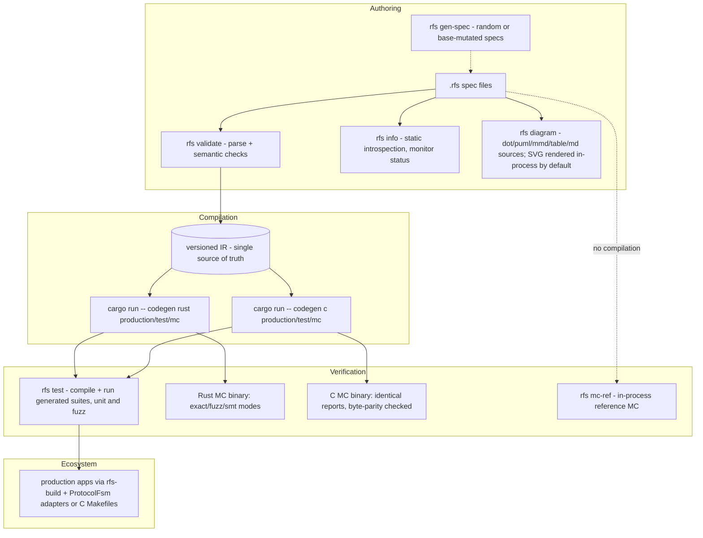

# RFS - Finite-State Protocol Specification Language

RFS is a constrained domain-specific language for protocol control logic: you
describe one endpoint of a protocol as a finite input/output machine (states,
events, outputs, variables, guarded transitions), and the toolchain compiles
that ONE description to production FSMs in Rust AND C, generated test suites,
model-checking binaries, state diagrams, and static introspection - all from
the same versioned IR. The language stays finite (no unbounded data, no
floats, no arbitrary functions) so that model checking can PROVE properties
instead of sampling them.

## Main principles

- **One constrained specification -> one versioned IR -> multiple targets.**
  The IR is the single source of truth for every generator: production code,
  tests, model checkers, and diagrams all consume the same normalized form, so
  they cannot diverge.
- **Backend parity.** The Rust and C backends provide the same commands, the
  same deliverables per command, and exactly the same observable behavior for
  the same spec and inputs - verified by cross-backend differential tests that
  compare generated artifacts field by field on every run.
- **Model-checking cross-checking.** Generated model checkers are
  soundness-checked against independent infrastructure: an in-process reference
  MC with deliberately different data structures, hand-written monitor
  references, an independent PSL evaluator, and two-layer toolchain fuzzing
  (the full suite list is in `BUILD.md` section 5).

## The RFS pipeline

A spec is parsed and validated into one versioned IR; every target - Rust or C
production FSMs, test suites, model-checking binaries, diagrams - consumes that
same IR. That single normalization step is what makes backend parity and MC
cross-checking possible: there is exactly one thing to check, and every
generator sees it identically.

## For users

The self-contained user documentation set - language reference, properties and
monitors, model checking, integration (build.rs, adapters, C Makefiles,
no_std), worked examples, FAQ, migration guide, and the NORMATIVE formal
semantics - starts at [docs/user/README.md](docs/user/README.md).

## For developers

The developer deep-dive set (Class A) - per-module internals with stable
fragment anchors, architecture, code map, algorithms, dependencies, and the
decision rationale index - starts at [docs/dev/README.md](docs/dev/README.md).
LLM-assisted sessions use the companion Class B set in `docs/llm/` (TASK_MAP,
CHANGE_IMPACT, budgeted per-module cards) and enter through `START.md`, the
session entry point carrying the operating protocol.
