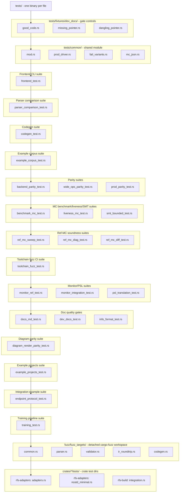

# RFS Test Structure - function and type inventory

Phase 10 analysis document (test source). Complete, dependency-annotated
inventory of every function and every data type in the project's TEST source,
classified into proposed component and functionality categories, with a
proposed new file-naming scheme and directory tree layout. Consumed by the
later refactoring phase that will actually reorganize the test tree - this
document is analysis and proposal only; no test source is moved or renamed
here. The dependency edges additionally support fine-grained impact analysis of
future test changes and precise scoping of refactoring/editing tasks. Non-test
source has its own inventory: `SRC_STRUCTURE.md`.

## Conventions (binding for all rows)

- Identifier formats: functions `<file>::<function>`, types `<file>::<Type>`,
  file paths relative to the repo root (e.g. `tests/frontend_test.rs::it_parses`,
  `fuzz/fuzz_targets/common.rs::Spec`). The All functions table's identifier
  column is named `Function`; the All types table's is named `Type`. A function
  nested inside another function body is `<file>::<parent_fn>::<child_fn>`
  (lowercase parent - distinct from the `<file>::<Type>::<method>` method form,
  whose middle segment is a capitalized type name); a type declared inside a
  function body follows the same form, `<file>::<parent_fn>::<Type>`.
- Inline `#[cfg(test)]` modules: functions and types declared inside an inline
  `#[cfg(test)] mod tests { ... }` in a `src/` file are enumerated HERE (not in
  SRC_STRUCTURE.md) with identifiers of the form `src/<file>.rs::tests::<fn>` -
  the host file is the identifier's file part and `tests` is the module segment.
  There are 26 such host files (the 23 under `src/`,
  `crates/rfs-build/src/lib.rs`, and the two example-crate `lib.rs` files per
  task 34).
- Depends column (BOTH tables, BOTH directions): comma-separated list of
  project identifiers - `<file>::<function>` AND `<file>::<Type>` - that the row
  depends on. A function row lists the functions it calls and the types it
  constructs/contains/matches; a type row lists the types it contains and the
  implementation functions its trait impls/methods delegate to. Cross-file and
  same-file alike; empty if none. Macro-generated call sites count once per
  distinct callee. External items (nom, std, dependency crates) are NOT
  dependencies - only project identifiers. Test rows frequently depend on
  NON-test source identifiers (those live in SRC_STRUCTURE.md's inventory); the
  edge still records the full `<file>::<item>` path.
- Component and Functionality cells may be multi-valued; values are
  comma-separated and must come from the `## Components` / `## Functionality`
  category tables (filled by task 31). They stay BLANK in every row until task
  32.
- Documented in column: copied verbatim from the file's single `//! Docs:`
  pointer line when it has one; blank otherwise. Most test files have no such
  line. A handful DO carry real `//! Docs:` pointers to fragments defined in
  `docs/` - the five fuzz targets (`fuzz/fuzz_targets/{common,parser,codegen,
  validator,ir_roundtrip}.rs`) and the three workspace-crate tests
  (`crates/rfs-adapters/tests/{adapters,nostd_minimal}.rs`,
  `crates/rfs-build/tests/integration.rs`) - and those fragments are copied like
  any other file's (these files are also in `tests/dev_docs_manifest.txt`). The
  three fixtures' `//! Docs:` lines are a separate case (see below). Where
  `docs/llm/TASK_MAP.md` has a suite entry for a test file, that is noted in the
  row's description instead of Documented-in.
- Fixtures: the three `tests/fixtures/dev_docs/*.rs` files
  (`good_code.rs`, `dangling_pointer.rs`, `missing_pointer.rs`) are
  negative-control FIXTURES for `dev_docs_test` - enumerated like any other file,
  but flagged as fixtures in their descriptions. Their "functions"/"types" are
  deliberate test subjects, not project code, and their `//! Docs:` lines point
  at fixture-only fragments (`dev:fixture-*` / `llm:fixture-*`) that are NOT
  defined in the doc set - they are the gate's own positive/negative controls,
  not real documentation pointers.
- Generated build output is NEVER enumerated: `crates/examples/fuzz_rust/fuzz/
  target/**` (and any other build-artifact tree) holds compiler/emitter output,
  not hand-written test source.
- Scope boundary (binding, from PHASE_10.md): this inventory covers `tests/**`,
  the inline `#[cfg(test)]` modules in `src/`, `crates/*/tests/**`, and
  `fuzz/fuzz_targets/**`. The fuzz targets' SOLE home is this document - they do
  not appear in SRC_STRUCTURE.md.
- Private (`fn`, no `pub`) items are included - the inventory is complete by
  construction, not public-API-only (most test functions are private).
- Every row stays on ONE physical line (grep-able, diff-friendly; future
  tooling and the refactoring phase rely on stable row identity).

## All functions

| Function | Depends | Component | Functionality | Short description | Documented in |
|---|---|---|---|---|---|
| tests/common/prod_driver.rs::rustc |  | Shared test helpers, IR model | parity pinning, determinism pinning (seeds + byte-identity) | rustc override - the RUSTC env var or "rustc" (same convention as backend_parity_test). |  |
| tests/common/prod_driver.rs::flatten_groups | src/ir.rs::ConstructorGroup, src/ir.rs::ConstructorVariant, tests/common/prod_driver.rs::FlatVariant | Shared test helpers, IR model | parity pinning, determinism pinning (seeds + byte-identity) | flatten constructor groups into variants using the backend naming convention (single-variant same-name group keeps the bare name; else Group_Variant; collisions get a numeric suffix). |  |
| tests/common/prod_driver.rs::flattened_inputs | src/ir.rs::Module, tests/common/prod_driver.rs::flatten_groups, tests/common/prod_driver.rs::FlatVariant | Shared test helpers, IR model | parity pinning, determinism pinning (seeds + byte-identity) | the module's input variants (flattened events). |  |
| tests/common/prod_driver.rs::flattened_outputs | src/ir.rs::Module, tests/common/prod_driver.rs::flatten_groups, tests/common/prod_driver.rs::FlatVariant | Shared test helpers, IR model | parity pinning, determinism pinning (seeds + byte-identity) | the module's output variants (flattened outputs). |  |
| tests/common/prod_driver.rs::state_variants | src/ir.rs::Module | Shared test helpers, IR model | parity pinning, determinism pinning (seeds + byte-identity) | the State enum's variant names (empty when the module has no State enum). |  |
| tests/common/prod_driver.rs::bit_rust_type |  | Shared test helpers, IR model | parity pinning, determinism pinning (seeds + byte-identity) | Rust integer type for a bit width (same mapping as the Rust backend): u8/u16/u32/u64/u128. |  |
| tests/common/prod_driver.rs::bit_c_type |  | Shared test helpers, IR model | parity pinning, determinism pinning (seeds + byte-identity) | C integer type for a bit width (same mapping as the C backend): uint8_t/uint16_t/uint32_t/uint64_t. |  |
| tests/common/prod_driver.rs::c_field_ty | src/ir.rs::Type, tests/common/prod_driver.rs::bit_c_type | Shared test helpers, IR model | parity pinning, determinism pinning (seeds + byte-identity) | C type of a payload/variable field (bool / bit<N> integer / {name}_t enum). |  |
| tests/common/prod_driver.rs::input_script | src/ir.rs::Module, src/ir.rs::Type, src/specgen.rs::Rng, tests/common/prod_driver.rs::flattened_inputs | Shared test helpers, IR model | parity pinning, determinism pinning (seeds + byte-identity) | deterministic input script (the LCG lineage of the fuzz wire format) - one line per step, variant picked by the RNG, field values drawn from each field's domain; the same bytes feed both drivers. |  |
| tests/common/prod_driver.rs::enum_helper_name |  | Shared test helpers, IR model | parity pinning, determinism pinning (seeds + byte-identity) | per-enum variant-index helper name (rfs_pp_enum_idx_{name}), shared by the Rust and C glue. |  |
| tests/common/prod_driver.rs::rust_driver_source | src/ir.rs::Module, src/ir.rs::Type, tests/common/prod_driver.rs::flattened_inputs, tests/common/prod_driver.rs::flattened_outputs, tests/common/prod_driver.rs::bit_rust_type, tests/common/prod_driver.rs::enum_helper_name | Shared test helpers, IR model | parity pinning, determinism pinning (seeds + byte-identity) | the Rust driver source - the production artifact verbatim plus generated glue (enum-index helpers, input parser, raw var/output renderers) and main, built by concatenation so it compiles as-is. |  |
| tests/common/prod_driver.rs::c_kind_name |  | Shared test helpers, IR model | parity pinning, determinism pinning (seeds + byte-identity) | the C kind-enum constant for a flattened variant ({prefix}_{UPPERCASE}). |  |
| tests/common/prod_driver.rs::c_payload_member |  | Shared test helpers, IR model | parity pinning, determinism pinning (seeds + byte-identity) | the C payload-union member name for a flattened variant ({prefix}_{lowercase}), same convention as the C backend. |  |
| tests/common/prod_driver.rs::c_union_member | tests/common/prod_driver.rs::c_payload_member | Shared test helpers, IR model | parity pinning, determinism pinning (seeds + byte-identity) | the input payload-union member name (c_payload_member with the "input" prefix). |  |
| tests/common/prod_driver.rs::c_driver_source | src/ir.rs::Module, tests/common/prod_driver.rs::flattened_inputs, tests/common/prod_driver.rs::flattened_outputs, tests/common/prod_driver.rs::c_kind_name, tests/common/prod_driver.rs::c_payload_member, tests/common/prod_driver.rs::c_union_member, tests/common/prod_driver.rs::c_field_ty | Shared test helpers, IR model | parity pinning, determinism pinning (seeds + byte-identity) | the C driver source - #include of the production artifact plus generated glue (kind enum, payload union, input parser, raw renderers) and main. |  |
| tests/common/prod_driver.rs::production_artifacts | src/ir.rs::Module, src/ir.rs::Ir, src/codegen.rs::BackendOptions, src/codegen.rs::CodegenCommandKind, src/codegen.rs::get_backend, tests/common/prod_driver.rs::ProductionArtifacts | Shared test helpers, IR model | parity pinning, determinism pinning (seeds + byte-identity) | generate the production artifacts (property monitors ON) for module into <scratch_root>/<tag>/ and return their paths + the Rust source; the input drivers build on top of this. |  |
| tests/common/prod_driver.rs::build_drivers | tests/common/prod_driver.rs::production_artifacts, tests/common/prod_driver.rs::rust_driver_source, tests/common/prod_driver.rs::c_driver_source, tests/common/prod_driver.rs::rustc | Shared test helpers, IR model | parity pinning, determinism pinning (seeds + byte-identity) | build both drivers for one spec - generate the production artifacts, write the driver sources next to them, compile with rustc and gcc (asserting the generated C is warning-free). |  |
| tests/common/prod_driver.rs::rust_sample_driver_source | src/ir.rs::Module, src/ir.rs::Type, tests/common/prod_driver.rs::state_variants, tests/common/prod_driver.rs::bit_rust_type | Shared test helpers, IR model | parity pinning, determinism pinning (seeds + byte-identity) | the Rust sample-level driver source - drives the generated property monitors over raw sample lines (State\|v0,v1,...) instead of FSM inputs; emits M{k} OK/FAIL + FIRST. |  |
| tests/common/prod_driver.rs::c_sample_driver_source | src/ir.rs::Module, src/ir.rs::Type, tests/common/prod_driver.rs::state_variants, tests/common/prod_driver.rs::bit_c_type | Shared test helpers, IR model | parity pinning, determinism pinning (seeds + byte-identity) | the C sample-level driver source - the C mirror of rust_sample_driver_source (generated monitors over raw sample lines). |  |
| tests/common/prod_driver.rs::build_sample_drivers | tests/common/prod_driver.rs::production_artifacts, tests/common/prod_driver.rs::rust_sample_driver_source, tests/common/prod_driver.rs::c_sample_driver_source, tests/common/prod_driver.rs::rustc | Shared test helpers, IR model | parity pinning, determinism pinning (seeds + byte-identity) | build both sample-level drivers for one spec (generated monitors over raw sample lines); returns (rust bin, c bin). |  |
| tests/common/prod_driver.rs::run_driver |  | Shared test helpers, IR model | parity pinning, determinism pinning (seeds + byte-identity) | run one driver with the script on stdin; returns (exit code, stdout). |  |
| tests/common/fail_variants.rs::root |  | Shared test helpers | behavior pinning | the repo root (CARGO_MANIFEST_DIR). |  |
| tests/common/fail_variants.rs::spec_source | tests/common/fail_variants.rs::root | Shared test helpers | behavior pinning | read a valid example spec from examples/valid/<name> (panics if unreadable). |  |
| tests/common/fail_variants.rs::mutate_spec | tests/common/fail_variants.rs::spec_source | Shared test helpers | behavior pinning | read a valid example and replace exactly one anchored block with new (asserts the anchor occurs exactly once - the drift guard). |  |
| tests/common/fail_variants.rs::http2_rst_fail_src | tests/common/fail_variants.rs::mutate_spec | Shared test helpers | behavior pinning | 47_http2_stream with the Open RstStream arm retargeted off Closed, so rst_goes_closed is violated at step 2 (the pinned FAIL variant). |  |
| tests/common/fail_variants.rs::can_passive_fail_src | tests/common/fail_variants.rs::mutate_spec | Shared test helpers | behavior pinning | 49_can_arbitration with the Data AckErr band-entry counter update weakened (+1 instead of +4), so passive_band is violated at step 6 (the pinned FAIL variant). |  |
| tests/common/mc_json.rs::zero_peak_rss |  | Shared test helpers, Shared MC concepts | parity pinning | zero the peak_rss_kb field in one compact MC JSON document before byte-comparison (machine-dependent, never pinned). |  |
| tests/frontend_test.rs::tmp_root |  | Frontend CLI suite, Frontend CLI logic, Parser, Validator, Printer, Info command, Diagram command + plugins, rfs-test command, gen-spec command, mc-ref command, External tool resolution, CLI dispatch | exit-code/CLI-contract pinning | create a fresh per-test temp dir under target/ and return its path. |  |
| tests/frontend_test.rs::cleanup |  | Frontend CLI suite, Frontend CLI logic, Parser, Validator, Printer, Info command, Diagram command + plugins, rfs-test command, gen-spec command, mc-ref command, External tool resolution, CLI dispatch | exit-code/CLI-contract pinning | remove a test temp-dir tree (ignore errors). |  |
| tests/frontend_test.rs::write_file |  | Frontend CLI suite, Frontend CLI logic, Parser, Validator, Printer, Info command, Diagram command + plugins, rfs-test command, gen-spec command, mc-ref command, External tool resolution, CLI dispatch | exit-code/CLI-contract pinning | write text to a path, creating parent directories as needed. |  |
| tests/frontend_test.rs::ir_json | src/parser.rs::parse_source | Frontend CLI suite, Frontend CLI logic, Parser, Validator, Printer, Info command, Diagram command + plugins, rfs-test command, gen-spec command, mc-ref command, External tool resolution, CLI dispatch | exit-code/CLI-contract pinning | serialize an Ir to compact JSON text through the IR wire format. |  |
| tests/frontend_test.rs::json_ir | src/json_rw.rs::parse | Frontend CLI suite, Frontend CLI logic, Parser, Validator, Printer, Info command, Diagram command + plugins, rfs-test command, gen-spec command, mc-ref command, External tool resolution, CLI dispatch | exit-code/CLI-contract pinning | parse an IR JSON document text into an Ir (panics with the error on failure). |  |
| tests/frontend_test.rs::format_from_str_and_extension |  | Frontend CLI suite, Frontend CLI logic, Parser, Validator, Printer, Info command, Diagram command + plugins, rfs-test command, gen-spec command, mc-ref command, External tool resolution, CLI dispatch | exit-code/CLI-contract pinning | resolve a Format from a CLI string plus the file extension (the strict-extension rule). |  |
| tests/frontend_test.rs::file_input_rejects_unsupported_extension | src/frontend.rs::run_conversion | Frontend CLI suite, Frontend CLI logic, Parser, Validator, Printer, Info command, Diagram command + plugins, rfs-test command, gen-spec command, mc-ref command, External tool resolution, CLI dispatch | exit-code/CLI-contract pinning | a single-file input with an unsupported extension is rejected before any conversion. |  |
| tests/frontend_test.rs::file_input_rejects_mismatched_format_extension | src/frontend.rs::run_conversion | Frontend CLI suite, Frontend CLI logic, Parser, Validator, Printer, Info command, Diagram command + plugins, rfs-test command, gen-spec command, mc-ref command, External tool resolution, CLI dispatch | exit-code/CLI-contract pinning | a file whose extension disagrees with the requested input format is rejected. |  |
| tests/frontend_test.rs::directory_scan_only_collects_matching_extension | src/frontend.rs::run_conversion | Frontend CLI suite, Frontend CLI logic, Parser, Validator, Printer, Info command, Diagram command + plugins, rfs-test command, gen-spec command, mc-ref command, External tool resolution, CLI dispatch | exit-code/CLI-contract pinning | a directory scan collects only files with the matching extension, ignoring the rest. |  |
| tests/frontend_test.rs::output_names_drop_original_extension_without_double_extensions | src/frontend.rs::run_conversion | Frontend CLI suite, Frontend CLI logic, Parser, Validator, Printer, Info command, Diagram command + plugins, rfs-test command, gen-spec command, mc-ref command, External tool resolution, CLI dispatch | exit-code/CLI-contract pinning | conversion output names drop the original extension and never produce a double extension. |  |
| tests/frontend_test.rs::file_input_writes_next_to_source_without_target_dir | src/frontend.rs::run_conversion | Frontend CLI suite, Frontend CLI logic, Parser, Validator, Printer, Info command, Diagram command + plugins, rfs-test command, gen-spec command, mc-ref command, External tool resolution, CLI dispatch | exit-code/CLI-contract pinning | with no --target-dir, a file input's output is written next to the source. |  |
| tests/frontend_test.rs::file_input_with_target_dir_writes_into_target_dir | src/frontend.rs::run_conversion | Frontend CLI suite, Frontend CLI logic, Parser, Validator, Printer, Info command, Diagram command + plugins, rfs-test command, gen-spec command, mc-ref command, External tool resolution, CLI dispatch | exit-code/CLI-contract pinning | with --target-dir, a file input's output is written into that directory. |  |
| tests/frontend_test.rs::directory_input_preserves_structure_in_target_dir | src/frontend.rs::run_conversion | Frontend CLI suite, Frontend CLI logic, Parser, Validator, Printer, Info command, Diagram command + plugins, rfs-test command, gen-spec command, mc-ref command, External tool resolution, CLI dispatch | exit-code/CLI-contract pinning | a directory input with --target-dir preserves the relative structure under the target. |  |
| tests/frontend_test.rs::directory_input_without_target_dir_writes_next_to_each_source | src/frontend.rs::run_conversion | Frontend CLI suite, Frontend CLI logic, Parser, Validator, Printer, Info command, Diagram command + plugins, rfs-test command, gen-spec command, mc-ref command, External tool resolution, CLI dispatch | exit-code/CLI-contract pinning | a directory input without --target-dir writes each output next to its source. |  |
| tests/frontend_test.rs::normalize_abs_resolves_relative_components | src/frontend.rs::normalize_abs | Frontend CLI suite, Frontend CLI logic, Parser, Validator, Printer, Info command, Diagram command + plugins, rfs-test command, gen-spec command, mc-ref command, External tool resolution, CLI dispatch | exit-code/CLI-contract pinning | normalize_abs collapses . / .. components into an absolute path. |  |
| tests/frontend_test.rs::in_place_same_format_conversion_is_rejected | src/frontend.rs::run_conversion | Frontend CLI suite, Frontend CLI logic, Parser, Validator, Printer, Info command, Diagram command + plugins, rfs-test command, gen-spec command, mc-ref command, External tool resolution, CLI dispatch | exit-code/CLI-contract pinning | converting a file in place to the same format is rejected as a misuse. |  |
| tests/frontend_test.rs::target_dir_equal_to_source_dir_is_rejected | src/frontend.rs::run_conversion | Frontend CLI suite, Frontend CLI logic, Parser, Validator, Printer, Info command, Diagram command + plugins, rfs-test command, gen-spec command, mc-ref command, External tool resolution, CLI dispatch | exit-code/CLI-contract pinning | a --target-dir equal to the source directory is rejected. |  |
| tests/frontend_test.rs::directory_conversion_into_its_own_tree_is_rejected | src/frontend.rs::run_conversion | Frontend CLI suite, Frontend CLI logic, Parser, Validator, Printer, Info command, Diagram command + plugins, rfs-test command, gen-spec command, mc-ref command, External tool resolution, CLI dispatch | exit-code/CLI-contract pinning | converting a directory into its own subtree is rejected. |  |
| tests/frontend_test.rs::check_roundtrip_source | src/parser.rs::parse_source | Frontend CLI suite, Frontend CLI logic, Parser, Validator, Printer, Info command, Diagram command + plugins, rfs-test command, gen-spec command, mc-ref command, External tool resolution, CLI dispatch | exit-code/CLI-contract pinning | assert one source file round-trips through a conversion and re-parses to an equivalent IR. |  |
| tests/frontend_test.rs::converts_rfs_to_json | src/frontend.rs::run_conversion | Frontend CLI suite, Frontend CLI logic, Parser, Validator, Printer, Info command, Diagram command + plugins, rfs-test command, gen-spec command, mc-ref command, External tool resolution, CLI dispatch | exit-code/CLI-contract pinning | an RFS source converts to JSON that parses back to the same IR. |  |
| tests/frontend_test.rs::converts_json_to_rfs | src/frontend.rs::run_conversion, src/parser.rs::parse_source | Frontend CLI suite, Frontend CLI logic, Parser, Validator, Printer, Info command, Diagram command + plugins, rfs-test command, gen-spec command, mc-ref command, External tool resolution, CLI dispatch | exit-code/CLI-contract pinning | a JSON document converts to RFS source that parses back to the same IR. |  |
| tests/frontend_test.rs::converts_rfs_to_rfs_with_target_dir | src/frontend.rs::run_conversion, src/parser.rs::parse_source | Frontend CLI suite, Frontend CLI logic, Parser, Validator, Printer, Info command, Diagram command + plugins, rfs-test command, gen-spec command, mc-ref command, External tool resolution, CLI dispatch | exit-code/CLI-contract pinning | RFS-to-RFS conversion with --target-dir rewrites the source into the target dir. |  |
| tests/frontend_test.rs::converts_json_to_json_with_target_dir | src/frontend.rs::run_conversion | Frontend CLI suite, Frontend CLI logic, Parser, Validator, Printer, Info command, Diagram command + plugins, rfs-test command, gen-spec command, mc-ref command, External tool resolution, CLI dispatch | exit-code/CLI-contract pinning | JSON-to-JSON conversion with --target-dir rewrites the document into the target dir. |  |
| tests/frontend_test.rs::json_to_json_in_place_is_rejected_by_collision_guard | src/frontend.rs::run_conversion | Frontend CLI suite, Frontend CLI logic, Parser, Validator, Printer, Info command, Diagram command + plugins, rfs-test command, gen-spec command, mc-ref command, External tool resolution, CLI dispatch | exit-code/CLI-contract pinning | an in-place JSON-to-JSON conversion is rejected by the output-collision guard. |  |
| tests/frontend_test.rs::conversion_reports_errors_and_continues_other_files | src/frontend.rs::run_conversion | Frontend CLI suite, Frontend CLI logic, Parser, Validator, Printer, Info command, Diagram command + plugins, rfs-test command, gen-spec command, mc-ref command, External tool resolution, CLI dispatch | exit-code/CLI-contract pinning | a batch conversion reports per-file errors and still processes the remaining files. |  |
| tests/frontend_test.rs::conversion_rejects_nonexistent_path | src/frontend.rs::run_conversion | Frontend CLI suite, Frontend CLI logic, Parser, Validator, Printer, Info command, Diagram command + plugins, rfs-test command, gen-spec command, mc-ref command, External tool resolution, CLI dispatch | exit-code/CLI-contract pinning | converting a nonexistent path is reported as an error, not a panic. |  |
| tests/frontend_test.rs::conversion_rejects_directory_without_matching_files | src/frontend.rs::run_conversion | Frontend CLI suite, Frontend CLI logic, Parser, Validator, Printer, Info command, Diagram command + plugins, rfs-test command, gen-spec command, mc-ref command, External tool resolution, CLI dispatch | exit-code/CLI-contract pinning | converting a directory with no matching files is reported as an error. |  |
| tests/frontend_test.rs::conversion_rejects_invalid_json_input | src/frontend.rs::run_conversion | Frontend CLI suite, Frontend CLI logic, Parser, Validator, Printer, Info command, Diagram command + plugins, rfs-test command, gen-spec command, mc-ref command, External tool resolution, CLI dispatch | exit-code/CLI-contract pinning | converting invalid JSON input is reported as a parse error. |  |
| tests/frontend_test.rs::validate_valid_rfs_file | src/frontend.rs::run_validate | Frontend CLI suite, Frontend CLI logic, Parser, Validator, Printer, Info command, Diagram command + plugins, rfs-test command, gen-spec command, mc-ref command, External tool resolution, CLI dispatch | exit-code/CLI-contract pinning | validating a valid RFS file reports no errors. |  |
| tests/frontend_test.rs::validate_valid_json_file | src/frontend.rs::run_validate | Frontend CLI suite, Frontend CLI logic, Parser, Validator, Printer, Info command, Diagram command + plugins, rfs-test command, gen-spec command, mc-ref command, External tool resolution, CLI dispatch | exit-code/CLI-contract pinning | validating a valid JSON file reports no errors. |  |
| tests/frontend_test.rs::validate_invalid_rfs_file_reports_errors | src/frontend.rs::run_validate | Frontend CLI suite, Frontend CLI logic, Parser, Validator, Printer, Info command, Diagram command + plugins, rfs-test command, gen-spec command, mc-ref command, External tool resolution, CLI dispatch | exit-code/CLI-contract pinning | validating an invalid RFS file reports the semantic errors. |  |
| tests/frontend_test.rs::validate_unparseable_file_reports_error | src/frontend.rs::run_validate | Frontend CLI suite, Frontend CLI logic, Parser, Validator, Printer, Info command, Diagram command + plugins, rfs-test command, gen-spec command, mc-ref command, External tool resolution, CLI dispatch | exit-code/CLI-contract pinning | validating an unparseable file reports a parse error. |  |
| tests/frontend_test.rs::validate_file_with_conflicting_input_format_is_misuse | src/frontend.rs::run_validate | Frontend CLI suite, Frontend CLI logic, Parser, Validator, Printer, Info command, Diagram command + plugins, rfs-test command, gen-spec command, mc-ref command, External tool resolution, CLI dispatch | exit-code/CLI-contract pinning | validating a single file with an explicit conflicting input format is a misuse error. |  |
| tests/frontend_test.rs::validate_file_with_unknown_extension_is_misuse | src/frontend.rs::run_validate | Frontend CLI suite, Frontend CLI logic, Parser, Validator, Printer, Info command, Diagram command + plugins, rfs-test command, gen-spec command, mc-ref command, External tool resolution, CLI dispatch | exit-code/CLI-contract pinning | validating a single file with an unknown extension is a misuse error. |  |
| tests/frontend_test.rs::validate_nonexistent_path_is_misuse | src/frontend.rs::run_validate | Frontend CLI suite, Frontend CLI logic, Parser, Validator, Printer, Info command, Diagram command + plugins, rfs-test command, gen-spec command, mc-ref command, External tool resolution, CLI dispatch | exit-code/CLI-contract pinning | validating a nonexistent path is a misuse error. |  |
| tests/frontend_test.rs::validate_directory_requires_input_format | src/frontend.rs::run_validate | Frontend CLI suite, Frontend CLI logic, Parser, Validator, Printer, Info command, Diagram command + plugins, rfs-test command, gen-spec command, mc-ref command, External tool resolution, CLI dispatch | exit-code/CLI-contract pinning | validating a directory without an explicit input format is a misuse error. |  |
| tests/frontend_test.rs::validate_directory_writes_err_files_next_to_failures | src/frontend.rs::run_validate | Frontend CLI suite, Frontend CLI logic, Parser, Validator, Printer, Info command, Diagram command + plugins, rfs-test command, gen-spec command, mc-ref command, External tool resolution, CLI dispatch | exit-code/CLI-contract pinning | directory validation writes a .rfs-validation.err file next to each failing RFS source. |  |
| tests/frontend_test.rs::validate_json_directory_writes_err_files_with_json_name | src/frontend.rs::run_validate | Frontend CLI suite, Frontend CLI logic, Parser, Validator, Printer, Info command, Diagram command + plugins, rfs-test command, gen-spec command, mc-ref command, External tool resolution, CLI dispatch | exit-code/CLI-contract pinning | directory validation names the err file after the JSON source for JSON inputs. |  |
| tests/frontend_test.rs::validate_directory_all_valid_has_no_err_files | src/frontend.rs::run_validate | Frontend CLI suite, Frontend CLI logic, Parser, Validator, Printer, Info command, Diagram command + plugins, rfs-test command, gen-spec command, mc-ref command, External tool resolution, CLI dispatch | exit-code/CLI-contract pinning | a directory of all-valid specs produces no err files. |  |
| tests/frontend_test.rs::positive_specs_pass_validation | src/frontend.rs::run_validate | Frontend CLI suite, Frontend CLI logic, Parser, Validator, Printer, Info command, Diagram command + plugins, rfs-test command, gen-spec command, mc-ref command, External tool resolution, CLI dispatch | exit-code/CLI-contract pinning, file-driven corpus coverage | every positive example spec passes validation with no errors. |  |
| tests/frontend_test.rs::negative_specs_fail_validation_with_messages | src/frontend.rs::run_validate | Frontend CLI suite, Frontend CLI logic, Parser, Validator, Printer, Info command, Diagram command + plugins, rfs-test command, gen-spec command, mc-ref command, External tool resolution, CLI dispatch | exit-code/CLI-contract pinning, file-driven corpus coverage | every negative example spec fails validation with a non-empty diagnostic message. |  |
| tests/frontend_test.rs::rfs_bin |  | Frontend CLI suite, Frontend CLI logic, Parser, Validator, Printer, Info command, Diagram command + plugins, rfs-test command, gen-spec command, mc-ref command, External tool resolution, CLI dispatch | exit-code/CLI-contract pinning | locate the compiled rfs test binary (panics if the build is missing). |  |
| tests/frontend_test.rs::e2e_parse_rfs_to_json_exits_zero_and_writes_output | src/parser.rs::parse_source | Frontend CLI suite, Frontend CLI logic, Parser, Validator, Printer, Info command, Diagram command + plugins, rfs-test command, gen-spec command, mc-ref command, External tool resolution, CLI dispatch | exit-code/CLI-contract pinning | the rfs parse subcommand converts RFS to JSON, exits 0, and writes the output file. |  |
| tests/frontend_test.rs::e2e_parse_in_place_same_format_exits_one |  | Frontend CLI suite, Frontend CLI logic, Parser, Validator, Printer, Info command, Diagram command + plugins, rfs-test command, gen-spec command, mc-ref command, External tool resolution, CLI dispatch | exit-code/CLI-contract pinning | rfs parse in place to the same format exits 1 with a usage error. |  |
| tests/frontend_test.rs::e2e_parse_missing_flags_exits_one |  | Frontend CLI suite, Frontend CLI logic, Parser, Validator, Printer, Info command, Diagram command + plugins, rfs-test command, gen-spec command, mc-ref command, External tool resolution, CLI dispatch | exit-code/CLI-contract pinning | rfs parse with missing required flags exits 1. |  |
| tests/frontend_test.rs::e2e_validate_valid_file_exits_zero |  | Frontend CLI suite, Frontend CLI logic, Parser, Validator, Printer, Info command, Diagram command + plugins, rfs-test command, gen-spec command, mc-ref command, External tool resolution, CLI dispatch | exit-code/CLI-contract pinning | rfs validate on a valid file exits 0. |  |
| tests/frontend_test.rs::e2e_validate_invalid_file_exits_one_with_stderr |  | Frontend CLI suite, Frontend CLI logic, Parser, Validator, Printer, Info command, Diagram command + plugins, rfs-test command, gen-spec command, mc-ref command, External tool resolution, CLI dispatch | exit-code/CLI-contract pinning | rfs validate on an invalid file exits 1 and prints diagnostics to stderr. |  |
| tests/frontend_test.rs::e2e_validate_directory_writes_err_file_and_exits_one |  | Frontend CLI suite, Frontend CLI logic, Parser, Validator, Printer, Info command, Diagram command + plugins, rfs-test command, gen-spec command, mc-ref command, External tool resolution, CLI dispatch | exit-code/CLI-contract pinning | rfs validate on a directory writes the err file and exits 1. |  |
| tests/frontend_test.rs::ir_json_golden_compact_pins_key_order | src/parser.rs::parse_source | Frontend CLI suite, Frontend CLI logic, Parser, Validator, Printer, Info command, Diagram command + plugins, rfs-test command, gen-spec command, mc-ref command, External tool resolution, CLI dispatch | exit-code/CLI-contract pinning | the compact IR JSON golden pins the exact key order of the wire format. |  |
| tests/frontend_test.rs::ir_json_golden_pretty_pins_layout | src/parser.rs::parse_source | Frontend CLI suite, Frontend CLI logic, Parser, Validator, Printer, Info command, Diagram command + plugins, rfs-test command, gen-spec command, mc-ref command, External tool resolution, CLI dispatch | exit-code/CLI-contract pinning | the pretty IR JSON golden pins the exact whitespace/layout of the wire format. |  |
| tests/frontend_test.rs::ir_version_read_policy_v0_loads_future_rejected | src/json_rw.rs::Json, src/json_rw.rs::parse, src/parser.rs::parse_source | Frontend CLI suite, Frontend CLI logic, Parser, Validator, Printer, Info command, Diagram command + plugins, rfs-test command, gen-spec command, mc-ref command, External tool resolution, CLI dispatch | exit-code/CLI-contract pinning | a v0 reader loads its own version but rejects a future ir_version. |  |
| tests/frontend_test.rs::ir_json_roundtrip_property_all_valid_examples | src/lib.rs::collect_rfs_files, src/parser.rs::parse_source | Frontend CLI suite, Frontend CLI logic, Parser, Validator, Printer, Info command, Diagram command + plugins, rfs-test command, gen-spec command, mc-ref command, External tool resolution, CLI dispatch | exit-code/CLI-contract pinning, file-driven corpus coverage | every valid example round-trips through to_json/from_json to an identical IR. |  |
| tests/frontend_test.rs::example_root_dir |  | Frontend CLI suite, Frontend CLI logic, Parser, Validator, Printer, Info command, Diagram command + plugins, rfs-test command, gen-spec command, mc-ref command, External tool resolution, CLI dispatch | exit-code/CLI-contract pinning | the examples/valid directory (the corpus for the info sweeps). |  |
| tests/frontend_test.rs::info_text_on_all_valid_examples | src/info.rs::InfoOptions, src/info.rs::run_info, src/lib.rs::collect_rfs_files | Frontend CLI suite, Frontend CLI logic, Parser, Validator, Printer, Info command, Diagram command + plugins, rfs-test command, gen-spec command, mc-ref command, External tool resolution, CLI dispatch | exit-code/CLI-contract pinning, file-driven corpus coverage | rfs info in text form runs over every valid example without error. |  |
| tests/frontend_test.rs::info_json_parses_and_matches_pinned_example | src/info.rs::InfoOptions, src/info.rs::run_info, src/json_rw.rs::Json, src/json_rw.rs::parse, src/parser.rs::parse_source | Frontend CLI suite, Frontend CLI logic, Parser, Validator, Printer, Info command, Diagram command + plugins, rfs-test command, gen-spec command, mc-ref command, External tool resolution, CLI dispatch | exit-code/CLI-contract pinning | rfs info --json on a pinned example parses and matches the expected structure. |  |
| tests/frontend_test.rs::e2e_info_valid_exits_zero_and_prints_module |  | Frontend CLI suite, Frontend CLI logic, Parser, Validator, Printer, Info command, Diagram command + plugins, rfs-test command, gen-spec command, mc-ref command, External tool resolution, CLI dispatch | exit-code/CLI-contract pinning | the rfs info subcommand on a valid spec exits 0 and prints the module summary. |  |
| tests/frontend_test.rs::e2e_info_invalid_spec_exits_one_with_diagnostics |  | Frontend CLI suite, Frontend CLI logic, Parser, Validator, Printer, Info command, Diagram command + plugins, rfs-test command, gen-spec command, mc-ref command, External tool resolution, CLI dispatch | exit-code/CLI-contract pinning | rfs info on an invalid spec exits 1 with diagnostics. |  |
| tests/frontend_test.rs::e2e_info_unparseable_spec_exits_one |  | Frontend CLI suite, Frontend CLI logic, Parser, Validator, Printer, Info command, Diagram command + plugins, rfs-test command, gen-spec command, mc-ref command, External tool resolution, CLI dispatch | exit-code/CLI-contract pinning | rfs info on an unparseable spec exits 1. |  |
| tests/frontend_test.rs::e2e_info_log_level_filters_stderr_progress |  | Frontend CLI suite, Frontend CLI logic, Parser, Validator, Printer, Info command, Diagram command + plugins, rfs-test command, gen-spec command, mc-ref command, External tool resolution, CLI dispatch | exit-code/CLI-contract pinning | rfs info's --log-level filters the stderr progress output. |  |
| tests/frontend_test.rs::e2e_info_usage_lists_info_and_rejects_unknown_option |  | Frontend CLI suite, Frontend CLI logic, Parser, Validator, Printer, Info command, Diagram command + plugins, rfs-test command, gen-spec command, mc-ref command, External tool resolution, CLI dispatch | exit-code/CLI-contract pinning | rfs info usage lists the subcommand and rejects unknown options. |  |
| tests/frontend_test.rs::diagram_opts | src/diagram.rs::DiagramOptions | Frontend CLI suite, Frontend CLI logic, Parser, Validator, Printer, Info command, Diagram command + plugins, rfs-test command, gen-spec command, mc-ref command, External tool resolution, CLI dispatch | exit-code/CLI-contract pinning | build the default DiagramOptions for an in-process run_diagram call. |  |
| tests/frontend_test.rs::diagram_stdout | src/diagram.rs::run_diagram | Frontend CLI suite, Frontend CLI logic, Parser, Validator, Printer, Info command, Diagram command + plugins, rfs-test command, gen-spec command, mc-ref command, External tool resolution, CLI dispatch | exit-code/CLI-contract pinning | run run_diagram in-process and return its stdout (panics on a non-Ok result). |  |
| tests/frontend_test.rs::diagram_pinned_dot_output |  | Frontend CLI suite, Frontend CLI logic, Parser, Validator, Printer, Info command, Diagram command + plugins, rfs-test command, gen-spec command, mc-ref command, External tool resolution, CLI dispatch | exit-code/CLI-contract pinning | the DOT renderer's output on the pinned spec matches the byte-pinned expectation. |  |
| tests/frontend_test.rs::diagram_pinned_puml_output |  | Frontend CLI suite, Frontend CLI logic, Parser, Validator, Printer, Info command, Diagram command + plugins, rfs-test command, gen-spec command, mc-ref command, External tool resolution, CLI dispatch | exit-code/CLI-contract pinning | the PlantUML renderer's output on the pinned spec matches the byte-pinned expectation. |  |
| tests/frontend_test.rs::diagram_pinned_mmd_output |  | Frontend CLI suite, Frontend CLI logic, Parser, Validator, Printer, Info command, Diagram command + plugins, rfs-test command, gen-spec command, mc-ref command, External tool resolution, CLI dispatch | exit-code/CLI-contract pinning | the Mermaid renderer's output on the pinned spec matches the byte-pinned expectation. |  |
| tests/frontend_test.rs::diagram_pinned_table_output |  | Frontend CLI suite, Frontend CLI logic, Parser, Validator, Printer, Info command, Diagram command + plugins, rfs-test command, gen-spec command, mc-ref command, External tool resolution, CLI dispatch | exit-code/CLI-contract pinning | the table renderer's output on the pinned spec matches the byte-pinned expectation. |  |
| tests/frontend_test.rs::diagram_pinned_md_output |  | Frontend CLI suite, Frontend CLI logic, Parser, Validator, Printer, Info command, Diagram command + plugins, rfs-test command, gen-spec command, mc-ref command, External tool resolution, CLI dispatch | exit-code/CLI-contract pinning | the markdown renderer's output on the pinned spec matches the byte-pinned expectation. |  |
| tests/frontend_test.rs::diagram_all_formats_sweep_valid_examples | src/diagram.rs::run_diagram, src/lib.rs::collect_rfs_files | Frontend CLI suite, Frontend CLI logic, Parser, Validator, Printer, Info command, Diagram command + plugins, rfs-test command, gen-spec command, mc-ref command, External tool resolution, CLI dispatch | exit-code/CLI-contract pinning, file-driven corpus coverage | every diagram format renders every valid example without error. |  |
| tests/frontend_test.rs::tool_on_path |  | Frontend CLI suite, Frontend CLI logic, Parser, Validator, Printer, Info command, Diagram command + plugins, rfs-test command, gen-spec command, mc-ref command, External tool resolution, CLI dispatch | exit-code/CLI-contract pinning | true when a bare tool name resolves on PATH (for gating real-tool tests). |  |
| tests/frontend_test.rs::write_stub |  | Frontend CLI suite, Frontend CLI logic, Parser, Validator, Printer, Info command, Diagram command + plugins, rfs-test command, gen-spec command, mc-ref command, External tool resolution, CLI dispatch | exit-code/CLI-contract pinning | write a stub executable that records its argv/env for the tool-precedence proofs. |  |
| tests/frontend_test.rs::e2e_diagram_valid_exits_zero_and_prints |  | Frontend CLI suite, Frontend CLI logic, Parser, Validator, Printer, Info command, Diagram command + plugins, rfs-test command, gen-spec command, mc-ref command, External tool resolution, CLI dispatch | exit-code/CLI-contract pinning | the rfs diagram subcommand on a valid spec exits 0 and prints the diagram. |  |
| tests/frontend_test.rs::e2e_diagram_invalid_spec_exits_one |  | Frontend CLI suite, Frontend CLI logic, Parser, Validator, Printer, Info command, Diagram command + plugins, rfs-test command, gen-spec command, mc-ref command, External tool resolution, CLI dispatch | exit-code/CLI-contract pinning | rfs diagram on an invalid spec exits 1. |  |
| tests/frontend_test.rs::e2e_diagram_render_dot_real_tool |  | Frontend CLI suite, Frontend CLI logic, Parser, Validator, Printer, Info command, Diagram command + plugins, rfs-test command, gen-spec command, mc-ref command, External tool resolution, CLI dispatch | exit-code/CLI-contract pinning | rfs diagram --render svg with a real dot tool produces an SVG (gated on dot being present). |  |
| tests/frontend_test.rs::e2e_diagram_render_puml_real_tool |  | Frontend CLI suite, Frontend CLI logic, Parser, Validator, Printer, Info command, Diagram command + plugins, rfs-test command, gen-spec command, mc-ref command, External tool resolution, CLI dispatch | exit-code/CLI-contract pinning | rfs diagram --render svg with a real plantuml tool produces an SVG (gated). |  |
| tests/frontend_test.rs::e2e_diagram_render_mmd_real_tool |  | Frontend CLI suite, Frontend CLI logic, Parser, Validator, Printer, Info command, Diagram command + plugins, rfs-test command, gen-spec command, mc-ref command, External tool resolution, CLI dispatch | exit-code/CLI-contract pinning | rfs diagram --render svg with a real mmdc tool produces an SVG (gated). |  |
| tests/frontend_test.rs::diagram_puml_negative_control_exit_200 | src/diagrams/plantuml.rs::render_svg, src/ext_tool.rs::ExtTool | Frontend CLI suite, Frontend CLI logic, Parser, Validator, Printer, Info command, Diagram command + plugins, rfs-test command, gen-spec command, mc-ref command, External tool resolution, CLI dispatch | exit-code/CLI-contract pinning | a PlantUML syntax error surfaces as the pinned exit code 200. |  |
| tests/frontend_test.rs::diagram_mmd_negative_control_parse_error | src/diagrams/mermaid.rs::render_svg, src/ext_tool.rs::ExtTool | Frontend CLI suite, Frontend CLI logic, Parser, Validator, Printer, Info command, Diagram command + plugins, rfs-test command, gen-spec command, mc-ref command, External tool resolution, CLI dispatch | exit-code/CLI-contract pinning | a Mermaid parse error surfaces with the pinned diagnostic. |  |
| tests/frontend_test.rs::clear_tool_env |  | Frontend CLI suite, Frontend CLI logic, Parser, Validator, Printer, Info command, Diagram command + plugins, rfs-test command, gen-spec command, mc-ref command, External tool resolution, CLI dispatch | exit-code/CLI-contract pinning | clear every diagram tool env var so ambient settings can't leak in. |  |
| tests/frontend_test.rs::diag_lock |  | Frontend CLI suite, Frontend CLI logic, Parser, Validator, Printer, Info command, Diagram command + plugins, rfs-test command, gen-spec command, mc-ref command, External tool resolution, CLI dispatch | exit-code/CLI-contract pinning | take the diagram env lock, recovering from poisoning so one panicking test can't wedge the rest. |  |
| tests/frontend_test.rs::set_env |  | Frontend CLI suite, Frontend CLI logic, Parser, Validator, Printer, Info command, Diagram command + plugins, rfs-test command, gen-spec command, mc-ref command, External tool resolution, CLI dispatch | exit-code/CLI-contract pinning | set a diagram tool env var under the diag lock. |  |
| tests/frontend_test.rs::e2e_diagram_stub_plantuml_receives_env_and_cli_args |  | Frontend CLI suite, Frontend CLI logic, Parser, Validator, Printer, Info command, Diagram command + plugins, rfs-test command, gen-spec command, mc-ref command, External tool resolution, CLI dispatch | exit-code/CLI-contract pinning | a stub plantuml receives the expected env vars and CLI args from rfs diagram. |  |
| tests/frontend_test.rs::e2e_diagram_stub_dot_receives_env_and_cli_args |  | Frontend CLI suite, Frontend CLI logic, Parser, Validator, Printer, Info command, Diagram command + plugins, rfs-test command, gen-spec command, mc-ref command, External tool resolution, CLI dispatch | exit-code/CLI-contract pinning | a stub dot receives the expected env vars and CLI args from rfs diagram. |  |
| tests/frontend_test.rs::e2e_diagram_flag_path_beats_env_for_mermaid |  | Frontend CLI suite, Frontend CLI logic, Parser, Validator, Printer, Info command, Diagram command + plugins, rfs-test command, gen-spec command, mc-ref command, External tool resolution, CLI dispatch | exit-code/CLI-contract pinning | the --mermaid flag path takes precedence over the MERMAID env var. |  |
| tests/frontend_test.rs::e2e_diagram_missing_dot_tool_exits_one |  | Frontend CLI suite, Frontend CLI logic, Parser, Validator, Printer, Info command, Diagram command + plugins, rfs-test command, gen-spec command, mc-ref command, External tool resolution, CLI dispatch | exit-code/CLI-contract pinning | rfs diagram with no dot tool available exits 1 with a clear error. |  |
| tests/frontend_test.rs::e2e_diagram_failing_plantuml_propagates_stderr |  | Frontend CLI suite, Frontend CLI logic, Parser, Validator, Printer, Info command, Diagram command + plugins, rfs-test command, gen-spec command, mc-ref command, External tool resolution, CLI dispatch | exit-code/CLI-contract pinning | a failing plantuml stub's stderr is propagated by rfs diagram. |  |
| tests/frontend_test.rs::e2e_diagram_failing_mmdc_exits_one |  | Frontend CLI suite, Frontend CLI logic, Parser, Validator, Printer, Info command, Diagram command + plugins, rfs-test command, gen-spec command, mc-ref command, External tool resolution, CLI dispatch | exit-code/CLI-contract pinning | a failing mmdc stub makes rfs diagram exit 1. |  |
| tests/frontend_test.rs::print_script_of |  | Frontend CLI suite, Frontend CLI logic, Parser, Validator, Printer, Info command, Diagram command + plugins, rfs-test command, gen-spec command, mc-ref command, External tool resolution, CLI dispatch | exit-code/CLI-contract pinning | extract the --print-script output (the exact external command) from a diagram run. |  |
| tests/frontend_test.rs::e2e_diagram_print_script_puml_render_pinned |  | Frontend CLI suite, Frontend CLI logic, Parser, Validator, Printer, Info command, Diagram command + plugins, rfs-test command, gen-spec command, mc-ref command, External tool resolution, CLI dispatch | exit-code/CLI-contract pinning | --print-script for a PlantUML render pins the exact external command. |  |
| tests/frontend_test.rs::e2e_diagram_print_script_mmd_render_pinned |  | Frontend CLI suite, Frontend CLI logic, Parser, Validator, Printer, Info command, Diagram command + plugins, rfs-test command, gen-spec command, mc-ref command, External tool resolution, CLI dispatch | exit-code/CLI-contract pinning | --print-script for a Mermaid render pins the exact external command. |  |
| tests/frontend_test.rs::e2e_diagram_print_script_no_tool_pinned |  | Frontend CLI suite, Frontend CLI logic, Parser, Validator, Printer, Info command, Diagram command + plugins, rfs-test command, gen-spec command, mc-ref command, External tool resolution, CLI dispatch | exit-code/CLI-contract pinning | --print-script with no tool installed still pins the would-be command. |  |
| tests/frontend_test.rs::e2e_diagram_list_pinned |  | Frontend CLI suite, Frontend CLI logic, Parser, Validator, Printer, Info command, Diagram command + plugins, rfs-test command, gen-spec command, mc-ref command, External tool resolution, CLI dispatch | exit-code/CLI-contract pinning | rfs diagram --list pins the list of available formats/renderers. |  |
| tests/frontend_test.rs::e2e_diagram_rejects_unknown_format |  | Frontend CLI suite, Frontend CLI logic, Parser, Validator, Printer, Info command, Diagram command + plugins, rfs-test command, gen-spec command, mc-ref command, External tool resolution, CLI dispatch | exit-code/CLI-contract pinning | rfs diagram rejects an unknown format argument. |  |
| tests/frontend_test.rs::e2e_diagram_render_requires_out_svg |  | Frontend CLI suite, Frontend CLI logic, Parser, Validator, Printer, Info command, Diagram command + plugins, rfs-test command, gen-spec command, mc-ref command, External tool resolution, CLI dispatch | exit-code/CLI-contract pinning | rfs diagram --render svg requires an --out path and errors without one. |  |
| tests/frontend_test.rs::e2e_diagram_table_md_have_no_renderer |  | Frontend CLI suite, Frontend CLI logic, Parser, Validator, Printer, Info command, Diagram command + plugins, rfs-test command, gen-spec command, mc-ref command, External tool resolution, CLI dispatch | exit-code/CLI-contract pinning | the table and md formats have no SVG renderer (render is rejected for them). |  |
| tests/frontend_test.rs::e2e_diagram_render_mmd_internal_default |  | Frontend CLI suite, Frontend CLI logic, Parser, Validator, Printer, Info command, Diagram command + plugins, rfs-test command, gen-spec command, mc-ref command, External tool resolution, CLI dispatch | exit-code/CLI-contract pinning | rfs diagram --render svg defaults to the internal Mermaid renderer when no tool is set. |  |
| tests/frontend_test.rs::diagram_internal_mmd_sweep_valid_examples | src/diagram.rs::DiagramOptions, src/diagram.rs::Renderer, src/diagram.rs::run_diagram, src/lib.rs::collect_rfs_files | Frontend CLI suite, Frontend CLI logic, Parser, Validator, Printer, Info command, Diagram command + plugins, rfs-test command, gen-spec command, mc-ref command, External tool resolution, CLI dispatch | exit-code/CLI-contract pinning, file-driven corpus coverage | the internal Mermaid renderer renders every valid example to SVG without error. |  |
| tests/frontend_test.rs::diagram_mmd_internal_negative_control_rejects_garbage | src/diagrams/mermaid.rs::render_svg_internal | Frontend CLI suite, Frontend CLI logic, Parser, Validator, Printer, Info command, Diagram command + plugins, rfs-test command, gen-spec command, mc-ref command, External tool resolution, CLI dispatch | exit-code/CLI-contract pinning | the internal Mermaid renderer rejects garbage input with a pinned error. |  |
| tests/frontend_test.rs::e2e_diagram_print_script_mmd_internal_pinned |  | Frontend CLI suite, Frontend CLI logic, Parser, Validator, Printer, Info command, Diagram command + plugins, rfs-test command, gen-spec command, mc-ref command, External tool resolution, CLI dispatch | exit-code/CLI-contract pinning | --print-script for the internal Mermaid renderer pins its command form. |  |
| tests/frontend_test.rs::e2e_diagram_renderer_flag_rejects_unknown_value |  | Frontend CLI suite, Frontend CLI logic, Parser, Validator, Printer, Info command, Diagram command + plugins, rfs-test command, gen-spec command, mc-ref command, External tool resolution, CLI dispatch | exit-code/CLI-contract pinning | the --renderer flag rejects an unknown value. |  |
| tests/frontend_test.rs::e2e_diagram_render_puml_internal_default |  | Frontend CLI suite, Frontend CLI logic, Parser, Validator, Printer, Info command, Diagram command + plugins, rfs-test command, gen-spec command, mc-ref command, External tool resolution, CLI dispatch | exit-code/CLI-contract pinning | rfs diagram --render svg defaults to the internal PlantUML renderer when no tool is set. |  |
| tests/frontend_test.rs::diagram_internal_puml_sweep_valid_examples | src/diagram.rs::DiagramOptions, src/diagram.rs::Renderer, src/diagram.rs::run_diagram, src/lib.rs::collect_rfs_files | Frontend CLI suite, Frontend CLI logic, Parser, Validator, Printer, Info command, Diagram command + plugins, rfs-test command, gen-spec command, mc-ref command, External tool resolution, CLI dispatch | exit-code/CLI-contract pinning, file-driven corpus coverage | the internal PlantUML renderer renders every valid example to SVG without error. |  |
| tests/frontend_test.rs::diagram_puml_internal_negative_control_rejects_garbage | src/diagrams/plantuml.rs::render_svg_internal | Frontend CLI suite, Frontend CLI logic, Parser, Validator, Printer, Info command, Diagram command + plugins, rfs-test command, gen-spec command, mc-ref command, External tool resolution, CLI dispatch | exit-code/CLI-contract pinning | the internal PlantUML renderer rejects garbage input with a pinned error. |  |
| tests/frontend_test.rs::e2e_diagram_print_script_puml_internal_pinned |  | Frontend CLI suite, Frontend CLI logic, Parser, Validator, Printer, Info command, Diagram command + plugins, rfs-test command, gen-spec command, mc-ref command, External tool resolution, CLI dispatch | exit-code/CLI-contract pinning | --print-script for the internal PlantUML renderer pins its command form. |  |
| tests/frontend_test.rs::e2e_diagram_render_dot_internal_default |  | Frontend CLI suite, Frontend CLI logic, Parser, Validator, Printer, Info command, Diagram command + plugins, rfs-test command, gen-spec command, mc-ref command, External tool resolution, CLI dispatch | exit-code/CLI-contract pinning | rfs diagram --render svg defaults to the internal DOT renderer when no tool is set. |  |
| tests/frontend_test.rs::diagram_internal_dot_sweep_valid_examples | src/diagram.rs::DiagramOptions, src/diagram.rs::Renderer, src/diagram.rs::run_diagram, src/lib.rs::collect_rfs_files | Frontend CLI suite, Frontend CLI logic, Parser, Validator, Printer, Info command, Diagram command + plugins, rfs-test command, gen-spec command, mc-ref command, External tool resolution, CLI dispatch | exit-code/CLI-contract pinning, file-driven corpus coverage | the internal DOT renderer renders every valid example to SVG without error. |  |
| tests/frontend_test.rs::diagram_dot_internal_negative_control_rejects_garbage | src/diagrams/dot.rs::render_svg_internal | Frontend CLI suite, Frontend CLI logic, Parser, Validator, Printer, Info command, Diagram command + plugins, rfs-test command, gen-spec command, mc-ref command, External tool resolution, CLI dispatch | exit-code/CLI-contract pinning | the internal DOT renderer rejects garbage input with a pinned error. |  |
| tests/frontend_test.rs::e2e_diagram_print_script_dot_internal_pinned |  | Frontend CLI suite, Frontend CLI logic, Parser, Validator, Printer, Info command, Diagram command + plugins, rfs-test command, gen-spec command, mc-ref command, External tool resolution, CLI dispatch | exit-code/CLI-contract pinning | --print-script for the internal DOT renderer pins its command form. |  |
| tests/frontend_test.rs::test_lock |  | Frontend CLI suite, Frontend CLI logic, Parser, Validator, Printer, Info command, Diagram command + plugins, rfs-test command, gen-spec command, mc-ref command, External tool resolution, CLI dispatch | exit-code/CLI-contract pinning | the rfs-test tool-env lock (serializes tests that mutate the environment). |  |
| tests/frontend_test.rs::clear_test_env |  | Frontend CLI suite, Frontend CLI logic, Parser, Validator, Printer, Info command, Diagram command + plugins, rfs-test command, gen-spec command, mc-ref command, External tool resolution, CLI dispatch | exit-code/CLI-contract pinning | clear the rfs-test tool env vars so ambient settings can't leak in. |  |
| tests/frontend_test.rs::e2e_test_passing_spec_both_backends_exit_zero |  | Frontend CLI suite, Frontend CLI logic, Parser, Validator, Printer, Info command, Diagram command + plugins, rfs-test command, gen-spec command, mc-ref command, External tool resolution, CLI dispatch | exit-code/CLI-contract pinning | rfs test on a passing spec exits 0 for both the rust and c backends. |  |
| tests/frontend_test.rs::e2e_test_failing_variant_exits_one |  | Frontend CLI suite, Frontend CLI logic, Parser, Validator, Printer, Info command, Diagram command + plugins, rfs-test command, gen-spec command, mc-ref command, External tool resolution, CLI dispatch | exit-code/CLI-contract pinning | rfs test on a failing variant exits 1. |  |
| tests/frontend_test.rs::e2e_test_print_script_pinned_and_no_execution |  | Frontend CLI suite, Frontend CLI logic, Parser, Validator, Printer, Info command, Diagram command + plugins, rfs-test command, gen-spec command, mc-ref command, External tool resolution, CLI dispatch | exit-code/CLI-contract pinning | rfs test --print-script pins the generated test command and does not execute it. |  |
| tests/frontend_test.rs::e2e_test_tool_precedence_stub_tools |  | Frontend CLI suite, Frontend CLI logic, Parser, Validator, Printer, Info command, Diagram command + plugins, rfs-test command, gen-spec command, mc-ref command, External tool resolution, CLI dispatch | exit-code/CLI-contract pinning | stub cargo/rustc tools prove rfs test's tool-resolution precedence. |  |
| tests/frontend_test.rs::e2e_test_usage_and_parse_errors |  | Frontend CLI suite, Frontend CLI logic, Parser, Validator, Printer, Info command, Diagram command + plugins, rfs-test command, gen-spec command, mc-ref command, External tool resolution, CLI dispatch | exit-code/CLI-contract pinning | rfs test usage and argument-parse errors are pinned. |  |
| tests/frontend_test.rs::clear_fuzz_env |  | Frontend CLI suite, Frontend CLI logic, Parser, Validator, Printer, Info command, Diagram command + plugins, rfs-test command, gen-spec command, mc-ref command, External tool resolution, CLI dispatch | exit-code/CLI-contract pinning | clear the task 17 fuzz tool env vars so ambient settings can't leak in. |  |
| tests/frontend_test.rs::clear_all_test_env |  | Frontend CLI suite, Frontend CLI logic, Parser, Validator, Printer, Info command, Diagram command + plugins, rfs-test command, gen-spec command, mc-ref command, External tool resolution, CLI dispatch | exit-code/CLI-contract pinning | clear both the rfs-test and fuzz tool env vars. |  |
| tests/frontend_test.rs::e2e_fuzz_suite_selection_pinned |  | Frontend CLI suite, Frontend CLI logic, Parser, Validator, Printer, Info command, Diagram command + plugins, rfs-test command, gen-spec command, mc-ref command, External tool resolution, CLI dispatch | exit-code/CLI-contract pinning, fuzzing (generated code) | rfs test --suite fuzz selection behaviour is pinned (which suites run per backend). |  |
| tests/frontend_test.rs::e2e_fuzz_missing_tools_pinned |  | Frontend CLI suite, Frontend CLI logic, Parser, Validator, Printer, Info command, Diagram command + plugins, rfs-test command, gen-spec command, mc-ref command, External tool resolution, CLI dispatch | exit-code/CLI-contract pinning, fuzzing (generated code) | rfs test --suite fuzz with missing tools produces the pinned error. |  |
| tests/frontend_test.rs::e2e_fuzz_real_tools_both_backends_exit_zero |  | Frontend CLI suite, Frontend CLI logic, Parser, Validator, Printer, Info command, Diagram command + plugins, rfs-test command, gen-spec command, mc-ref command, External tool resolution, CLI dispatch | exit-code/CLI-contract pinning, fuzzing (generated code) | rfs test --suite fuzz with real tools exits 0 for both backends (gated). |  |
| tests/frontend_test.rs::e2e_fuzz_crash_stub_exits_one |  | Frontend CLI suite, Frontend CLI logic, Parser, Validator, Printer, Info command, Diagram command + plugins, rfs-test command, gen-spec command, mc-ref command, External tool resolution, CLI dispatch | exit-code/CLI-contract pinning, fuzzing (generated code) | a crashing fuzz stub makes rfs test --suite fuzz exit 1. |  |
| tests/frontend_test.rs::e2e_fuzz_stub_argv_proofs |  | Frontend CLI suite, Frontend CLI logic, Parser, Validator, Printer, Info command, Diagram command + plugins, rfs-test command, gen-spec command, mc-ref command, External tool resolution, CLI dispatch | exit-code/CLI-contract pinning, fuzzing (generated code) | stub fuzz tools prove the exact argv rfs test --suite fuzz passes them. |  |
| tests/frontend_test.rs::e2e_fuzz_print_script_pinned_and_no_execution |  | Frontend CLI suite, Frontend CLI logic, Parser, Validator, Printer, Info command, Diagram command + plugins, rfs-test command, gen-spec command, mc-ref command, External tool resolution, CLI dispatch | exit-code/CLI-contract pinning, fuzzing (generated code) | rfs test --suite fuzz --print-script pins the command and does not execute it. |  |
| tests/frontend_test.rs::e2e_validate_json_parse_error_shape_and_position | src/json_rw.rs::Json, src/json_rw.rs::parse, src/parser.rs::parse_source | Frontend CLI suite, Frontend CLI logic, Parser, Validator, Printer, Info command, Diagram command + plugins, rfs-test command, gen-spec command, mc-ref command, External tool resolution, CLI dispatch | exit-code/CLI-contract pinning | validate --json on a parse error pins the JSON error shape and source position. |  |
| tests/frontend_test.rs::e2e_validate_json_semantic_error_shape_pinned | src/json_rw.rs::Json, src/json_rw.rs::parse | Frontend CLI suite, Frontend CLI logic, Parser, Validator, Printer, Info command, Diagram command + plugins, rfs-test command, gen-spec command, mc-ref command, External tool resolution, CLI dispatch | exit-code/CLI-contract pinning | validate --json on a semantic error pins the JSON error shape. |  |
| tests/frontend_test.rs::e2e_validate_json_ok_true_on_valid_file | src/json_rw.rs::Json, src/json_rw.rs::parse | Frontend CLI suite, Frontend CLI logic, Parser, Validator, Printer, Info command, Diagram command + plugins, rfs-test command, gen-spec command, mc-ref command, External tool resolution, CLI dispatch | exit-code/CLI-contract pinning | validate --json on a valid file reports ok=true. |  |
| tests/frontend_test.rs::e2e_validate_json_directory_mode_array | src/json_rw.rs::Json, src/json_rw.rs::parse | Frontend CLI suite, Frontend CLI logic, Parser, Validator, Printer, Info command, Diagram command + plugins, rfs-test command, gen-spec command, mc-ref command, External tool resolution, CLI dispatch | exit-code/CLI-contract pinning | validate --json in directory mode emits an array of per-file results. |  |
| tests/frontend_test.rs::ide_grammar_valid_json_and_covers_all_keywords | src/json_rw.rs::Json, src/json_rw.rs::parse | Frontend CLI suite, Frontend CLI logic, Parser, Validator, Printer, Info command, Diagram command + plugins, rfs-test command, gen-spec command, mc-ref command, External tool resolution, CLI dispatch | exit-code/CLI-contract pinning | the IDE grammar export is valid JSON and covers every RFS keyword. |  |
| tests/frontend_test.rs::rustc_on_path |  | Frontend CLI suite, Frontend CLI logic, Parser, Validator, Printer, Info command, Diagram command + plugins, rfs-test command, gen-spec command, mc-ref command, External tool resolution, CLI dispatch | exit-code/CLI-contract pinning | true when rustc resolves on PATH (for gating the generated-binary agreement test). |  |
| tests/frontend_test.rs::mc_ref_run | src/mc_ref_cmd.rs::McRefOptions, src/mc_ref_cmd.rs::run_mc_ref | Frontend CLI suite, Frontend CLI logic, Parser, Validator, Printer, Info command, Diagram command + plugins, rfs-test command, gen-spec command, mc-ref command, External tool resolution, CLI dispatch | exit-code/CLI-contract pinning | run the mc-ref CLI in-process and return its exit code + stdout + stderr. |  |
| tests/frontend_test.rs::mc_ref_exit_codes_pinned_for_all_three_statuses | src/mc_ref_cmd.rs::McRefOptions | Frontend CLI suite, Frontend CLI logic, Parser, Validator, Printer, Info command, Diagram command + plugins, rfs-test command, gen-spec command, mc-ref command, External tool resolution, CLI dispatch | exit-code/CLI-contract pinning | mc-ref exit codes are pinned for all three MC statuses (pass/fail/unknown). |  |
| tests/frontend_test.rs::mc_ref_flag_errors_are_usage_failures | src/mc_ref_cmd.rs::run_cli | Frontend CLI suite, Frontend CLI logic, Parser, Validator, Printer, Info command, Diagram command + plugins, rfs-test command, gen-spec command, mc-ref command, External tool resolution, CLI dispatch | exit-code/CLI-contract pinning | mc-ref flag errors are usage failures (pinned exit code + message). |  |
| tests/frontend_test.rs::mc_ref_output_agrees_with_generated_binary_text_and_json | src/codegen.rs::BackendOptions, src/codegen.rs::get_backend, src/mc_ref_cmd.rs::CeFormat, src/mc_ref_cmd.rs::McRefOptions, src/parser.rs::parse_file, tests/common/mc_json.rs::zero_peak_rss | Frontend CLI suite, Frontend CLI logic, Parser, Validator, Printer, Info command, Diagram command + plugins, rfs-test command, gen-spec command, mc-ref command, External tool resolution, CLI dispatch | exit-code/CLI-contract pinning, differential soundness | mc-ref text and JSON output agree with the generated MC binary's output. |  |
| tests/frontend_test.rs::gen_spec_run | src/gen_spec_cmd.rs::run_cli | Frontend CLI suite, Frontend CLI logic, Parser, Validator, Printer, Info command, Diagram command + plugins, rfs-test command, gen-spec command, mc-ref command, External tool resolution, CLI dispatch | exit-code/CLI-contract pinning | run the gen-spec CLI in-process and return its exit code + stdout + stderr. |  |
| tests/frontend_test.rs::gen_spec_seed_determinism_same_args_byte_identical |  | Frontend CLI suite, Frontend CLI logic, Parser, Validator, Printer, Info command, Diagram command + plugins, rfs-test command, gen-spec command, mc-ref command, External tool resolution, CLI dispatch | exit-code/CLI-contract pinning, determinism pinning (seeds + byte-identity) | gen-spec with the same seed/args is byte-identical across runs. |  |
| tests/frontend_test.rs::gen_spec_base_mutations_reproducible | src/parser.rs::parse_source | Frontend CLI suite, Frontend CLI logic, Parser, Validator, Printer, Info command, Diagram command + plugins, rfs-test command, gen-spec command, mc-ref command, External tool resolution, CLI dispatch | exit-code/CLI-contract pinning, determinism pinning (seeds + byte-identity) | gen-spec base mutations are reproducible for a pinned seed. |  |
| tests/frontend_test.rs::gen_spec_output_validity_sweep_20_seeds_both_modes | src/parser.rs::parse_source, src/validator.rs::validate_ir | Frontend CLI suite, Frontend CLI logic, Parser, Validator, Printer, Info command, Diagram command + plugins, rfs-test command, gen-spec command, mc-ref command, External tool resolution, CLI dispatch | exit-code/CLI-contract pinning | gen-spec output is valid for 20 seeds in both generation modes. |  |
| tests/frontend_test.rs::gen_spec_error_cases_pinned |  | Frontend CLI suite, Frontend CLI logic, Parser, Validator, Printer, Info command, Diagram command + plugins, rfs-test command, gen-spec command, mc-ref command, External tool resolution, CLI dispatch | exit-code/CLI-contract pinning | gen-spec error cases (bad flags/seed) are pinned. |  |
| tests/library_comparison.rs::nom_smoke::ident_start |  | Parser comparison suite, Parser | differential soundness | nom: match an identifier's first character (alphabetic or _). |  |
| tests/library_comparison.rs::nom_smoke::ident_cont |  | Parser comparison suite, Parser | differential soundness | nom: match an identifier's continuation character (alphanumeric or _). |  |
| tests/library_comparison.rs::nom_smoke::identifier | tests/library_comparison.rs::nom_smoke::ident_start, tests/library_comparison.rs::nom_smoke::ident_cont | Parser comparison suite, Parser | differential soundness | nom: parse a full identifier (first char then many0 continuation chars). |  |
| tests/library_comparison.rs::nom_smoke::module_header | tests/library_comparison.rs::nom_smoke::identifier | Parser comparison suite, Parser | differential soundness | nom: parse a `module <name>` header (whitespace, keyword, identifier). |  |
| tests/library_comparison.rs::nom_smoke::nom_can_parse_module_header | tests/library_comparison.rs::nom_smoke::module_header | Parser comparison suite, Parser | differential soundness | nom smoke test: a well-formed module header parses to its name. |  |
| tests/library_comparison.rs::nom_smoke::nom_reports_errors_for_bad_input | tests/library_comparison.rs::nom_smoke::module_header | Parser comparison suite, Parser | differential soundness | nom smoke test: malformed input yields a parse error. |  |
| tests/library_comparison.rs::chumsky_smoke::module_header |  | Parser comparison suite, Parser | differential soundness | chumsky: build the `module <name>` parser (keyword then identifier). |  |
| tests/library_comparison.rs::chumsky_smoke::chumsky_can_parse_module_header | tests/library_comparison.rs::chumsky_smoke::module_header | Parser comparison suite, Parser | differential soundness | chumsky smoke test: a well-formed module header parses to its name. |  |
| tests/library_comparison.rs::chumsky_smoke::chumsky_reports_errors_for_bad_input | tests/library_comparison.rs::chumsky_smoke::module_header | Parser comparison suite, Parser | differential soundness | chumsky smoke test: malformed input yields a parse error. |  |
| tests/info_format_test.rs::rfs_bin |  | Doc quality gates, Info-format registry, EBNF grammar model, JSON-schema emitter, Info command | doc-quality gating | locate the compiled rfs test binary (panics if the build is missing). |  | 
| tests/info_format_test.rs::root |  | Doc quality gates, Info-format registry, EBNF grammar model, JSON-schema emitter, Info command | doc-quality gating | the repo root (CARGO_MANIFEST_DIR). |  | 
| tests/info_format_test.rs::run_info_format |  | Doc quality gates, Info-format registry, EBNF grammar model, JSON-schema emitter, Info command | doc-quality gating | run `rfs info format` in-process and return its result. |  | 
| tests/info_format_test.rs::stdout_of |  | Doc quality gates, Info-format registry, EBNF grammar model, JSON-schema emitter, Info command | doc-quality gating | extract stdout from an info-format run. |  | 
| tests/info_format_test.rs::stderr_of |  | Doc quality gates, Info-format registry, EBNF grammar model, JSON-schema emitter, Info command | doc-quality gating | extract stderr from an info-format run. |  | 
| tests/docs_md_test.rs::check_markdown::walk | tests/docs_md_test.rs::check_link | Doc quality gates, Diagram command + plugins | doc-quality gating | recursively walk the comrak AST checking fence closure, mermaid rendering, and links. |  | 
| tests/info_format_test.rs::list_pins_all_registered_formats |  | Doc quality gates, Info-format registry, EBNF grammar model, JSON-schema emitter, Info command | doc-quality gating | `rfs info format --list` pins the full set of registered formats. |  | 
| tests/info_format_test.rs::spec_rfs_md_pins_all_rules_and_keywords |  | Doc quality gates, Info-format registry, EBNF grammar model, JSON-schema emitter, Info command | doc-quality gating | the spec-rfs markdown output pins every grammar rule and keyword. |  | 
| tests/info_format_test.rs::spec_rfs_plantuml_pins_structure |  | Doc quality gates, Info-format registry, EBNF grammar model, JSON-schema emitter, Info command | doc-quality gating | the spec-rfs PlantUML output pins the diagram structure. |  | 
| tests/info_format_test.rs::spec_rfs_svg_pins_labels |  | Doc quality gates, Info-format registry, EBNF grammar model, JSON-schema emitter, Info command | doc-quality gating | the spec-rfs SVG output pins the rendered labels. |  | 
| tests/info_format_test.rs::design_md_fence_rule_names |  | Doc quality gates, Info-format registry, EBNF grammar model, JSON-schema emitter, Info command | doc-quality gating | extract the rule names from the ```ebnf fence in DESIGN.md section 6. |  | 
| tests/info_format_test.rs::design_md_section6_rule_names_match_model |  | Doc quality gates, Info-format registry, EBNF grammar model, JSON-schema emitter, Info command | doc-quality gating | DESIGN.md section 6's rule names match the EBNF grammar model exactly. |  | 
| tests/info_format_test.rs::collect_nonterminals | src/ebnf_grammar.rs::RuleNode | Doc quality gates, Info-format registry, EBNF grammar model, JSON-schema emitter, Info command | doc-quality gating | collect every non-terminal rule name referenced in the grammar model. |  | 
| tests/info_format_test.rs::no_dangling_nonterminals |  | Doc quality gates, Info-format registry, EBNF grammar model, JSON-schema emitter, Info command | doc-quality gating | every non-terminal referenced by the grammar model is itself defined (no dangling rules). |  | 
| tests/info_format_test.rs::keywords_appear_as_terminals_in_model | src/ebnf_grammar.rs::RuleNode | Doc quality gates, Info-format registry, EBNF grammar model, JSON-schema emitter, Info command | doc-quality gating | every RFS keyword appears as a terminal in the EBNF grammar model. |  | 
| tests/info_format_test.rs::keywords_appear_as_terminals_in_model::collect_terminals | src/ebnf_grammar.rs::RuleNode | Doc quality gates, Info-format registry, EBNF grammar model, JSON-schema emitter, Info command | doc-quality gating | recursively collect every terminal string from a grammar RuleNode tree. |  | 
| tests/info_format_test.rs::spec_json_schema_document_pin | src/info_format.rs::spec_json_schema, src/json_rw.rs::parse | Doc quality gates, Info-format registry, EBNF grammar model, JSON-schema emitter, Info command | doc-quality gating | the spec-json draft-07 schema document is byte-pinned. |  | 
| tests/info_format_test.rs::spec_json_md_pins_all_sections | src/info_format.rs::spec_json_schema | Doc quality gates, Info-format registry, EBNF grammar model, JSON-schema emitter, Info command | doc-quality gating | the spec-json markdown output pins all its sections. |  | 
| tests/info_format_test.rs::spec_json_walk_all_valid_examples | src/info_format.rs::spec_json_schema, src/json_schema.rs::walk_check, src/lib.rs::collect_rfs_files, src/parser.rs::parse_file | Doc quality gates, Info-format registry, EBNF grammar model, JSON-schema emitter, Info command | doc-quality gating, file-driven corpus coverage | every valid example's spec-json output walks cleanly against the embedded model. |  | 
| tests/info_format_test.rs::ce_trace_schema_document_pin | src/json_rw.rs::parse | Doc quality gates, Info-format registry, EBNF grammar model, JSON-schema emitter, Info command | doc-quality gating | the ce-trace draft-07 schema document is byte-pinned. |  | 
| tests/info_format_test.rs::ce_trace_md_pins_sections | src/info_format.rs::ce_trace_schema | Doc quality gates, Info-format registry, EBNF grammar model, JSON-schema emitter, Info command | doc-quality gating | the ce-trace markdown output pins its sections. |  | 
| tests/info_format_test.rs::rustc_path |  | Doc quality gates, Info-format registry, EBNF grammar model, JSON-schema emitter, Info command | doc-quality gating | locate rustc for compiling the exact-mode MC binaries. |  | 
| tests/info_format_test.rs::ce_mc_binary | src/codegen.rs::BackendOptions, src/codegen.rs::CodegenCommandKind, src/codegen.rs::get_backend, src/parser.rs::parse_source | Doc quality gates, Info-format registry, EBNF grammar model, JSON-schema emitter, Info command | doc-quality gating | codegen + compile one exact-mode MC binary for a spec (cached per key so the suite stays fast). |  | 
| tests/info_format_test.rs::mc_report_of | src/json_rw.rs::Json, src/json_rw.rs::parse | Doc quality gates, Info-format registry, EBNF grammar model, JSON-schema emitter, Info command | doc-quality gating | one --counterexample-format json run returning the full report document. |  | 
| tests/info_format_test.rs::ce_object | src/json_rw.rs::Json | Doc quality gates, Info-format registry, EBNF grammar model, JSON-schema emitter, Info command | doc-quality gating | one --counterexample-format json run of a FAILING binary returning the report's ce object. |  | 
| tests/info_format_test.rs::walk_ce | src/info_format.rs::ce_trace_schema, src/json_rw.rs::Json, src/json_schema.rs::walk_check | Doc quality gates, Info-format registry, EBNF grammar model, JSON-schema emitter, Info command | doc-quality gating | the D-P7-9 walk against the ce-trace model (required keys present, no undocumented keys). |  | 
| tests/info_format_test.rs::ce_trace_walk_trace_and_lasso_both_backends | src/json_rw.rs::Json | Doc quality gates, Info-format registry, EBNF grammar model, JSON-schema emitter, Info command | doc-quality gating | the ce-trace walk passes for trace and lasso counterexamples on both backends. |  | 
| tests/info_format_test.rs::ce_trace_walk_deadlock_config_both_backends | src/json_rw.rs::Json, tests/common/fail_variants.rs::spec_source | Doc quality gates, Info-format registry, EBNF grammar model, JSON-schema emitter, Info command | doc-quality gating | the ce-trace walk passes for deadlock-config counterexamples on both backends. |  | 
| tests/info_format_test.rs::ce_trace_walk_ref_mc_in_process | src/codegen_mc.rs::ExactStatus, src/json_rw.rs::Json, src/parser.rs::parse_source, src/ref_mc.rs::RefConfig, src/ref_mc.rs::run, src/ref_mc.rs::to_json_report, tests/common/fail_variants.rs::spec_source | Doc quality gates, Info-format registry, EBNF grammar model, JSON-schema emitter, Info command | doc-quality gating | the ce-trace walk passes against the in-process reference MC's output. |  | 
| tests/info_format_test.rs::prop_names | src/json_rw.rs::Json | Doc quality gates, Info-format registry, EBNF grammar model, JSON-schema emitter, Info command | doc-quality gating | the property names for a spec (helper for the mc-report walks). |  | 
| tests/info_format_test.rs::enum_vals | src/json_rw.rs::Json | Doc quality gates, Info-format registry, EBNF grammar model, JSON-schema emitter, Info command | doc-quality gating | the enum values for a spec (helper for the mc-report walks). |  | 
| tests/info_format_test.rs::walk_mc_report | src/info_format.rs::mc_report_schema, src/json_rw.rs::Json, src/json_schema.rs::walk_check | Doc quality gates, Info-format registry, EBNF grammar model, JSON-schema emitter, Info command | doc-quality gating | the D-P7-9 walk against the mc-report model (required keys present, no undocumented keys). |  | 
| tests/info_format_test.rs::mc_report_schema_document_pin | src/codegen_mc.rs::ExactStatus, src/codegen_mc.rs::FailReason, src/info_format.rs::ce_trace_schema, src/json_rw.rs::parse, src/json_schema.rs::emit_type | Doc quality gates, Info-format registry, EBNF grammar model, JSON-schema emitter, Info command | doc-quality gating | the mc-report draft-07 schema document is byte-pinned. |  | 
| tests/info_format_test.rs::mc_report_md_pins_sections | src/info_format.rs::mc_report_schema | Doc quality gates, Info-format registry, EBNF grammar model, JSON-schema emitter, Info command | doc-quality gating | the mc-report markdown output pins its sections. |  | 
| tests/info_format_test.rs::mc_report_walk_benchmarks_both_backends | src/json_rw.rs::Json, tests/common/fail_variants.rs::can_passive_fail_src, tests/common/fail_variants.rs::http2_rst_fail_src, tests/common/fail_variants.rs::spec_source | Doc quality gates, Info-format registry, EBNF grammar model, JSON-schema emitter, Info command | doc-quality gating | the mc-report walk passes for the benchmark specs on both backends. |  | 
| tests/info_format_test.rs::mc_report_walk_ref_mc_in_process | src/codegen_mc.rs::ExactStatus, src/parser.rs::parse_source, src/ref_mc.rs::RefConfig, src/ref_mc.rs::run, src/ref_mc.rs::to_json_report, tests/common/fail_variants.rs::spec_source | Doc quality gates, Info-format registry, EBNF grammar model, JSON-schema emitter, Info command | doc-quality gating | the mc-report walk passes against the in-process reference MC's output. |  | 
| tests/info_format_test.rs::validate_json_schema_document_pin | src/json_rw.rs::parse | Doc quality gates, Info-format registry, EBNF grammar model, JSON-schema emitter, Info command | doc-quality gating | the validate-json draft-07 schema document is byte-pinned. |  | 
| tests/info_format_test.rs::validate_json_md_pins_sections | src/info_format.rs::validate_json_schema | Doc quality gates, Info-format registry, EBNF grammar model, JSON-schema emitter, Info command | doc-quality gating | the validate-json markdown output pins its sections. |  | 
| tests/info_format_test.rs::walk_validate_json | src/json_rw.rs::Json, src/json_schema.rs::SchemaDoc, src/json_schema.rs::walk_check | Doc quality gates, Info-format registry, EBNF grammar model, JSON-schema emitter, Info command | doc-quality gating | the D-P7-9 walk against the validate-json model (required keys present, no undocumented keys). |  | 
| tests/info_format_test.rs::validate_json_walk_invalid_examples_both_kinds | src/frontend.rs::render_validate_json, src/frontend.rs::run_validate_structured, src/info_format.rs::validate_json_schema, src/json_rw.rs::parse, src/lib.rs::collect_rfs_files | Doc quality gates, Info-format registry, EBNF grammar model, JSON-schema emitter, Info command | doc-quality gating | the validate-json walk passes for invalid examples of both error kinds. |  | 
| tests/info_format_test.rs::validate_json_walk_valid_files_ok_true | src/frontend.rs::render_validate_json, src/frontend.rs::run_validate_structured, src/info_format.rs::validate_json_schema, src/json_rw.rs::parse, src/lib.rs::collect_rfs_files | Doc quality gates, Info-format registry, EBNF grammar model, JSON-schema emitter, Info command | doc-quality gating | the validate-json walk reports ok=true for valid files. |  | 
| tests/info_format_test.rs::validate_json_walk_directory_mode | src/frontend.rs::Format, src/frontend.rs::render_validate_json, src/frontend.rs::run_validate_structured, src/info_format.rs::validate_json_schema, src/json_rw.rs::parse | Doc quality gates, Info-format registry, EBNF grammar model, JSON-schema emitter, Info command | doc-quality gating | the validate-json walk handles directory mode (an array of per-file results). |  | 
| tests/info_format_test.rs::info_json_schema_document_pin | src/json_rw.rs::parse | Doc quality gates, Info-format registry, EBNF grammar model, JSON-schema emitter, Info command | doc-quality gating | the info-json draft-07 schema document is byte-pinned. |  | 
| tests/info_format_test.rs::info_json_md_pins_sections | src/info_format.rs::info_json_schema | Doc quality gates, Info-format registry, EBNF grammar model, JSON-schema emitter, Info command | doc-quality gating | the info-json markdown output pins its sections. |  | 
| tests/info_format_test.rs::info_json_walk_all_valid_examples | src/info.rs::InfoOptions, src/info.rs::run_info, src/info_format.rs::info_json_schema, src/json_rw.rs::Json, src/json_rw.rs::parse, src/json_schema.rs::walk_check, src/lib.rs::collect_rfs_files, src/parser.rs::parse_file | Doc quality gates, Info-format registry, EBNF grammar model, JSON-schema emitter, Info command | doc-quality gating, file-driven corpus coverage | every valid example's info-json output walks cleanly against the embedded model. |  | 
| tests/info_format_test.rs::diagram_dot_md_pins_sections |  | Doc quality gates, Info-format registry, EBNF grammar model, JSON-schema emitter, Info command | doc-quality gating | the diagram-dot markdown output pins its sections. |  | 
| tests/info_format_test.rs::check_dot_documented_subset | src/diagrams/mod.rs::event_label, src/diagrams/mod.rs::guard_label, src/ir.rs::Module | Doc quality gates, Info-format registry, EBNF grammar model, JSON-schema emitter, Info command | doc-quality gating | the coverage check for the diagram-dot format (D-P7-9 style): every documented line appears in generated output. |  | 
| tests/info_format_test.rs::diagram_dot_generated_output_matches_documented_subset | src/diagrams/dot.rs::generate, src/ir.rs::PatternVariant, src/lib.rs::collect_rfs_files, src/parser.rs::parse_file | Doc quality gates, Info-format registry, EBNF grammar model, JSON-schema emitter, Info command | doc-quality gating | the generated DOT output matches the documented subset exactly. |  | 
| tests/info_format_test.rs::diagram_puml_md_pins_sections |  | Doc quality gates, Info-format registry, EBNF grammar model, JSON-schema emitter, Info command | doc-quality gating | the diagram-puml markdown output pins its sections. |  | 
| tests/info_format_test.rs::check_puml_documented_subset | src/diagrams/mod.rs::emit_labels, src/diagrams/mod.rs::event_label, src/diagrams/mod.rs::guard_label, src/diagrams/mod.rs::states, src/ir.rs::Module | Doc quality gates, Info-format registry, EBNF grammar model, JSON-schema emitter, Info command | doc-quality gating | the coverage check for the diagram-puml format (D-P7-9 style): every documented line appears in generated output. |  | 
| tests/info_format_test.rs::diagram_puml_generated_output_matches_documented_subset | src/diagrams/plantuml.rs::generate, src/ir.rs::PatternVariant, src/lib.rs::collect_rfs_files, src/parser.rs::parse_file | Doc quality gates, Info-format registry, EBNF grammar model, JSON-schema emitter, Info command | doc-quality gating | the generated PlantUML output matches the documented subset exactly. |  | 
| tests/info_format_test.rs::diagram_mmd_md_pins_sections |  | Doc quality gates, Info-format registry, EBNF grammar model, JSON-schema emitter, Info command | doc-quality gating | the diagram-mmd markdown output pins its sections. |  | 
| tests/info_format_test.rs::check_mmd_documented_subset | src/diagrams/mod.rs::emit_labels, src/diagrams/mod.rs::event_label, src/diagrams/mod.rs::guard_label, src/diagrams/mod.rs::states, src/ir.rs::Module | Doc quality gates, Info-format registry, EBNF grammar model, JSON-schema emitter, Info command | doc-quality gating | the coverage check for the diagram-mmd format (D-P7-9 style): every documented line appears in generated output. |  | 
| tests/info_format_test.rs::diagram_mmd_generated_output_matches_documented_subset | src/diagrams/mermaid.rs::generate, src/ir.rs::PatternVariant, src/lib.rs::collect_rfs_files, src/parser.rs::parse_file | Doc quality gates, Info-format registry, EBNF grammar model, JSON-schema emitter, Info command | doc-quality gating | the generated Mermaid output matches the documented subset exactly. |  | 
| tests/info_format_test.rs::artifact_header_md_pins_sections |  | Doc quality gates, Info-format registry, EBNF grammar model, JSON-schema emitter, Info command | doc-quality gating | the artifact-header markdown output pins its sections. |  | 
| tests/info_format_test.rs::expected_header_line | src/ir.rs::Ir, src/spec_hash.rs::spec_hash16 | Doc quality gates, Info-format registry, EBNF grammar model, JSON-schema emitter, Info command | doc-quality gating | the documented line-1 template filled with the IR data (D-P7-9 style). |  | 
| tests/info_format_test.rs::artifact_header_generated_output_matches_documented_format | src/codegen.rs::BackendOptions, src/codegen.rs::CodegenCommandKind, src/codegen.rs::get_backend, src/lib.rs::collect_rfs_files, src/parser.rs::parse_source | Doc quality gates, Info-format registry, EBNF grammar model, JSON-schema emitter, Info command | doc-quality gating | the generated artifact header matches the documented format, including hash variation. |  | 
| tests/info_format_test.rs::unknown_format_errors_with_list_hint |  | Doc quality gates, Info-format registry, EBNF grammar model, JSON-schema emitter, Info command | doc-quality gating | an unknown `rfs info format` argument errors with a --list hint. |  | 
| tests/info_format_test.rs::unsupported_output_errors |  | Doc quality gates, Info-format registry, EBNF grammar model, JSON-schema emitter, Info command | doc-quality gating | an unsupported output combination errors cleanly. |  | 
| tests/info_format_test.rs::no_name_and_no_list_errors |  | Doc quality gates, Info-format registry, EBNF grammar model, JSON-schema emitter, Info command | doc-quality gating | calling `rfs info format` with neither a name nor --list errors. |  | 
| tests/docs_md_test.rs::mdr_options |  | Doc quality gates, Diagram command + plugins | doc-quality gating | the GFM extension set mdr enables (tables, task lists, strikethrough, footnotes, autolinks). |  | 
| tests/docs_md_test.rs::url_decode |  | Doc quality gates, Diagram command + plugins | doc-quality gating | minimal percent-decoding for link targets (%20 -> space, ...). |  | 
| tests/docs_md_test.rs::hex_val |  | Doc quality gates, Diagram command + plugins | doc-quality gating | decode one hex digit to a u8 (None if not a hex digit). |  | 
| tests/docs_md_test.rs::check_link |  | Doc quality gates, Diagram command + plugins | doc-quality gating | check one link/image URL - skip external/fragment targets, resolve relative ones against the doc dir. |  | 
| tests/docs_md_test.rs::check_markdown |  | Doc quality gates, Diagram command + plugins | doc-quality gating | run all document-quality checks over one Markdown source, returning the problem list. |  | 
| tests/docs_md_test.rs::collect_docs |  | Doc quality gates, Diagram command + plugins | doc-quality gating | collect every .md file in the repo, skipping target/, __pycache__/, and hidden dirs. |  | 
| tests/docs_md_test.rs::collect_docs::walk_dir |  | Doc quality gates, Diagram command + plugins | doc-quality gating | recursively walk a directory collecting .md files. |  | 
| tests/docs_md_test.rs::all_repo_docs_pass_quality_checks |  | Doc quality gates, Diagram command + plugins | doc-quality gating | assert every repo .md passes the quality checks (the main gate). |  | 
| tests/docs_md_test.rs::valid_mermaid_diagrams_and_links_pass |  | Doc quality gates, Diagram command + plugins | doc-quality gating | negative-control fixture: valid mermaid + links pass the checker. |  | 
| tests/docs_md_test.rs::unterminated_fence_is_detected |  | Doc quality gates, Diagram command + plugins | doc-quality gating | negative-control fixture: an unterminated fence is detected. |  | 
| tests/docs_md_test.rs::non_rendering_mermaid_is_detected |  | Doc quality gates, Diagram command + plugins | doc-quality gating | negative-control fixture: a non-rendering mermaid block is detected. |  | 
| tests/docs_md_test.rs::dead_relative_link_is_detected |  | Doc quality gates, Diagram command + plugins | doc-quality gating | negative-control fixture: a dead relative link is detected. |  |
| tests/codegen_test.rs::files | src/ir.rs::Ir | Codegen suite, Shared test planning, Rust backend, C backend, Monitor compiler | file-driven corpus coverage | test-data helper: the valid example .rfs file paths used across the codegen sweeps. |  |
| tests/codegen_test.rs::parse_module | src/ir.rs::Ir, src/parser.rs::parse_file | Codegen suite, Shared test planning, Rust backend, C backend, Monitor compiler | file-driven corpus coverage | parse one .rfs file into an Ir (panics with the error on failure). |  |
| tests/codegen_test.rs::registry_lists_rust_backend | src/codegen.rs::get_backend, src/codegen.rs::list_backends | Codegen suite, Shared test planning, Rust backend, C backend, Monitor compiler | file-driven corpus coverage | the backend registry lists the rust backend with all of its commands. |  |
| tests/codegen_test.rs::registry_help_texts_are_nonempty | src/codegen.rs::backend_help, src/codegen.rs::common_help, src/codegen.rs::get_backend | Codegen suite, Shared test planning, Rust backend, C backend, Monitor compiler | file-driven corpus coverage | every backend and command help text is non-empty. |  |
| tests/codegen_test.rs::all_rust_commands_generate_for_valid_examples | src/codegen.rs::AssumptionSelection, src/codegen.rs::BackendOptions, src/codegen.rs::CodegenCommandKind, src/codegen.rs::get_backend | Codegen suite, Shared test planning, Rust backend, C backend, Monitor compiler | file-driven corpus coverage | every rust codegen command generates successfully for all valid examples. |  |
| tests/codegen_test.rs::rust_production_flag_toggles_property_monitors | src/codegen.rs::AssumptionSelection, src/codegen.rs::BackendOptions, src/codegen.rs::CodegenCommandKind, src/codegen.rs::get_backend | Codegen suite, Shared test planning, Rust backend, C backend, Monitor compiler | file-driven corpus coverage | --with-property-monitors toggles the #[cfg(debug_assertions)] monitor block in rust production output. |  |
| tests/codegen_test.rs::steps_option_changes_test_generation | src/codegen.rs::BackendOptions, src/codegen.rs::CodegenCommandKind, src/codegen.rs::get_backend | Codegen suite, Shared test planning, Rust backend, C backend, Monitor compiler | file-driven corpus coverage | the --test-steps option changes the generated random-trace test. |  |
| tests/codegen_test.rs::argss |  | Codegen suite, Shared test planning, Rust backend, C backend, Monitor compiler | file-driven corpus coverage | helper: split a CLI argument string into the Vec passed to parse_codegen_args. |  |
| tests/codegen_test.rs::cli_parses_list_and_help | src/codegen.rs::CodegenRequest, src/codegen.rs::parse_codegen_args | Codegen suite, Shared test planning, Rust backend, C backend, Monitor compiler | file-driven corpus coverage | the CLI parses `list` and `help` requests. |  |
| tests/codegen_test.rs::cli_parses_backend_help | src/codegen.rs::CodegenRequest, src/codegen.rs::parse_codegen_args | Codegen suite, Shared test planning, Rust backend, C backend, Monitor compiler | file-driven corpus coverage | the CLI parses backend-specific help requests. |  |
| tests/codegen_test.rs::cli_parses_generate_with_options | src/codegen.rs::AssumptionSelection, src/codegen.rs::CodegenCommandKind, src/codegen.rs::CodegenRequest, src/codegen.rs::parse_codegen_args | Codegen suite, Shared test planning, Rust backend, C backend, Monitor compiler | file-driven corpus coverage | the CLI parses a generate request carrying all of its options. |  |
| tests/codegen_test.rs::cli_generate_defaults | src/codegen.rs::AssumptionSelection, src/codegen.rs::CodegenCommandKind, src/codegen.rs::CodegenRequest, src/codegen.rs::parse_codegen_args | Codegen suite, Shared test planning, Rust backend, C backend, Monitor compiler | file-driven corpus coverage | a bare generate request fills in the documented defaults. |  |
| tests/codegen_test.rs::cli_parses_assume_labels | src/codegen.rs::AssumptionSelection, src/codegen.rs::CodegenRequest, src/codegen.rs::parse_codegen_args | Codegen suite, Shared test planning, Rust backend, C backend, Monitor compiler | file-driven corpus coverage | the CLI parses --assume labels/all/none into an AssumptionSelection. |  |
| tests/codegen_test.rs::cli_reports_errors | src/codegen.rs::parse_codegen_args | Codegen suite, Shared test planning, Rust backend, C backend, Monitor compiler | file-driven corpus coverage | the CLI reports usage errors for malformed arguments. |  |
| tests/codegen_test.rs::aggregate_codegen_succeeds_for_valid_examples_and_training_snippets | src/backends/rust_test.rs::generate_aggregate_test_crate, src/codegen.rs::AssumptionSelection, src/codegen.rs::BackendOptions | Codegen suite, Shared test planning, Rust backend, C backend, Monitor compiler | file-driven corpus coverage | aggregate test-crate codegen succeeds for all valid examples plus the training snippets. |  |
| tests/codegen_test.rs::model_checker_codegen_contains_main | src/codegen.rs::AssumptionSelection, src/codegen.rs::BackendOptions, src/codegen.rs::CodegenCommandKind, src/codegen.rs::get_backend | Codegen suite, Shared test planning, Rust backend, C backend, Monitor compiler | file-driven corpus coverage | the generated model checker contains a main entry point. |  |
| tests/codegen_test.rs::priority_10_arm_precedes_priority_1_in_generated_step | src/codegen.rs::AssumptionSelection, src/codegen.rs::BackendOptions, src/codegen.rs::CodegenCommandKind, src/codegen.rs::get_backend | Codegen suite, Shared test planning, Rust backend, C backend, Monitor compiler | file-driven corpus coverage | in the generated step, the priority-10 guard arm is checked before the priority-1 arm. |  |
| tests/codegen_test.rs::on_error_fallback_replaces_unexpected_event_error | src/codegen.rs::AssumptionSelection, src/codegen.rs::BackendOptions, src/codegen.rs::CodegenCommandKind, src/codegen.rs::get_backend | Codegen suite, Shared test planning, Rust backend, C backend, Monitor compiler | file-driven corpus coverage | an on_error fallback replaces the unexpected-event error path in the generated code. |  |
| tests/codegen_test.rs::version_header_becomes_spec_version_constant | src/codegen.rs::AssumptionSelection, src/codegen.rs::BackendOptions, src/codegen.rs::CodegenCommandKind, src/codegen.rs::get_backend | Codegen suite, Shared test planning, Rust backend, C backend, Monitor compiler | file-driven corpus coverage | a spec version header becomes the SPEC_VERSION constant in generated code. |  |
| tests/codegen_test.rs::generated_negative_test_asserts_on_error_landing | src/codegen.rs::AssumptionSelection, src/codegen.rs::BackendOptions, src/codegen.rs::CodegenCommandKind, src/codegen.rs::get_backend | Codegen suite, Shared test planning, Rust backend, C backend, Monitor compiler | file-driven corpus coverage | the generated negative test asserts the on_error landing state. |  |
| tests/codegen_test.rs::c_backend_registered_with_all_commands | src/codegen.rs::get_backend, src/codegen.rs::list_backends | Codegen suite, Shared test planning, Rust backend, C backend, Monitor compiler | file-driven corpus coverage | the backend registry lists the c backend with all of its commands. |  |
| tests/codegen_test.rs::all_c_commands_generate_for_valid_examples | src/codegen.rs::AssumptionSelection, src/codegen.rs::BackendOptions, src/codegen.rs::CodegenCommandKind, src/codegen.rs::get_backend, src/spec_hash.rs::spec_hash16 | Codegen suite, Shared test planning, Rust backend, C backend, Monitor compiler | file-driven corpus coverage | every c codegen command generates successfully for all valid examples. |  |
| tests/codegen_test.rs::c_production_flag_toggles_property_monitors | src/codegen.rs::AssumptionSelection, src/codegen.rs::BackendOptions, src/codegen.rs::CodegenCommandKind, src/codegen.rs::get_backend | Codegen suite, Shared test planning, Rust backend, C backend, Monitor compiler | file-driven corpus coverage | --with-property-monitors toggles the monitor block in c production output. |  |
| tests/codegen_test.rs::c_production_matches_rust_semantics_on_endpoint_protocol | src/codegen.rs::AssumptionSelection, src/codegen.rs::BackendOptions, src/codegen.rs::CodegenCommandKind, src/codegen.rs::get_backend | Codegen suite, Shared test planning, Rust backend, C backend, Monitor compiler | file-driven corpus coverage, parity pinning | the c production engine matches rust semantics on the endpoint-protocol example. |  |
| tests/codegen_test.rs::mc_and_test_always_include_property_monitors | src/codegen.rs::AssumptionSelection, src/codegen.rs::BackendOptions, src/codegen.rs::CodegenCommandKind, src/codegen.rs::get_backend, src/codegen.rs::parse_codegen_args | Codegen suite, Shared test planning, Rust backend, C backend, Monitor compiler | file-driven corpus coverage | mc and test codegen always include property monitors (no flag required). |  |
| tests/codegen_test.rs::no_skip_warnings_for_in_subset_properties_both_backends | src/codegen.rs::AssumptionSelection, src/codegen.rs::BackendOptions, src/codegen.rs::CodegenCommandKind, src/codegen.rs::get_backend, src/ir.rs::Formula, src/spec_hash.rs::spec_hash16 | Codegen suite, Shared test planning, Rust backend, C backend, Monitor compiler | file-driven corpus coverage, parity pinning | no skip-warnings are emitted for in-subset properties on both backends. |  |
| tests/codegen_test.rs::formula_has_liveness | src/ir.rs::Formula | Codegen suite, Shared test planning, Rust backend, C backend, Monitor compiler | file-driven corpus coverage | true iff the formula contains an eventually/until operator anywhere (liveness detector). |  |
| tests/codegen_test.rs::liveness_properties_skip_with_identical_warning_both_backends | src/codegen.rs::AssumptionSelection, src/codegen.rs::BackendOptions, src/codegen.rs::CodegenCommandKind, src/codegen.rs::get_backend, src/parser.rs::parse_source | Codegen suite, Shared test planning, Rust backend, C backend, Monitor compiler | file-driven corpus coverage, parity pinning | liveness properties are skipped with an identical warning on both backends. |  |
| tests/codegen_test.rs::mc_exact_flags_embedded_as_runtime_defaults | src/codegen.rs::Backend, src/codegen.rs::BackendOptions, src/codegen.rs::get_backend, src/ir.rs::Ir | Codegen suite, Shared test planning, Rust backend, C backend, Monitor compiler | file-driven corpus coverage | D-P4-7: codegen-time MC flags are embedded as runtime defaults, each changing the generated output as expected. |  |
| tests/codegen_test.rs::mc_exact_flags_embedded_as_runtime_defaults::gen | src/codegen.rs::Backend, src/codegen.rs::BackendOptions, src/codegen.rs::CodegenCommandKind, src/ir.rs::Ir | Codegen suite, Shared test planning, Rust backend, C backend, Monitor compiler | file-driven corpus coverage | helper (nested): run ModelChecker codegen for (ir, backend, opts) and return the generated code string. |  |
| tests/codegen_test.rs::mc_flag_parsing_roundtrip | src/codegen.rs::CodegenRequest, src/codegen.rs::McMode, src/codegen.rs::parse_codegen_args, src/codegen_mc.rs::CounterexampleFormat | Codegen suite, Shared test planning, Rust backend, C backend, Monitor compiler | file-driven corpus coverage | MC flag parsing round-trips - parse then re-emit yields the same embedded defaults. |  |
| tests/codegen_test.rs::mc_json_writer_embedded_and_dependency_free | src/codegen.rs::BackendOptions, src/codegen.rs::CodegenCommandKind, src/codegen.rs::get_backend | Codegen suite, Shared test planning, Rust backend, C backend, Monitor compiler | file-driven corpus coverage | the --counterexample-format json writer is embedded in the generated MC and stays dependency-free. |  |
| tests/codegen_test.rs::mc_enum_input_field_domain_qualified_both_backends | src/codegen.rs::BackendOptions, src/codegen.rs::CodegenCommandKind, src/codegen.rs::get_backend, src/parser.rs::parse_source | Codegen suite, Shared test planning, Rust backend, C backend, Monitor compiler | file-driven corpus coverage, behavior pinning | a concrete enum input field generates compiling, domain-qualified engines on both backends (the task-10 fix). |  |
| tests/codegen_test.rs::rfs_bin | src/ir.rs::Ir | Codegen suite, Shared test planning, Rust backend, C backend, Monitor compiler | file-driven corpus coverage | locate the compiled rfs test binary (CARGO_BIN_EXE_rfs). |  |
| tests/codegen_test.rs::example_module | src/ir.rs::Ir | Codegen suite, Shared test planning, Rust backend, C backend, Monitor compiler | file-driven corpus coverage | parse one valid example module into an Ir. |  |
| tests/codegen_test.rs::cli_no_std_flag_parsing | src/codegen.rs::CodegenRequest, src/codegen.rs::parse_codegen_args | Codegen suite, Shared test planning, Rust backend, C backend, Monitor compiler | file-driven corpus coverage | production accepts --no-std (both backends parse it identically). |  |
| tests/codegen_test.rs::cli_no_std_e2e_exit_codes_and_output |  | Codegen suite, Shared test planning, Rust backend, C backend, Monitor compiler | file-driven corpus coverage | --no-std end-to-end produces the right exit codes and no_std output. |  |
| tests/codegen_test.rs::test_mc_entry_points_reject_no_std | src/backends/c_mc.rs::generate_model_checker, src/backends/c_test.rs::generate_unit_tests, src/backends/rust_mc.rs::generate_model_checker, src/backends/rust_test.rs::generate_unit_tests, src/codegen.rs::BackendOptions | Codegen suite, Shared test planning, Rust backend, C backend, Monitor compiler | file-driven corpus coverage | the test and mc entry points reject --no-std with an error. |  |
| tests/codegen_test.rs::no_std_header_pins_and_std_unchanged | src/backends/rust_fsm.rs::generate_production, src/codegen.rs::BackendOptions, src/spec_hash.rs::spec_hash16 | Codegen suite, Shared test planning, Rust backend, C backend, Monitor compiler | file-driven corpus coverage, exit-code/CLI-contract pinning | the no_std file header is byte-pinned and the std header is unchanged. |  |
| tests/codegen_test.rs::no_std_header_imports_vec_macro_when_outputs_exist | src/backends/rust_fsm.rs::generate_production, src/codegen.rs::BackendOptions | Codegen suite, Shared test planning, Rust backend, C backend, Monitor compiler | file-driven corpus coverage | the no_std header imports the vec! macro only when the module has outputs. |  |
| tests/codegen_test.rs::c_production_no_std_is_documented_noop | src/backends/c_fsm.rs::generate_production, src/codegen.rs::BackendOptions | Codegen suite, Shared test planning, Rust backend, C backend, Monitor compiler | file-driven corpus coverage | --no-std on c production is a documented no-op. |  |
| tests/codegen_test.rs::strip_generated_rust_header |  | Codegen suite, Shared test planning, Rust backend, C backend, Monitor compiler | file-driven corpus coverage | strip the generated file header (comment line, inner attributes, and the use block) for body comparison. |  |
| tests/codegen_test.rs::tool_on_path |  | Codegen suite, Shared test planning, Rust backend, C backend, Monitor compiler | file-driven corpus coverage | true when a bare tool name resolves on PATH (for gating real compile checks). |  |
| tests/codegen_test.rs::no_std_compile_sweep_and_body_parity_all_valid_examples | src/codegen.rs::BackendOptions, src/codegen.rs::get_backend, src/lib.rs::collect_rfs_files | Codegen suite, Shared test planning, Rust backend, C backend, Monitor compiler | file-driven corpus coverage | the no_std output compiles for all valid examples and its body matches the std body. |  |
| tests/codegen_test.rs::cli_protocol_fsm_flag_parsing | src/codegen.rs::CodegenRequest, src/codegen.rs::parse_codegen_args | Codegen suite, Shared test planning, Rust backend, C backend, Monitor compiler | file-driven corpus coverage | production accepts --with-protocol-fsm (rust only) in CLI parsing. |  |
| tests/codegen_test.rs::cli_protocol_fsm_e2e_exit_codes_and_output |  | Codegen suite, Shared test planning, Rust backend, C backend, Monitor compiler | file-driven corpus coverage | --with-protocol-fsm end-to-end produces the right exit codes and emission. |  |
| tests/codegen_test.rs::protocol_fsm_emission_pins_and_default_unchanged | src/backends/c_fsm.rs::generate_production, src/backends/rust_fsm.rs::generate_production, src/backends/rust_test.rs::generate_unit_tests, src/codegen.rs::BackendOptions | Codegen suite, Shared test planning, Rust backend, C backend, Monitor compiler | file-driven corpus coverage, exit-code/CLI-contract pinning | the ProtocolFsm emission block is byte-pinned and absent by default. |  |
| tests/codegen_test.rs::mc_entry_points_reject_protocol_fsm | src/backends/c_mc.rs::generate_model_checker, src/backends/rust_mc.rs::generate_model_checker, src/codegen.rs::BackendOptions | Codegen suite, Shared test planning, Rust backend, C backend, Monitor compiler | file-driven corpus coverage | the mc entry points reject --with-protocol-fsm with an error. |  |
| tests/codegen_test.rs::extract_generated_test_names |  | Codegen suite, Shared test planning, Rust backend, C backend, Monitor compiler | file-driven corpus coverage | extract the generated test function names from a #[cfg(test)] module. |  |
| tests/codegen_test.rs::rust_test_emits_all_four_extended_classes_for_property_examples | src/codegen.rs::BackendOptions, src/codegen.rs::CodegenCommandKind, src/codegen.rs::get_backend | Codegen suite, Shared test planning, Rust backend, C backend, Monitor compiler | file-driven corpus coverage | rust test codegen emits all four extended test classes for property examples. |  |
| tests/codegen_test.rs::rust_test_names_follow_the_pinned_convention | src/codegen.rs::BackendOptions, src/codegen.rs::CodegenCommandKind, src/codegen.rs::get_backend | Codegen suite, Shared test planning, Rust backend, C backend, Monitor compiler | file-driven corpus coverage | the generated rust test names follow the pinned naming convention. |  |
| tests/codegen_test.rs::rust_test_steps_option_changes_random_trace_class | src/codegen.rs::BackendOptions, src/codegen.rs::CodegenCommandKind, src/codegen.rs::get_backend | Codegen suite, Shared test planning, Rust backend, C backend, Monitor compiler | file-driven corpus coverage | --test-steps changes the generated random-trace test class. |  |
| tests/codegen_test.rs::rust_test_emits_fuzz_skeleton_as_separate_file | src/codegen.rs::BackendOptions, src/codegen.rs::CodegenCommandKind, src/codegen.rs::get_backend | Codegen suite, Shared test planning, Rust backend, C backend, Monitor compiler | file-driven corpus coverage, fuzzing (generated code) | rust test codegen emits the libfuzzer skeleton as a separate file. |  |
| tests/codegen_test.rs::cli_test_command_writes_fuzz_target_next_to_out |  | Codegen suite, Shared test planning, Rust backend, C backend, Monitor compiler | file-driven corpus coverage | the rfs test CLI writes the fuzz target next to the --out artifact. |  |
| tests/codegen_test.rs::aggregate_crate_carries_new_classes_and_stays_dependency_free | src/backends/rust_test.rs::generate_aggregate_test_crate, src/codegen.rs::BackendOptions | Codegen suite, Shared test planning, Rust backend, C backend, Monitor compiler | file-driven corpus coverage | the aggregate test crate carries the new test classes and stays dependency-free. |  |
| tests/codegen_test.rs::extract_c_test_names |  | Codegen suite, Shared test planning, Rust backend, C backend, Monitor compiler | file-driven corpus coverage | extract the generated C test names from the harness tests[] table. |  |
| tests/codegen_test.rs::c_test_emits_all_four_extended_classes_for_property_examples | src/codegen.rs::BackendOptions, src/codegen.rs::CodegenCommandKind, src/codegen.rs::get_backend | Codegen suite, Shared test planning, Rust backend, C backend, Monitor compiler | file-driven corpus coverage | c test codegen emits all four extended test classes for property examples. |  |
| tests/codegen_test.rs::c_test_names_follow_the_pinned_convention | src/codegen.rs::BackendOptions, src/codegen.rs::CodegenCommandKind, src/codegen.rs::get_backend | Codegen suite, Shared test planning, Rust backend, C backend, Monitor compiler | file-driven corpus coverage | the generated c test names follow the pinned naming convention. |  |
| tests/codegen_test.rs::c_test_steps_option_changes_random_trace_class | src/codegen.rs::BackendOptions, src/codegen.rs::CodegenCommandKind, src/codegen.rs::get_backend | Codegen suite, Shared test planning, Rust backend, C backend, Monitor compiler | file-driven corpus coverage | --test-steps changes the generated c random-trace test class. |  |
| tests/codegen_test.rs::c_test_emits_fuzz_skeleton_as_extra_file | src/codegen.rs::BackendOptions, src/codegen.rs::CodegenCommandKind, src/codegen.rs::get_backend | Codegen suite, Shared test planning, Rust backend, C backend, Monitor compiler | file-driven corpus coverage, fuzzing (generated code) | c test codegen emits the libfuzzer skeleton as an extra file. |  |
| tests/codegen_test.rs::c_fuzz_target_frees_per_input_and_bounded_run_stays_green | src/codegen.rs::BackendOptions, src/codegen.rs::CodegenCommandKind, src/codegen.rs::get_backend | Codegen suite, Shared test planning, Rust backend, C backend, Monitor compiler | file-driven corpus coverage, behavior pinning | the c fuzz target frees its per-input allocation and the bounded run stays green (the C-fuzz free regression). |  |
| tests/examples_test.rs::example_root |  | Example corpus suite, Frontend CLI logic, IR model | file-driven corpus coverage | the examples/ directory root. |  |
| tests/examples_test.rs::valid_examples_parse_and_roundtrip | src/json_rw.rs::parse | Example corpus suite, Frontend CLI logic, IR model | file-driven corpus coverage | all 50 valid examples parse, validate, and round-trip through conversion. |  |
| tests/examples_test.rs::invalid_examples_rejected | src/validator.rs::validate_ir | Example corpus suite, Frontend CLI logic, IR model | file-driven corpus coverage | all 13 invalid examples are rejected by parse or validate. |  |
| tests/examples_test.rs::example_count_is_reported |  | Example corpus suite, Frontend CLI logic, IR model | file-driven corpus coverage | the valid/invalid example counts are reported; dropping a new .rfs into examples/valid\|invalid works without test-code change. |  |
| tests/backend_parity_test.rs::root |  | Parity suites, Rust backend, C backend, Shared MC concepts | parity pinning | the repo root (CARGO_MANIFEST_DIR). |  |
| tests/backend_parity_test.rs::rustc |  | Parity suites, Rust backend, C backend, Shared MC concepts | parity pinning | rustc override - the RUSTC env var or "rustc". |  |
| tests/backend_parity_test.rs::property_bearing_examples | src/lib.rs::collect_rfs_files, tests/backend_parity_test.rs::root | Parity suites, Rust backend, C backend, Shared MC concepts | parity pinning | all valid examples carrying prop/assume declarations (dynamic set incl. tla_adapted; anchored on 41_property_monitors + 33_german_transfer_tla). |  |
| tests/backend_parity_test.rs::example_name |  | Parity suites, Rust backend, C backend, Shared MC concepts | parity pinning | the file name of a spec path. |  |
| tests/backend_parity_test.rs::cached_binary | tests/backend_parity_test.rs::root | Parity suites, Rust backend, C backend, Shared MC concepts | parity pinning | compile-and-cache under one lock so each key is built exactly once even when test threads race for it. |  |
| tests/backend_parity_test.rs::generate_full | src/parser.rs::parse_source, src/codegen.rs::get_backend, src/codegen.rs::BackendOptions, src/codegen.rs::AssumptionSelection, src/codegen.rs::CodegenCommandKind, src/codegen.rs::CodegenOutput | Parity suites, Rust backend, C backend, Shared MC concepts | parity pinning | codegen one spec through the named backend + command (assumptions all, 4 steps, no monitors) returning the full output incl. extra files. |  |
| tests/backend_parity_test.rs::generate | tests/backend_parity_test.rs::generate_full, src/codegen.rs::CodegenCommandKind, src/codegen.rs::CodegenOutput | Parity suites, Rust backend, C backend, Shared MC concepts | parity pinning | the generated code text of generate_full (the file-based twin used by the MC/test binary builders). |  |
| tests/backend_parity_test.rs::compile_rust | tests/backend_parity_test.rs::rustc | Parity suites, Rust backend, C backend, Shared MC concepts | parity pinning | compile generated Rust with rustc --edition 2021 (--test when as_test) and assert success. |  |
| tests/backend_parity_test.rs::compile_c |  | Parity suites, Rust backend, C backend, Shared MC concepts | parity pinning | compile generated C with gcc -Wall and assert zero warnings (the hard bar). |  |
| tests/backend_parity_test.rs::mc_binary | tests/backend_parity_test.rs::cached_binary, tests/backend_parity_test.rs::generate, src/codegen.rs::CodegenCommandKind, tests/backend_parity_test.rs::compile_c, tests/backend_parity_test.rs::compile_rust | Parity suites, Rust backend, C backend, Shared MC concepts | parity pinning | the cached exact-mode MC binary for a spec + backend (generate, write, compile). |  |
| tests/backend_parity_test.rs::test_binary | tests/backend_parity_test.rs::cached_binary, tests/backend_parity_test.rs::generate, src/codegen.rs::CodegenCommandKind, tests/backend_parity_test.rs::compile_c, tests/backend_parity_test.rs::compile_rust | Parity suites, Rust backend, C backend, Shared MC concepts | parity pinning | the cached generated-test-executable binary for a spec + backend. |  |
| tests/backend_parity_test.rs::run_mc | tests/backend_parity_test.rs::mc_binary, tests/backend_parity_test.rs::McOutcome | Parity suites, Rust backend, C backend, Shared MC concepts | parity pinning | run one MC binary with extra args and capture (exit code, stdout). |  |
| tests/backend_parity_test.rs::parse_exact | tests/backend_parity_test.rs::McExact | Parity suites, Rust backend, C backend, Shared MC concepts | parity pinning | parse one exact-mode run's stdout + exit code into status, summary-line fields, fail suffix and counterexample fields. |  |
| tests/backend_parity_test.rs::mc_exact_runs_parity_all_property_bearing_examples | tests/backend_parity_test.rs::property_bearing_examples, tests/backend_parity_test.rs::example_name, tests/backend_parity_test.rs::run_mc, tests/backend_parity_test.rs::parse_exact, tests/backend_parity_test.rs::McExact | Parity suites, Rust backend, C backend, Shared MC concepts | parity pinning | exact-mode MC runs over ALL property-bearing examples are field-identical across backends (exit code + parsed McExact). |  |
| tests/backend_parity_test.rs::pinned | tests/backend_parity_test.rs::Pinned | Parity suites, Rust backend, C backend, Shared MC concepts | parity pinning | the re-pinned exact-mode expectation (status/metrics/fail fields) for one example name; panics on an unknown name. |  |
| tests/backend_parity_test.rs::mc_exact_results_match_re_pinned_values | tests/backend_parity_test.rs::property_bearing_examples, tests/backend_parity_test.rs::example_name, tests/backend_parity_test.rs::run_mc, tests/backend_parity_test.rs::pinned, tests/backend_parity_test.rs::parse_exact, tests/backend_parity_test.rs::McExact, tests/backend_parity_test.rs::Pinned | Parity suites, Rust backend, C backend, Shared MC concepts | parity pinning | every property-bearing example's exact-mode results match the re-pinned values (14 pass-complete / 9 fail split). |  |
| tests/backend_parity_test.rs::parse_rust_test_results |  | Parity suites, Rust backend, C backend, Shared MC concepts | parity pinning | per-test results from a Rust libtest executable, normalized to test name + PASS/FAIL outcome. |  |
| tests/backend_parity_test.rs::parse_c_test_results |  | Parity suites, Rust backend, C backend, Shared MC concepts | parity pinning | per-test results from the C plain-assert harness, normalized to test name + PASS/FAIL outcome. |  |
| tests/backend_parity_test.rs::extract_coverage_line |  | Parity suites, Rust backend, C backend, Shared MC concepts | parity pinning | the deterministic random-trace coverage line wherever it appears in the output. |  |
| tests/backend_parity_test.rs::generated_test_executables_parity_all_property_bearing_examples | tests/backend_parity_test.rs::property_bearing_examples, tests/backend_parity_test.rs::example_name, tests/backend_parity_test.rs::generate_full, src/codegen.rs::CodegenCommandKind, src/codegen.rs::CodegenOutput, tests/backend_parity_test.rs::test_binary, tests/backend_parity_test.rs::parse_rust_test_results, tests/backend_parity_test.rs::parse_c_test_results, tests/backend_parity_test.rs::extract_coverage_line | Parity suites, Rust backend, C backend, Shared MC concepts | parity pinning | both backends' generated test executables agree on every example: fuzz skeleton present in both, identical per-test result lists, byte-identical random-trace coverage line. |  |
| tests/backend_parity_test.rs::generate_inline | src/parser.rs::parse_source, src/codegen.rs::get_backend, src/codegen.rs::BackendOptions, src/codegen.rs::AssumptionSelection, src/codegen.rs::CodegenCommandKind | Parity suites, Rust backend, C backend, Shared MC concepts | parity pinning | MC codegen for an inline spec string (the file-based twin of generate). |  |
| tests/backend_parity_test.rs::liv_mc_binary | tests/backend_parity_test.rs::cached_binary, tests/backend_parity_test.rs::generate_inline, tests/backend_parity_test.rs::compile_c, tests/backend_parity_test.rs::compile_rust | Parity suites, Rust backend, C backend, Shared MC concepts | parity pinning | the cached MC binary for one inline liveness spec + backend. |  |
| tests/backend_parity_test.rs::run_bin |  | Parity suites, Rust backend, C backend, Shared MC concepts | parity pinning | run one binary with args and capture (exit code, stdout). |  |
| tests/backend_parity_test.rs::mc_liveness_example_43_exact_parity | tests/backend_parity_test.rs::property_bearing_examples, tests/backend_parity_test.rs::run_mc, tests/backend_parity_test.rs::parse_exact, tests/backend_parity_test.rs::McExact | Parity suites, Rust backend, C backend, Shared MC concepts | parity pinning | example 43 exact-mode status + full stdout byte-identical across backends (pass-complete, no counterexample). |  |
| tests/backend_parity_test.rs::mc_liveness_inline_variants_parity | tests/backend_parity_test.rs::liv_mc_binary, tests/backend_parity_test.rs::run_bin | Parity suites, Rust backend, C backend, Shared MC concepts | parity pinning | all inline liveness variants (pass/fail/until/skeleton/input_is/nondet/truncated/safety-precedence) agree on exit code + byte-identical stdout across backends. |  |
| tests/backend_parity_test.rs::mc_liveness_counterexample_fields_pinned | tests/backend_parity_test.rs::liv_mc_binary, tests/backend_parity_test.rs::run_bin | Parity suites, Rust backend, C backend, Shared MC concepts | parity pinning | pinned lasso counterexample fields on the eventually-fail variant (cycle length 2, violation step 0). |  |
| tests/backend_parity_test.rs::mc_liveness_truncated_mode_sound | tests/backend_parity_test.rs::liv_mc_binary, tests/backend_parity_test.rs::run_bin, tests/backend_parity_test.rs::parse_exact, tests/backend_parity_test.rs::McExact | Parity suites, Rust backend, C backend, Shared MC concepts | parity pinning | bounded mode is sound: bad cycle inside the explored part => FAIL, cut off => UNKNOWN, never a false pass-complete. |  |
| tests/backend_parity_test.rs::json_options | src/codegen.rs::BackendOptions, src/codegen_mc.rs::CounterexampleFormat | Parity suites, Rust backend, C backend, Shared MC concepts | parity pinning | MC codegen options with the JSON counterexample report format. |  |
| tests/backend_parity_test.rs::generate_spec_json | src/parser.rs::parse_source, src/codegen.rs::get_backend, tests/backend_parity_test.rs::json_options, src/codegen.rs::CodegenCommandKind | Parity suites, Rust backend, C backend, Shared MC concepts | parity pinning | MC codegen for a spec file with the JSON report format. |  |
| tests/backend_parity_test.rs::mc_json_binary | tests/backend_parity_test.rs::cached_binary, tests/backend_parity_test.rs::generate_spec_json, tests/backend_parity_test.rs::compile_c, tests/backend_parity_test.rs::compile_rust | Parity suites, Rust backend, C backend, Shared MC concepts | parity pinning | the cached JSON-report MC binary for a spec + backend. |  |
| tests/backend_parity_test.rs::generate_inline_json | src/parser.rs::parse_source, src/codegen.rs::get_backend, tests/backend_parity_test.rs::json_options, src/codegen.rs::CodegenCommandKind | Parity suites, Rust backend, C backend, Shared MC concepts | parity pinning | MC codegen for an inline spec with the JSON report format. |  |
| tests/backend_parity_test.rs::mc_json_binary_for | tests/backend_parity_test.rs::cached_binary, tests/backend_parity_test.rs::generate_inline_json, tests/backend_parity_test.rs::compile_c, tests/backend_parity_test.rs::compile_rust | Parity suites, Rust backend, C backend, Shared MC concepts | parity pinning | the cached JSON-report MC binary for one inline spec + backend. |  |
| tests/backend_parity_test.rs::parse_text_stats |  | Parity suites, Rust backend, C backend, Shared MC concepts | parity pinning | the statistics block of a TEXT run (unexpected terminations, monitor size bits, memory estimate bytes). |  |
| tests/backend_parity_test.rs::text_step_count |  | Parity suites, Rust backend, C backend, Shared MC concepts | parity pinning | number of step lines in a TEXT run's counterexample trace. |  |
| tests/backend_parity_test.rs::mc_json_report_parity_all_property_bearing_examples | tests/backend_parity_test.rs::property_bearing_examples, tests/backend_parity_test.rs::example_name, tests/backend_parity_test.rs::mc_json_binary, tests/backend_parity_test.rs::run_bin, tests/common/mc_json.rs::zero_peak_rss, src/json_rw.rs::parse, tests/backend_parity_test.rs::run_mc, tests/backend_parity_test.rs::parse_exact, tests/backend_parity_test.rs::McExact, tests/backend_parity_test.rs::parse_text_stats, tests/backend_parity_test.rs::text_step_count | Parity suites, Rust backend, C backend, Shared MC concepts | parity pinning | for EVERY property-bearing example the JSON report is byte-identical across backends (modulo peak_rss_kb), strict-parseable in canonical form, and value-agreeing with the text run. |  |
| tests/backend_parity_test.rs::mc_json_five_status_reason_cases | tests/backend_parity_test.rs::root, tests/backend_parity_test.rs::mc_json_binary, tests/backend_parity_test.rs::run_bin, tests/common/mc_json.rs::zero_peak_rss, src/json_rw.rs::parse, tests/backend_parity_test.rs::mc_json_binary_for, tests/backend_parity_test.rs::mc_json_five_status_reason_cases::JsonCase | Parity suites, Rust backend, C backend, Shared MC concepts | parity pinning | the five status/reason combinations produce byte-identical JSON across backends (pass-complete, property-violation, deadlock, unknown-state-limit + the inline liveness lasso). |  |
| tests/backend_parity_test.rs::mc_json_golden_document_pin | tests/backend_parity_test.rs::mc_json_binary_for, tests/backend_parity_test.rs::run_bin, tests/common/mc_json.rs::zero_peak_rss | Parity suites, Rust backend, C backend, Shared MC concepts | parity pinning | golden full-document pin: the exact JSON bytes for an enum-fields+outputs spec are the cross-backend contract (key order, escaping, value rendering). |  |
| tests/backend_parity_test.rs::assumption_bearing_examples | src/lib.rs::collect_rfs_files, tests/backend_parity_test.rs::root | Parity suites, Rust backend, C backend, Shared MC concepts | parity pinning | all valid examples carrying assume declarations (dynamic set, anchored on example 43). |  |
| tests/backend_parity_test.rs::assume_labels |  | Parity suites, Rust backend, C backend, Shared MC concepts | parity pinning | the assumption labels of one spec in declaration order (parsed from the assume lines). |  |
| tests/backend_parity_test.rs::fv_args |  | Parity suites, Rust backend, C backend, Shared MC concepts | parity pinning | the pinned forced-violation run args (--mode fuzz, 5 runs, bound 10, seed 777, --violate directive). |  |
| tests/backend_parity_test.rs::mc_forced_violation_parity_all_assumption_bearing_examples | tests/backend_parity_test.rs::assumption_bearing_examples, tests/backend_parity_test.rs::example_name, tests/backend_parity_test.rs::assume_labels, tests/backend_parity_test.rs::fv_args, tests/backend_parity_test.rs::mc_binary, tests/backend_parity_test.rs::run_bin | Parity suites, Rust backend, C backend, Shared MC concepts | parity pinning | seeded forced-violation runs (--violate per label + combined all-labels) are byte-identical across backends on all assumption-bearing examples. |  |
| tests/wide_ops_parity_test.rs::repo_root |  | Parity suites, Rust backend, C backend | parity pinning | the repo root (CARGO_MANIFEST_DIR). |  |
| tests/wide_ops_parity_test.rs::tool_on_path |  | Parity suites, Rust backend, C backend | parity pinning | whether a tool name resolves on PATH (availability gate for the differential runs). |  |
| tests/wide_ops_parity_test.rs::rust_driver_source |  | Parity suites, Rust backend, C backend | parity pinning | the Rust driver source appended to the generated production code - steps the pinned boundary sequence and prints per-step state. |  |
| tests/wide_ops_parity_test.rs::c_driver_source |  | Parity suites, Rust backend, C backend | parity pinning | the C driver source appended to the generated production code - the C mirror of rust_driver_source (same lockstep contract). |  |
| tests/wide_ops_parity_test.rs::generate | tests/wide_ops_parity_test.rs::repo_root, src/parser.rs::parse_file, src/codegen.rs::get_backend, src/codegen.rs::CodegenCommandKind, src/codegen.rs::BackendOptions | Parity suites, Rust backend, C backend | parity pinning | codegen examples/valid/50_wide_ops.rfs through the named backend + command (production or mc). |  |
| tests/wide_ops_parity_test.rs::wide_ops_production_drivers_byte_identical_and_pinned | tests/wide_ops_parity_test.rs::tool_on_path, tests/wide_ops_parity_test.rs::generate, tests/wide_ops_parity_test.rs::rust_driver_source, tests/wide_ops_parity_test.rs::c_driver_source | Parity suites, Rust backend, C backend | parity pinning | per-step output of the wide-ops boundary sequence is byte-identical across backends AND matches the pinned expected values (shifts by k >= width give 0; wide products 63744 then 53248). |  |
| tests/wide_ops_parity_test.rs::wide_ops_exact_mc_status_parity | tests/wide_ops_parity_test.rs::tool_on_path, tests/wide_ops_parity_test.rs::generate | Parity suites, Rust backend, C backend | parity pinning | exact-mode MC on the wide-ops spec: both backends pass-complete with identical summary lines. |  |
| tests/prod_parity_test.rs::root |  | Parity suites, Rust backend, C backend | parity pinning | the repo root (CARGO_MANIFEST_DIR). |  |
| tests/prod_parity_test.rs::run_one | tests/prod_parity_test.rs::root, src/parser.rs::parse_source, tests/common/prod_driver.rs::build_drivers, tests/common/prod_driver.rs::input_script, tests/common/prod_driver.rs::run_driver, tests/prod_parity_test.rs::DriverRun | Parity suites, Rust backend, C backend | parity pinning | build both production drivers for one spec (monitors ON) and drive them with the identical seeded LCG script (seed 43210, 200 steps). |  |
| tests/prod_parity_test.rs::production_drivers_byte_identical_all_valid_examples | src/lib.rs::collect_rfs_files, tests/prod_parity_test.rs::root, tests/prod_parity_test.rs::run_one, tests/prod_parity_test.rs::DriverRun | Parity suites, Rust backend, C backend | parity pinning | EVERY valid example x both backends: byte-identical driver stdout + exit code 0, and the unexpected-event path is exercised somewhere in the suite. |  |
| tests/benchmark_mc_test.rs::root |  | MC benchmark/liveness/SMT suites, Rust backend, C backend, Shared MC concepts, MC plan, Monitor compiler | benchmarking | the repo root (CARGO_MANIFEST_DIR). |  |
| tests/benchmark_mc_test.rs::rustc |  | MC benchmark/liveness/SMT suites, Rust backend, C backend, Shared MC concepts, MC plan, Monitor compiler | benchmarking | rustc override - the RUSTC env var or "rustc". |  |
| tests/benchmark_mc_test.rs::pin_for | tests/benchmark_mc_test.rs::Pin | MC benchmark/liveness/SMT suites, Rust backend, C backend, Shared MC concepts, MC plan, Monitor compiler | benchmarking | pinned exact-mode metrics per benchmark spec (deterministic; recorded in tasks 6/8); panics on an unknown name. |  |
| tests/benchmark_mc_test.rs::cached_binary | tests/benchmark_mc_test.rs::root | MC benchmark/liveness/SMT suites, Rust backend, C backend, Shared MC concepts, MC plan, Monitor compiler | benchmarking | compile-and-cache under one lock so each key is built exactly once even when test threads race for it. |  |
| tests/benchmark_mc_test.rs::generate_from_source | src/parser.rs::parse_source, src/codegen.rs::get_backend, src/codegen.rs::BackendOptions, src/codegen.rs::AssumptionSelection, src/codegen.rs::CodegenCommandKind | MC benchmark/liveness/SMT suites, Rust backend, C backend, Shared MC concepts, MC plan, Monitor compiler | benchmarking | MC codegen from an in-memory spec source through the named backend (assumptions all, 4 steps, no monitors). |  |
| tests/benchmark_mc_test.rs::compile_rust | tests/benchmark_mc_test.rs::rustc | MC benchmark/liveness/SMT suites, Rust backend, C backend, Shared MC concepts, MC plan, Monitor compiler | benchmarking | compile generated Rust with rustc --edition 2021 -O (the suite is a performance artifact) and assert success. |  |
| tests/benchmark_mc_test.rs::compile_c |  | MC benchmark/liveness/SMT suites, Rust backend, C backend, Shared MC concepts, MC plan, Monitor compiler | benchmarking | compile generated C with gcc -Wall and assert zero warnings (the hard bar). |  |
| tests/benchmark_mc_test.rs::bench_binary | tests/benchmark_mc_test.rs::cached_binary, tests/benchmark_mc_test.rs::generate_from_source, tests/benchmark_mc_test.rs::compile_c, tests/benchmark_mc_test.rs::compile_rust | MC benchmark/liveness/SMT suites, Rust backend, C backend, Shared MC concepts, MC plan, Monitor compiler | benchmarking | the cached MC binary for one spec source + backend (generate, write, compile). |  |
| tests/benchmark_mc_test.rs::det | tests/benchmark_mc_test.rs::BenchRun | MC benchmark/liveness/SMT suites, Rust backend, C backend, Shared MC concepts, MC plan, Monitor compiler | benchmarking | the deterministic projection of a run (wall clock zeroed) - what parity compares. |  |
| tests/benchmark_mc_test.rs::run_args_full | tests/benchmark_mc_test.rs::parse_run, tests/benchmark_mc_test.rs::BenchRun | MC benchmark/liveness/SMT suites, Rust backend, C backend, Shared MC concepts, MC plan, Monitor compiler | benchmarking | one exact-mode run with explicit runtime args, keeping the raw stdout for byte-identity comparisons (task 10B threads gate). |  |
| tests/benchmark_mc_test.rs::run_parsed | tests/benchmark_mc_test.rs::run_args_full, tests/benchmark_mc_test.rs::BenchRun | MC benchmark/liveness/SMT suites, Rust backend, C backend, Shared MC concepts, MC plan, Monitor compiler | benchmarking | one exact-mode run with no extra args, parsed. |  |
| tests/benchmark_mc_test.rs::parse_run | tests/benchmark_mc_test.rs::BenchRun | MC benchmark/liveness/SMT suites, Rust backend, C backend, Shared MC concepts, MC plan, Monitor compiler | benchmarking | parse one exact-mode run's stdout into its deterministic fields (status, summary, statistics, fail suffix, counterexample). |  |
| tests/benchmark_mc_test.rs::run_json_mode | src/json_rw.rs::parse, src/json_rw.rs::Json | MC benchmark/liveness/SMT suites, Rust backend, C backend, Shared MC concepts, MC plan, Monitor compiler | benchmarking | one --counterexample-format json run: stdout is the single compact JSON document (D-P5-10 shape - key order is the cross-backend byte-parity contract). |  |
| tests/benchmark_mc_test.rs::json_peak_rss_kb | src/json_rw.rs::Json | MC benchmark/liveness/SMT suites, Rust backend, C backend, Shared MC concepts, MC plan, Monitor compiler | benchmarking | statistics.peak_rss_kb (always present; 0 on read failure - informational). |  |
| tests/benchmark_mc_test.rs::json_ce_steps | src/json_rw.rs::Json | MC benchmark/liveness/SMT suites, Rust backend, C backend, Shared MC concepts, MC plan, Monitor compiler | benchmarking | counterexample.ce_steps (present iff the run failed). |  |
| tests/benchmark_mc_test.rs::bench_mc_pass_complete_metrics_parity | tests/common/fail_variants.rs::spec_source, tests/benchmark_mc_test.rs::bench_binary, tests/benchmark_mc_test.rs::run_parsed, tests/benchmark_mc_test.rs::pin_for, tests/benchmark_mc_test.rs::det, tests/benchmark_mc_test.rs::Pin, tests/benchmark_mc_test.rs::BenchRun | MC benchmark/liveness/SMT suites, Rust backend, C backend, Shared MC concepts, MC plan, Monitor compiler | benchmarking | all six benchmark specs pass-complete in BOTH backends with pinned deterministic metrics (incl. monitor size) field-identical across backends. |  |
| tests/benchmark_mc_test.rs::bench_mc_fail_variants_both_backends | tests/common/fail_variants.rs::spec_source, tests/common/fail_variants.rs::http2_rst_fail_src, tests/common/fail_variants.rs::can_passive_fail_src, tests/benchmark_mc_test.rs::bench_binary, tests/benchmark_mc_test.rs::run_args_full, tests/benchmark_mc_test.rs::run_json_mode, tests/benchmark_mc_test.rs::json_ce_steps, tests/benchmark_mc_test.rs::det, tests/benchmark_mc_test.rs::FailPin, tests/benchmark_mc_test.rs::BenchRun | MC benchmark/liveness/SMT suites, Rust backend, C backend, Shared MC concepts, MC plan, Monitor compiler | benchmarking | the five pinned FAIL variants (safety, liveness, assumption relaxation) fail identically in both backends with counterexample parity + ce_steps pins from the JSON report. |  |
| tests/benchmark_mc_test.rs::time_parse_codegen | tests/common/fail_variants.rs::spec_source, src/parser.rs::parse_source, src/codegen.rs::get_backend, src/codegen.rs::BackendOptions, src/codegen.rs::AssumptionSelection, src/codegen.rs::CodegenCommandKind, tests/benchmark_mc_test.rs::CodegenTimes | MC benchmark/liveness/SMT suites, Rust backend, C backend, Shared MC concepts, MC plan, Monitor compiler | benchmarking | in-process parse + codegen wall clocks in ms (informational only - never asserted on). |  |
| tests/benchmark_mc_test.rs::codegen_times_json | tests/benchmark_mc_test.rs::CodegenTimes, src/json_rw.rs::Json | MC benchmark/liveness/SMT suites, Rust backend, C backend, Shared MC concepts, MC plan, Monitor compiler | benchmarking | the two timing fields as a compact JSON object. |  |
| tests/benchmark_mc_test.rs::run_json | tests/benchmark_mc_test.rs::BenchRun, src/json_rw.rs::Json | MC benchmark/liveness/SMT suites, Rust backend, C backend, Shared MC concepts, MC plan, Monitor compiler | benchmarking | one benchmark spec's per-backend report entry (status, deterministic metrics, peak_rss_kb, wall_ms) as JSON. |  |
| tests/benchmark_mc_test.rs::bench_mc_json_report_and_table | tests/common/fail_variants.rs::spec_source, tests/benchmark_mc_test.rs::bench_binary, tests/benchmark_mc_test.rs::run_parsed, tests/benchmark_mc_test.rs::run_json_mode, tests/benchmark_mc_test.rs::json_peak_rss_kb, tests/benchmark_mc_test.rs::time_parse_codegen, tests/benchmark_mc_test.rs::codegen_times_json, tests/benchmark_mc_test.rs::run_json, tests/benchmark_mc_test.rs::root, src/json_rw.rs::parse, src/json_rw.rs::Json, tests/benchmark_mc_test.rs::SpecRuns, tests/benchmark_mc_test.rs::BenchRun | MC benchmark/liveness/SMT suites, Rust backend, C backend, Shared MC concepts, MC plan, Monitor compiler | benchmarking | writes target/mc_benchmarks.json (per spec x backend + codegen timing section), asserts on parsed fields only (never byte-for-byte), and prints per-backend summary + timing tables. |  |
| tests/benchmark_mc_test.rs::threads_gate_workloads | tests/common/fail_variants.rs::spec_source, tests/common/fail_variants.rs::http2_rst_fail_src, tests/common/fail_variants.rs::can_passive_fail_src | MC benchmark/liveness/SMT suites, Rust backend, C backend, Shared MC concepts, MC plan, Monitor compiler | benchmarking | all eight workloads of the threads gate: the six benchmark specs plus all five inline FAIL variants (the 48 assumption-relaxation run carries its --assumes none args). |  |
| tests/benchmark_mc_test.rs::bench_mc_threads_parity | tests/benchmark_mc_test.rs::threads_gate_workloads, tests/benchmark_mc_test.rs::bench_binary, tests/benchmark_mc_test.rs::run_args_full | MC benchmark/liveness/SMT suites, Rust backend, C backend, Shared MC concepts, MC plan, Monitor compiler | benchmarking, determinism pinning (seeds + byte-identity) | --threads 1/2/4 runs are byte-identical to each other and across backends on all eight workloads (determinism by construction - a broken pin here means a bug in the parallel path). |  |
| tests/benchmark_mc_test.rs::bench_mc_fast_smoke | tests/benchmark_mc_test.rs::bench_binary, tests/benchmark_mc_test.rs::run_args_full | MC benchmark/liveness/SMT suites, Rust backend, C backend, Shared MC concepts, MC plan, Monitor compiler | benchmarking | --fast smoke: soundness only (exit 1, status=fail, genuinely violated label) - documented non-parity mode. |  |
| tests/liveness_mc_test.rs::root |  | MC benchmark/liveness/SMT suites, Rust backend, Shared MC concepts, MC plan, Monitor compiler | behavior pinning | the repo root (CARGO_MANIFEST_DIR). |  |
| tests/liveness_mc_test.rs::scratch | tests/liveness_mc_test.rs::root | MC benchmark/liveness/SMT suites, Rust backend, Shared MC concepts, MC plan, Monitor compiler | behavior pinning | scratch dir under target/ (self-cleaning with cargo clean), removed first so re-runs start from a clean slate; one dir per test. |  |
| tests/liveness_mc_test.rs::rustc |  | MC benchmark/liveness/SMT suites, Rust backend, Shared MC concepts, MC plan, Monitor compiler | behavior pinning | rustc override - the RUSTC env var or "rustc". |  |
| tests/liveness_mc_test.rs::codegen_mc | src/parser.rs::parse_source, src/codegen.rs::get_backend, src/codegen.rs::BackendOptions, src/codegen.rs::AssumptionSelection, src/codegen.rs::CodegenCommandKind | MC benchmark/liveness/SMT suites, Rust backend, Shared MC concepts, MC plan, Monitor compiler | behavior pinning | MC codegen for an inline spec; returns (code, warnings). |  |
| tests/liveness_mc_test.rs::build | tests/liveness_mc_test.rs::codegen_mc, tests/liveness_mc_test.rs::rustc | MC benchmark/liveness/SMT suites, Rust backend, Shared MC concepts, MC plan, Monitor compiler | behavior pinning | generate + write + compile one inline spec's MC binary with rustc --edition 2021. |  |
| tests/liveness_mc_test.rs::run |  | MC benchmark/liveness/SMT suites, Rust backend, Shared MC concepts, MC plan, Monitor compiler | behavior pinning | run the MC binary with args and capture (exit code, stdout). |  |
| tests/liveness_mc_test.rs::parse_liv | tests/liveness_mc_test.rs::LivOut | MC benchmark/liveness/SMT suites, Rust backend, Shared MC concepts, MC plan, Monitor compiler | behavior pinning | parse one exact-mode run's stdout into summary fields, liveness counterexample fields and the per-position (state, vars) trace. |  |
| tests/liveness_mc_test.rs::assert_lasso | tests/liveness_mc_test.rs::LivOut | MC benchmark/liveness/SMT suites, Rust backend, Shared MC concepts, MC plan, Monitor compiler | behavior pinning | the lasso structure check: the trace is prefix + one cycle iteration and its final configuration equals the configuration at the cycle start. |  |
| tests/liveness_mc_test.rs::liveness_pass_complete | tests/liveness_mc_test.rs::scratch, tests/liveness_mc_test.rs::build, tests/liveness_mc_test.rs::run, tests/liveness_mc_test.rs::parse_liv | MC benchmark/liveness/SMT suites, Rust backend, Shared MC concepts, MC plan, Monitor compiler | behavior pinning | the correct eventually variant reaches pass-complete with no reason. |  |
| tests/liveness_mc_test.rs::liveness_eventually_violation | tests/liveness_mc_test.rs::scratch, tests/liveness_mc_test.rs::build, tests/liveness_mc_test.rs::run, tests/liveness_mc_test.rs::parse_liv, tests/liveness_mc_test.rs::assert_lasso | MC benchmark/liveness/SMT suites, Rust backend, Shared MC concepts, MC plan, Monitor compiler | behavior pinning | eventually violation: pinned formula/step/cycle/note + a structurally valid lasso counterexample. |  |
| tests/liveness_mc_test.rs::liveness_until_violation | tests/liveness_mc_test.rs::scratch, tests/liveness_mc_test.rs::build, tests/liveness_mc_test.rs::run, tests/liveness_mc_test.rs::parse_liv, tests/liveness_mc_test.rs::assert_lasso | MC benchmark/liveness/SMT suites, Rust backend, Shared MC concepts, MC plan, Monitor compiler | behavior pinning | WEAK until violation: the cycle starts at the first not-p position where the right side does not hold. |  |
| tests/liveness_mc_test.rs::liveness_skeleton_safety_leaf_falsified | tests/liveness_mc_test.rs::scratch, tests/liveness_mc_test.rs::build, tests/liveness_mc_test.rs::run, tests/liveness_mc_test.rs::parse_liv, tests/liveness_mc_test.rs::assert_lasso | MC benchmark/liveness/SMT suites, Rust backend, Shared MC concepts, MC plan, Monitor compiler | behavior pinning | skeleton property: the safety leaf is falsified at step 1 and the bad cycle starts at step 2. |  |
| tests/liveness_mc_test.rs::liveness_input_is_edge_labels | tests/liveness_mc_test.rs::scratch, tests/liveness_mc_test.rs::build, tests/liveness_mc_test.rs::run, tests/liveness_mc_test.rs::parse_liv, tests/liveness_mc_test.rs::assert_lasso | MC benchmark/liveness/SMT suites, Rust backend, Shared MC concepts, MC plan, Monitor compiler | behavior pinning | input_is edge labels: the witness cycle must use the Pong self-loop (edge-based labeling, not node-based). |  |
| tests/liveness_mc_test.rs::nondet_strong_fairness_filter | tests/liveness_mc_test.rs::scratch, tests/liveness_mc_test.rs::build, tests/liveness_mc_test.rs::run, tests/liveness_mc_test.rs::parse_liv | MC benchmark/liveness/SMT suites, Rust backend, Shared MC concepts, MC plan, Monitor compiler | behavior pinning | --nondet strong-fairness filter: the Stay self-loop is unfair under nondet (Esc enabled and never taken), so the property holds. |  |
| tests/liveness_mc_test.rs::truncated_analysis_sound_fail_and_unknown | tests/liveness_mc_test.rs::scratch, tests/liveness_mc_test.rs::build, tests/liveness_mc_test.rs::run, tests/liveness_mc_test.rs::parse_liv, tests/liveness_mc_test.rs::assert_lasso | MC benchmark/liveness/SMT suites, Rust backend, Shared MC concepts, MC plan, Monitor compiler | behavior pinning | truncated-mode soundness: bad cycle inside the explored part => FAIL with lasso; cut off => unknown-state-limit, never a false pass-complete. |  |
| tests/liveness_mc_test.rs::deeper_nesting_codegen_diagnostic | tests/liveness_mc_test.rs::codegen_mc, tests/liveness_mc_test.rs::scratch, tests/liveness_mc_test.rs::rustc, tests/liveness_mc_test.rs::run, tests/liveness_mc_test.rs::parse_liv | MC benchmark/liveness/SMT suites, Rust backend, Shared MC concepts, MC plan, Monitor compiler | behavior pinning | deeper-nesting diagnostic: the property is skipped with a warning (not a parse error) and the binary compiles and runs to pass-complete. |  |
| tests/liveness_mc_test.rs::safety_failure_takes_precedence_over_liveness | tests/liveness_mc_test.rs::scratch, tests/liveness_mc_test.rs::build, tests/liveness_mc_test.rs::run, tests/liveness_mc_test.rs::parse_liv | MC benchmark/liveness/SMT suites, Rust backend, Shared MC concepts, MC plan, Monitor compiler | behavior pinning | safety failure takes precedence over liveness: the monitor-checkable safety violation is reported and the liveness path never runs. |  |
| tests/smt_bounded_test.rs::root |  | MC benchmark/liveness/SMT suites, SMT plan + emitter, MC plan, Rust backend, C backend | parity pinning | the repo root (CARGO_MANIFEST_DIR). |  |
| tests/smt_bounded_test.rs::generate | src/parser.rs::parse_source, src/codegen.rs::get_backend, src/codegen.rs::BackendOptions, src/codegen.rs::McMode, src/codegen.rs::CodegenCommandKind | MC benchmark/liveness/SMT suites, SMT plan + emitter, MC plan, Rust backend, C backend | parity pinning | SMT-bounded MC codegen for an inline spec through the named backend (bound 3 at codegen time). |  |
| tests/smt_bounded_test.rs::compile_c |  | MC benchmark/liveness/SMT suites, SMT plan + emitter, MC plan, Rust backend, C backend | parity pinning | compile generated C with gcc -Wall -O2 against the project-local z3 (include/bin/-lz3) and assert zero warnings. |  |
| tests/smt_bounded_test.rs::rust_e2e_project | tests/smt_bounded_test.rs::root | MC benchmark/liveness/SMT suites, SMT plan + emitter, MC plan, Rust backend, C backend | parity pinning | scratch cargo project for the generated Rust binaries (offline build from the local registry cache; empty [workspace] table so cargo does not walk up into the repository workspace). |  |
| tests/smt_bounded_test.rs::build_rust |  | MC benchmark/liveness/SMT suites, SMT plan + emitter, MC plan, Rust backend, C backend | parity pinning | write the generated main.rs and build the scratch project with cargo build --release --offline (Z3_LIBRARY_PATH_OVERRIDE + Z3_SYS_Z3_VERSION pinned to the project-local z3 5.3.1). |  |
| tests/smt_bounded_test.rs::run_bin |  | MC benchmark/liveness/SMT suites, SMT plan + emitter, MC plan, Rust backend, C backend | parity pinning | run one generated binary with LD_LIBRARY_PATH pointed at the project-local libz3, capturing (exit code, stdout). |  |
| tests/smt_bounded_test.rs::smt_bounded_backend_parity | tests/smt_bounded_test.rs::rust_e2e_project, tests/smt_bounded_test.rs::root, tests/smt_bounded_test.rs::generate, tests/smt_bounded_test.rs::compile_c, tests/smt_bounded_test.rs::build_rust, tests/smt_bounded_test.rs::run_bin | MC benchmark/liveness/SMT suites, SMT plan + emitter, MC plan, Rust backend, C backend | parity pinning | both backends x three specs (FAIL/liveness/PASS): byte-identical stdout + exit codes, pinned status/label/step lines, incomplete labeling on the PASS spec. |  |
| tests/smt_bounded_test.rs::smt_bounded_runtime_bound_flag | tests/smt_bounded_test.rs::rust_e2e_project, tests/smt_bounded_test.rs::root, tests/smt_bounded_test.rs::generate, tests/smt_bounded_test.rs::compile_c, tests/smt_bounded_test.rs::build_rust, tests/smt_bounded_test.rs::run_bin | MC benchmark/liveness/SMT suites, SMT plan + emitter, MC plan, Rust backend, C backend | parity pinning | the runtime --bound flag overrides the codegen default in both backends (same behavior, same output shape). |  |
| tests/ref_mc_sweep_test.rs::prep | src/parser.rs::parse_file, src/validator.rs::validate_ir, src/ref_mc.rs::RefConfig, src/ref_mc.rs::run, src/ref_mc.rs::render_text, src/ref_mc.rs::to_json_report, src/codegen.rs::get_backend, src/codegen.rs::BackendOptions, tests/ref_mc_sweep_test.rs::Prep | Ref-MC soundness suites, Reference MC, Shared MC concepts, Rust backend | differential soundness | all in-process phases for one sample (parse, validate, ref_mc run, text+JSON rendering, Rust MC codegen); runs in a watchdog thread so a stuck ref_mc cannot stall the suite. |  |
| tests/ref_mc_sweep_test.rs::wait_watchdog | tests/ref_mc_sweep_test.rs::SampleErr, tests/ref_mc_sweep_test.rs::Prep | Ref-MC soundness suites, Reference MC, Shared MC concepts, Rust backend | differential soundness | wait for the watchdog result, honoring stop + deadline in 50ms ticks. |  |
| tests/ref_mc_sweep_test.rs::run_bounded | tests/ref_mc_sweep_test.rs::SampleErr | Ref-MC soundness suites, Reference MC, Shared MC concepts, Rust backend | differential soundness | run a subprocess with stdout/stderr captured, bounded by a deadline; the child is killed on timeout or when stop is observed. |  |
| tests/ref_mc_sweep_test.rs::run_sample | tests/ref_mc_sweep_test.rs::prep, tests/ref_mc_sweep_test.rs::wait_watchdog, tests/ref_mc_sweep_test.rs::run_bounded, tests/ref_mc_sweep_test.rs::diff_snippet, tests/common/mc_json.rs::zero_peak_rss, tests/ref_mc_sweep_test.rs::Job, tests/ref_mc_sweep_test.rs::SampleErr | Ref-MC soundness suites, Reference MC, Shared MC concepts, Rust backend | differential soundness | the full per-sample pipeline under one deadline: watchdog prep, write source, rustc -O compile, run the generated binary in text+JSON and byte-compare against ref_mc modulo peak_rss_kb. |  |
| tests/ref_mc_sweep_test.rs::diff_snippet |  | Ref-MC soundness suites, Reference MC, Shared MC concepts, Rust backend | differential soundness | a byte-offset diff snippet around the first mismatch between the generated output and the reference output. |  |
| tests/ref_mc_sweep_test.rs::ref_mc_vs_generated_rust_mc_sweep | src/lib.rs::collect_rfs_files, tests/ref_mc_sweep_test.rs::run_sample, tests/ref_mc_sweep_test.rs::Job, tests/ref_mc_sweep_test.rs::SampleErr | Ref-MC soundness suites, Reference MC, Shared MC concepts, Rust backend | differential soundness | byte-parity sweep of ref_mc vs the generated Rust MC over all tractable valid examples: fail-fast N-way parallel workers, per-sample timeout, failed-first reordering via target/rfs_refmc_sweep/failed_order.txt. |  |
| tests/ref_mc_diag_test.rs::prep | src/parser.rs::parse_file, src/validator.rs::validate_ir, src/ref_mc.rs::RefConfig, src/ref_mc.rs::run, src/ref_mc.rs::render_text, src/ref_mc.rs::to_json_report, src/codegen.rs::get_backend, src/codegen.rs::BackendOptions, tests/ref_mc_diag_test.rs::Prep | Ref-MC soundness suites, Reference MC, Shared MC concepts, Rust backend | differential soundness | all in-process phases for one sample (parse, validate, ref_mc run, text+JSON rendering, Rust MC codegen). |  |
| tests/ref_mc_diag_test.rs::run_bounded |  | Ref-MC soundness suites, Reference MC, Shared MC concepts, Rust backend | differential soundness | bounded subprocess run (no stop flag; hard deadline only). |  |
| tests/ref_mc_diag_test.rs::diff_snippet |  | Ref-MC soundness suites, Reference MC, Shared MC concepts, Rust backend | differential soundness | a byte-offset diff snippet around the first mismatch between the generated output and the reference output. |  |
| tests/ref_mc_diag_test.rs::check_sample | tests/ref_mc_diag_test.rs::prep, tests/ref_mc_diag_test.rs::run_bounded, tests/ref_mc_diag_test.rs::diff_snippet | Ref-MC soundness suites, Reference MC, Shared MC concepts, Rust backend | differential soundness | one sample's full pipeline (watchdog prep with a 15s in-process deadline, rustc -O compile, text+JSON runs) returning an OK/HANG/MISMATCH/ERROR status string. |  |
| tests/ref_mc_diag_test.rs::enumerate_all_mismatches | src/lib.rs::collect_rfs_files, tests/ref_mc_diag_test.rs::check_sample | Ref-MC soundness suites, Reference MC, Shared MC concepts, Rust backend | differential soundness | the non-fail-fast diagnostic companion: 8 workers enumerate every ref_mc-vs-generated-mc mismatch over all tractable valid examples in one shot. |  |
| tests/ref_mc_diff_test.rs::root |  | Ref-MC soundness suites, Reference MC, Shared MC concepts, Rust backend, C backend, mc-ref command | differential soundness | the repo root (CARGO_MANIFEST_DIR). |  |
| tests/ref_mc_diff_test.rs::rustc |  | Ref-MC soundness suites, Reference MC, Shared MC concepts, Rust backend, C backend, mc-ref command | differential soundness | rustc override - the RUSTC env var or "rustc". |  |
| tests/ref_mc_diff_test.rs::eligible_examples | src/lib.rs::collect_rfs_files, tests/ref_mc_diff_test.rs::root | Ref-MC soundness suites, Reference MC, Shared MC concepts, Rust backend, C backend, mc-ref command | differential soundness | all valid examples except the pinned exclusions (dynamic enumeration, so future additions are covered automatically; asserts the set has not shrunk below 40). |  |
| tests/ref_mc_diff_test.rs::example_name |  | Ref-MC soundness suites, Reference MC, Shared MC concepts, Rust backend, C backend, mc-ref command | differential soundness | the file name of a spec path. |  |
| tests/ref_mc_diff_test.rs::cached_binary | tests/ref_mc_diff_test.rs::root | Ref-MC soundness suites, Reference MC, Shared MC concepts, Rust backend, C backend, mc-ref command | differential soundness | compile-and-cache under one lock so each key is built exactly once even when test threads race for it. |  |
| tests/ref_mc_diff_test.rs::generate_mc_json | src/codegen.rs::get_backend, src/codegen.rs::BackendOptions, src/codegen_mc.rs::CounterexampleFormat, src/codegen.rs::CodegenCommandKind, src/ir.rs::Ir | Ref-MC soundness suites, Reference MC, Shared MC concepts, Rust backend, C backend, mc-ref command | differential soundness | MC codegen for a parsed IR with the JSON counterexample report format. |  |
| tests/ref_mc_diff_test.rs::compile_rust | tests/ref_mc_diff_test.rs::rustc | Ref-MC soundness suites, Reference MC, Shared MC concepts, Rust backend, C backend, mc-ref command | differential soundness | compile generated Rust with rustc --edition 2021 and assert success. |  |
| tests/ref_mc_diff_test.rs::compile_c |  | Ref-MC soundness suites, Reference MC, Shared MC concepts, Rust backend, C backend, mc-ref command | differential soundness | compile generated C with gcc -Wall and assert success. |  |
| tests/ref_mc_diff_test.rs::tag_of |  | Ref-MC soundness suites, Reference MC, Shared MC concepts, Rust backend, C backend, mc-ref command | differential soundness | cache/file tag: the example name without its .rfs extension (a dot in the file name would derive an invalid Rust crate name). |  |
| tests/ref_mc_diff_test.rs::mc_json_binary | tests/ref_mc_diff_test.rs::tag_of, tests/ref_mc_diff_test.rs::cached_binary, tests/ref_mc_diff_test.rs::generate_mc_json, tests/ref_mc_diff_test.rs::compile_c, tests/ref_mc_diff_test.rs::compile_rust, src/ir.rs::Ir | Ref-MC soundness suites, Reference MC, Shared MC concepts, Rust backend, C backend, mc-ref command | differential soundness | the cached JSON-report MC binary for one IR + backend. |  |
| tests/ref_mc_diff_test.rs::run_mc_json | src/json_rw.rs::parse, src/json_rw.rs::Json | Ref-MC soundness suites, Reference MC, Shared MC concepts, Rust backend, C backend, mc-ref command | differential soundness | run one generated MC binary (exact mode is the default) and return (exit code, parsed JSON report document). |  |
| tests/ref_mc_diff_test.rs::ref_cfg | src/ref_mc.rs::RefConfig | Ref-MC soundness suites, Reference MC, Shared MC concepts, Rust backend, C backend, mc-ref command | differential soundness | the ref_mc configuration for eligible runs (500k state budget, 60s timeout, all assumptions). |  |
| tests/ref_mc_diff_test.rs::ref_json_doc | src/ref_mc.rs::to_json_report, src/ir.rs::Module, src/ref_mc.rs::RefResult, src/json_rw.rs::Json | Ref-MC soundness suites, Reference MC, Shared MC concepts, Rust backend, C backend, mc-ref command | differential soundness | the ref JSON document rendered through the SAME unified report model as the generated binaries (D-P6-10) - directly comparable. |  |
| tests/ref_mc_diff_test.rs::doc_status | src/json_rw.rs::Json | Ref-MC soundness suites, Reference MC, Shared MC concepts, Rust backend, C backend, mc-ref command | differential soundness | the status field of a JSON report document. |  |
| tests/ref_mc_diff_test.rs::doc_fail | src/json_rw.rs::Json, src/codegen_mc.rs::FailReason | Ref-MC soundness suites, Reference MC, Shared MC concepts, Rust backend, C backend, mc-ref command | differential soundness | the fail suffix of a JSON report (reason wire name -> FailReason, label, step); None on pass/unknown. |  |
| tests/ref_mc_diff_test.rs::json_io | src/json_rw.rs::Json, src/codegen_mc.rs::JsonIo | Ref-MC soundness suites, Reference MC, Shared MC concepts, Rust backend, C backend, mc-ref command | differential soundness | one JSON input/output record -> the shared report-model JsonIo. |  |
| tests/ref_mc_diff_test.rs::json_step | tests/ref_mc_diff_test.rs::json_io, src/json_rw.rs::Json, src/codegen_mc.rs::JsonStep | Ref-MC soundness suites, Reference MC, Shared MC concepts, Rust backend, C backend, mc-ref command | differential soundness | one JSON step record -> the shared report-model JsonStep (input, outputs, from/to state, vars). |  |
| tests/ref_mc_diff_test.rs::json_ce | tests/ref_mc_diff_test.rs::json_step, src/json_rw.rs::Json, src/codegen_mc.rs::JsonCounterexample | Ref-MC soundness suites, Reference MC, Shared MC concepts, Rust backend, C backend, mc-ref command | differential soundness | the counterexample object of a JSON report -> the shared report-model enum (so ref_mc::verify_counterexample can consume it); asserts ce_steps equals the CE trace length. |  |
| tests/ref_mc_diff_test.rs::compare_one | tests/ref_mc_diff_test.rs::ref_cfg, tests/ref_mc_diff_test.rs::mc_json_binary, tests/ref_mc_diff_test.rs::run_mc_json, tests/ref_mc_diff_test.rs::doc_status, tests/ref_mc_diff_test.rs::doc_fail, tests/ref_mc_diff_test.rs::json_ce, src/ref_mc.rs::run, src/ref_mc.rs::minimal_violation_labels, src/ref_mc.rs::verify_counterexample, src/codegen_mc.rs::ExactStatus, src/codegen_mc.rs::FailReason, src/ir.rs::Ir | Ref-MC soundness suites, Reference MC, Shared MC concepts, Rust backend, C backend, mc-ref command | differential soundness | the per-spec comparison shared by examples and random specs: status agreement, exact states/max_depth, label ground truth via the minimal-violation set (label+step equality for unique-minimal specs), CE replay through ref_mc's independent evaluators, plus the documented sample-0 assumption asymmetry. |  |
| tests/ref_mc_diff_test.rs::ref_mc_vs_generated_all_eligible_examples | tests/ref_mc_diff_test.rs::eligible_examples, tests/ref_mc_diff_test.rs::example_name, src/parser.rs::parse_source, tests/ref_mc_diff_test.rs::compare_one | Ref-MC soundness suites, Reference MC, Shared MC concepts, Rust backend, C backend, mc-ref command | differential soundness | ref-MC vs both generated engines over every eligible valid example (first module of multi-module files). |  |
| tests/ref_mc_diff_test.rs::ref_mc_vs_generated_random_specs | src/specgen.rs::SpecGen, src/specgen.rs::Bounds, src/printer.rs::print_ir, src/parser.rs::parse_source, tests/ref_mc_diff_test.rs::compare_one | Ref-MC soundness suites, Reference MC, Shared MC concepts, Rust backend, C backend, mc-ref command | differential soundness | ref-MC vs both generated engines over 20 small random specs (pinned seeds), with a printer round-trip drift guard. |  |
| tests/ref_mc_diff_test.rs::tiny_state_limit_never_pass_complete | tests/ref_mc_diff_test.rs::root, src/parser.rs::parse_source, src/ref_mc.rs::run, src/ref_mc.rs::RefConfig, src/codegen_mc.rs::ExactStatus, tests/ref_mc_diff_test.rs::mc_json_binary, tests/ref_mc_diff_test.rs::run_mc_json, tests/ref_mc_diff_test.rs::doc_status | Ref-MC soundness suites, Reference MC, Shared MC concepts, Rust backend, C backend, mc-ref command | differential soundness | negative control: a tiny --max-states on 44_token_ring must yield UnknownStateLimit in ref_mc AND both generated backends - never PassComplete. |  |
| tests/ref_mc_diff_test.rs::rfs_bin |  | Ref-MC soundness suites, Reference MC, Shared MC concepts, Rust backend, C backend, mc-ref command | differential soundness | the path to the built rfs CLI binary (CARGO_BIN_EXE_rfs). |  |
| tests/ref_mc_diff_test.rs::mc_ref_cli_matches_in_process_and_generated_engine | tests/ref_mc_diff_test.rs::root, src/parser.rs::parse_source, tests/ref_mc_diff_test.rs::ref_cfg, src/ref_mc.rs::run, tests/ref_mc_diff_test.rs::ref_json_doc, tests/ref_mc_diff_test.rs::rfs_bin, tests/ref_mc_diff_test.rs::mc_json_binary, tests/ref_mc_diff_test.rs::run_mc_json, tests/common/mc_json.rs::zero_peak_rss | Ref-MC soundness suites, Reference MC, Shared MC concepts, Rust backend, C backend, mc-ref command | differential soundness, exit-code/CLI-contract pinning | the rfs mc-ref CLI itself: exit codes mirror the generated binaries and the JSON stdout is byte-identical (modulo peak_rss_kb) to the in-process render and both engines. |  |
| tests/toolchain_fuzz_test.rs::root |  | Toolchain fuzz CI suite, Reference MC, Rust backend, C backend, Codegen core, Spec generation | fuzzing (generated code) | the repo root (CARGO_MANIFEST_DIR). |  |
| tests/toolchain_fuzz_test.rs::rustc |  | Toolchain fuzz CI suite, Reference MC, Rust backend, C backend, Codegen core, Spec generation | fuzzing (generated code) | rustc override - the RUSTC env var or "rustc". |  |
| tests/toolchain_fuzz_test.rs::scratch_dir | tests/toolchain_fuzz_test.rs::root | Toolchain fuzz CI suite, Reference MC, Rust backend, C backend, Codegen core, Spec generation | fuzzing (generated code) | per-process scratch dir under target/ (unique per process, cleaned by cargo clean). |  |
| tests/toolchain_fuzz_test.rs::compile_rust | tests/toolchain_fuzz_test.rs::rustc | Toolchain fuzz CI suite, Reference MC, Rust backend, C backend, Codegen core, Spec generation | fuzzing (generated code) | compile a generated Rust artifact (rlib for production, libtest harness for test) and assert success - compilation success IS the no-invalid-target-language-code check. |  |
| tests/toolchain_fuzz_test.rs::compile_c |  | Toolchain fuzz CI suite, Reference MC, Rust backend, C backend, Codegen core, Spec generation | fuzzing (generated code) | compile generated C with gcc -Wall (-c compile-only for production) and assert success. |  |
| tests/toolchain_fuzz_test.rs::run_mc | tests/toolchain_fuzz_test.rs::Run | Toolchain fuzz CI suite, Reference MC, Rust backend, C backend, Codegen core, Spec generation | fuzzing (generated code) | run one MC binary with args, capturing exit code + stdout + stderr (a signal crash is a panic). |  |
| tests/toolchain_fuzz_test.rs::doc_status | src/json_rw.rs::Json | Toolchain fuzz CI suite, Reference MC, Rust backend, C backend, Codegen core, Spec generation | fuzzing (generated code) | the status field of a JSON report document. |  |
| tests/toolchain_fuzz_test.rs::run_one | src/printer.rs::print_ir, src/parser.rs::parse_source, src/validator.rs::validate_ir, tests/toolchain_fuzz_test.rs::scratch_dir, src/codegen.rs::get_backend, src/codegen.rs::CodegenCommandKind, src/codegen.rs::BackendOptions, src/codegen_mc.rs::CounterexampleFormat, tests/toolchain_fuzz_test.rs::compile_rust, tests/toolchain_fuzz_test.rs::compile_c, src/ref_mc.rs::run, src/ref_mc.rs::RefConfig, tests/toolchain_fuzz_test.rs::check_status_agreement, tests/toolchain_fuzz_test.rs::check_sample0_assumption_abort, src/ir.rs::Ir | Toolchain fuzz CI suite, Reference MC, Rust backend, C backend, Codegen core, Spec generation | fuzzing (generated code), differential soundness | the per-spec flow: render -> re-parse -> validate (exercising printer + parser), generate ALL six artifacts (2 backends x production/test/mc with JSON report), compile them all, then ref_mc ground truth vs the generated engines. |  |
| tests/toolchain_fuzz_test.rs::check_status_agreement | tests/toolchain_fuzz_test.rs::scratch_dir, tests/toolchain_fuzz_test.rs::run_mc, src/json_rw.rs::parse, tests/toolchain_fuzz_test.rs::doc_status, src/codegen_mc.rs::ExactStatus, src/ref_mc.rs::RefResult | Toolchain fuzz CI suite, Reference MC, Rust backend, C backend, Codegen core, Spec generation | fuzzing (generated code), differential soundness | exact + fuzz runs of BOTH generated engines vs the ref_mc verdict: exit-code taxonomy {0,1,2}, NO FALSE PASS, full status agreement, stderr stability across two runs. |  |
| tests/toolchain_fuzz_test.rs::check_sample0_assumption_abort | tests/toolchain_fuzz_test.rs::scratch_dir | Toolchain fuzz CI suite, Reference MC, Rust backend, C backend, Codegen core, Spec generation | fuzzing (generated code), differential soundness | the documented sample-0 assumption-violation asymmetry: ref_mc reports a clean error; the generated binaries panic/abort naming the SAME label - in both exact and fuzz mode. |  |
| tests/toolchain_fuzz_test.rs::c_mc_trigger_step_zero_report_no_crash | src/parser.rs::parse_source, tests/toolchain_fuzz_test.rs::scratch_dir, src/codegen.rs::get_backend, src/codegen.rs::CodegenCommandKind, src/codegen.rs::BackendOptions, tests/toolchain_fuzz_test.rs::rustc | Toolchain fuzz CI suite, Reference MC, Rust backend, C backend, Codegen core, Spec generation | fuzzing (generated code), behavior pinning | regression pin (plan correction 5b): a fuzz-mode property violation with trigger step 0 must not crash the C report path - both backends exit 1 with the trigger-step-0 + vars lines. |  |
| tests/toolchain_fuzz_test.rs::toolchain_fuzz_slow_suite | src/specgen.rs::SpecGen, src/specgen.rs::Bounds, tests/toolchain_fuzz_test.rs::run_one | Toolchain fuzz CI suite, Reference MC, Rust backend, C backend, Codegen core, Spec generation | fuzzing (generated code) | the seeded suite: 3 pinned seeds x 10 small specgen specs through the full per-spec flow (the 24099 seed is the plan-correction-5a regression seed). |  |
| tests/monitor_ref_test.rs::root |  | Monitor/PSL suites, Monitor compiler, Rust backend, C backend | differential soundness | the repo root (CARGO_MANIFEST_DIR). |  |
| tests/monitor_ref_test.rs::scratch | tests/monitor_ref_test.rs::root | Monitor/PSL suites, Monitor compiler, Rust backend, C backend | differential soundness | scratch dir under target/rfs_monitor_ref. |  |
| tests/monitor_ref_test.rs::parse_samples | tests/monitor_ref_test.rs::parse_sample_line, tests/monitor_ref_test.rs::Sample | Monitor/PSL suites, Monitor compiler, Rust backend, C backend | differential soundness | parse State\|v0,v1,... lines (bare State when the module has no vars). |  |
| tests/monitor_ref_test.rs::parse_sample_line | tests/monitor_ref_test.rs::Sample | Monitor/PSL suites, Monitor compiler, Rust backend, C backend | differential soundness | parse one sample line into a Sample (state, declaration-order raw var values, live flag). |  |
| tests/monitor_ref_test.rs::render_samples | tests/monitor_ref_test.rs::Sample | Monitor/PSL suites, Monitor compiler, Rust backend, C backend | differential soundness | render samples back to the script format (fed to the C reference). |  |
| tests/monitor_ref_test.rs::verdict_block |  | Monitor/PSL suites, Monitor compiler, Rust backend, C backend | differential soundness | extract the monitor verdict block (M* lines + FIRST line) from a driver's stdout. |  |
| tests/monitor_ref_test.rs::parse_trace_from_driver_output | tests/monitor_ref_test.rs::parse_sample_line, tests/monitor_ref_test.rs::Sample | Monitor/PSL suites, Monitor compiler, Rust backend, C backend | differential soundness | parse the recorded trace out of an action-3 input-level driver stdout (ASSUME-stopped samples are marked live=false). |  |
| tests/monitor_ref_test.rs::m_line_to_first |  | Monitor/PSL suites, Monitor compiler, Rust backend, C backend | differential soundness | convert an M-line into the corresponding FIRST line; None for OK lines. |  |
| tests/monitor_ref_test.rs::ref_run | tests/monitor_ref_test.rs::RefProp, tests/monitor_ref_test.rs::Sample, tests/monitor_ref_test.rs::RefViolation | Monitor/PSL suites, Monitor compiler, Rust backend, C backend | differential soundness | step all reference monitors over the sample stream (sticky failure, first confirmation wins, declaration order on same-sample ties); returns (per-sample M lines, first violation overall). |  |
| tests/monitor_ref_test.rs::block_of | tests/monitor_ref_test.rs::RefViolation | Monitor/PSL suites, Monitor compiler, Rust backend, C backend | differential soundness | render the verdict block (M lines + FIRST line) from a reference run. |  |
| tests/monitor_ref_test.rs::b43_window_bound | tests/monitor_ref_test.rs::Sample | Monitor/PSL suites, Monitor compiler, Rust backend, C backend | differential soundness | 43: window_bound - always (next_seq - acked <= 4), bit<4> wraparound. |  |
| tests/monitor_ref_test.rs::b44_holder_no_request | tests/monitor_ref_test.rs::Sample | Monitor/PSL suites, Monitor compiler, Rust backend, C backend | differential soundness | 44: holder_no_request - always (req & (1 << holder) == 0). |  |
| tests/monitor_ref_test.rs::t44_req1_set | tests/monitor_ref_test.rs::Sample | Monitor/PSL suites, Monitor compiler, Rust backend, C backend | differential soundness | 44: req_granted_1_bounded trigger - req bit 1 set. |  |
| tests/monitor_ref_test.rs::b44_req1_clear | tests/monitor_ref_test.rs::Sample | Monitor/PSL suites, Monitor compiler, Rust backend, C backend | differential soundness | 44: req_granted_1_bounded body - req bit 1 clear. |  |
| tests/monitor_ref_test.rs::b45_idle_no_local_call | tests/monitor_ref_test.rs::Sample | Monitor/PSL suites, Monitor compiler, Rust backend, C backend | differential soundness | 45: idle_no_local_call - always (state == Idle -> no local up/down calls at pos). |  |
| tests/monitor_ref_test.rs::spec_defs | tests/monitor_ref_test.rs::SpecDef, tests/monitor_ref_test.rs::RefProp, tests/monitor_ref_test.rs::CTable, tests/monitor_ref_test.rs::b43_window_bound, tests/monitor_ref_test.rs::b44_holder_no_request, tests/monitor_ref_test.rs::t44_req1_set, tests/monitor_ref_test.rs::b44_req1_clear, tests/monitor_ref_test.rs::b45_idle_no_local_call | Monitor/PSL suites, Monitor compiler, Rust backend, C backend | differential soundness | per-spec definitions: the monitorable properties (declaration order) as hand-written Rust bodies, their C twins, and the crafted failure scenarios. |  |
| tests/monitor_ref_test.rs::c_reference_source | tests/monitor_ref_test.rs::SpecDef | Monitor/PSL suites, Monitor compiler, Rust backend, C backend | differential soundness | the C reference source: per-spec hand-written bodies + one generic engine (SEMANTICS 5.2-5.5 over raw sample lines). |  |
| tests/monitor_ref_test.rs::run_c_reference | tests/monitor_ref_test.rs::scratch, tests/monitor_ref_test.rs::c_reference_source, tests/common/prod_driver.rs::run_driver, tests/monitor_ref_test.rs::SpecDef | Monitor/PSL suites, Monitor compiler, Rust backend, C backend | differential soundness | compile the C reference with gcc -Wall (warning-free, serialized under a lock) and run it over the script. |  |
| tests/monitor_ref_test.rs::load_module | tests/monitor_ref_test.rs::root, src/parser.rs::parse_source, src/ir.rs::Module | Monitor/PSL suites, Monitor compiler, Rust backend, C backend | differential soundness | load one valid example spec into its first module. |  |
| tests/monitor_ref_test.rs::monitor_references_match_generated_random_traces | tests/monitor_ref_test.rs::spec_defs, tests/monitor_ref_test.rs::load_module, tests/common/prod_driver.rs::build_drivers, tests/common/prod_driver.rs::input_script, tests/common/prod_driver.rs::run_driver, tests/monitor_ref_test.rs::parse_trace_from_driver_output, tests/monitor_ref_test.rs::ref_run, tests/monitor_ref_test.rs::m_line_to_first, tests/monitor_ref_test.rs::run_c_reference, tests/monitor_ref_test.rs::render_samples, tests/monitor_ref_test.rs::SpecDef | Monitor/PSL suites, Monitor compiler, Rust backend, C backend | differential soundness | random traces: the seeded input script drives the real production FSM; both hand-written references (Rust + C) must match the generated monitors' M-lines and the FSM's sticky FIRST record. |  |
| tests/monitor_ref_test.rs::monitor_references_match_generated_crafted_scenarios | tests/monitor_ref_test.rs::spec_defs, tests/monitor_ref_test.rs::load_module, tests/common/prod_driver.rs::build_sample_drivers, tests/common/prod_driver.rs::run_driver, tests/monitor_ref_test.rs::verdict_block, tests/monitor_ref_test.rs::parse_samples, tests/monitor_ref_test.rs::ref_run, tests/monitor_ref_test.rs::block_of, tests/monitor_ref_test.rs::run_c_reference, tests/monitor_ref_test.rs::SpecDef | Monitor/PSL suites, Monitor compiler, Rust backend, C backend | differential soundness | crafted sample scripts: boundary values, bit-width wraparound, obligation deadlines, re-trigger after clear, sticky failure, same-sample tie-break - generated backends agree with each other AND with both references. |  |
| tests/monitor_integration_test.rs::root |  | Monitor/PSL suites, Monitor compiler, Rust backend, C backend | parity pinning | the repo root (CARGO_MANIFEST_DIR). |  |
| tests/monitor_integration_test.rs::scratch | tests/monitor_integration_test.rs::root | Monitor/PSL suites, Monitor compiler, Rust backend, C backend | parity pinning | scratch dir under target/ (self-cleaning with cargo clean), removed first so re-runs start from a clean slate; one dir per test. |  |
| tests/monitor_integration_test.rs::rustc |  | Monitor/PSL suites, Monitor compiler, Rust backend, C backend | parity pinning | rustc override - the RUSTC env var or "rustc". |  |
| tests/monitor_integration_test.rs::compile_rust | tests/monitor_integration_test.rs::rustc | Monitor/PSL suites, Monitor compiler, Rust backend, C backend | parity pinning | compile generated Rust with rustc --edition 2021 and assert success. |  |
| tests/monitor_integration_test.rs::compile_c |  | Monitor/PSL suites, Monitor compiler, Rust backend, C backend | parity pinning | compile generated C with gcc -Wall (plus optional -D defines) and assert success. |  |
| tests/monitor_integration_test.rs::example41_source | tests/monitor_integration_test.rs::root | Monitor/PSL suites, Monitor compiler, Rust backend, C backend | parity pinning | the reference spec examples/valid/41_property_monitors.rfs source. |  |
| tests/monitor_integration_test.rs::buggy_spec_source | tests/monitor_integration_test.rs::example41_source | Monitor/PSL suites, Monitor compiler, Rust backend, C backend | parity pinning | buggy variant of example 41: the Ack-handling transition is dropped, so a Fin can never be answered and fin_acked_bounded must expire. |  |
| tests/monitor_integration_test.rs::generate | src/parser.rs::parse_source, src/codegen.rs::get_backend, src/codegen.rs::BackendOptions, src/codegen.rs::AssumptionSelection, src/codegen.rs::CodegenCommandKind | Monitor/PSL suites, Monitor compiler, Rust backend, C backend | parity pinning | in-process codegen (same path as the CLI): parse the source and run the command for the backend with the given monitor flag. |  |
| tests/monitor_integration_test.rs::parse_mc_violation | tests/monitor_integration_test.rs::McViolation | Monitor/PSL suites, Monitor compiler, Rust backend, C backend | parity pinning | parse the property-specific counterexample fields (label, trigger step, violation step) from MC stdout. |  |
| tests/monitor_integration_test.rs::mc_buggy_run | tests/monitor_integration_test.rs::generate, tests/monitor_integration_test.rs::buggy_spec_source, tests/monitor_integration_test.rs::compile_c, tests/monitor_integration_test.rs::compile_rust, tests/monitor_integration_test.rs::parse_mc_violation, src/codegen.rs::CodegenCommandKind, tests/monitor_integration_test.rs::McViolation | Monitor/PSL suites, Monitor compiler, Rust backend, C backend | parity pinning | generate + compile + run the buggy spec's MC in seedless exact mode; assert exit 1 + counterexample trace and return the parsed violation. |  |
| tests/monitor_integration_test.rs::mc_catches_injected_bug_both_backends | tests/monitor_integration_test.rs::scratch, tests/monitor_integration_test.rs::mc_buggy_run, tests/monitor_integration_test.rs::McViolation | Monitor/PSL suites, Monitor compiler, Rust backend, C backend | parity pinning | MC catches the injected bug in BOTH backends with cross-backend parity on label/trigger/violation steps (re-pinned: fin_acked_bounded, trigger 1, violation 5). |  |
| tests/monitor_integration_test.rs::summary_keys |  | Monitor/PSL suites, Monitor compiler, Rust backend, C backend | parity pinning | the summary field names of a parsed summary line, in order. |  |
| tests/monitor_integration_test.rs::parse_mc_summary |  | Monitor/PSL suites, Monitor compiler, Rust backend, C backend | parity pinning | parse model-check summary: k=v ... into (key, value) pairs in order. |  |
| tests/monitor_integration_test.rs::mc_good_run | tests/monitor_integration_test.rs::generate, tests/monitor_integration_test.rs::example41_source, tests/monitor_integration_test.rs::compile_c, tests/monitor_integration_test.rs::compile_rust, tests/monitor_integration_test.rs::parse_mc_summary, src/codegen.rs::CodegenCommandKind | Monitor/PSL suites, Monitor compiler, Rust backend, C backend | parity pinning | generate + compile + run the correct spec's MC in exact mode; assert no property violation is reported and return the parsed summary. |  |
| tests/monitor_integration_test.rs::mc_correct_spec_reports_no_property_violation_both_backends | tests/monitor_integration_test.rs::scratch, tests/monitor_integration_test.rs::mc_good_run, tests/monitor_integration_test.rs::summary_keys | Monitor/PSL suites, Monitor compiler, Rust backend, C backend | parity pinning | the correct spec reports NO property violation in either backend (no monitor false positives); identical summary field sets + re-pinned FAIL(deadlock) at depth 3. |  |
| tests/monitor_integration_test.rs::rust_production_debug_monitors_surface_property_violation | tests/monitor_integration_test.rs::scratch, tests/monitor_integration_test.rs::generate, tests/monitor_integration_test.rs::example41_source, tests/monitor_integration_test.rs::compile_rust, src/codegen.rs::CodegenCommandKind | Monitor/PSL suites, Monitor compiler, Rust backend, C backend | parity pinning | Rust production debug monitors: --with-property-monitors + no -O, the violating sequence (Fin + 4 Ticks) surfaces StepError::PropertyViolation at step 5 with the pinned label/step. |  |
| tests/monitor_integration_test.rs::c_production_monitors_surface_property_violation_parity | tests/monitor_integration_test.rs::scratch, tests/monitor_integration_test.rs::generate, tests/monitor_integration_test.rs::example41_source, tests/monitor_integration_test.rs::compile_c, src/codegen.rs::CodegenCommandKind | Monitor/PSL suites, Monitor compiler, Rust backend, C backend | parity pinning | C production monitors: -DRFS_PROPERTY_MONITORS, the same sequence reports RFS_PROPERTY_VIOLATION with label/step/trigger values identical to the Rust step API. |  |
| tests/psl_translation_test.rs::root |  | Monitor/PSL suites, Monitor compiler, Rust backend, C backend | differential soundness | the repo root (CARGO_MANIFEST_DIR). |  |
| tests/psl_translation_test.rs::scratch | tests/psl_translation_test.rs::root | Monitor/PSL suites, Monitor compiler, Rust backend, C backend | differential soundness | scratch dir under target/rfs_psl_translation. |  |
| tests/psl_translation_test.rs::parse_name_fields |  | Monitor/PSL suites, Monitor compiler, Rust backend, C backend | differential soundness | parse a Name\|f0,f1,... field list into (name, raw values); bare name when there are no fields. |  |
| tests/psl_translation_test.rs::parse_trace | tests/psl_translation_test.rs::parse_vars, tests/psl_translation_test.rs::parse_name_fields, tests/psl_translation_test.rs::PslSample | Monitor/PSL suites, Monitor compiler, Rust backend, C backend | differential soundness | parse the recorded trace out of an action-3 driver stdout with full fidelity (state, vars, input, outputs); UNEXPECTED lines record nothing. |  |
| tests/psl_translation_test.rs::parse_vars |  | Monitor/PSL suites, Monitor compiler, Rust backend, C backend | differential soundness | parse a comma-separated raw var value list (- or empty = none). |  |
| tests/psl_translation_test.rs::render_canonical | tests/psl_translation_test.rs::PslSample | Monitor/PSL suites, Monitor compiler, Rust backend, C backend | differential soundness | canonical sample lines for the RFS_PSL_REF_TOOL interface (st= vars= in= out=, raw values, - for absent parts). |  |
| tests/psl_translation_test.rs::Ctx::new | tests/psl_translation_test.rs::Ctx, src/ir.rs::Module, tests/psl_translation_test.rs::PslSample, tests/common/prod_driver.rs::flattened_inputs, tests/common/prod_driver.rs::flattened_outputs | Monitor/PSL suites, Monitor compiler, Rust backend, C backend | differential soundness | build the evaluator context (module + samples + flattened input/output variants). |  |
| tests/psl_translation_test.rs::Ctx::n | tests/psl_translation_test.rs::Ctx | Monitor/PSL suites, Monitor compiler, Rust backend, C backend | differential soundness | the sample count of the context's trace. |  |
| tests/psl_translation_test.rs::Ctx::mask |  | Monitor/PSL suites, Monitor compiler, Rust backend, C backend | differential soundness | the bit mask for a width (u64::MAX at >= 64). |  |
| tests/psl_translation_test.rs::Ctx::var_index | tests/psl_translation_test.rs::Ctx, src/ir.rs::Module | Monitor/PSL suites, Monitor compiler, Rust backend, C backend | differential soundness | the declaration index of a variable name in the module. |  |
| tests/psl_translation_test.rs::Ctx::enum_variants | tests/psl_translation_test.rs::Ctx, src/ir.rs::Module | Monitor/PSL suites, Monitor compiler, Rust backend, C backend | differential soundness | the variant names of an enum declared in the module. |  |
| tests/psl_translation_test.rs::Ctx::state_index | tests/psl_translation_test.rs::Ctx, tests/common/prod_driver.rs::state_variants, src/ir.rs::Module | Monitor/PSL suites, Monitor compiler, Rust backend, C backend | differential soundness | the index of a state name among the module's State variants. |  |
| tests/psl_translation_test.rs::eval_expr | tests/psl_translation_test.rs::Val, tests/psl_translation_test.rs::Ctx, src/ir.rs::Expr, src/ir.rs::Type, src/ir.rs::UnaryOp, tests/psl_translation_test.rs::binop, tests/psl_translation_test.rs::PslSample | Monitor/PSL suites, Monitor compiler, Rust backend, C backend | differential soundness | evaluate an expression AST node at one sample (its own bit-vector semantics per SEMANTICS 2.2). |  |
| tests/psl_translation_test.rs::bits_of | tests/psl_translation_test.rs::Val | Monitor/PSL suites, Monitor compiler, Rust backend, C backend | differential soundness | extract (width, value) from a bitvector Val; panics on non-bitvector. |  |
| tests/psl_translation_test.rs::binop | tests/psl_translation_test.rs::cmp, tests/psl_translation_test.rs::arith_or_bit, tests/psl_translation_test.rs::Val, src/ir.rs::BinOp | Monitor/PSL suites, Monitor compiler, Rust backend, C backend | differential soundness | apply a binary operator (logical / comparison / arithmetic-bit) to two values. |  |
| tests/psl_translation_test.rs::cmp | tests/psl_translation_test.rs::eq_of, tests/psl_translation_test.rs::lt_of, tests/psl_translation_test.rs::Val, src/ir.rs::BinOp | Monitor/PSL suites, Monitor compiler, Rust backend, C backend | differential soundness | comparison operators (Eq/NotEq/Lt/Le/Gt/Ge) over the value union. |  |
| tests/psl_translation_test.rs::eq_of | tests/psl_translation_test.rs::Ctx, tests/psl_translation_test.rs::Val | Monitor/PSL suites, Monitor compiler, Rust backend, C backend | differential soundness | equality across bool / bitvector (width-masked) / enum-vs-identifier / enum pairs. |  |
| tests/psl_translation_test.rs::lt_of | tests/psl_translation_test.rs::Ctx, tests/psl_translation_test.rs::Val | Monitor/PSL suites, Monitor compiler, Rust backend, C backend | differential soundness | ordering comparison on bitvectors only (width-masked). |  |
| tests/psl_translation_test.rs::arith_or_bit | tests/psl_translation_test.rs::bits_of, tests/psl_translation_test.rs::Ctx, tests/psl_translation_test.rs::Val, src/ir.rs::BinOp | Monitor/PSL suites, Monitor compiler, Rust backend, C backend | differential soundness | arithmetic + bitwise operators with wrapping bit-vector semantics (shifts by >= width -> 0; wide multiplication via u128). |  |
| tests/psl_translation_test.rs::is_signal | src/ir.rs::Formula | Monitor/PSL suites, Monitor compiler, Rust backend, C backend | differential soundness | whether a formula is temporal-operator-free (a per-sample signal), recursively. |  |
| tests/psl_translation_test.rs::sig_formula | tests/psl_translation_test.rs::eval_expr, tests/psl_translation_test.rs::pattern_matches_input, tests/psl_translation_test.rs::match_pattern, tests/psl_translation_test.rs::Ctx, tests/psl_translation_test.rs::PslSample, src/ir.rs::Formula | Monitor/PSL suites, Monitor compiler, Rust backend, C backend | differential soundness | evaluate a signal formula at one sample (Expr / InputIs / OutputHas + boolean connectives). |  |
| tests/psl_translation_test.rs::pattern_matches_input | tests/psl_translation_test.rs::match_pattern, tests/psl_translation_test.rs::Ctx, tests/psl_translation_test.rs::PslSample, src/ir.rs::EventPattern | Monitor/PSL suites, Monitor compiler, Rust backend, C backend | differential soundness | whether the sample's input matches an event pattern. |  |
| tests/psl_translation_test.rs::match_pattern | tests/psl_translation_test.rs::Ctx, tests/common/prod_driver.rs::FlatVariant, src/ir.rs::PatternVariant, src/ir.rs::PatternExpr, src/ir.rs::Type | Monitor/PSL suites, Monitor compiler, Rust backend, C backend | differential soundness | match a flattened variant name + raw field values against a pattern (wildcard/bind/int/bool/enum-variant field patterns). |  |
| tests/psl_translation_test.rs::confirm | tests/psl_translation_test.rs::scan_anchors, tests/psl_translation_test.rs::one_shot_obligation, tests/psl_translation_test.rs::Ctx, src/ir.rs::Formula | Monitor/PSL suites, Monitor compiler, Rust backend, C backend | differential soundness | first confirmation (sample index, trigger sample) within window [i..n) for a TOP-LEVEL monitorable formula; panics on non-monitorable shapes. |  |
| tests/psl_translation_test.rs::scan_anchors | tests/psl_translation_test.rs::confirm_body_at_anchor, tests/psl_translation_test.rs::Ctx, src/ir.rs::Formula | Monitor/PSL suites, Monitor compiler, Rust backend, C backend | differential soundness | scan anchor samples [i..end) for the first body confirmation (always / bounded_always). |  |
| tests/psl_translation_test.rs::confirm_body_at_anchor | tests/psl_translation_test.rs::is_signal, tests/psl_translation_test.rs::sig_formula, tests/psl_translation_test.rs::confirm_implied, tests/psl_translation_test.rs::one_shot_obligation, tests/psl_translation_test.rs::Ctx, src/ir.rs::Formula | Monitor/PSL suites, Monitor compiler, Rust backend, C backend | differential soundness | confirm within window [anchor..n) for a body anchored at anchor (signal / implies / bounded_eventually). |  |
| tests/psl_translation_test.rs::confirm_implied | tests/psl_translation_test.rs::sig_formula, tests/psl_translation_test.rs::scan_obligation, tests/psl_translation_test.rs::Ctx, src/ir.rs::Formula | Monitor/PSL suites, Monitor compiler, Rust backend, C backend | differential soundness | implies consequents: next (one-sample delay) and bounded_eventually (reactive obligation). |  |
| tests/psl_translation_test.rs::scan_obligation | tests/psl_translation_test.rs::sig_formula, tests/psl_translation_test.rs::Ctx, src/ir.rs::Formula | Monitor/PSL suites, Monitor compiler, Rust backend, C backend | differential soundness | reactive obligation trigger -> bounded_eventually[bound] body anchored at anchor (SEMANTICS 5.5): re-triggers while pending are ignored; a still-pending obligation at end-of-trace never confirms. |  |
| tests/psl_translation_test.rs::one_shot_obligation | tests/psl_translation_test.rs::sig_formula, tests/psl_translation_test.rs::Ctx, src/ir.rs::Formula | Monitor/PSL suites, Monitor compiler, Rust backend, C backend | differential soundness | one-shot obligation (top-level bounded_eventually): pending from anchor; deadline min(anchor+bound-1, n-1). |  |
| tests/psl_translation_test.rs::extract_property_labels |  | Monitor/PSL suites, Monitor compiler, Rust backend, C backend | differential soundness | the PROPERTY_LABELS const of a generated Rust artifact - exactly the properties codegen emitted monitors for. |  |
| tests/psl_translation_test.rs::extract_generated_verdicts |  | Monitor/PSL suites, Monitor compiler, Rust backend, C backend | differential soundness | per-property generated verdicts from the driver's M-lines: each property confirms at most once (sticky). |  |
| tests/psl_translation_test.rs::ref_tool |  | Monitor/PSL suites, Monitor compiler, Rust backend, C backend | differential soundness | the RFS_PSL_REF_TOOL hook: None unless the variable names an existing file. |  |
| tests/psl_translation_test.rs::run_ref_tool |  | Monitor/PSL suites, Monitor compiler, Rust backend, C backend | differential soundness | run the external reference tool over one trace; returns its per-label verdicts (label -> Option<(step, trig)>). |  |
| tests/psl_translation_test.rs::psl_translation_matches_generated_monitors_all_property_examples | src/lib.rs::collect_rfs_files, tests/psl_translation_test.rs::root, tests/psl_translation_test.rs::ref_tool, tests/common/prod_driver.rs::production_artifacts, tests/psl_translation_test.rs::extract_property_labels, tests/common/prod_driver.rs::build_drivers, tests/common/prod_driver.rs::input_script, tests/common/prod_driver.rs::run_driver, tests/psl_translation_test.rs::parse_trace, tests/psl_translation_test.rs::extract_generated_verdicts, tests/psl_translation_test.rs::Ctx, tests/psl_translation_test.rs::confirm, tests/psl_translation_test.rs::render_canonical, tests/psl_translation_test.rs::run_ref_tool | Monitor/PSL suites, Monitor compiler, Rust backend, C backend | differential soundness, file-driven corpus coverage | the independent recursive window evaluator vs the generated monitors over ALL property-bearing examples (seeded random traces): first-confirmation sample AND trigger sample must match exactly; RFS_PSL_REF_TOOL hook cross-checked when set; non-degeneracy floors pinned. |  |
| tests/dev_docs_test.rs::repo_root |  | Doc quality gates | doc-quality gating | the repo root (CARGO_MANIFEST_DIR). |  |
| tests/dev_docs_test.rs::rel |  | Doc quality gates | doc-quality gating | a path relative to the repo root (falls back to display when not under it). |  |
| tests/dev_docs_test.rs::is_fragment_id |  | Doc quality gates | doc-quality gating | fragment ID grammar: dev: or llm: prefix + kebab-case name. |  |
| tests/dev_docs_test.rs::parse_code_ref |  | Doc quality gates | code<->doc traceability | doc-to-code reference: repo-relative source path (at least one slash, .rs/.c/.h) optionally followed by ::item; returns (path, item). |  |
| tests/dev_docs_test.rs::scan_doc_refs | tests/dev_docs_test.rs::parse_code_ref | Doc quality gates | code<->doc traceability | inline code spans of a Markdown document that parse as doc-to-code references (line, span text, path, item); fenced and indented blocks are NOT scanned. |  |
| tests/dev_docs_test.rs::doc_lines_with_fence |  | Doc quality gates | doc-quality gating | lines of a doc with fence state: (line number, line, inside_fence); fence lines themselves are reported as outside. |  |
| tests/dev_docs_test.rs::collect_fragment_defs | tests/dev_docs_test.rs::doc_lines_with_fence, tests/dev_docs_test.rs::is_fragment_id, tests/dev_docs_test.rs::rel, tests/dev_docs_test.rs::FragDef | Doc quality gates | doc-quality gating | collect fragment definitions (anchor lines outside code fences) and validate the ID grammar + heading adjacency; returns (defs, problems). |  |
| tests/dev_docs_test.rs::parse_code_pointers | tests/dev_docs_test.rs::is_fragment_id, tests/dev_docs_test.rs::PointerParse | Doc quality gates | code<->doc traceability | parse the //! Docs: pointer lines of a Rust source file (fragment IDs, line count, malformed-entry problems). |  |
| tests/dev_docs_test.rs::is_ident_char |  | Doc quality gates | code<->doc traceability | whether a char is an identifier character (underscore or alphanumeric). |  |
| tests/dev_docs_test.rs::starts_with_ident | tests/dev_docs_test.rs::is_ident_char | Doc quality gates | code<->doc traceability | whether s starts with the identifier item (whole-token match). |  |
| tests/dev_docs_test.rs::strip_visibility |  | Doc quality gates | code<->doc traceability | strip a leading pub / pub(...) visibility qualifier. |  |
| tests/dev_docs_test.rs::keyword_declares | tests/dev_docs_test.rs::starts_with_ident | Doc quality gates | code<->doc traceability | whether s (visibility already stripped) starts with an item-declaration keyword followed by the identifier item. |  |
| tests/dev_docs_test.rs::impl_line_names_type | tests/dev_docs_test.rs::is_ident_char | Doc quality gates | code<->doc traceability | whether an impl header line names item as the impl'd type (first ident after optional generics, or the ident after for). |  |
| tests/dev_docs_test.rs::line_declares_item | tests/dev_docs_test.rs::strip_visibility, tests/dev_docs_test.rs::keyword_declares, tests/dev_docs_test.rs::impl_line_names_type | Doc quality gates | code<->doc traceability | whether this Rust source line declares an item named item (fn/struct/enum/trait/type/const/static/mod incl. async/const/unsafe fn and impl headers); line-anchored on purpose. |  |
| tests/dev_docs_test.rs::file_declares_item | tests/dev_docs_test.rs::line_declares_item | Doc quality gates | code<->doc traceability | whether any line of the file declares an item named item. |  |
| tests/dev_docs_test.rs::check_doc_code_refs | tests/dev_docs_test.rs::scan_doc_refs, tests/dev_docs_test.rs::rel, tests/dev_docs_test.rs::file_declares_item | Doc quality gates | code<->doc traceability | doc-to-code: every reference in every doc must resolve to an existing file, and (for .rs + ::item) to an item declared in that file. |  |
| tests/dev_docs_test.rs::check_code_pointers | tests/dev_docs_test.rs::parse_code_pointers, tests/dev_docs_test.rs::rel | Doc quality gates | code<->doc traceability | code-to-doc: every manifest-listed file carries exactly one //! Docs: line naming at least one defined fragment; returns (problems, owned_fragments). |  |
| tests/dev_docs_test.rs::check_task_map_coverage | tests/dev_docs_test.rs::scan_doc_refs | Doc quality gates | code<->doc traceability | coverage: if docs/llm/TASK_MAP.md exists, every manifest-listed source file must be referenced from it (the check activates on creation). |  |
| tests/dev_docs_test.rs::parse_budget_header |  | Doc quality gates | doc-quality gating | parse a <!-- llm-budget: N --> header line. |  |
| tests/dev_docs_test.rs::check_llm_budgets | tests/dev_docs_test.rs::parse_budget_header, tests/dev_docs_test.rs::rel | Doc quality gates | doc-quality gating | Class B budgets: every docs/llm/*.md declares exactly one budget header within its first 10 lines and stays within it. |  |
| tests/dev_docs_test.rs::check_no_orphans | tests/dev_docs_test.rs::rel | Doc quality gates | code<->doc traceability | no orphans: every defined fragment must be named by at least one source file's //! Docs: line (every fragment has an owner). |  |
| tests/dev_docs_test.rs::validate_manifest_entries |  | Doc quality gates | doc-quality gating | validate manifest entries (repo-relative .rs paths): non-.rs, duplicate and nonexistent entries; returns (valid_entries, problems). |  |
| tests/dev_docs_test.rs::read_manifest | tests/dev_docs_test.rs::validate_manifest_entries | Doc quality gates | doc-quality gating | read + validate the coverage manifest (tests/dev_docs_manifest.txt). |  |
| tests/dev_docs_test.rs::collect_md |  | Doc quality gates | doc-quality gating | all .md files under a directory (recursive; skips hidden dirs + target/), sorted. |  |
| tests/dev_docs_test.rs::collect_md::walk |  | Doc quality gates | doc-quality gating | recursive directory walk collecting .md files (skips hidden dirs + target/). |  |
| tests/dev_docs_test.rs::sync_gate_passes_on_current_tree | tests/dev_docs_test.rs::repo_root, tests/dev_docs_test.rs::collect_md, tests/dev_docs_test.rs::read_manifest, tests/dev_docs_test.rs::collect_fragment_defs, tests/dev_docs_test.rs::rel, tests/dev_docs_test.rs::check_doc_code_refs, tests/dev_docs_test.rs::check_code_pointers, tests/dev_docs_test.rs::check_task_map_coverage, tests/dev_docs_test.rs::check_llm_budgets, tests/dev_docs_test.rs::check_no_orphans | Doc quality gates | doc-quality gating | the gate over the real tree: all five checks (doc-to-code, code-to-doc pointers, TASK_MAP coverage, Class B budgets, no orphans) must find zero problems. |  |
| tests/dev_docs_test.rs::manifest_matches_filesystem_scan | tests/dev_docs_test.rs::repo_root, tests/dev_docs_test.rs::read_manifest, tests/dev_docs_test.rs::rel | Doc quality gates | doc-quality gating | completeness: the manifest must equal a filesystem scan of every hand-written .rs file under src/, crates/ and fuzz/fuzz_targets/ (generated artifacts excluded). |  |
| tests/dev_docs_test.rs::manifest_matches_filesystem_scan::walk |  | Doc quality gates | doc-quality gating | recursive directory walk collecting .rs files (skips hidden dirs + target/; excludes the build-generated arq.rs). |  |
| tests/dev_docs_test.rs::fixture_dir | tests/dev_docs_test.rs::repo_root | Doc quality gates | code<->doc traceability | the pinned fixture directory tests/fixtures/dev_docs. |  |
| tests/dev_docs_test.rs::positive_control_fixtures_pass_all_checks | tests/dev_docs_test.rs::repo_root, tests/dev_docs_test.rs::fixture_dir, tests/dev_docs_test.rs::collect_fragment_defs, tests/dev_docs_test.rs::check_doc_code_refs, tests/dev_docs_test.rs::check_code_pointers, tests/dev_docs_test.rs::check_llm_budgets, tests/dev_docs_test.rs::check_no_orphans | Doc quality gates | code<->doc traceability | positive control: the good fixtures pass every check with zero problems. |  |
| tests/dev_docs_test.rs::broken_doc_code_ref_is_detected | tests/dev_docs_test.rs::repo_root, tests/dev_docs_test.rs::fixture_dir, tests/dev_docs_test.rs::check_doc_code_refs | Doc quality gates | code<->doc traceability | negative control: a broken doc-to-code reference (missing file + missing item) is detected - exactly 2 problems. |  |
| tests/dev_docs_test.rs::missing_code_pointer_is_detected | tests/dev_docs_test.rs::repo_root, tests/dev_docs_test.rs::check_code_pointers | Doc quality gates | code<->doc traceability | negative control: a manifest-listed file with no //! Docs: pointer line is detected. |  |
| tests/dev_docs_test.rs::dangling_pointer_is_detected | tests/dev_docs_test.rs::repo_root, tests/dev_docs_test.rs::check_code_pointers | Doc quality gates | code<->doc traceability | negative control: a //! Docs: line naming an undefined fragment is detected and owns nothing. |  |
| tests/dev_docs_test.rs::orphan_fragment_is_detected | tests/dev_docs_test.rs::repo_root, tests/dev_docs_test.rs::fixture_dir, tests/dev_docs_test.rs::collect_fragment_defs, tests/dev_docs_test.rs::check_no_orphans | Doc quality gates | code<->doc traceability | negative control: a defined fragment named by no source file's pointer line is detected. |  |
| tests/dev_docs_test.rs::budget_overflow_is_detected | tests/dev_docs_test.rs::repo_root, tests/dev_docs_test.rs::fixture_dir, tests/dev_docs_test.rs::check_llm_budgets | Doc quality gates | doc-quality gating | negative control: a docs/llm file exceeding its declared llm-budget is detected. |  |
| tests/dev_docs_test.rs::manifest_entry_problems_are_detected | tests/dev_docs_test.rs::repo_root, tests/dev_docs_test.rs::validate_manifest_entries | Doc quality gates | doc-quality gating | negative control: nonexistent / non-.rs / duplicate manifest entries are each detected. |  |
| tests/dev_docs_test.rs::scan_doc_refs::walk |  | Doc quality gates | code<->doc traceability | recursive comrak AST walk collecting inline code spans with their source line numbers. |  |
| tests/diagram_render_parity_test.rs::rfs_bin |  | Diagram parity suite, Diagram command + plugins, External tool resolution | parity pinning | the built rfs CLI binary path (CARGO_BIN_EXE_rfs). |  |
| tests/diagram_render_parity_test.rs::root |  | Diagram parity suite, Diagram command + plugins, External tool resolution | parity pinning | the repo root (CARGO_MANIFEST_DIR). |  |
| tests/diagram_render_parity_test.rs::tmp_root |  | Diagram parity suite, Diagram command + plugins, External tool resolution | parity pinning | a fresh per-test temp dir under std's temp dir (unique per process + tag), removed first. |  |
| tests/diagram_render_parity_test.rs::cleanup |  | Diagram parity suite, Diagram command + plugins, External tool resolution | parity pinning | remove a test temp-dir tree (ignore errors). |  |
| tests/diagram_render_parity_test.rs::tool_lock |  | Diagram parity suite, Diagram command + plugins, External tool resolution | parity pinning | the serialization guard for all external-tool invocations and env mutations (mmdc/Chrome must not run concurrently - TOOLCHAIN.md 6.4). |  |
| tests/diagram_render_parity_test.rs::tool_on_path |  | Diagram parity suite, Diagram command + plugins, External tool resolution | parity pinning | whether a tool name resolves on PATH (availability gate for the external half). |  |
| tests/diagram_render_parity_test.rs::set_env |  | Diagram parity suite, Diagram command + plugins, External tool resolution | parity pinning | set/remove environment variables in one batch. |  |
| tests/diagram_render_parity_test.rs::clear_tool_env | tests/diagram_render_parity_test.rs::set_env | Diagram parity suite, Diagram command + plugins, External tool resolution | parity pinning | clear all six RFS_DOT/RFS_PLANTUML/RFS_MERMAID (+_ARGS) env vars. |  |
| tests/diagram_render_parity_test.rs::valid_examples | src/lib.rs::collect_rfs_files, tests/diagram_render_parity_test.rs::root | Diagram parity suite, Diagram command + plugins, External tool resolution | file-driven corpus coverage | all valid examples (dynamic set incl. the tla_adapted subdirectory; asserts the full 50-example corpus). |  |
| tests/diagram_render_parity_test.rs::generate_source | src/diagram.rs::DiagramOptions, src/diagram.rs::run_diagram | Diagram parity suite, Diagram command + plugins, External tool resolution | parity pinning | generate the diagram source text in-process (text mode, no rendering). |  |
| tests/diagram_render_parity_test.rs::internal_render | src/diagrams/dot.rs::render_svg_internal, src/diagrams/plantuml.rs::render_svg_internal, src/diagrams/mermaid.rs::render_svg_internal | Diagram parity suite, Diagram command + plugins, External tool resolution | parity pinning, file-driven corpus coverage | feed the generated text to the format's in-process renderer (strict error semantics: Err = diagnostics). |  |
| tests/diagram_render_parity_test.rs::internal_sweep | tests/diagram_render_parity_test.rs::valid_examples, tests/diagram_render_parity_test.rs::generate_source, tests/diagram_render_parity_test.rs::internal_render | Diagram parity suite, Diagram command + plugins, External tool resolution | file-driven corpus coverage | internal half of the matrix: ALL valid examples x one format - every render must emit an SVG document. |  |
| tests/diagram_render_parity_test.rs::parity_internal_dot_all_valid_examples | tests/diagram_render_parity_test.rs::internal_sweep | Diagram parity suite, Diagram command + plugins, External tool resolution | file-driven corpus coverage | internal sweep over all valid examples in dot format. |  |
| tests/diagram_render_parity_test.rs::parity_internal_puml_all_valid_examples | tests/diagram_render_parity_test.rs::internal_sweep | Diagram parity suite, Diagram command + plugins, External tool resolution | file-driven corpus coverage | internal sweep over all valid examples in puml format. |  |
| tests/diagram_render_parity_test.rs::parity_internal_mmd_all_valid_examples | tests/diagram_render_parity_test.rs::internal_sweep | Diagram parity suite, Diagram command + plugins, External tool resolution | file-driven corpus coverage | internal sweep over all valid examples in mmd format. |  |
| tests/diagram_render_parity_test.rs::external_matrix | tests/diagram_render_parity_test.rs::tool_on_path, tests/diagram_render_parity_test.rs::tool_lock, tests/diagram_render_parity_test.rs::clear_tool_env, tests/diagram_render_parity_test.rs::tmp_root, tests/diagram_render_parity_test.rs::root, tests/diagram_render_parity_test.rs::generate_source, tests/diagram_render_parity_test.rs::rfs_bin, tests/diagram_render_parity_test.rs::cleanup | Diagram parity suite, Diagram command + plugins, External tool resolution | parity pinning | external half of the matrix: pinned 4-spec subset x one tool via rfs diagram --renderer external - the source file rfs writes must be byte-identical to the in-process generated text (both renderers parse the SAME text). |  |
| tests/diagram_render_parity_test.rs::parity_external_dot_pinned_subset | tests/diagram_render_parity_test.rs::external_matrix | Diagram parity suite, Diagram command + plugins, External tool resolution | parity pinning | external parity over the pinned subset via dot. |  |
| tests/diagram_render_parity_test.rs::parity_external_puml_pinned_subset | tests/diagram_render_parity_test.rs::external_matrix | Diagram parity suite, Diagram command + plugins, External tool resolution | parity pinning | external parity over the pinned subset via plantuml. |  |
| tests/diagram_render_parity_test.rs::parity_external_mmd_pinned_subset | tests/diagram_render_parity_test.rs::external_matrix | Diagram parity suite, Diagram command + plugins, External tool resolution | parity pinning | external parity over the pinned subset via mmdc. |  |
| tests/diagram_render_parity_test.rs::parity_unresolvable_tools_internal_all_formats_exit_zero | tests/diagram_render_parity_test.rs::tool_lock, tests/diagram_render_parity_test.rs::set_env, tests/diagram_render_parity_test.rs::tmp_root, tests/diagram_render_parity_test.rs::root, tests/diagram_render_parity_test.rs::rfs_bin, tests/diagram_render_parity_test.rs::cleanup | Diagram parity suite, Diagram command + plugins, External tool resolution | behavior pinning | zero-external-dependency proof: with EVERY tool env var pointed at a nonexistent path the default (internal) render still succeeds for dot, puml AND mmd. |  |
| tests/diagram_render_parity_test.rs::print_script_internal_pinned | tests/diagram_render_parity_test.rs::tmp_root, tests/diagram_render_parity_test.rs::root, tests/diagram_render_parity_test.rs::rfs_bin, tests/diagram_render_parity_test.rs::cleanup | Diagram parity suite, Diagram command + plugins, External tool resolution | exit-code/CLI-contract pinning | --print-script in internal mode: heredoc + in-process comment naming the crate, no external tool line (structural pins). |  |
| tests/diagram_render_parity_test.rs::parity_print_script_internal_dot_pinned | tests/diagram_render_parity_test.rs::print_script_internal_pinned | Diagram parity suite, Diagram command + plugins, External tool resolution | exit-code/CLI-contract pinning | --print-script internal-mode pin for dot (layout-rs 0.1.3, no dot -Tsvg line). |  |
| tests/diagram_render_parity_test.rs::parity_print_script_internal_puml_pinned | tests/diagram_render_parity_test.rs::print_script_internal_pinned | Diagram parity suite, Diagram command + plugins, External tool resolution | exit-code/CLI-contract pinning | --print-script internal-mode pin for puml (plantuml-core, no plantuml -tsvg line). |  |
| tests/diagram_render_parity_test.rs::parity_print_script_internal_mmd_pinned | tests/diagram_render_parity_test.rs::print_script_internal_pinned | Diagram parity suite, Diagram command + plugins, External tool resolution | exit-code/CLI-contract pinning | --print-script internal-mode pin for mmd (mermaid-rs-renderer, no mmdc -i line). |  |
| tests/diagram_render_parity_test.rs::parity_negative_control_dot_rejects_garbage | src/diagrams/dot.rs::render_svg_internal | Diagram parity suite, Diagram command + plugins, External tool resolution | behavior pinning | negative control: corrupted text is rejected by the in-process dot renderer with diagnostics. |  |
| tests/diagram_render_parity_test.rs::parity_negative_control_puml_rejects_garbage | src/diagrams/plantuml.rs::render_svg_internal | Diagram parity suite, Diagram command + plugins, External tool resolution | behavior pinning | negative control: corrupted text is rejected by the in-process puml renderer with diagnostics. |  |
| tests/diagram_render_parity_test.rs::parity_negative_control_mmd_rejects_garbage | src/diagrams/mermaid.rs::render_svg_internal | Diagram parity suite, Diagram command + plugins, External tool resolution | behavior pinning | negative control: corrupted text is rejected by the in-process mmd renderer with diagnostics. |  |
| tests/example_projects_test.rs::repo_root |  | Example projects suite, Example crates, rfs-build crate, External tool resolution | parity pinning | the repo root (CARGO_MANIFEST_DIR). |  |
| tests/example_projects_test.rs::rfs_bin |  | Example projects suite, Example crates, rfs-build crate, External tool resolution | parity pinning | the built rfs CLI binary path (CARGO_BIN_EXE_rfs). |  |
| tests/example_projects_test.rs::cargo_bin |  | Example projects suite, Example crates, rfs-build crate, External tool resolution | parity pinning | the cargo executable used by the parent build (the CARGO env var). |  |
| tests/example_projects_test.rs::tool_on_path |  | Example projects suite, Example crates, rfs-build crate, External tool resolution | parity pinning | whether a tool name resolves on PATH (availability gate for the gcc/make/clang checks). |  |
| tests/example_projects_test.rs::scenario_data_lines |  | Example projects suite, Example crates, rfs-build crate, External tool resolution | parity pinning | the scenario data lines (byte-identical between the Rust and C handlers; the header line is language-specific and not compared). |  |
| tests/example_projects_test.rs::has_gcc_diagnostic |  | Example projects suite, Example crates, rfs-build crate, External tool resolution | behavior pinning | whether stderr carries a gcc-style diagnostic referencing the source file (the rfs codegen's own property warnings must not trip the zero-warning bar). |  |
| tests/example_projects_test.rs::c_sync_handler_builds_wall_clean_and_matches_rust_scenario | tests/example_projects_test.rs::repo_root, tests/example_projects_test.rs::rfs_bin, tests/example_projects_test.rs::cargo_bin, tests/example_projects_test.rs::tool_on_path, tests/example_projects_test.rs::scenario_data_lines, tests/example_projects_test.rs::has_gcc_diagnostic | Example projects suite, Example crates, rfs-build crate, External tool resolution | parity pinning, behavior pinning | c_sync_handler rebuilt from scratch via its Makefile (gcc -Wall clean) with C/Rust scenario data lines byte-identical AND pinned (19 ticks / [0..8] frames+acks / 5 dropped out-of-band acks / max window 4). |  |
| tests/example_projects_test.rs::fuzz_rust_skeleton_compiles_in_cargo_fuzz_layout | tests/example_projects_test.rs::cargo_bin, tests/example_projects_test.rs::repo_root | Example projects suite, Example crates, rfs-build crate, External tool resolution | fuzzing (generated code), behavior pinning | the fuzz_rust root crate builds (build.rs generates the adapted skeleton) and cargo check in the detached fuzz workspace type-checks it (no fuzzer runtime needed - link-time only; registry/network failure skips with a note). |  |
| tests/example_projects_test.rs::fuzz_c_generates_without_clang_and_builds_when_available | tests/example_projects_test.rs::repo_root, tests/example_projects_test.rs::rfs_bin, tests/example_projects_test.rs::tool_on_path | Example projects suite, Example crates, rfs-build crate, External tool resolution | fuzzing (generated code), exit-code/CLI-contract pinning | fuzz_c generation without clang (skeleton + FSM content pins incl. the v1.0 unified line-1 header); build gated on clang availability. |  |
| tests/integration_example_test.rs::root |  | Integration example suite, rfs-adapters crate, Example crates | determinism pinning (seeds + byte-identity) | the repo root (CARGO_MANIFEST_DIR). |  |
| tests/integration_example_test.rs::generate_fsm_source | src/parser.rs::parse_file, src/codegen.rs::get_backend, src/codegen.rs::BackendOptions, src/codegen.rs::AssumptionSelection, src/codegen.rs::CodegenCommandKind | Integration example suite, rfs-adapters crate, Example crates | determinism pinning (seeds + byte-identity) | generate production code for the endpoint-protocol example into a scratch dir and return its path. |  |
| tests/integration_example_test.rs::endpoint_protocol_channel_driver_is_deterministic | tests/integration_example_test.rs::root, tests/integration_example_test.rs::generate_fsm_source | Integration example suite, rfs-adapters crate, Example crates | determinism pinning (seeds + byte-identity), behavior pinning | the Phase 2 integration example: an mpsc-channel driver steps the generated endpoint FSM - two runs byte-identical (determinism) + pinned protocol behavior (SynAck/Ack seq advance/FinAck/Alert_Code 9/final Closed) + the version header survives into the artifact. |  |
| tests/integration_example_test.rs::endpoint_protocol_on_error_rejects_unexpected_inputs | tests/integration_example_test.rs::root, tests/integration_example_test.rs::generate_fsm_source | Integration example suite, rfs-adapters crate, Example crates | behavior pinning | the on_error fallback handles inputs no transition matches (Rst while Connecting): lands in Closed with Alert_Code(255), no StepError. |  |
| tests/training_test.rs::project_root |  | Training pipeline suite, Training pipeline | behavior pinning | the repo root (CARGO_MANIFEST_DIR). |  |
| tests/training_test.rs::training_categories_exist_and_have_valid_jsonl | src/training.rs::category_dirs, src/training.rs::category_jsonl_path, src/training.rs::read_jsonl_lines, src/training.rs::validate_training_line, tests/training_test.rs::project_root | Training pipeline suite, Training pipeline | behavior pinning | every training category has a non-empty rfs_training.jsonl and every line passes the 2-message format validation. |  |
| tests/training_test.rs::extracted_training_snippets_parse_as_expected | src/lib.rs::collect_rfs_files, src/parser.rs::parse_source, src/validator.rs::validate_ir, src/ir.rs::Ir, src/json_rw.rs::parse, src/printer.rs::roundtrip_rfs, src/printer.rs::roundtrip_json, src/training.rs::category_dirs, tests/training_test.rs::project_root | Training pipeline suite, Training pipeline | file-driven corpus coverage, behavior pinning | every valid snippet parses + validates + IR-JSON round-trips + RFS printer round-trips both directions; every invalid snippet is NOT translation-ready. |  |
| tests/training_test.rs::aggregate_training_sets_matches_category_files | src/training.rs::category_dirs, src/training.rs::category_jsonl_path, src/training.rs::read_jsonl_lines, src/training.rs::aggregate_training_sets, src/training.rs::validate_training_line, tests/training_test.rs::project_root | Training pipeline suite, Training pipeline | behavior pinning | aggregating the category JSONLs produces exactly the sum of their line counts and every aggregate line is valid. |  |
| tests/training_test.rs::committed_all_rfs_training_file_is_fresh | src/training.rs::category_dirs, src/training.rs::category_jsonl_path, src/training.rs::read_jsonl_lines, tests/training_test.rs::project_root | Training pipeline suite, Training pipeline | behavior pinning | the committed all_rfs_training.jsonl is fresh: its line count equals the sum over the category files (stale -> run cargo build-training). |  |
| tests/fixtures/dev_docs/good_code.rs::fixture_stub |  | Doc quality gates | code<->doc traceability | FIXTURE (never compiled by cargo): stub item so the file looks like a real module - the sync gate's positive-control input. |  |
| tests/fixtures/dev_docs/missing_pointer.rs::missing_pointer_stub |  | Doc quality gates | code<->doc traceability | FIXTURE (never compiled by cargo): a source file with NO //! Docs: pointer line - the missing-pointer negative control. |  |
| tests/fixtures/dev_docs/dangling_pointer.rs::dangling_pointer_stub |  | Doc quality gates | code<->doc traceability | FIXTURE (never compiled by cargo): the pointer names a fragment that no document defines - the dangling-pointer negative control. |  |

| src/parser.rs::tests::parses_minimal_module | src/parser.rs::parse_source, src/printer.rs::roundtrip_rfs, src/ir.rs::Ir, src/ir.rs::Module | Inline unit tests, Parser | behavior pinning | a minimal single-state module parses with the expected transition shape and round-trips through the RFS printer. |  |
| src/parser.rs::tests::parses_grouped_event_with_payload | src/parser.rs::parse_source, src/printer.rs::roundtrip_rfs, src/ir.rs::Ir, src/ir.rs::Module, src/ir.rs::EventPattern | Inline unit tests, Parser | behavior pinning | a grouped event Recv(Ack(x)) parses and the transition pattern references the group; round-trips. |  |
| src/parser.rs::tests::parses_temporal_formula | src/parser.rs::parse_source, src/printer.rs::roundtrip_rfs, src/ir.rs::Formula | Inline unit tests, Parser | behavior pinning | a property with an always(...) implication formula parses and round-trips. |  |
| src/parser.rs::tests::mixed_conjunction_state_comparison_left_parses | src/parser.rs::parse_source, src/printer.rs::roundtrip_rfs, src/ir.rs::Formula, src/ir.rs::Expr, src/ir.rs::BinOp | Inline unit tests, Parser | behavior pinning | task-23 pre-fix failing shape: a bare state comparison LEFT of && with an output_has right parses as Formula::And, not an absorbed variable path. |  |
| src/parser.rs::tests::mixed_disjunction_state_comparison_left_parses | src/parser.rs::parse_source, src/printer.rs::roundtrip_rfs, src/ir.rs::Formula | Inline unit tests, Parser | behavior pinning | the same mixed-atom shape over \|\| parses as Formula::Or with the comparison on the left. |  |
| src/parser.rs::tests::pre_fix_working_shapes_still_parse | src/parser.rs::parse_source, src/ir.rs::Formula | Inline unit tests, Parser | behavior pinning | the four shapes that already worked before the task-23 fix (reordered operands, parenthesized left, comparison/comparison) still parse with the correct top boolean operator. |  |
| src/parser.rs::tests::pure_expr_conjunction_parses_as_formula_and | src/parser.rs::parse_source, src/ir.rs::Formula, src/ir.rs::Expr | Inline unit tests, Parser | behavior pinning | a pure-expression conjunction in a property now parses as Formula::And(Expr, Expr) - the old Expr(Binary(LogicAnd)) shape is only reachable from JSON. |  |
| src/parser.rs::tests::formula_level_precedence_and_tighter_than_or | src/parser.rs::parse_source, src/ir.rs::Formula | Inline unit tests, Parser | behavior pinning | a && b \|\| c nests as Or(And(a, b), c) at the formula level. |  |
| src/parser.rs::tests::comparison_mix_keeps_both_comparisons | src/parser.rs::parse_source, src/ir.rs::Formula, src/ir.rs::Expr, src/ir.rs::BinOp | Inline unit tests, Parser | behavior pinning | x == y && z == w keeps both comparisons intact as separate formula operands. |  |
| src/parser.rs::tests::parses_bounded_always | src/parser.rs::parse_source, src/printer.rs::roundtrip_rfs, src/ir.rs::Formula | Inline unit tests, Parser | behavior pinning | always[3] parses as BoundedAlways with bound 3; unbounded always keeps parsing as Always; round-trips. |  |
| src/parser.rs::tests::ir_json_roundtrip | src/parser.rs::parse_source, src/ir.rs::Ir::to_json, src/json_rw.rs::parse, src/ir.rs::Ir::from_json, src/printer.rs::roundtrip_rfs, src/printer.rs::roundtrip_json, src/ir.rs::Ir, src/json_rw.rs::Json | Inline unit tests, Parser | behavior pinning | a full module (payload event, output emit, property) round-trips rfs->json->rfs and json->rfs->json with IR equality. |  |
| src/parser.rs::tests::duplicate_next_fails | src/parser.rs::parse_source | Inline unit tests, Parser | behavior pinning | two next actions in one transition body are rejected at parse. |  |
| src/parser.rs::tests::missing_next_fails | src/parser.rs::parse_source | Inline unit tests, Parser | behavior pinning | an empty transition body (no next) is rejected at parse. |  |
| src/parser.rs::tests::parses_version_header | src/parser.rs::parse_source, src/printer.rs::roundtrip_rfs, src/ir.rs::Module | Inline unit tests, Parser | behavior pinning | module m version "0.9" stores the quoted version string and round-trips. |  |
| src/parser.rs::tests::parses_on_error_block_with_emit | src/parser.rs::parse_source, src/printer.rs::roundtrip_rfs, src/ir.rs::OnError | Inline unit tests, Parser | behavior pinning | an on_error block with next + emit parses into the module's on_error field; round-trips. |  |
| src/parser.rs::tests::duplicate_on_error_fails_parse | src/parser.rs::parse_source | Inline unit tests, Parser | behavior pinning | two on_error blocks in one module are rejected at parse. |  |
| src/parser.rs::tests::version_header_requires_quoted_string | src/parser.rs::parse_source | Inline unit tests, Parser | behavior pinning | an unquoted version literal (module m version 1.0) must not parse. |  |
| src/parser.rs::tests::prop_formula | src/parser.rs::parse_source, src/ir.rs::Formula, src/ir.rs::Expr | Inline unit tests, Parser | behavior pinning | helper: parses a formula body inside a fixed module with boolean vars a/b/c and returns the property's Formula. |  |
| src/parser.rs::tests::atom | src/ir.rs::Formula, src/ir.rs::Expr | Inline unit tests, Parser | behavior pinning | helper: wraps a var name as a Formula::Expr(Path) atom for expected-value construction. |  |
| src/parser.rs::tests::until_binds_tighter_than_and | src/parser.rs::tests::prop_formula, src/parser.rs::tests::atom, src/ir.rs::Formula | Inline unit tests, Parser | behavior pinning | pinned precedence: a && b until c = a && (b until c). |  |
| src/parser.rs::tests::until_is_left_associative | src/parser.rs::tests::prop_formula, src/parser.rs::tests::atom, src/ir.rs::Formula | Inline unit tests, Parser | behavior pinning | pinned associativity: a until b until c = (a until b) until c. |  |
| src/parser.rs::tests::negation_binds_tighter_than_until | src/parser.rs::tests::prop_formula, src/parser.rs::tests::atom, src/ir.rs::Formula | Inline unit tests, Parser | behavior pinning | !a until b and !!a until b nest the Not chain inside the Until's left operand. |  |
| src/parser.rs::tests::compound_until_operands_require_parens | src/parser.rs::tests::prop_formula, src/parser.rs::tests::atom, src/ir.rs::Formula | Inline unit tests, Parser | behavior pinning | boolean groups in until positions parse only with parentheses: (a && b) until c and a until (b \|\| c). |  |
| src/parser.rs::tests::eventually_primary_with_nested_boolean_formula | src/parser.rs::tests::prop_formula, src/ir.rs::Formula | Inline unit tests, Parser | behavior pinning | eventually's body is a full formula: boolean connectives and a nested always parse inside it. |  |
| src/parser.rs::tests::liveness_shapes_roundtrip | src/printer.rs::roundtrip_rfs | Inline unit tests, Parser | behavior pinning | eight liveness shapes (eventually/until, negation, mixed with &&) round-trip through the RFS printer. |  |
| src/parser.rs::tests::eventually_missing_paren_reports_dedicated_diagnostic | src/parser.rs::parse_source, src/error.rs::ParseError | Inline unit tests, Parser | behavior pinning | a missing paren after eventually reports the dedicated message with the span at the keyword, not offset 0. |  |
| src/parser.rs::tests::parse_failures_without_eventually_pattern_keep_generic_message | src/parser.rs::parse_source, src/error.rs::ParseError | Inline unit tests, Parser | behavior pinning | other parse failures (missing closing brace) keep the generic trailing-input message - the dedicated diagnostic does not over-fire. |  |
| src/parser.rs::tests::identifier_named_eventually_outside_formulas_still_parses | src/parser.rs::parse_source | Inline unit tests, Parser | behavior pinning | eventually as a plain variable name in guard context is legal; the dedicated diagnostic must not fire on valid files. |  |
| src/parser.rs::tests::liveness_malformed_shapes_rejected | src/parser.rs::tests::prop_formula_err | Inline unit tests, Parser | behavior pinning | eventually without parens, until without a right operand, and an unclosed eventually body are all rejected. |  |
| src/parser.rs::tests::prop_formula_err | src/parser.rs::parse_source | Inline unit tests, Parser | behavior pinning | helper: parses a formula body in the fixed test module and reports whether it failed. |  |
| src/parser.rs::tests::until_keyword_not_shadowed_in_expression_contexts | src/parser.rs::tests::prop_formula, src/parser.rs::tests::atom, src/ir.rs::Formula, src/ir.rs::Expr, src/ir.rs::BinOp | Inline unit tests, Parser | behavior pinning | until_b stays an identifier in expression contexts (a == until_b) and as a formula atom (a && until_b) - no Until node. |  |
| src/parser.rs::tests::keyword_list_matches_parser_sites |  | Inline unit tests, Parser | behavior pinning | KEYWORDS (the IDE-grammar source of truth) is pinned bidirectionally against the parser's own keyword()/soft_keyword() call sites and the emit/set/priority action keywords; the scan stops at the test module so it never sees itself. |  |
| src/validator.rs::tests::module_from | src/parser.rs::parse_source, src/ir.rs::Ir, src/ir.rs::Module | Inline unit tests, Validator | behavior pinning | helper: parses a single-module source and returns the module. |  |
| src/validator.rs::tests::version_header_is_parsed_into_module | src/validator.rs::tests::module_from, src/ir.rs::Module | Inline unit tests, Validator | behavior pinning | the version header lands in Module.version as parsed by the parser. |  |
| src/validator.rs::tests::version_header_format_check | src/validator.rs::tests::module_from, src/validator.rs::validate_module, src/validator.rs::ValidationError, src/ir.rs::Module | Inline unit tests, Validator | behavior pinning | X.Y / X.Y.Z and an absent header validate; malformed versions (1.x, 1, 1.2.3.4, 1..2) are semantic errors with the pinned message. |  |
| src/validator.rs::tests::on_error_block_is_parsed_into_module | src/validator.rs::tests::module_from, src/ir.rs::OnError | Inline unit tests, Validator | behavior pinning | an on_error block with next + emit lands in the module's on_error field. |  |
| src/validator.rs::tests::on_error_without_next_fails_parse | src/parser.rs::parse_source | Inline unit tests, Validator | behavior pinning | an on_error block without a next action must not parse. |  |
| src/validator.rs::tests::duplicate_priority_same_pattern_is_error | src/validator.rs::tests::module_from, src/validator.rs::validate_module, src/validator.rs::ValidationError | Inline unit tests, Validator | behavior pinning | two transitions with the same pattern and the same priority are a validation error. |  |
| src/validator.rs::tests::duplicate_priority_different_patterns_is_allowed | src/validator.rs::tests::module_from, src/validator.rs::validate_module | Inline unit tests, Validator | behavior pinning | the same priority across different event patterns validates cleanly. |  |
| src/validator.rs::tests::shadowed_duplicate_transition_is_error | src/validator.rs::tests::module_from, src/validator.rs::validate_module | Inline unit tests, Validator | behavior pinning | duplicate unguarded transitions on one pattern are a 'duplicate transitions' error. |  |
| src/validator.rs::tests::order_dependent_guard_pair_is_warning_only | src/validator.rs::tests::module_from, src/validator.rs::validate_module, src/validator.rs::module_warnings | Inline unit tests, Validator | behavior pinning | complementary guards (x < 5 / x >= 5) sharing an event pattern warn about order dependence but produce no hard error. |  |
| src/validator.rs::tests::unreachable_state_is_warning | src/validator.rs::tests::module_from, src/validator.rs::validate_module, src/validator.rs::module_warnings | Inline unit tests, Validator | behavior pinning | an isolated state warns as unreachable without a hard error. |  |
| src/validator.rs::tests::dead_event_is_warning | src/validator.rs::tests::module_from, src/validator.rs::validate_module, src/validator.rs::module_warnings | Inline unit tests, Validator | behavior pinning | a never-used event warns as dead without a hard error. |  |
| src/validator.rs::tests::unused_var_is_warning | src/validator.rs::tests::module_from, src/validator.rs::validate_module, src/validator.rs::module_warnings | Inline unit tests, Validator | behavior pinning | a never-read-or-written var warns without a hard error. |  |
| src/validator.rs::tests::literal_false_guard_is_warning | src/validator.rs::tests::module_from, src/validator.rs::validate_module, src/validator.rs::module_warnings | Inline unit tests, Validator | behavior pinning | a where-false guard warns as always false without a hard error. |  |
| src/validator.rs::tests::contradictory_equalities_guard_is_warning | src/validator.rs::tests::module_from, src/validator.rs::validate_module, src/validator.rs::module_warnings | Inline unit tests, Validator | behavior pinning | x == 1 && x == 2 warns as an impossible guard without a hard error. |  |
| src/validator.rs::tests::on_error_unknown_state_is_error | src/validator.rs::tests::module_from, src/validator.rs::validate_module | Inline unit tests, Validator | behavior pinning | an on_error next to a non-variant state name is rejected at validation (the parser accepts bare identifiers). |  |
| src/validator.rs::tests::bounded_always_zero_bound_is_error | src/validator.rs::tests::module_from, src/validator.rs::validate_module | Inline unit tests, Validator | behavior pinning | always[0] carries the pinned 'always[N] requires N >= 1' error. |  |
| src/validator.rs::tests::bounded_always_zero_bound_nested_is_error | src/validator.rs::tests::module_from, src/validator.rs::validate_module | Inline unit tests, Validator | behavior pinning | the bound check reaches an always[0] nested under a formula-level And (task-23 grammar). |  |
| src/validator.rs::tests::bounded_eventually_zero_bound_is_allowed | src/validator.rs::tests::module_from, src/validator.rs::validate_module | Inline unit tests, Validator | behavior pinning | bounded_eventually[0] validates - the same-step obligation is legal. |  |
| src/validator.rs::tests::duplicate_property_name_rejected_at_parse | src/parser.rs::parse_source | Inline unit tests, Validator | behavior pinning | duplicate prop names never reach validation - the parser's build_module guard rejects them. |  |
| src/validator.rs::tests::duplicate_property_and_assume_name_rejected_at_parse | src/parser.rs::parse_source | Inline unit tests, Validator | behavior pinning | a prop/assumption name collision is rejected at parse (cross-list duplicate). |  |
| src/validator.rs::tests::validator_rejects_duplicate_names_in_ir | src/validator.rs::tests::module_from, src/validator.rs::validate_module, src/ir.rs::Property | Inline unit tests, Validator | behavior pinning | the validator guard also covers IR loaded from JSON (which bypasses the parser pass): a hand-duplicated property is rejected. |  |
| src/validator.rs::tests::liveness_module | src/validator.rs::tests::module_from, src/ir.rs::Module | Inline unit tests, Validator | behavior pinning | helper: builds a module with boolean/bit vars and the given property formula body. |  |
| src/validator.rs::tests::liveness_operands_must_be_boolean_accepted | src/validator.rs::tests::liveness_module, src/validator.rs::validate_module | Inline unit tests, Validator | behavior pinning | five boolean-operand eventually/until shapes (incl. mixed with comparisons) validate cleanly. |  |
| src/validator.rs::tests::liveness_operands_must_be_boolean_rejected | src/validator.rs::tests::liveness_module, src/validator.rs::validate_module | Inline unit tests, Validator | behavior pinning | non-boolean operands to eventually and to either side of until are rejected with a bool diagnostic. |  |
| src/validator.rs::tests::bounded_always_check_reaches_into_liveness_operands | src/validator.rs::tests::liveness_module, src/validator.rs::validate_module | Inline unit tests, Validator | behavior pinning | the always[N] >= 1 bound check recurses through eventually and until bodies. |  |
| src/validator.rs::tests::liveness_operators_are_not_safety_formulas | src/validator.rs::tests::liveness_module, src/validator.rs::is_safety_formula, src/ir.rs::Formula | Inline unit tests, Validator | behavior pinning | eventually and until formulas are not safety formulas (they leave the monitor subset). |  |
| src/json_rw.rs::tests::writer_escapes_specials | src/json_rw.rs::Json::str, src/json_rw.rs::Json::fmt | Inline unit tests, JSON I/O | behavior pinning | quote/backslash and the six control escapes render as \" \\ \b \t \n \f \r. |  |
| src/json_rw.rs::tests::writer_escapes_control_chars_as_u00xx | src/json_rw.rs::Json::str, src/json_rw.rs::Json::fmt | Inline unit tests, JSON I/O | behavior pinning | U+0001 and U+001B become \u00XX; DEL (0x7F) stays raw - JSON only mandates escaping U+0000..=U+001F. |  |
| src/json_rw.rs::tests::writer_keeps_non_ascii_raw | src/json_rw.rs::Json::str, src/json_rw.rs::Json::fmt | Inline unit tests, JSON I/O | behavior pinning | non-ASCII text (accented, arrow, CJK, emoji) is emitted unescaped. |  |
| src/json_rw.rs::tests::writer_compact_layout | src/json_rw.rs::Json::obj, src/json_rw.rs::Json::int, src/json_rw.rs::Json::arr, src/json_rw.rs::Json::fmt | Inline unit tests, JSON I/O | behavior pinning | the compact layout byte-pins nested objects/arrays with empty containers inline. |  |
| src/json_rw.rs::tests::writer_pretty_layout | src/json_rw.rs::Json::obj, src/json_rw.rs::Json::int, src/json_rw.rs::Json::arr, src/json_rw.rs::Json::to_string_pretty | Inline unit tests, JSON I/O | behavior pinning | the pretty layout's two-space indentation and line breaks are byte-pinned. |  |
| src/json_rw.rs::tests::writer_empty_containers_inline | src/json_rw.rs::Json::obj, src/json_rw.rs::Json::arr, src/json_rw.rs::Json::fmt, src/json_rw.rs::Json::to_string_pretty | Inline unit tests, JSON I/O | behavior pinning | empty objects/arrays render as {} / [] in BOTH layouts. |  |
| src/json_rw.rs::tests::writer_int_rendering | src/json_rw.rs::Json::int, src/json_rw.rs::Json::fmt | Inline unit tests, JSON I/O | behavior pinning | 0, negatives, and the i64 extremes render exactly (no overflow, no formatting drift). |  |
| src/json_rw.rs::tests::reader_parses_all_value_kinds | src/json_rw.rs::parse, src/json_rw.rs::Json | Inline unit tests, JSON I/O | behavior pinning | null/bool/int/string/array/object all parse to the expected Json values. |  |
| src/json_rw.rs::tests::reader_tolerates_surrounding_whitespace | src/json_rw.rs::parse, src/json_rw.rs::Json | Inline unit tests, JSON I/O | behavior pinning | surrounding whitespace (spaces, newlines, tabs, CR) is skipped. |  |
| src/json_rw.rs::tests::reader_string_escapes | src/json_rw.rs::parse, src/json_rw.rs::Json | Inline unit tests, JSON I/O | behavior pinning | all escape sequences incl. \\uXXXX and NUL decode to the right characters. |  |
| src/json_rw.rs::tests::reader_surrogate_pair_becomes_non_bmp_char | src/json_rw.rs::parse, src/json_rw.rs::Json | Inline unit tests, JSON I/O | behavior pinning | a UTF-16 surrogate pair (\\uD83D\\uDE00) decodes to the non-BMP character U+1F600. |  |
| src/json_rw.rs::tests::reader_number_boundaries | src/json_rw.rs::parse, src/json_rw.rs::Json | Inline unit tests, JSON I/O | behavior pinning | 0, -0, and the i64 extremes parse to the right integers. |  |
| src/json_rw.rs::tests::expect_err | src/json_rw.rs::parse, src/json_rw.rs::JsonError | Inline unit tests, JSON I/O | behavior pinning | helper: asserts a parse error at the exact offset with a message substring. |  |
| src/json_rw.rs::tests::reader_rejects_trailing_garbage | src/json_rw.rs::tests::expect_err | Inline unit tests, JSON I/O | behavior pinning | trailing characters after a complete value are rejected at the right offset (object and array forms). |  |
| src/json_rw.rs::tests::reader_rejects_duplicate_keys | src/json_rw.rs::tests::expect_err, src/json_rw.rs::parse | Inline unit tests, JSON I/O | behavior pinning | duplicate object keys are rejected at the second occurrence's quote; duplicates in different objects are fine. |  |
| src/json_rw.rs::tests::reader_rejects_number_syntax | src/json_rw.rs::tests::expect_err | Inline unit tests, JSON I/O | behavior pinning | leading zeros, fractions/exponents, out-of-i64-range values, and a bare minus are all rejected with pinned offsets. |  |
| src/json_rw.rs::tests::reader_rejects_nan_and_infinity | src/json_rw.rs::tests::expect_err | Inline unit tests, JSON I/O | behavior pinning | NaN / Infinity / -Infinity are not numbers in this strict reader. |  |
| src/json_rw.rs::tests::reader_rejects_bad_strings | src/json_rw.rs::tests::expect_err | Inline unit tests, JSON I/O | behavior pinning | unterminated strings, invalid escapes, truncated/bad \\uXXXX, and raw control characters inside strings are rejected at the escape's backslash. |  |
| src/json_rw.rs::tests::reader_rejects_bad_surrogates | src/json_rw.rs::tests::expect_err | Inline unit tests, JSON I/O | behavior pinning | a lone high surrogate, a lone low surrogate, and a high followed by a non-surrogate \\u escape are all rejected. |  |
| src/json_rw.rs::tests::reader_rejects_structural_errors | src/json_rw.rs::tests::expect_err | Inline unit tests, JSON I/O | behavior pinning | empty input, missing key string / colon / comma, and invalid literals (nul, tru) are rejected with pinned offsets. |  |
| src/json_rw.rs::tests::reader_rejects_trailing_commas | src/json_rw.rs::tests::expect_err | Inline unit tests, JSON I/O | behavior pinning | strict JSON: trailing commas in objects and arrays are rejected. |  |
| src/json_rw.rs::tests::reader_enforces_depth_limit | src/json_rw.rs::tests::expect_err, src/json_rw.rs::parse | Inline unit tests, JSON I/O | behavior pinning | MAX_DEPTH+1 nested arrays are rejected at the innermost value; exactly MAX_DEPTH still parses (the MAX_DEPTH const pins the boundary). |  |
| src/json_rw.rs::tests::typed_extraction_helpers | src/json_rw.rs::Json::get, src/json_rw.rs::Json::as_str, src/json_rw.rs::Json::as_int, src/json_rw.rs::Json::as_bool, src/json_rw.rs::Json::as_arr, src/json_rw.rs::Json::as_obj | Inline unit tests, JSON I/O | behavior pinning | typed getters return Some on a type match and None on a mismatch or missing key (incl. get on a non-object). |  |
| src/json_rw.rs::tests::corpus | src/json_rw.rs::Json::obj, src/json_rw.rs::Json::arr, src/json_rw.rs::Json::int, src/json_rw.rs::Json::str | Inline unit tests, JSON I/O | behavior pinning | helper: IR-shaped and CLI-shaped documents covering every value kind, escaping edge cases, empty containers, and deep nesting. |  |
| src/json_rw.rs::tests::roundtrip_property_compact_and_pretty | src/json_rw.rs::tests::corpus, src/json_rw.rs::parse, src/json_rw.rs::Json::fmt, src/json_rw.rs::Json::to_string_pretty | Inline unit tests, JSON I/O | behavior pinning | every corpus document re-parses to itself in BOTH layouts, and compact/pretty render the same value. |  |
| src/json_rw.rs::tests::roundtrip_property_key_order_preserved | src/json_rw.rs::Json::obj, src/json_rw.rs::Json::int, src/json_rw.rs::parse, src/json_rw.rs::Json::get, src/json_rw.rs::Json::as_int | Inline unit tests, JSON I/O | behavior pinning | declaration order survives parse + re-render in both layouts - keys are never alphabetized. |  |
| src/printer.rs::tests::guard_module |  | Inline unit tests, Parser, Printer | behavior pinning | helper: wraps an expression in a fixed two-state module with one guarded transition and the standard bit<8> vars. |  |
| src/printer.rs::tests::canonical_module_format | src/parser.rs::parse_source, src/printer.rs::print_ir, src/ir.rs::Ir | Inline unit tests, Parser, Printer | behavior pinning | the printed form of a full module (vars, guarded transition with set, always property) is byte-pinned. |  |
| src/printer.rs::tests::expression_precedence_roundtrips | src/printer.rs::tests::guard_module, src/printer.rs::roundtrip_rfs | Inline unit tests, Parser, Printer | behavior pinning | sixteen expression precedence shapes (arithmetic, shifts, bitwise, comparisons, logic) round-trip through the printer. |  |
| src/printer.rs::tests::expression_printing_is_exact | src/printer.rs::tests::guard_module, src/parser.rs::parse_source, src/printer.rs::print_ir, src/ir.rs::Ir | Inline unit tests, Parser, Printer | behavior pinning | left-associative chains stay bare; right-nested same-precedence gets parens; redundant parens normalize away; a looser right operand keeps its parentheses. |  |
| src/printer.rs::tests::formula_precedence_roundtrips | src/printer.rs::roundtrip_rfs | Inline unit tests, Parser, Printer | behavior pinning | twenty-two formula shapes round-trip: implication precedence (-> tighter than \|\|), Not, next/always/bounded_eventually, task-23 mixed atom kinds, nested implications. |  |
| src/printer.rs::tests::formula_printing_keeps_implicit_precedence | src/parser.rs::parse_source, src/printer.rs::print_ir, src/ir.rs::Ir | Inline unit tests, Parser, Printer | behavior pinning | formula-level && is tighter than \|\| (prints bare); an implication right of \|\| must be parenthesized or it would re-associate. |  |
| src/printer.rs::tests::formula_and_or_with_expr_children_print_minimal | src/printer.rs::roundtrip_rfs, src/ir.rs::Ir::to_json, src/printer.rs::roundtrip_json, src/json_rw.rs::Json | Inline unit tests, Parser, Printer | behavior pinning | formula And/Or with plain-expression children print without redundant parens (the Not arm keeps its group); both rfs and json directions round-trip. |  |
| src/printer.rs::tests::patterns_and_payloads_roundtrip | src/printer.rs::roundtrip_rfs | Inline unit tests, Parser, Printer | behavior pinning | constructor groups, payload patterns, and literal pattern fields (Recv(Ack(ack_seq)), Cmd(Value(0, true))) round-trip. |  |
| src/printer.rs::tests::empty_and_multi_module_roundtrip | src/printer.rs::roundtrip_rfs, src/ir.rs::Ir | Inline unit tests, Parser, Printer | behavior pinning | empty source and a two-module source round-trip; the module separator (blank line) is pinned. |  |
| src/printer.rs::tests::json_to_rfs_roundtrip | src/parser.rs::parse_source, src/ir.rs::Ir::to_json, src/printer.rs::roundtrip_json, src/json_rw.rs::Json | Inline unit tests, Parser, Printer | behavior pinning | a parsed module's JSON re-renders to RFS and back (json -> rfs -> json). |  |
| src/printer.rs::tests::prop_module |  | Inline unit tests, Parser, Printer | behavior pinning | helper: wraps a formula in a fixed module with boolean vars a/b/c. |  |
| src/printer.rs::tests::liveness_formula_roundtrips_both_directions | src/printer.rs::tests::prop_module, src/printer.rs::roundtrip_rfs, src/ir.rs::Ir::to_json, src/printer.rs::roundtrip_json, src/json_rw.rs::Json | Inline unit tests, Parser, Printer | behavior pinning | thirteen eventually/until shapes print in canonical minimal-parenthesis form (the input string IS the output) and round-trip rfs<->json both ways. |  |
| src/printer.rs::tests::pre_liveness_ir_json_still_deserializes | src/parser.rs::parse_source, src/ir.rs::Ir::to_json, src/json_rw.rs::parse, src/ir.rs::Ir::from_json, src/ir.rs::Ir, src/json_rw.rs::Json | Inline unit tests, Parser, Printer | behavior pinning | a pre-liveness IR JSON document (no eventually/until variant kinds, at the current IR_VERSION) still deserializes - the D-P4-8 IR extension was additive. |  |
| src/printer.rs::tests::liveness_printing_exact_shapes | src/printer.rs::tests::prop_module, src/parser.rs::parse_source, src/printer.rs::print_ir, src/ir.rs::Ir | Inline unit tests, Parser, Printer | behavior pinning | left-associative until chains stay bare; a right-nested Not and a boolean group in an until position keep their parentheses. |  |
| src/monitor.rs::tests::formula | src/parser.rs::parse_source, src/ir.rs::Formula, src/ir.rs::Module, src/ir.rs::Property | Inline unit tests, Monitor compiler | behavior pinning | helper: parses a formula body inside the fixed test module (Recv(Fin)/Send(Ack) I/O). |  |
| src/monitor.rs::tests::plan | src/monitor.rs::compile_formula, src/monitor.rs::tests::formula, src/monitor.rs::MonitorPlan | Inline unit tests, Monitor compiler | behavior pinning | helper: compiles a formula body into a MonitorPlan under property name p. |  |
| src/monitor.rs::tests::eval_at | src/monitor.rs::SignalExpr, src/monitor.rs::SignalAtom, src/ir.rs::Expr, src/ir.rs::BinOp, src/ir.rs::EventPattern, src/ir.rs::OutputPattern | Inline unit tests, Monitor compiler | behavior pinning | helper: test-side signal interpreter - evaluates a SignalExpr against per-sample state/input/output sequences (state==X, input_is(Recv(Fin)), output_has(Send(Ack))). |  |
| src/monitor.rs::tests::run | src/monitor.rs::ReferenceMonitor::new, src/monitor.rs::ReferenceMonitor::step, src/monitor.rs::MonState::trigger_step, src/monitor.rs::MonitorPlan, src/monitor.rs::tests::eval_at | Inline unit tests, Monitor compiler | behavior pinning | helper: steps the reference monitor over n samples; returns (violation sample, trigger step) or None. |  |
| src/monitor.rs::tests::no |  | Inline unit tests, Monitor compiler | behavior pinning | helper: a vector of n false values (no I/O at any sample). |  |
| src/monitor.rs::tests::plan_structure_bare_signal_is_invariant | src/monitor.rs::tests::plan, src/monitor.rs::MonNode, src/monitor.rs::AnchorRange::all | Inline unit tests, Monitor compiler | behavior pinning | a bare signal compiles to a RangeCheck anchored at the full range - sample 0 has no I/O, so a one-shot reading would make I/O atoms vacuously false. |  |
| src/monitor.rs::tests::plan_structure_mixed_conjunction_is_in_subset | src/monitor.rs::tests::plan, src/monitor.rs::MonNode, src/monitor.rs::AnchorRange::all | Inline unit tests, Monitor compiler | behavior pinning | task 23: always(state == A && output_has(...)) - a formula-level mixed conjunction - compiles as an And of two per-sample RangeChecks. |  |
| src/monitor.rs::tests::plan_structure_always_and_bounded_always_ranges | src/monitor.rs::tests::plan, src/monitor.rs::MonNode, src/monitor.rs::AnchorRange::all | Inline unit tests, Monitor compiler | behavior pinning | always -> full anchor range; always[5] -> the bounded range [0,4]. |  |
| src/monitor.rs::tests::plan_structure_next_shifts_range_by_one | src/monitor.rs::tests::plan, src/monitor.rs::MonNode, src/monitor.rs::AnchorRange | Inline unit tests, Monitor compiler | behavior pinning | next shifts the invariant range to [1, inf), also under always (p at every i is p at i+1). |  |
| src/monitor.rs::tests::plan_structure_obligation_anchors | src/monitor.rs::tests::plan, src/monitor.rs::MonNode, src/monitor.rs::AnchorRange::all | Inline unit tests, Monitor compiler | behavior pinning | be[N] anchors one-shot at sample 0; an implication's trigger is one-shot; under always the anchor range is recurring (unbounded); under always[4] it is the window [0,3]. |  |
| src/monitor.rs::tests::plan_structure_rejects_outside_subset | src/monitor.rs::tests::plan_err | Inline unit tests, Monitor compiler | behavior pinning | R1-R4 subset rejections: no be[N] under Not, temporal-operator-free be bodies, no always[N] under a temporal operator, safety-only next bodies, and no temporal consequent other than be[N]. |  |
| src/monitor.rs::tests::plan_structure_rejects_liveness_operators | src/monitor.rs::tests::plan_err | Inline unit tests, Monitor compiler | behavior pinning | D-P4-8/D-P4-9: ANY formula containing eventually/until is outside the monitor subset - top-level and nested under other operators. |  |
| src/monitor.rs::tests::plan_err | src/monitor.rs::compile_formula, src/monitor.rs::tests::formula | Inline unit tests, Monitor compiler | behavior pinning | helper: compiles a formula body and reports whether it failed (subset rejection). |  |
| src/monitor.rs::tests::fin_ack_violation_confirmed_at_exact_deadline | src/monitor.rs::tests::plan, src/monitor.rs::tests::run, src/monitor.rs::tests::no_states, src/monitor.rs::tests::no | Inline unit tests, Monitor compiler | behavior pinning | the pinned FIN_ACK obligation: Fin at sample 2 with no Ack anywhere - window [2..4], violation confirmed at exactly 4, trigger step 2. |  |
| src/monitor.rs::tests::fin_ack_same_step_satisfaction | src/monitor.rs::tests::plan, src/monitor.rs::tests::run, src/monitor.rs::tests::no_states, src/monitor.rs::tests::no | Inline unit tests, Monitor compiler | behavior pinning | Fin and Ack at the same sample satisfy the obligation immediately. |  |
| src/monitor.rs::tests::fin_ack_deadline_sample_satisfaction | src/monitor.rs::tests::plan, src/monitor.rs::tests::run, src/monitor.rs::tests::no_states, src/monitor.rs::tests::no | Inline unit tests, Monitor compiler | behavior pinning | an Ack exactly at the deadline sample (4) avoids a violation - the window is inclusive. |  |
| src/monitor.rs::tests::fin_ack_one_sample_past_deadline_is_violation | src/monitor.rs::tests::plan, src/monitor.rs::tests::run, src/monitor.rs::tests::no_states, src/monitor.rs::tests::no | Inline unit tests, Monitor compiler | behavior pinning | an Ack one sample past the deadline is a violation confirmed at 4. |  |
| src/monitor.rs::tests::periodic_bounded_eventually | src/monitor.rs::tests::plan, src/monitor.rs::tests::run, src/monitor.rs::tests::no_states, src/monitor.rs::tests::no | Inline unit tests, Monitor compiler | behavior pinning | always(be[3] ack): an obligation starts at EVERY sample - the one from sample 2 needs an ack in [2..4] and violates at 4, triggered at step 2. |  |
| src/monitor.rs::tests::bounded_always_window | src/monitor.rs::tests::plan, src/monitor.rs::tests::run, src/monitor.rs::tests::no_states, src/monitor.rs::tests::no | Inline unit tests, Monitor compiler | behavior pinning | always[5]: a state-B sample inside the window (3) is a violation there; state B only outside the window (5) is clean. |  |
| src/monitor.rs::tests::next_delay_is_vacuous_at_sample_zero | src/monitor.rs::tests::plan, src/monitor.rs::tests::run, src/monitor.rs::tests::no_states, src/monitor.rs::tests::no | Inline unit tests, Monitor compiler | behavior pinning | next asserts at sample 1 only: state B at 1 violates at 1; a one-sample trace never reaches the assertion (vacuous). |  |
| src/monitor.rs::tests::bounded_eventually_zero_is_same_step | src/monitor.rs::tests::plan, src/monitor.rs::tests::run, src/monitor.rs::tests::no_states, src/monitor.rs::tests::no | Inline unit tests, Monitor compiler | behavior pinning | be[0]: the body must hold at the trigger sample itself - an Ack only later violates AT the trigger sample. |  |
| src/monitor.rs::tests::disjunction_of_obligations_fails_when_all_fail | src/monitor.rs::tests::plan, src/monitor.rs::tests::run, src/monitor.rs::tests::no_states, src/monitor.rs::tests::no | Inline unit tests, Monitor compiler | behavior pinning | be[3] ack \|\| be[3] fin: violated only when NEITHER holds in the window (both one-shot obligations fail); a Fin at 1 saves it. |  |
| src/monitor.rs::tests::disjunction_of_invariants_children_fail_at_different_samples | src/monitor.rs::tests::plan, src/monitor.rs::tests::run, src/monitor.rs::tests::no_states, src/monitor.rs::tests::no | Inline unit tests, Monitor compiler | behavior pinning | per-sample Or semantics: children failing at DIFFERENT samples never violate (sticky child flags would falsely report one); simultaneous failure at sample 0 does. |  |
| src/monitor.rs::tests::implication_next_uses_delay_register | src/monitor.rs::tests::plan, src/monitor.rs::tests::run, src/monitor.rs::tests::no_states, src/monitor.rs::tests::no | Inline unit tests, Monitor compiler | behavior pinning | fin -> next ack: the antecedent at sample i is paired with the consequent at i+1 (one-sample delay register, vacuous at sample 0). |  |
| src/monitor.rs::tests::always_implication_next_under_bounded_window | src/monitor.rs::tests::plan, src/monitor.rs::tests::run, src/monitor.rs::tests::no_states, src/monitor.rs::tests::no | Inline unit tests, Monitor compiler | behavior pinning | always[3](fin -> next ack): positions 0..2 check at samples 1..3 - a Fin at position 2 lands exactly on the window edge. |  |
| src/monitor.rs::tests::and_under_or_recovers_per_sample | src/monitor.rs::tests::plan, src/monitor.rs::tests::run, src/monitor.rs::tests::no_states, src/monitor.rs::tests::no | Inline unit tests, Monitor compiler | behavior pinning | ((state == A) && fin) \|\| ack: per-sample recovery prevents a false violation even though every child is sticky-failed by sample 2. |  |
| src/monitor.rs::tests::conjunction_fails_when_any_child_fails | src/monitor.rs::tests::plan, src/monitor.rs::tests::run, src/monitor.rs::tests::no_states, src/monitor.rs::tests::no | Inline unit tests, Monitor compiler | behavior pinning | always(state == A) && be[2] ack: violated when EITHER child fails - a state-B sample violates even though the ack holds. |  |
| src/monitor.rs::tests::no_states |  | Inline unit tests, Monitor compiler | behavior pinning | helper: a vector of n 'A' state names (state never changes). |  |
| src/codegen_test.rs::tests::variants | src/parser.rs::parse_source, src/codegen_fsm.rs::build_variants, src/ir.rs::Module, src/codegen_fsm.rs::FsmVariants | Inline unit tests, Shared test planning | behavior pinning | helper: parses a single-module source and builds its FSM variants. |  |
| src/codegen_test.rs::tests::module_file | src/parser.rs::parse_source, src/ir.rs::Module | Inline unit tests, Shared test planning | behavior pinning | helper: reads an example .rfs file from the repo root and parses its module. |  |
| src/codegen_test.rs::tests::plan_flags_deadlocked_module | src/codegen_test.rs::tests::variants, src/codegen_test.rs::build_test_plan, src/codegen_test.rs::is_deadlocked_initial, src/codegen_test.rs::TestPlan | Inline unit tests, Shared test planning | behavior pinning | a module with no transitions is deadlocked: definite_unexpected set, expect_progress clear. |  |
| src/codegen_test.rs::tests::plan_flags_fully_covered_module | src/codegen_test.rs::tests::variants, src/codegen_test.rs::build_test_plan, src/codegen_test.rs::is_deadlocked_initial, src/codegen_test.rs::TestPlan | Inline unit tests, Shared test planning | behavior pinning | a fully covered module expects progress and is not deadlocked. |  |
| src/codegen_test.rs::tests::plan_expect_progress_respects_guarded_out_initial_arms | src/codegen_test.rs::tests::variants, src/codegen_test.rs::build_test_plan, src/codegen_test.rs::TestPlan | Inline unit tests, Shared test planning | behavior pinning | phase-6 regression: when every initial-state arm rejects the representative input (w = 0), expect_progress is FALSE; an unguarded sibling arm restores it. |  |
| src/codegen_test.rs::tests::partial_coverage_is_definite_unexpected | src/codegen_test.rs::tests::variants, src/codegen_test.rs::build_test_plan, src/codegen_test.rs::TestPlan | Inline unit tests, Shared test planning | behavior pinning | an input variant no transition matches (Recv_Ack) sets definite_unexpected. |  |
| src/codegen_test.rs::tests::lcg_pinned_sequences_match_fuzz_wire_format | src/codegen_test.rs::Lcg::new, src/codegen_test.rs::Lcg::pick_index | Inline unit tests, Shared test planning | behavior pinning, determinism pinning (seeds + byte-identity) | the pinned LCG sequences (seed RANDOM_TRACE_SEED): K=8 over 2 variants, K=10 over 5, and the empty-input case - matching the fuzz wire format. |  |
| src/codegen_test.rs::tests::random_trace_case_is_deterministic_and_pinned | src/codegen_test.rs::tests::variants, src/codegen_test.rs::build_test_plan, src/codegen_test.rs::TestPlan, src/codegen_test.rs::RandomTraceCase | Inline unit tests, Shared test planning | behavior pinning, determinism pinning (seeds + byte-identity) | the random trace carries the pinned seed/steps and the len-8 index sequence for two variants; no inputs -> empty sequence. |  |
| src/codegen_test.rs::tests::unguarded_transition_gets_single_taken_case | src/codegen_test.rs::tests::variants, src/codegen_test.rs::build_test_plan, src/codegen_test.rs::TransitionExpectation, src/codegen_test.rs::TransitionTestCase, src/codegen_test.rs::OutputCase | Inline unit tests, Shared test planning | behavior pinning | an unguarded transition plans exactly one taken case with the emitted output group/variant. |  |
| src/codegen_test.rs::tests::guarded_transition_pins_both_cases_with_concrete_values | src/codegen_test.rs::tests::variants, src/codegen_test.rs::build_test_plan, src/codegen_test.rs::TransitionExpectation, src/codegen_test.rs::VarValue | Inline unit tests, Shared test planning | behavior pinning | a guarded transition pins BOTH cases with concrete values: taken at x = 0 (emit arg evaluates to 0), not-taken at x = 15 (only_candidate, no on_error, signature B). |  |
| src/codegen_test.rs::tests::binding_referenced_emit_evaluates_in_not_taken_signature | src/codegen_test.rs::tests::variants, src/codegen_test.rs::build_test_plan, src/codegen_test.rs::TransitionExpectation, src/codegen_test.rs::VarValue | Inline unit tests, Shared test planning | behavior pinning | regression pin (correction 5a): an emit argument referencing a PATTERN BINDING evaluates against the concrete input's value in the not-taken signature - no toothless-test refusal. |  |
| src/codegen_test.rs::tests::fuzz_regression_seed_24099_test_codegen_succeeds_both_backends | src/specgen.rs::SpecGen::new, src/specgen.rs::Bounds::small, src/specgen.rs::SpecGen::generate, src/codegen.rs::get_backend, src/codegen.rs::BackendOptions(Default)::default, src/codegen.rs::CodegenCommandKind::run, src/ir.rs::Ir | Inline unit tests, Shared test planning | behavior pinning | regression pin (correction 5a): the exact spec found by the codegen fuzz target (seed 24099 / small) succeeds test codegen on BOTH backends. |  |
| src/codegen_test.rs::tests::unsatisfiable_guard_by_candidates_gets_note_and_not_taken_only | src/codegen_test.rs::tests::variants, src/codegen_test.rs::build_test_plan, src/codegen_test.rs::TransitionExpectation, src/codegen_test.rs::PlannerNote | Inline unit tests, Shared test planning | behavior pinning | x == 8 is unreachable with bit<4> candidates [0,1,15]: no taken case, a not-taken case, and the 'not statically satisfiable' note on transition #0. |  |
| src/codegen_test.rs::tests::shadowed_transition_is_noted_and_gets_no_cases | src/codegen_test.rs::tests::variants, src/codegen_test.rs::build_test_plan, src/codegen_test.rs::PlannerNote | Inline unit tests, Shared test planning | behavior pinning | a transition shadowed by an earlier unguarded sibling gets no cases and a 'shadowed' note. |  |
| src/codegen_test.rs::tests::higher_priority_sibling_must_be_disabled_for_taken_case | src/codegen_test.rs::tests::variants, src/codegen_test.rs::build_test_plan, src/codegen_test.rs::TransitionExpectation, src/codegen_test.rs::VarValue | Inline unit tests, Shared test planning | behavior pinning | the lower-priority transition's taken case must use the only candidate where the higher-priority sibling's guard is false (x = 15, not x = 1). |  |
| src/codegen_test.rs::tests::pattern_literals_flow_into_input_and_guard_evaluation | src/codegen_test.rs::tests::variants, src/codegen_test.rs::build_test_plan, src/codegen_test.rs::TransitionExpectation, src/codegen_test.rs::VarValue | Inline unit tests, Shared test planning | behavior pinning | a literal pattern field (Recv(P(n: 5))) flows into the input case and its guard evaluates true. |  |
| src/codegen_test.rs::tests::example_43_plans_every_transition | src/codegen_test.rs::tests::module_file, src/codegen_fsm.rs::build_variants, src/codegen_test.rs::build_test_plan, src/codegen_test.rs::TransitionExpectation, src/codegen_test.rs::TransitionTestCase, src/codegen_test.rs::PlannerNote | Inline unit tests, Shared test planning | behavior pinning | example 43: all 8 transitions are planned with the exact taken/not-taken split (unguarded -> one taken case; #2 not-taken only with the satisfiability note) and every case references a real transition. |  |
| src/codegen_test.rs::tests::invariants_select_safety_only_on_example_43 | src/codegen_test.rs::tests::module_file, src/codegen_fsm.rs::build_variants, src/codegen_test.rs::build_test_plan, src/codegen_test.rs::InvariantCase | Inline unit tests, Shared test planning | behavior pinning | only the safety property window_bound is selected as an invariant; the liveness properties (eventually/until) and the assumption are excluded. |  |
| src/codegen_test.rs::tests::invariants_cover_bounded_always_and_skip_liveness | src/codegen_test.rs::tests::variants, src/codegen_test.rs::build_test_plan, src/codegen_test.rs::InvariantCase | Inline unit tests, Shared test planning | behavior pinning | always and always[5] are selected with their bounds (None / Some(5)); bounded_eventually/eventually/until properties are skipped. |  |
| src/codegen_test.rs::tests::monitor_violation_at_initial_configuration_needs_no_step | src/codegen_test.rs::tests::variants, src/codegen_test.rs::build_test_plan, src/codegen_test.rs::MonitorViolationCase, src/codegen_test.rs::VarValue | Inline unit tests, Shared test planning | behavior pinning | a property violated at the initial configuration (x = 7 > 5) plans a zero-step case: no step_input, post-configuration equals the initial one. |  |
| src/codegen_test.rs::tests::monitor_violation_one_step_drive_pins_post_configuration | src/codegen_test.rs::tests::variants, src/codegen_test.rs::build_test_plan, src/codegen_test.rs::MonitorViolationCase, src/codegen_test.rs::VarValue | Inline unit tests, Shared test planning | behavior pinning | a one-step drive pins the post-state and post-vars of the violation (set x = 9 lands in B). |  |
| src/codegen_test.rs::tests::monitor_violation_non_atom_shapes_are_skipped_with_notes | src/codegen_test.rs::tests::variants, src/codegen_test.rs::build_test_plan, src/codegen_test.rs::PlannerNote | Inline unit tests, Shared test planning | behavior pinning | non-atom property shapes (input_is, temporal implication) are skipped with 'not a state/vars expression' / 'temporal operators' notes. |  |
| src/codegen_test.rs::tests::planned_violating_traces_fire_the_reference_monitor | src/codegen_test.rs::tests::variants, src/codegen_test.rs::build_test_plan, src/monitor.rs::formula_to_signal, src/monitor.rs::compile_formula, src/monitor.rs::ReferenceMonitor::new, src/monitor.rs::ReferenceMonitor::step, src/codegen_test.rs::init_var_values, src/codegen_test.rs::eval_env, src/codegen_test.rs::eval_expr, src/ir.rs::Formula, src/monitor.rs::SignalExpr, src/monitor.rs::SignalAtom, src/codegen_test.rs::VarValue, src/codegen_test.rs::EvalEnv | Inline unit tests, Shared test planning | behavior pinning | exit-criterion check: the planned violating trace fires EXACTLY the target property's reference monitor at the expected sample (0 for zero-step, 1 after the drive) and not before. |  |
| src/codegen_test.rs::tests::example_43_monitor_violation_uses_bit_wraparound | src/codegen_test.rs::tests::module_file, src/codegen_fsm.rs::build_variants, src/codegen_test.rs::build_test_plan, src/codegen_test.rs::MonitorViolationCase, src/codegen_test.rs::VarValue, src/codegen_test.rs::PlannerNote | Inline unit tests, Shared test planning | behavior pinning | window_bound (next_seq - acked <= 4) is violated by the first candidate drive: a Tick from Idle wraps 0-1 to 15 in bit<4> at Active; the liveness properties are noted, not planned. |  |
| src/codegen_test.rs::tests::fuzz_decode_covers_every_variant_with_field_strategies | src/codegen_test.rs::tests::variants, src/codegen_test.rs::build_test_plan, src/codegen_test.rs::FuzzDecodePlan, src/codegen_test.rs::FuzzVariantDecode, src/codegen_test.rs::FuzzFieldStrategy | Inline unit tests, Shared test planning | behavior pinning | every input variant gets a decode entry with per-field strategies: bool -> ByteNonZero, bit<13> -> PayloadBytes{13}, enum -> Representative. |  |
| src/codegen_test.rs::tests::example_43_fuzz_decode_pins_payload_widths | src/codegen_test.rs::tests::module_file, src/codegen_fsm.rs::build_variants, src/codegen_test.rs::build_test_plan, src/codegen_test.rs::FuzzFieldStrategy | Inline unit tests, Shared test planning | behavior pinning | example 43's fuzz decode pins the payload widths: seq -> PayloadBytes{4}, checksum -> PayloadBytes{32}. |  |
| src/codegen_test.rs::tests::planner_runs_on_all_valid_examples | src/lib.rs::collect_rfs_files, src/parser.rs::parse_source, src/codegen_fsm.rs::build_variants, src/codegen_test.rs::build_test_plan, src/ir.rs::Module, src/codegen_test.rs::TransitionTestCase, src/codegen_test.rs::RandomTraceCase, src/codegen_test.rs::FuzzDecodePlan | Inline unit tests, Shared test planning | behavior pinning, file-driven corpus coverage | corpus robustness: all 50 valid examples plan with in-bounds references - every case names a real transition, random indices stay in range, fuzz decode covers all variants. |  |
| src/codegen_test.rs::tests::evaluator_mirrors_backend_width_semantics | src/codegen_test.rs::tests::variants, src/codegen_test.rs::eval_env, src/codegen_test.rs::eval_expr, src/ir.rs::Expr, src/ir.rs::BinOp, src/codegen_test.rs::VarValue, src/codegen_test.rs::EvalEnv | Inline unit tests, Shared test planning | behavior pinning | the static evaluator mirrors the backends: bit<4> addition wraps (15+1 = 0), shifts saturate to 0 at the width, state comparisons evaluate. |  |
| src/codegen_test.rs::tests::firing_transition | src/codegen_fsm.rs::FsmVariants::input_variant, src/codegen_test.rs::pattern_can_match_variant, src/codegen_test.rs::eval_env, src/codegen_test.rs::eval_bool, src/ir.rs::Module, src/codegen_test.rs::InputCase, src/ir.rs::Transition, src/ir.rs::Type | Inline unit tests, Shared test planning | behavior pinning | helper: the transition that actually fires for a concrete input - descending effective priority, then source order (mirrors the generated fsm_step). |  |
| src/codegen_test.rs::tests::planned_monitor_violations_are_executable_and_record_target_first | src/lib.rs::collect_rfs_files, src/parser.rs::parse_source, src/codegen_fsm.rs::build_variants, src/codegen_test.rs::build_test_plan, src/codegen_test.rs::tests::firing_transition, src/codegen_test.rs::apply_assignments, src/monitor.rs::compile_formula, src/monitor.rs::ReferenceMonitor::new, src/monitor.rs::ReferenceMonitor::step, src/codegen_test.rs::init_var_values, src/codegen_test.rs::eval_env, src/codegen_test.rs::MonitorViolationCase, src/monitor.rs::MonitorPlan | Inline unit tests, Shared test planning | behavior pinning, file-driven corpus coverage | corpus guarantee over all 50 examples: every planned violation is EXECUTABLE (the drive takes the recorded transition, post-vars match apply_assignments) and TARGET-FIRST (no other monitored property newly fails earlier or same-sample-earlier-declared). |  |
| src/codegen_test.rs::tests::planned_monitor_violations_are_executable_and_record_target_first::eval_sig | src/monitor.rs::SignalExpr, src/monitor.rs::SignalAtom, src/codegen_test.rs::eval_expr, src/codegen_test.rs::VarValue, src/codegen_test.rs::EvalEnv | Inline unit tests, Shared test planning | behavior pinning | nested helper: recursive signal evaluator for the reference monitors (VarExpr atoms only - the planned traces carry no I/O samples). |  |
| src/ext_tool.rs::tests::set_env |  | Inline unit tests, External tool resolution | behavior pinning | helper: sets/removes environment variables in bulk (env-mutating tests serialize on the shared ENV_LOCK). |  |
| src/ext_tool.rs::tests::resolve_precedence_flag_beats_env_beats_default | src/ext_tool.rs::tests::set_env, src/ext_tool.rs::ExtTool::resolve, src/ext_tool.rs::ResolvedTool | Inline unit tests, External tool resolution | behavior pinning | resolution precedence: CLI flag > env var > bare default; an empty string counts as unset; GCC/DOT use their own RFS_* vars. |  |
| src/ext_tool.rs::tests::resolve_args_env_first_cli_appended | src/ext_tool.rs::tests::set_env, src/ext_tool.rs::ExtTool::resolve, src/ext_tool.rs::ResolvedTool | Inline unit tests, External tool resolution | behavior pinning | extra-args order is pinned: env args first, CLI args appended after. |  |
| src/ext_tool.rs::tests::sh_quoting_rules | src/ext_tool.rs::sh_quote | Inline unit tests, External tool resolution | behavior pinning | quoting only when needed: plain paths/flags stay bare, a space forces single quotes, an embedded quote escapes as '\'', the empty string is quoted. |  |
| src/ext_tool.rs::tests::render_command_line_with_extra_args | src/ext_tool.rs::ResolvedTool::render, src/ext_tool.rs::ResolvedTool | Inline unit tests, External tool resolution | behavior pinning | the rendered command line: path, extra args, then the real arguments - each quoted as needed (byte-pinned). |  |
| src/ext_tool.rs::tests::script_output_byte_pinned | src/ext_tool.rs::Script::new, src/ext_tool.rs::Script::with_tool, src/ext_tool.rs::Script::step, src/ext_tool.rs::Script::render, src/ext_tool.rs::ResolvedTool | Inline unit tests, External tool resolution | behavior pinning | the generated sh script is byte-pinned end to end, including the tools header line with path and args. |  |
| src/ext_tool.rs::tests::script_without_tools_or_args | src/ext_tool.rs::Script::new, src/ext_tool.rs::Script::step, src/ext_tool.rs::Script::render | Inline unit tests, External tool resolution | behavior pinning | a tool-less script omits the tools header entirely (byte-pinned). |  |
| src/ext_tool.rs::tests::clang_and_cargo_fuzz_presets_resolve | src/ext_tool.rs::tests::set_env, src/ext_tool.rs::ExtTool::resolve, src/ext_tool.rs::ResolvedTool::display_name, src/ext_tool.rs::ResolvedTool | Inline unit tests, External tool resolution | behavior pinning | phase-5 presets: CLANG follows the standard flag > env > bare precedence; CARGO_FUZZ resolves the cargo path with the fixed 'fuzz' subcommand and the 'cargo-fuzz' display name. |  |
| src/ext_tool.rs::tests::cargo_fuzz_subcommand_placement_pinned | src/ext_tool.rs::tests::set_env, src/ext_tool.rs::ExtTool::resolve, src/ext_tool.rs::ResolvedTool::render, src/ext_tool.rs::ResolvedTool::run, src/ext_tool.rs::Script::new, src/ext_tool.rs::Script::with_tool, src/ext_tool.rs::Script::step, src/ext_tool.rs::Script::render, src/ext_tool.rs::ToolOutput | Inline unit tests, External tool resolution | behavior pinning | the fixed subcommand renders right after the path (before env/CLI args, then real args); a stub process receives the same argv order; the subcommand tool's script header is byte-pinned. |  |
| src/ext_tool.rs::tests::stub_tool_receives_resolved_path_and_args | src/ext_tool.rs::tests::set_env, src/ext_tool.rs::ExtTool::resolve, src/ext_tool.rs::ResolvedTool::run, src/ext_tool.rs::ToolOutput::success, src/ext_tool.rs::ToolOutput | Inline unit tests, External tool resolution | behavior pinning | end-to-end with stub tools: the resolved path + env args + CLI args reach the invoked process in the pinned order; a CLI flag path beats the env var. |  |
| src/cli_log.rs::tests::level_parsing | src/cli_log.rs::LogLevel::parse, src/cli_log.rs::LogLevel | Inline unit tests, CLI dispatch | behavior pinning | off/error/warn/info/debug parse case-sensitively; unknown words and wrong-case input are None. |  |
| src/cli_log.rs::tests::level_ordering | src/cli_log.rs::LogLevel | Inline unit tests, CLI dispatch | behavior pinning | the level ordering is pinned: Off < Error < Warn < Info < Debug. |  |
| src/lib.rs::tests::collect_rfs_files_accepts_single_file | src/lib.rs::collect_rfs_files | Inline unit tests, Shared test planning | behavior pinning | a single .rfs file path collects to exactly itself (no directory walk). |  |
| src/lib.rs::tests::parse_source_smoke | src/parser.rs::parse_source, src/ir.rs::Ir | Inline unit tests, Shared test planning | behavior pinning | the re-exported parse_source parses a minimal module (crate-root API smoke test). |  |
| src/frontend.rs::tests::format_parsing | src/frontend.rs::Format::from_str, src/frontend.rs::Format::from_extension, src/frontend.rs::Format | Inline unit tests, Frontend CLI logic | behavior pinning | rfs/JSON parse case-insensitively; unknown formats and extensions are rejected. |  |
| src/frontend.rs::tests::normalize_abs_resolves_dots | src/frontend.rs::normalize_abs | Inline unit tests, Frontend CLI logic | behavior pinning | x/y/../z.rfs normalizes to the same absolute path as x/z.rfs (dot segments resolved, result absolute). |  |
| src/frontend.rs::tests::err_file_path_appends_suffix | src/frontend.rs::err_file_path | Inline unit tests, Frontend CLI logic | behavior pinning | the .rfs-validation.err suffix is appended for both .rfs and .json input paths. |  |
| src/spec_hash.rs::tests::nist_vectors | src/spec_hash.rs::sha256_hex | Inline unit tests, Spec hashing | behavior pinning | the four NIST FIPS 180-4 SHA-256 vectors pin the implementation: empty, abc, the 56-byte padding-boundary message, and the 112-byte multi-block message. |  |
| src/spec_hash.rs::tests::spec_hash16_is_prefix_and_stable | src/spec_hash.rs::spec_hash16, src/spec_hash.rs::sha256_hex | Inline unit tests, Spec hashing | behavior pinning | spec_hash16 is the lowercase 16-hex-digit prefix of sha256_hex - deterministic and sensitive to content (trailing whitespace changes it). |  |
| src/codegen_fsm.rs::tests::module | src/parser.rs::parse_source, src/ir.rs::Module | Inline unit tests, Shared FSM concepts | behavior pinning | helper: parses a single-module source. |  |
| src/codegen_fsm.rs::tests::variant_flattening_and_unique_names | src/codegen_fsm.rs::tests::module, src/codegen_fsm.rs::build_variants, src/codegen_fsm.rs::FsmVariants, src/codegen_fsm.rs::VariantInfo, src/ir.rs::Type | Inline unit tests, Shared FSM concepts | behavior pinning | grouped events flatten to Group_Variant unique names with field types preserved; a single-variant group keeps the bare name. |  |
| src/codegen_fsm.rs::tests::representative_values_cover_all_field_kinds | src/codegen_fsm.rs::tests::module, src/codegen_fsm.rs::build_variants, src/codegen_fsm.rs::representative_values, src/codegen_fsm.rs::RepValue | Inline unit tests, Shared FSM concepts | behavior pinning | representative values cover every field kind: bool -> false, bit<N> -> 0, enum -> its first variant. |  |
| src/codegen_fsm.rs::tests::safety_subset_analysis | src/codegen_fsm.rs::tests::module, src/codegen_fsm.rs::safety_formula_inner, src/codegen_fsm.rs::contains_liveness, src/ir.rs::Formula | Inline unit tests, Shared FSM concepts | behavior pinning | always(state == A) has a safety inner; always(bounded_eventually[3] ...) does not and contains liveness. |  |
| src/backends/rust.rs::tests::identifier_mangling | src/backends/rust.rs::rust_ident, src/backends/rust.rs::snake | Inline unit tests, C backend, Rust backend | behavior pinning | Rust keywords get the r# prefix, plain identifiers pass through; snake() lowercases spaces and prefixes a leading digit. |  |
| src/backends/rust.rs::tests::type_mapping | src/backends/rust.rs::rust_type, src/ir.rs::Type | Inline unit tests, C backend, Rust backend | behavior pinning | the Rust backend's type mapping is pinned: Bool -> bool, bit<N> -> uN, enum -> its name. |  |
| src/backends/rust.rs::tests::backend_registration_shape |  | Inline unit tests, C backend, Rust backend | behavior pinning | the registered Rust backend (the RUST_BACKEND const) exposes exactly the production/test/mc commands under the name 'rust'. |  |
| src/backends/c.rs::tests::identifier_mangling | src/backends/c.rs::c_ident | Inline unit tests, C backend | behavior pinning | C keywords get the c_ prefix; ordinary identifiers pass through unchanged. |  |
| src/backends/c.rs::tests::type_mapping | src/backends/c.rs::c_type, src/ir.rs::Type | Inline unit tests, C backend | behavior pinning | Bool -> bool, bit<N> -> uintN_t, enum -> Name_t; a width above 64 is an error. |  |
| src/backends/c.rs::tests::backend_registration_shape |  | Inline unit tests, C backend | behavior pinning | the registered C backend (the C_BACKEND const) exposes exactly the production/test/mc commands under the name 'c'. |  |
| src/backends/c.rs::tests::literals_and_masks | src/backends/c.rs::int_c_literal, src/backends/c.rs::mask_c_expr | Inline unit tests, C backend | behavior pinning | integer literals render with width-appropriate suffixes ((255u), 300 wraps to (44u) at bit<8>, unbounded (7ULL)); masks render as ((1ULL << N) - 1). |  |
| src/specgen.rs::tests::roundtrip_gen | src/specgen.rs::SpecGen::generate, src/printer.rs::print_ir, src/parser.rs::parse_source, src/validator.rs::validate_ir | Inline unit tests, Spec generation | behavior pinning | helper: generates one spec and proves it renders, re-parses, and validates (returns the rendered source). |  |
| src/specgen.rs::tests::seed_determinism_same_seed_byte_identical | src/specgen.rs::tests::roundtrip_gen, src/specgen.rs::SpecGen::new, src/specgen.rs::Bounds::small | Inline unit tests, Spec generation | behavior pinning, determinism pinning (seeds + byte-identity) | six seeds (incl. 0 and u64::MAX) each render byte-identically across two independent generations. |  |
| src/specgen.rs::tests::different_seeds_differ | src/specgen.rs::tests::roundtrip_gen, src/specgen.rs::SpecGen::new, src/specgen.rs::Bounds::small | Inline unit tests, Spec generation | behavior pinning | adjacent seeds produce different specs - the seed genuinely drives generation. |  |
| src/specgen.rs::tests::generated_specs_parse_validate_and_respect_bounds | src/specgen.rs::SpecGen::new, src/specgen.rs::SpecGen::generate, src/printer.rs::print_ir, src/parser.rs::parse_source, src/validator.rs::validate_ir, src/specgen.rs::state_variants, src/specgen.rs::Bounds::small, src/specgen.rs::Bounds::medium, src/ir.rs::Module | Inline unit tests, Spec generation | behavior pinning | exit criterion: 50 seeds x both presets all parse + validate and respect every bound (states/events/vars/transitions/props). |  |
| src/specgen.rs::tests::mutated_k_zero_is_identity | src/specgen.rs::tests::roundtrip_gen, src/parser.rs::parse_source, src/specgen.rs::mutate, src/specgen.rs::Rng::new, src/printer.rs::print_ir | Inline unit tests, Spec generation | behavior pinning, determinism pinning (seeds + byte-identity) | a k=0 mutation re-renders the input byte-identically (three seeds). |  |
| src/specgen.rs::tests::mutation_per_step_validity_k_up_to_20 | src/specgen.rs::tests::roundtrip_gen, src/parser.rs::parse_source, src/specgen.rs::mutate_traced, src/validator.rs::validate_ir, src/specgen.rs::Rng::new | Inline unit tests, Spec generation | behavior pinning | per-step validity invariant: every k in 1..=20 (three seeds) ends in a validating spec with at most k applied ops. |  |
| src/specgen.rs::tests::mutation_determinism_same_seed_byte_identical | src/specgen.rs::tests::roundtrip_gen, src/parser.rs::parse_source, src/specgen.rs::mutate, src/specgen.rs::Rng::new, src/printer.rs::print_ir | Inline unit tests, Spec generation | behavior pinning, determinism pinning (seeds + byte-identity) | a 15-step mutation is byte-deterministic from its seed (three seeds). |  |
| src/specgen.rs::tests::mutation_coverage_exercises_adds_and_removes | src/specgen.rs::tests::roundtrip_gen, src/parser.rs::parse_source, src/specgen.rs::mutate_traced, src/specgen.rs::Rng::new, src/specgen.rs::MutOp | Inline unit tests, Spec generation | behavior pinning | over 30 seeds x 10 steps the applied ops include BOTH Add* and Remove* kinds - no degenerate single-op RNG path. |  |
| src/specgen.rs::tests::mutation_grows_state_count_over_seeds | src/specgen.rs::tests::roundtrip_gen, src/parser.rs::parse_source, src/specgen.rs::mutate_traced, src/validator.rs::validate_ir, src/specgen.rs::state_variants, src/specgen.rs::Rng::new, src/specgen.rs::MutOp | Inline unit tests, Spec generation | behavior pinning | over 12 seeds x 60 steps AddState lands at least once and the state count actually grows past the base. |  |
| src/specgen.rs::tests::apply_op_remove_state_deterministic | src/parser.rs::parse_source, src/specgen.rs::apply_op, src/validator.rs::validate_ir, src/specgen.rs::state_variants, src/specgen.rs::Rng::new, src/specgen.rs::MutOp, src/printer.rs::print_ir | Inline unit tests, Spec generation | behavior pinning | RemoveState removes exactly the unreferenced state; when every state is referenced it is infeasible (false, module untouched). |  |
| src/specgen.rs::tests::generated_source_byte_pin_seed_one_small | src/specgen.rs::SpecGen::new, src/specgen.rs::Bounds::small, src/specgen.rs::SpecGen::generate, src/printer.rs::print_ir | Inline unit tests, Spec generation | behavior pinning, determinism pinning (seeds + byte-identity) | byte pin: seed 1 with the small preset renders EXACTLY the pinned source (re-pin deliberately only when the generator changes on purpose). |  |
| src/codegen_mc.rs::tests::violation_spec_wire_format | src/codegen_mc.rs::ViolationSpec::parse, src/codegen_mc.rs::ViolationSpec::to_wire, src/codegen_mc.rs::ViolationSpec | Inline unit tests, Shared MC concepts | behavior pinning | label / label:prob:percent% parse with defaults (1.0/100.0); to_wire drops the % suffix. |  |
| src/codegen_mc.rs::tests::assume_selection_parsing | src/codegen_mc.rs::parse_assume_selection | Inline unit tests, Shared MC concepts | behavior pinning | 'all' selects every assumption, 'none' none, a comma list dedupes and drops unknown names while preserving order. |  |
| src/codegen_mc.rs::tests::default_config_matches_documented_defaults | src/codegen_mc.rs::McConfig(Default)::default, src/codegen_mc.rs::McPhase | Inline unit tests, Shared MC concepts | behavior pinning | the documented defaults are pinned: bound 5, runs 20, seed 12345, three phases. |  |
| src/codegen_mc.rs::tests::exact_summary_line_format | src/codegen_mc.rs::exact_summary_line, src/codegen_mc.rs::ExactStatus, src/codegen_mc.rs::FailReason | Inline unit tests, Shared MC concepts | behavior pinning | the summary line is byte-pinned for pass-complete and both fail reasons (property-violation with label+step, deadlock with label -). |  |
| src/codegen_mc.rs::tests::counterexample_format_wire_and_parse | src/codegen_mc.rs::CounterexampleFormat::wire, src/codegen_mc.rs::CounterexampleFormat::parse | Inline unit tests, Shared MC concepts | behavior pinning | text/json wire forms parse case-sensitively; the usage-error string is pinned. |  |
| src/codegen_mc.rs::tests::step | src/codegen_mc.rs::JsonStep, src/codegen_mc.rs::JsonIo, src/json_rw.rs::Json | Inline unit tests, Shared MC concepts | behavior pinning | helper: one synthetic trace step exercising all three var field kinds (bool/int/enum). |  |
| src/codegen_mc.rs::tests::json_report_pass_complete_shape | src/codegen_mc.rs::McJsonReport::to_json_string, src/codegen_mc.rs::ExactStatus, src/codegen_mc.rs::McJsonReport | Inline unit tests, Shared MC concepts | behavior pinning | the pass-complete JSON report is byte-pinned (metrics + statistics, no reason/counterexample keys). |  |
| src/codegen_mc.rs::tests::json_report_unknown_shape | src/codegen_mc.rs::McJsonReport::to_json_string, src/codegen_mc.rs::ExactStatus, src/codegen_mc.rs::McJsonReport | Inline unit tests, Shared MC concepts | behavior pinning | the unknown-state-limit JSON report is byte-pinned. |  |
| src/codegen_mc.rs::tests::json_report_fail_property_shape | src/codegen_mc.rs::McJsonReport::to_json_string, src/codegen_mc.rs::ExactStatus, src/codegen_mc.rs::FailReason, src/codegen_mc.rs::JsonCounterexample, src/codegen_mc.rs::tests::step | Inline unit tests, Shared MC concepts | behavior pinning | the property-violation JSON report is byte-pinned incl. the trace counterexample (initial vars, two steps, ce_steps). |  |
| src/codegen_mc.rs::tests::json_report_fail_liveness_shape | src/codegen_mc.rs::McJsonReport::to_json_string, src/codegen_mc.rs::ExactStatus, src/codegen_mc.rs::FailReason, src/codegen_mc.rs::JsonCounterexample, src/codegen_mc.rs::tests::step | Inline unit tests, Shared MC concepts | behavior pinning | the liveness-violation JSON report is byte-pinned incl. the lasso counterexample (prefix/cycle/cycle_length). |  |
| src/codegen_mc.rs::tests::json_report_fail_deadlock_shape | src/codegen_mc.rs::McJsonReport::to_json_string, src/codegen_mc.rs::ExactStatus, src/codegen_mc.rs::FailReason, src/codegen_mc.rs::JsonCounterexample | Inline unit tests, Shared MC concepts | behavior pinning | the deadlock JSON report is byte-pinned incl. the deadlock-config counterexample. |  |
| src/codegen_mc.rs::tests::json_report_escaping_contract | src/codegen_mc.rs::McJsonReport::to_json_string, src/codegen_mc.rs::JsonCounterexample | Inline unit tests, Shared MC concepts | behavior pinning | the writer's escaping contract applies to every string field: quote/backslash/control chars in labels and state names. |  |
| src/codegen_mc.rs::tests::exact_status_wire_human_exit | src/codegen_mc.rs::ExactStatus::wire, src/codegen_mc.rs::ExactStatus::human, src/codegen_mc.rs::ExactStatus::exit_code | Inline unit tests, Shared MC concepts | behavior pinning | wire strings, human strings, exit codes 0/1/2, and the default max-states/timeout constants are pinned. |  |
| src/json_schema.rs::tests::tiny_doc | src/json_schema.rs::SchemaDoc, src/json_schema.rs::FieldType::obj, src/json_schema.rs::FieldType::str, src/json_schema.rs::FieldType::int, src/json_schema.rs::FieldType::nullable, src/json_schema.rs::FieldType::r#ref, src/json_schema.rs::FieldType::tagged_union, src/json_schema.rs::FieldType::enum_str, src/json_schema.rs::Field::req, src/json_schema.rs::Field::opt, src/json_schema.rs::TaggedVariant::new | Inline unit tests, JSON-schema emitter | behavior pinning | helper: a small schema document exercising required/optional/nullable-ref fields and a tagged-union definition. |  |
| src/json_schema.rs::tests::schema_emits_draft07_with_refs_and_oneof | src/json_schema.rs::tests::tiny_doc, src/json_schema.rs::emit_schema_pretty, src/json_rw.rs::parse, src/json_rw.rs::Json | Inline unit tests, JSON-schema emitter | behavior pinning | the emitted schema is draft-07 with additionalProperties:false; a nullable ref becomes anyOf[$ref,null]; definitions carry oneOf. |  |
| src/json_schema.rs::tests::walk_check_accepts_conforming_and_rejects_drift | src/json_schema.rs::tests::tiny_doc, src/json_schema.rs::walk_check, src/json_rw.rs::parse | Inline unit tests, JSON-schema emitter | behavior pinning | a conforming document passes; missing required keys, undocumented keys, bad enum values, and unknown kinds each produce their pinned error. |  |
| src/json_schema.rs::tests::md_renders_all_sections | src/json_schema.rs::tests::tiny_doc, src/json_schema.rs::render_md | Inline unit tests, JSON-schema emitter | behavior pinning | the markdown renders the title, the document section with its field table, and the definition sections (a nullable ref as '[thing] or null'). |  |
| src/json_schema.rs::tests::free_obj_and_union_emit_and_walk | src/json_schema.rs::SchemaDoc, src/json_schema.rs::FieldType::obj, src/json_schema.rs::FieldType::free_obj, src/json_schema.rs::FieldType::union, src/json_schema.rs::FieldType::bool, src/json_schema.rs::FieldType::int, src/json_schema.rs::Field::req, src/json_schema.rs::emit_schema_pretty, src/json_schema.rs::render_md, src/json_schema.rs::walk_check, src/json_rw.rs::parse | Inline unit tests, JSON-schema emitter | behavior pinning | free objects emit additionalProperties carrying the value union (no properties/required list); extra sections append to the md; walk accepts arbitrary keys but enforces value types. |  |
| src/json_schema.rs::tests::tagged_union_root_renders_kind_table_in_document_section | src/json_schema.rs::SchemaDoc, src/json_schema.rs::FieldType::tagged_union, src/json_schema.rs::TaggedVariant::new, src/json_schema.rs::render_md | Inline unit tests, JSON-schema emitter | behavior pinning | a tagged-union root renders its kind table in the document section. |  |
| src/info_format.rs::tests::registry_names_are_unique |  | Inline unit tests, Info-format registry | behavior pinning | every registered format name is unique (the FORMATS const). |  |
| src/info_format.rs::tests::every_entry_renders_its_default_output |  | Inline unit tests, Info-format registry | behavior pinning | every registry entry renders its default output to a non-empty document. |  |
| src/info_format.rs::tests::unknown_format_errors | src/info_format.rs::render | Inline unit tests, Info-format registry | behavior pinning | an unknown format errors with the pinned message pointing at --list. |  |
| src/info_format.rs::tests::unsupported_output_errors | src/info_format.rs::render | Inline unit tests, Info-format registry | behavior pinning | a format/output combination without support errors with the pinned message. |  |
| src/smt_emit.rs::tests::test_spec | src/smt_plan.rs::SmtSpec, src/smt_plan.rs::SmtVar, src/smt_plan.rs::SmtClass | Inline unit tests, SMT plan + emitter | behavior pinning | helper: the minimal renderer-test spec - 2 states, counter(bit<8>)/flag(bool)/big(bit<16>) vars, classes Go_F(x,y,ok) and Noop(). |  |
| src/smt_emit.rs::tests::bin_ops | src/smt_plan.rs::Se, src/smt_plan.rs::Sb | Inline unit tests, SMT plan + emitter | behavior pinning | helper: the (left, right) operands of a Bin node. |  |
| src/smt_emit.rs::tests::cmp_widths_full_fits_and_widens | src/smt_emit.rs::tests::test_spec, src/smt_emit.rs::tests::bin_ops, src/smt_emit.rs::cmp_widths_full, src/smt_plan.rs::Se, src/smt_plan.rs::Sb | Inline unit tests, SMT plan + emitter | behavior pinning | comparison width rules: a fitting literal does not widen; 256 widens the left side to 9 bits; the literal side renders at final width (ext 0); two literals both render widened; bool-vs-bool is width 1. |  |
| src/smt_emit.rs::tests::shift_amt_width_rules | src/smt_emit.rs::tests::test_spec, src/smt_emit.rs::shift_amt_width, src/smt_plan.rs::Se | Inline unit tests, SMT plan + emitter | behavior pinning | shift-amount widths: a bitvector amount keeps its width; an integer literal lifts to at least wl; an oversized literal keeps enough bits to stay detectable (20 needs 5); zero still needs one bit. |  |
| src/smt_emit.rs::tests::normalize_rust |  | Inline unit tests, SMT plan + emitter | behavior pinning | helper: normalizes one rendered Rust builder body to a sequence of z3 op tokens (backend syntax stripped; leaf variables map to the same token in both backends). |  |
| src/smt_emit.rs::tests::normalize_c |  | Inline unit tests, SMT plan + emitter | behavior pinning | helper: the C-side counterpart of normalize_rust - one rendered C builder body to z3 op tokens. |  |
| src/smt_emit.rs::tests::fn_body |  | Inline unit tests, SMT plan + emitter | behavior pinning | helper: extracts one builder function body by name from a rendered spec (generated functions are flat - the body ends at the first newline-}). |  |
| src/smt_emit.rs::tests::rust_and_c_render_identical_op_sequences | src/smt_emit.rs::tests::test_spec, src/smt_emit.rs::emit_rust_spec, src/smt_emit.rs::emit_c_spec, src/smt_emit.rs::tests::normalize_rust, src/smt_emit.rs::tests::normalize_c, src/smt_emit.rs::tests::fn_body | Inline unit tests, SMT plan + emitter | behavior pinning, parity pinning | parity by construction: every emitted transition/property expression builder renders an IDENTICAL z3 op sequence in Rust and C. |  |
| src/smt_emit.rs::tests::oversized_literal_comparison_widens | src/smt_emit.rs::tests::test_spec, src/smt_emit.rs::emit_rust_spec, src/smt_emit.rs::emit_c_spec, src/smt_emit.rs::tests::fn_body | Inline unit tests, SMT plan + emitter | behavior pinning, parity pinning | counter < 256 widens the literal to 9 bits with a zero-extended comparison in BOTH backends (BV::from_u64(256u64,9) + concat + bvult / z3_num(9,256ull) + Z3_mk_concat + Z3_mk_bvult). |  |
| src/smt_emit.rs::tests::shift_rendering_paths | src/smt_emit.rs::tests::test_spec, src/smt_emit.rs::emit_rust_spec, src/smt_emit.rs::tests::fn_body | Inline unit tests, SMT plan + emitter | behavior pinning | shift rendering paths: a fitting literal amount uses bvshl directly (no concat/extract); a narrow bitvector amount zero-extends; a wide one truncates via extract; right shifts use bvlshr. |  |
| src/ref_mc.rs::tests::module | src/parser.rs::parse_source, src/ir.rs::Module | Inline unit tests, Reference MC | behavior pinning | helper: parses a single-module spec into its module. |  |
| src/ref_mc.rs::tests::cfg | src/ref_mc.rs::RefConfig::default | Inline unit tests, Reference MC | behavior pinning | helper: the default reference configuration. |  |
| src/ref_mc.rs::tests::pass_spec_is_pass_complete | src/ref_mc.rs::tests::module, src/ref_mc.rs::tests::cfg, src/ref_mc.rs::run, src/codegen_mc.rs::ExactStatus, src/ref_mc.rs::RefResult | Inline unit tests, Reference MC | behavior pinning | a passing A<->B spec is pass-complete with pinned metrics (2 states, 2 transitions, depth 1) and no fail/CE. |  |
| src/ref_mc.rs::tests::safety_fail_reports_label_and_step | src/ref_mc.rs::tests::module, src/ref_mc.rs::tests::cfg, src/ref_mc.rs::run, src/codegen_mc.rs::FailReason, src/ref_mc.rs::CeData | Inline unit tests, Reference MC | behavior pinning | a safety FAIL reports the label + step; canonical input order puts the self-loop first, so the violation lands at step 1 with a one-step trace CE. |  |
| src/ref_mc.rs::tests::liveness_fail_reports_lasso | src/ref_mc.rs::tests::module, src/ref_mc.rs::tests::cfg, src/ref_mc.rs::run, src/codegen_mc.rs::FailReason, src/ref_mc.rs::CeData | Inline unit tests, Reference MC | behavior pinning | an eventually over an unreachable state FAILs with a lasso CE (cycle start 1, prefix + cycle steps, formula text and note pinned). |  |
| src/ref_mc.rs::tests::deadlock_reports_terminal_configuration | src/ref_mc.rs::tests::module, src/ref_mc.rs::tests::cfg, src/ref_mc.rs::run, src/codegen_mc.rs::FailReason, src/ref_mc.rs::CeData | Inline unit tests, Reference MC | behavior pinning | a terminal state with no outgoing transitions reports a deadlock at its depth with the reaching trace. |  |
| src/ref_mc.rs::tests::state_limit_is_unknown | src/ref_mc.rs::tests::module, src/ref_mc.rs::run, src/ref_mc.rs::RefConfig, src/codegen_mc.rs::ExactStatus | Inline unit tests, Reference MC | behavior pinning | state-limit truncation is UnknownStateLimit (never a completeness claim) at both cap 1 and cap 2. |  |
| src/ref_mc.rs::tests::sample_zero_violation | src/ref_mc.rs::tests::module, src/ref_mc.rs::tests::cfg, src/ref_mc.rs::run, src/codegen_mc.rs::FailReason, src/ref_mc.rs::CeData | Inline unit tests, Reference MC | behavior pinning | a property violated at the initial configuration FAILs at step 0 with an empty trace. |  |
| src/ref_mc.rs::tests::assumption_prunes_successor | src/ref_mc.rs::tests::module, src/ref_mc.rs::run, src/ref_mc.rs::RefConfig, src/codegen_mc.rs::ExactStatus | Inline unit tests, Reference MC | behavior pinning | an assumption forbidding consecutive Gos prunes B's self-loop successor -> deadlock at depth 1; with assumptions off the same spec is pass-complete. |  |
| src/ref_mc.rs::tests::bounded_eventually_deadline | src/ref_mc.rs::tests::module, src/ref_mc.rs::tests::cfg, src/ref_mc.rs::run, src/codegen_mc.rs::FailReason, src/ref_mc.rs::CeData | Inline unit tests, Reference MC | behavior pinning | a top-level be[2] one-shot obligation: an emit first at step 2 is too late - the violation confirms at sample 1 with trigger step 0, and the violating successor is never enqueued. |  |
| src/ref_mc.rs::tests::unexpected_inputs_are_not_failures | src/ref_mc.rs::tests::module, src/ref_mc.rs::tests::cfg, src/ref_mc.rs::run, src/codegen_mc.rs::ExactStatus | Inline unit tests, Reference MC | behavior pinning | unexpected inputs terminate paths (counted, first occurrence pinned) but do not fail the model. |  |
| src/ref_mc.rs::tests::pinned_pass_text_and_json | src/ref_mc.rs::tests::module, src/ref_mc.rs::tests::cfg, src/ref_mc.rs::run, src/ref_mc.rs::render_text, src/ref_mc.rs::to_json_report | Inline unit tests, Reference MC | behavior pinning, determinism pinning (seeds + byte-identity) | the pass report is byte-pinned in BOTH text and JSON forms (summary line, statistics). |  |
| src/ref_mc.rs::tests::pinned_safety_fail_text_and_json | src/ref_mc.rs::tests::module, src/ref_mc.rs::tests::cfg, src/ref_mc.rs::run, src/ref_mc.rs::render_text, src/ref_mc.rs::to_json_report | Inline unit tests, Reference MC | behavior pinning, determinism pinning (seeds + byte-identity) | the safety-fail report (summary line, violation details, counterexample trace) is byte-pinned in both forms. |  |
| src/ref_mc.rs::tests::pinned_deadlock_text | src/ref_mc.rs::tests::module, src/ref_mc.rs::tests::cfg, src/ref_mc.rs::run, src/ref_mc.rs::render_text | Inline unit tests, Reference MC | behavior pinning, determinism pinning (seeds + byte-identity) | the deadlock report (incl. the first-unexpected line and the no-enabled-transition detail) is byte-pinned in text form. |  |
| src/ref_mc.rs::tests::pinned_liveness_text | src/ref_mc.rs::tests::module, src/ref_mc.rs::tests::cfg, src/ref_mc.rs::run, src/ref_mc.rs::render_text | Inline unit tests, Reference MC | behavior pinning, determinism pinning (seeds + byte-identity) | the liveness report (formula, violation step, cycle length, note, two-step trace) is byte-pinned in text form. |  |
| src/ref_mc.rs::tests::minimal_labels_unique_and_tied | src/ref_mc.rs::tests::module, src/ref_mc.rs::tests::cfg, src/ref_mc.rs::minimal_violation_labels | Inline unit tests, Reference MC | behavior pinning | a unique minimal violation returns its single label; a passing spec returns the empty set. |  |
| src/ref_mc.rs::tests::timeout_fires_mid_level_on_giant_level | src/ref_mc.rs::tests::module, src/ref_mc.rs::run, src/ref_mc.rs::RefConfig, src/codegen_mc.rs::ExactStatus | Inline unit tests, Reference MC | behavior pinning | timeout granularity: a SINGLE BFS level (4095 configs x 4096 inputs) that exceeds the 3s budget aborts mid-level - the deadline check fires within a level, not only between levels. |  |
| src/ref_mc.rs::tests::minimal_labels_sample_zero_violation | src/ref_mc.rs::tests::module, src/ref_mc.rs::tests::cfg, src/ref_mc.rs::run, src/ref_mc.rs::minimal_violation_labels, src/codegen_mc.rs::FailReason | Inline unit tests, Reference MC | behavior pinning | regression (correction 4a): a sample-0 violation still yields the FULL minimal-label set (both failing properties, sorted) - not an empty set. |  |
| src/ref_mc.rs::tests::ce_step | src/codegen_mc.rs::JsonStep, src/codegen_mc.rs::JsonIo | Inline unit tests, Reference MC | behavior pinning | helper: builds one JSON CE step from bare names (the wire form prefixes states with State::). |  |
| src/ref_mc.rs::tests::verify_trace_ce_valid_and_tampered | src/ref_mc.rs::tests::module, src/ref_mc.rs::tests::cfg, src/ref_mc.rs::verify_counterexample, src/codegen_mc.rs::FailReason, src/codegen_mc.rs::JsonCounterexample, src/ref_mc.rs::tests::ce_step | Inline unit tests, Reference MC | behavior pinning | a genuine trace CE verifies; tampering the claimed step, the target state, or the input is each rejected with a pinned diagnostic. |  |
| src/ref_mc.rs::tests::verify_lasso_ce_valid_and_non_falsifying | src/ref_mc.rs::tests::module, src/ref_mc.rs::tests::cfg, src/ref_mc.rs::verify_counterexample, src/codegen_mc.rs::FailReason, src/codegen_mc.rs::JsonCounterexample, src/ref_mc.rs::tests::ce_step | Inline unit tests, Reference MC | behavior pinning | a genuine lasso verifies; the SAME path that satisfies the claimed property (eventually B) is rejected as non-falsifying. |  |
| src/ref_mc.rs::tests::verify_deadlock_ce_valid_and_non_deadlocked | src/ref_mc.rs::tests::module, src/ref_mc.rs::run, src/ref_mc.rs::tests::cfg, src/ref_mc.rs::verify_counterexample, src/codegen_mc.rs::FailReason, src/codegen_mc.rs::JsonCounterexample | Inline unit tests, Reference MC | behavior pinning | a genuine deadlock CE verifies against the run's terminal monitor projection (the SEMANTICS 8.4 re-derivation input); a non-deadlocked configuration is rejected. |  |
| src/ref_mc.rs::tests::verify_deadlock_ce_assumption_pruned | src/ref_mc.rs::tests::module, src/ref_mc.rs::run, src/ref_mc.rs::tests::cfg, src/ref_mc.rs::verify_counterexample, src/codegen_mc.rs::FailReason, src/codegen_mc.rs::JsonCounterexample | Inline unit tests, Reference MC | behavior pinning | regression (Phase 6 task 4): SEMANTICS 8.4 deadlock includes assumption PRUNING - a configuration whose enabled successors are all pruned verifies as deadlocked; one with a surviving successor is rejected. |  |
| src/ref_mc.rs::tests::independence_import_audit |  | Inline unit tests, Reference MC | behavior pinning | independence audit: ref_mc.rs must not import the shared engines' search/evaluation code (mc_plan/monitor/codegen_fsm/printer/backends) - independence by construction, enforced on its own source text. |  |
| src/mc_plan.rs::tests::module | src/parser.rs::parse_source, src/ir.rs::Module | Inline unit tests, MC plan | behavior pinning | helper: parses a single-module spec into its module. |  |
| src/mc_plan.rs::tests::field | src/mc_plan.rs::McPlan, src/mc_plan.rs::FieldSpec | Inline unit tests, MC plan | behavior pinning | helper: looks up one field spec by variant + name in the plan's input abstraction. |  |
| src/mc_plan.rs::tests::each_reference_kind_keeps_field_concrete | src/mc_plan.rs::tests::module, src/mc_plan.rs::McPlan::compute, src/codegen.rs::AssumptionSelection, src/mc_plan.rs::tests::field | Inline unit tests, MC plan | behavior pinning | all five reference kinds (guard, emit argument, assignment value, property input_is literal, assumption input_is literal) keep a field concrete. |  |
| src/mc_plan.rs::tests::unreferenced_field_is_abstracted_with_representative | src/mc_plan.rs::tests::module, src/mc_plan.rs::McPlan::compute, src/codegen.rs::AssumptionSelection, src/mc_plan.rs::tests::field, src/codegen_fsm.rs::RepValue, src/mc_plan.rs::ValueDomain | Inline unit tests, MC plan | behavior pinning | an unreferenced field is abstracted with its representative (Int(0)) and no domain; a concrete field carries its canonical domain instead. |  |
| src/mc_plan.rs::tests::bound_but_unused_field_is_abstracted | src/mc_plan.rs::tests::module, src/mc_plan.rs::McPlan::compute, src/codegen.rs::AssumptionSelection, src/mc_plan.rs::tests::field | Inline unit tests, MC plan | behavior pinning | binding a pattern field does NOT reference it - only USING the binding does (D-P4-3). |  |
| src/mc_plan.rs::tests::wildcard_and_bind_in_input_is_do_not_reference | src/mc_plan.rs::tests::module, src/mc_plan.rs::McPlan::compute, src/codegen.rs::AssumptionSelection, src/mc_plan.rs::tests::field | Inline unit tests, MC plan | behavior pinning | input_is with wildcards/binds constrains nothing - the field stays abstracted. |  |
| src/mc_plan.rs::tests::encoding_layout_is_deterministic_and_exact | src/mc_plan.rs::tests::module, src/mc_plan.rs::McPlan::compute, src/codegen.rs::AssumptionSelection, src/mc_plan.rs::ConfigEncoding | Inline unit tests, MC plan | behavior pinning | the plan is byte-deterministic for a fixed IR; the bit layout is exact: 1 state bit + 4 var bits at offset 1, two zero-bit per-sample monitors at offset 5, total 5 bits -> 1 byte (D-P4-2). |  |
| src/mc_plan.rs::tests::obligation_and_delayedcheck_state_bits | src/mc_plan.rs::tests::module, src/mc_plan.rs::McPlan::compute, src/codegen.rs::AssumptionSelection, src/mc_plan.rs::MonitorNodeState | Inline unit tests, MC plan | behavior pinning | p -> be[5] q compiles to one root Obligation node (pending 1 + remaining ceil(log2(6)) = 3 bits); p -> next q to one root DelayedCheck (antecedent register, 1 bit). |  |
| src/mc_plan.rs::tests::assumption_selection_affects_encoding | src/mc_plan.rs::tests::module, src/mc_plan.rs::McPlan::compute, src/codegen.rs::AssumptionSelection | Inline unit tests, MC plan | behavior pinning | All/None/Labels selection changes the monitor set exactly as documented (2/1/2 monitors). |  |
| src/mc_plan.rs::tests::canonical_value_domains_and_order | src/mc_plan.rs::tests::module, src/mc_plan.rs::McPlan::compute, src/codegen.rs::AssumptionSelection, src/mc_plan.rs::ValueDomain | Inline unit tests, MC plan | behavior pinning | variant order is declaration order; value domains are canonical (Bool, Int{max}, Enum with variants in declaration order); a unit variant has no fields. |  |
| src/mc_plan.rs::tests::state_transition_firing_order | src/mc_plan.rs::tests::module, src/mc_plan.rs::McPlan::compute, src/codegen.rs::AssumptionSelection, src/mc_plan.rs::StateTransitionOrder | Inline unit tests, MC plan | behavior pinning | state order is declaration order; per-state firing order is descending effective priority, then source order (shared by det first-match and nondet enumeration). |  |
| src/mc_plan.rs::tests::assumption_labels_in_declaration_order | src/mc_plan.rs::tests::module, src/mc_plan.rs::McPlan::compute, src/codegen.rs::AssumptionSelection | Inline unit tests, MC plan | behavior pinning | assumption labels are in declaration order. |  |
| src/mc_plan.rs::tests::atom | src/ir.rs::Formula, src/ir.rs::Expr | Inline unit tests, MC plan | behavior pinning | helper: wraps a var name as a Formula::Expr(Path) atom for expected-skeleton construction. |  |
| src/mc_plan.rs::tests::liveness_decomposition_shapes | src/mc_plan.rs::tests::module, src/mc_plan.rs::LivenessDecomposition::compute, src/mc_plan.rs::LivenessObligation, src/mc_plan.rs::Skeleton, src/mc_plan.rs::SkeletonLeaf, src/mc_plan.rs::tests::atom | Inline unit tests, MC plan | behavior pinning | D-P4-9 shapes: a pure safety property is not liveness-bearing; a bare eventually decomposes to one obligation + leaf skeleton; f && eventually(g) \|\| !(h until i) decomposes to two obligations + the exact boolean skeleton. |  |
| src/mc_plan.rs::tests::liveness_decomposition_diagnostics | src/mc_plan.rs::tests::module, src/mc_plan.rs::LivenessDecomposition::compute | Inline unit tests, MC plan | behavior pinning | uncheckable shapes produce codegen diagnostics (never parse errors): deeper nesting under a temporal operator, non-boolean operands, and a temporal safety part combined with an obligation. |  |
| src/mc_plan.rs::tests::liveness_input_is_refs_count_for_abstraction | src/mc_plan.rs::tests::module, src/mc_plan.rs::McPlan::compute, src/codegen.rs::AssumptionSelection | Inline unit tests, MC plan | behavior pinning | task 6: a field constrained ONLY inside an obligation body stays concrete - the abstraction analysis sees through liveness operators. |  |
| src/mc_ref_cmd.rs::tests::ce_format_parse_pinned | src/mc_ref_cmd.rs::CeFormat::parse, src/mc_ref_cmd.rs::CeFormat | Inline unit tests, mc-ref command | behavior pinning | text/json parse case-sensitively; empty and unknown inputs are None. |  |
| src/mc_ref_cmd.rs::tests::exit_codes_mirror_generated_binaries | src/mc_ref_cmd.rs::exit_code_for, src/codegen_mc.rs::ExactStatus | Inline unit tests, mc-ref command | behavior pinning | exit codes mirror the generated binaries: 0 pass-complete, 1 fail, 2 unknown-state-limit. |  |
| src/mc_ref_cmd.rs::tests::run_mc_ref_pass_spec_exits_zero_with_summary_line | src/mc_ref_cmd.rs::run_mc_ref, src/mc_ref_cmd.rs::McRefOptions::default | Inline unit tests, mc-ref command | behavior pinning | a passing spec exits 0 with the PASS (complete) header + summary line through the full pipeline (parse -> validate -> run -> render). |  |
| src/mc_ref_cmd.rs::tests::run_mc_ref_json_mode_is_compact_line_plus_newline | src/mc_ref_cmd.rs::run_mc_ref, src/mc_ref_cmd.rs::McRefOptions, src/mc_ref_cmd.rs::CeFormat, src/json_rw.rs::parse, src/json_rw.rs::Json | Inline unit tests, mc-ref command | behavior pinning | JSON mode emits exactly one compact line + newline - strict-parseable and canonically compact (the wire contract). |  |
| src/mc_ref_cmd.rs::tests::run_mc_ref_max_states_truncation_exits_two | src/mc_ref_cmd.rs::run_mc_ref, src/mc_ref_cmd.rs::McRefOptions | Inline unit tests, mc-ref command | behavior pinning | --max-states 10 on a 256-cycle counter truncates: exit 2 with status=unknown-state-limit. |  |
| src/mc_ref_cmd.rs::tests::run_mc_ref_validation_error_is_diagnostic_not_panic | src/mc_ref_cmd.rs::run_mc_ref, src/mc_ref_cmd.rs::McRefOptions::default | Inline unit tests, mc-ref command | behavior pinning | a spec that parses but fails validation (transition to an undeclared state) is a clean diagnostic error, not a panic. |  |
| src/mc_ref_cmd.rs::tests::run_cli_usage_errors_exit_one | src/mc_ref_cmd.rs::run_cli | Inline unit tests, mc-ref command | behavior pinning | a missing spec file, an unknown flag, and a bad --max-states value all exit 1 (usage errors). |  |
| src/gen_spec_cmd.rs::tests::default_seed_is_pinned_constant |  | Inline unit tests, gen-spec command | behavior pinning | the default seed is the pinned constant 12345 (the DEFAULT_SEED const). |  |
| src/gen_spec_cmd.rs::tests::generate_random_deterministic_and_valid | src/gen_spec_cmd.rs::generate_random, src/gen_spec_cmd.rs::RandomOptions::default, src/parser.rs::parse_source, src/validator.rs::validate_ir | Inline unit tests, gen-spec command | behavior pinning, determinism pinning (seeds + byte-identity) | default options generate deterministically (byte-identical twice) and the result parses + validates. |  |
| src/gen_spec_cmd.rs::tests::caps_override_preset | src/gen_spec_cmd.rs::generate_random, src/gen_spec_cmd.rs::RandomOptions, src/specgen.rs::Bounds::small, src/parser.rs::parse_source, src/ir.rs::EnumDecl | Inline unit tests, gen-spec command | behavior pinning | explicit bounds override the preset: max_states = 2 is respected by the generated spec. |  |
| src/gen_spec_cmd.rs::tests::mutate_base_k_zero_rerenders_base | src/gen_spec_cmd.rs::mutate_base, src/parser.rs::parse_source | Inline unit tests, gen-spec command | behavior pinning | a k=0 mutation re-renders the base file to an IR-equal document (the identity). |  |
| src/gen_spec_cmd.rs::tests::mutate_base_missing_file_errors | src/gen_spec_cmd.rs::mutate_base | Inline unit tests, gen-spec command | behavior pinning | a missing base file is a clean non-empty error string. |  |
| crates/rfs-build/tests/integration.rs::workspace_root |  | Workspace crate tests, rfs-build crate, Rust backend | behavior pinning | helper: the repo root from CARGO_MANIFEST_DIR. | dev:workspace-crates-overview, dev:workspace-crates-build, llm:workspace-crates |
| crates/rfs-build/tests/integration.rs::real_rfs_bin | crates/rfs-build/tests/integration.rs::workspace_root | Workspace crate tests, rfs-build crate, Rust backend | behavior pinning | helper: locates the workspace rfs binary cargo just built (target/debug/rfs). | dev:workspace-crates-overview, dev:workspace-crates-build, llm:workspace-crates |
| crates/rfs-build/tests/integration.rs::out_dir |  | Workspace crate tests, rfs-build crate, Rust backend | behavior pinning | helper: a unique per-test temp output directory (cleaned on entry). | dev:workspace-crates-overview, dev:workspace-crates-build, llm:workspace-crates |
| crates/rfs-build/tests/integration.rs::rustc |  | Workspace crate tests, rfs-build crate, Rust backend | behavior pinning | helper: the RUSTC env var or 'rustc' on PATH (the pinned project toolchain, TOOLCHAIN.md). | dev:workspace-crates-overview, dev:workspace-crates-build, llm:workspace-crates |
| crates/rfs-build/tests/integration.rs::real_end_to_end_rust_backend_compiles | crates/rfs-build/tests/integration.rs::workspace_root, crates/rfs-build/tests/integration.rs::real_rfs_bin, crates/rfs-build/tests/integration.rs::out_dir, crates/rfs-build/tests/integration.rs::rustc, crates/rfs-build/src/lib.rs::RfsBuild::new, crates/rfs-build/src/lib.rs::RfsBuild::backend, crates/rfs-build/src/lib.rs::RfsBuild::production, crates/rfs-build/src/lib.rs::RfsBuild::compile | Workspace crate tests, rfs-build crate, Rust backend | behavior pinning | real end-to-end: rfs-build drives the REAL workspace binary to generate the Rust artifact for example 01, and the artifact compiles standalone with rustc (the consumer contract). | dev:workspace-crates-overview, dev:workspace-crates-build, llm:workspace-crates |
| crates/rfs-build/tests/integration.rs::real_end_to_end_c_backend_generates_c_file | crates/rfs-build/tests/integration.rs::workspace_root, crates/rfs-build/tests/integration.rs::real_rfs_bin, crates/rfs-build/tests/integration.rs::out_dir, crates/rfs-build/src/lib.rs::RfsBuild::new, crates/rfs-build/src/lib.rs::RfsBuild::backend, crates/rfs-build/src/lib.rs::RfsBuild::compile | Workspace crate tests, rfs-build crate, Rust backend | behavior pinning | real end-to-end: the C backend generates a .c file with includes for example 01 through the real workspace binary. | dev:workspace-crates-overview, dev:workspace-crates-build, llm:workspace-crates |
| crates/rfs-adapters/tests/adapters.rs::MockFsm::new | crates/rfs-adapters/src/lib.rs::ProtocolFsm::new | Workspace crate tests, rfs-adapters crate | behavior pinning | trait impl: the mock counter FSM in its initial configuration (count 0). | dev:workspace-crates-overview, dev:workspace-crates-adapters, llm:workspace-crates |
| crates/rfs-adapters/tests/adapters.rs::MockFsm::step | crates/rfs-adapters/src/lib.rs::ProtocolFsm::step, crates/rfs-adapters/tests/adapters.rs::MockInput, crates/rfs-adapters/tests/adapters.rs::MockOutput, crates/rfs-adapters/tests/adapters.rs::MockError | Workspace crate tests, rfs-adapters crate | behavior pinning | trait impl: Add(k) adds k and emits Tick(count); Reset clears with no output; Boom fails with MockError::Boom. | dev:workspace-crates-overview, dev:workspace-crates-adapters, llm:workspace-crates |
| crates/rfs-adapters/tests/adapters.rs::minimal_forwards_steps_and_unwraps | crates/rfs-adapters/src/minimal.rs::Minimal::new, crates/rfs-adapters/src/minimal.rs::Minimal::step, crates/rfs-adapters/src/minimal.rs::Minimal::into_inner, crates/rfs-adapters/tests/adapters.rs::MockInput, crates/rfs-adapters/tests/adapters.rs::MockOutput | Workspace crate tests, rfs-adapters crate | behavior pinning | the core-only wrapper forwards steps, unwraps outputs (Tick(1), Tick(3), empty on Reset), and exposes the inner FSM. | dev:workspace-crates-overview, dev:workspace-crates-adapters, llm:workspace-crates |
| crates/rfs-adapters/tests/adapters.rs::minimal_is_itself_a_protocol_fsm | crates/rfs-adapters/src/minimal.rs::Minimal::new, crates/rfs-adapters/src/callback.rs::drive, crates/rfs-adapters/src/callback.rs::CallbackResult, crates/rfs-adapters/tests/adapters.rs::MockInput | Workspace crate tests, rfs-adapters crate | behavior pinning | composition: a Minimal<MockFsm> is itself a ProtocolFsm - it drives through the callback driver to the step limit. | dev:workspace-crates-overview, dev:workspace-crates-adapters, llm:workspace-crates |
| crates/rfs-adapters/tests/adapters.rs::callback_drives_until_the_closure_stops | crates/rfs-adapters/src/callback.rs::drive, crates/rfs-adapters/src/callback.rs::CallbackResult, crates/rfs-adapters/tests/adapters.rs::MockInput, crates/rfs-adapters/tests/adapters.rs::MockOutput | Workspace crate tests, rfs-adapters crate | behavior pinning | the reactive driver stops when the closure returns None (once it sees Tick(5)): Completed(5) with the FSM at count 5. | dev:workspace-crates-overview, dev:workspace-crates-adapters, llm:workspace-crates |
| crates/rfs-adapters/tests/adapters.rs::callback_reports_fsm_errors_with_steps_done | crates/rfs-adapters/src/callback.rs::drive, crates/rfs-adapters/src/callback.rs::CallbackResult, crates/rfs-adapters/tests/adapters.rs::MockError, crates/rfs-adapters/tests/adapters.rs::MockInput | Workspace crate tests, rfs-adapters crate | behavior pinning | an FSM error stops the drive with Failed(error, steps_done) - two successful Adds before the Boom. | dev:workspace-crates-overview, dev:workspace-crates-adapters, llm:workspace-crates |
| crates/rfs-adapters/tests/adapters.rs::callback_respects_the_step_limit | crates/rfs-adapters/src/callback.rs::drive, crates/rfs-adapters/src/callback.rs::CallbackResult, crates/rfs-adapters/tests/adapters.rs::MockInput | Workspace crate tests, rfs-adapters crate | behavior pinning | the step limit stops the drive with StepLimit(4) after exactly four steps. | dev:workspace-crates-overview, dev:workspace-crates-adapters, llm:workspace-crates |
| crates/rfs-adapters/tests/adapters.rs::channel_tests::channel_round_trip_preserves_order | crates/rfs-adapters/src/channel.rs::ChannelFsm::spawn, crates/rfs-adapters/src/channel.rs::ChannelFsm::send_input, crates/rfs-adapters/src/channel.rs::ChannelFsm::recv_outcome, crates/rfs-adapters/src/channel.rs::ChannelOutcome, crates/rfs-adapters/tests/adapters.rs::MockInput, crates/rfs-adapters/tests/adapters.rs::MockOutput | Workspace crate tests, rfs-adapters crate | behavior pinning | the sync channel adapter (std feature) preserves FIFO order across Add/Add/Reset/Add - outcomes arrive in submission order. | dev:workspace-crates-overview, dev:workspace-crates-adapters, llm:workspace-crates |
| crates/rfs-adapters/tests/adapters.rs::channel_tests::channel_error_outcome_keeps_the_fsm_running | crates/rfs-adapters/src/channel.rs::ChannelFsm::spawn, crates/rfs-adapters/src/channel.rs::ChannelFsm::send_input, crates/rfs-adapters/src/channel.rs::ChannelFsm::recv_outcome, crates/rfs-adapters/src/channel.rs::ChannelOutcome, crates/rfs-adapters/tests/adapters.rs::MockError | Workspace crate tests, rfs-adapters crate | behavior pinning | a failed step yields an Error outcome but the FSM thread SURVIVES and still processes later inputs (std feature). | dev:workspace-crates-overview, dev:workspace-crates-adapters, llm:workspace-crates |
| crates/rfs-adapters/tests/adapters.rs::async_tests::async_stream_yields_outcomes_in_order | crates/rfs-adapters/src/async_adapter.rs::AsyncFsm::new, crates/rfs-adapters/src/async_adapter.rs::AsyncFsm::submit, crates/rfs-adapters/src/async_adapter.rs::AsyncOutcome, crates/rfs-adapters/tests/adapters.rs::MockInput, crates/rfs-adapters/tests/adapters.rs::MockOutput | Workspace crate tests, rfs-adapters crate | behavior pinning | the futures stream (async feature) yields outcomes in submission order under a block_on executor. | dev:workspace-crates-overview, dev:workspace-crates-adapters, llm:workspace-crates |
| crates/rfs-adapters/tests/adapters.rs::async_tests::async_stream_is_pending_when_empty_and_ends_after_close | crates/rfs-adapters/src/async_adapter.rs::AsyncFsm::new, crates/rfs-adapters/src/async_adapter.rs::AsyncFsm(Stream)::poll_next, crates/rfs-adapters/src/async_adapter.rs::AsyncFsm::close | Workspace crate tests, rfs-adapters crate | behavior pinning | empty queue + not closed is Pending (checked without an executor so the test cannot hang); after close() the stream ends once drained. | dev:workspace-crates-overview, dev:workspace-crates-adapters, llm:workspace-crates |
| crates/rfs-adapters/tests/adapters.rs::async_tests::async_stream_carries_errors_and_keeps_going | crates/rfs-adapters/src/async_adapter.rs::AsyncFsm::new, crates/rfs-adapters/src/async_adapter.rs::AsyncFsm::submit, crates/rfs-adapters/src/async_adapter.rs::AsyncOutcome, crates/rfs-adapters/tests/adapters.rs::MockError | Workspace crate tests, rfs-adapters crate | behavior pinning | an error outcome is carried through the stream and it keeps yielding subsequent outputs (async feature). | dev:workspace-crates-overview, dev:workspace-crates-adapters, llm:workspace-crates |
| crates/rfs-adapters/tests/nostd_minimal.rs::rustc_on_path |  | Workspace crate tests, rfs-adapters crate, Spec hashing | behavior pinning | helper: whether rustc is resolvable on PATH (the compile checks are availability-gated). | dev:workspace-crates-overview, dev:workspace-crates-adapters, llm:workspace-crates |
| crates/rfs-adapters/tests/nostd_minimal.rs::adapters_rlib |  | Workspace crate tests, rfs-adapters crate, Spec hashing | behavior pinning | helper: locates the rfs-adapters rlib cargo built for this test run (CARGO_TARGET_DIR or ../../target). | dev:workspace-crates-overview, dev:workspace-crates-adapters, llm:workspace-crates |
| crates/rfs-adapters/tests/nostd_minimal.rs::compile_nostd_lib |  | Workspace crate tests, rfs-adapters crate, Spec hashing | behavior pinning | helper: compiles a no_std harness crate against the adapters rlib with bare rustc (--emit=metadata, -L dependency) and asserts success. | dev:workspace-crates-overview, dev:workspace-crates-adapters, llm:workspace-crates |
| crates/rfs-adapters/tests/nostd_minimal.rs::minimal_and_callback_compile_under_no_std_mock | crates/rfs-adapters/tests/nostd_minimal.rs::adapters_rlib, crates/rfs-adapters/tests/nostd_minimal.rs::rustc_on_path, crates/rfs-adapters/tests/nostd_minimal.rs::compile_nostd_lib | Workspace crate tests, rfs-adapters crate, Spec hashing | behavior pinning | check 1: a #![no_std] crate using the minimal wrapper + callback driver over an in-file mock FSM compiles (core-only path, no generated code). | dev:workspace-crates-overview, dev:workspace-crates-adapters, llm:workspace-crates |
| crates/rfs-adapters/tests/nostd_minimal.rs::minimal_compiles_against_nostd_generated_fsm | crates/rfs-adapters/tests/nostd_minimal.rs::adapters_rlib, crates/rfs-adapters/tests/nostd_minimal.rs::rustc_on_path, crates/rfs-adapters/tests/nostd_minimal.rs::compile_nostd_lib, src/parser.rs::parse_source, src/codegen.rs::get_backend, src/codegen.rs::BackendOptions, src/codegen.rs::CodegenCommandKind::run | Workspace crate tests, rfs-adapters crate, Spec hashing | behavior pinning | check 2: the minimal wrapper compiles against a REAL task-9 no_std generated FSM (--no-std + --with-protocol-fsm), whose v1.0 header (version + pinned spec hash + module name) and ProtocolFsm impl are asserted. | dev:workspace-crates-overview, dev:workspace-crates-adapters, llm:workspace-crates |
| fuzz/fuzz_targets/common.rs::RandSpec::arbitrary | src/specgen.rs::Bounds::medium, src/specgen.rs::Bounds::small, src/specgen.rs::SpecGen::new, src/specgen.rs::SpecGen::generate, fuzz/fuzz_targets/common.rs::RandSpec | Toolchain fuzz targets, Spec generation | fuzzing (toolchain) | Arbitrary impl: fuzzer bytes -> u64 seed + small/medium size flag -> one random VALID spec through the specgen builder (validity by construction - never derives Arbitrary over raw IR types). | dev:toolchain-fuzz-overview, dev:toolchain-fuzz-targets, llm:toolchain-fuzz |
| fuzz/fuzz_targets/common.rs::split_head_rest |  | Toolchain fuzz targets, Spec generation | fuzzing (toolchain) | splits fuzzer input into the RandSpec head (9 bytes: 8 seed + 1 size flag, the HEAD_LEN const) and the raw remainder for targets that need both. | dev:toolchain-fuzz-overview, dev:toolchain-fuzz-targets, llm:toolchain-fuzz |
| fuzz/fuzz_targets/common.rs::rand_spec | src/specgen.rs::SpecGen::new, src/specgen.rs::Bounds::small, src/specgen.rs::SpecGen::generate, fuzz/fuzz_targets/common.rs::RandSpec | Toolchain fuzz targets, Spec generation | fuzzing (toolchain) | builds a random valid spec from fuzzer bytes; exhausted input falls back to a fixed seed so the target stays alive. | dev:toolchain-fuzz-overview, dev:toolchain-fuzz-targets, llm:toolchain-fuzz |
| fuzz/fuzz_targets/parser.rs::fuzz_target | src/parser.rs::parse_source, src/validator.rs::validate_ir, src/ir.rs::Ir::to_json, src/json_rw.rs::parse, src/ir.rs::Ir::from_json, src/ir.rs::Ir | Toolchain fuzz targets, Parser, JSON I/O | fuzzing (toolchain) | libFuzzer macro entry (no explicit helper fns): arbitrary bytes -> parse_source must NOT panic; on success the IR validates without panicking and round-trips through the JSON serialization byte-stably (the D-P5-2 contract). | dev:toolchain-fuzz-overview, dev:toolchain-fuzz-targets, llm:toolchain-fuzz |
| fuzz/fuzz_targets/validator.rs::fuzz_target | src/validator.rs::validate_ir, src/json_rw.rs::parse, src/ir.rs::Ir::from_json, fuzz/fuzz_targets/common.rs::split_head_rest, fuzz/fuzz_targets/common.rs::RandSpec | Toolchain fuzz targets, Validator, IR model, JSON I/O | fuzzing (toolchain) | libFuzzer macro entry (no explicit helper fns): random VALID IRs -> validate_ir must not panic; arbitrary raw bytes as JSON text -> Ir::from_json returns Err or Ok, never panics. | dev:toolchain-fuzz-overview, dev:toolchain-fuzz-targets, llm:toolchain-fuzz |
| fuzz/fuzz_targets/ir_roundtrip.rs::fuzz_target | src/ir.rs::Ir::to_json, src/json_rw.rs::parse, src/ir.rs::Ir::from_json, src/specgen.rs::Rng::new, src/specgen.rs::mutate, fuzz/fuzz_targets/common.rs::split_head_rest, fuzz/fuzz_targets/common.rs::RandSpec | Toolchain fuzz targets, IR model, JSON I/O, Spec generation | fuzzing (toolchain) | libFuzzer macro entry (no explicit helper fns): random valid IRs, optionally mutated 0..4 validity-preserving steps, satisfy to_json -> from_json -> to_json byte-stability. | dev:toolchain-fuzz-overview, dev:toolchain-fuzz-targets, llm:toolchain-fuzz |
| fuzz/fuzz_targets/codegen.rs::check_structure |  | Toolchain fuzz targets, Codegen core, Rust backend, C backend, Spec hashing | fuzzing (toolchain) | cheap structural invariants over one generated artifact (string scans only - runs on every fuzzer iteration): the v1 header line, balanced delimiters (comments/strings/char literals skipped), no placeholder tokens, and the core symbols (pub struct Fsm / fsm_t + fsm_new). | dev:toolchain-fuzz-overview, dev:toolchain-fuzz-targets, llm:toolchain-fuzz |
| fuzz/fuzz_targets/codegen.rs::fuzz_target | src/codegen.rs::get_backend, src/codegen.rs::BackendOptions(Default)::default, src/codegen.rs::CodegenCommandKind::run, fuzz/fuzz_targets/common.rs::rand_spec, fuzz/fuzz_targets/codegen.rs::check_structure | Toolchain fuzz targets, Codegen core, Rust backend, C backend, Spec hashing | fuzzing (toolchain) | libFuzzer macro entry: random valid specs generate ALL six artifacts (2 backends x production/test/mc) without error, each passing check_structure. No compilation inside the fuzzer - that lives in tests/toolchain_fuzz_test.rs. | dev:toolchain-fuzz-overview, dev:toolchain-fuzz-targets, llm:toolchain-fuzz |
| crates/examples/async_handler/src/lib.rs::tests::arq_session_completes_over_the_stream | crates/examples/async_handler/src/lib.rs::run, crates/examples/async_handler/src/lib.rs::ArqReport | Inline unit tests, Example crates | behavior pinning | the full integration story as a test: the generated spec-43 FSM exposed as a futures Stream completes one ARQ session with every observable protocol invariant pinned (frames 0..8 sent + acked, window bound 4, an out-of-band Ack dropped). |  |
| crates/examples/sync_handler/src/lib.rs::tests::arq_session_completes_over_channels | crates/examples/sync_handler/src/lib.rs::run, crates/examples/sync_handler/src/lib.rs::ArqReport | Inline unit tests, Example crates | behavior pinning | the full integration story as a test: the generated spec-43 FSM on its own thread completes one ARQ session over std mpsc channels with every observable protocol invariant pinned (frames 0..8 sent + acked, window bound 4, an out-of-band Ack dropped). |  |
| crates/rfs-build/src/lib.rs::tests::temp_dir |  | Inline unit tests, rfs-build crate | behavior pinning | helper: a unique per-test temp directory (cleaned on entry). |  |
| crates/rfs-build/src/lib.rs::tests::write_spec |  | Inline unit tests, rfs-build crate | behavior pinning | helper: writes the minimal one-state spec file into a directory. |  |
| crates/rfs-build/src/lib.rs::tests::write_stub |  | Inline unit tests, rfs-build crate | behavior pinning | helper: a stub rfs shell script that records its argv, honors --out by writing a marker file, and fails (exit 3 + stderr) when RFS_STUB_FAIL is set. |  |
| crates/rfs-build/src/lib.rs::tests::set_env |  | Inline unit tests, rfs-build crate | behavior pinning | helper: sets/removes environment variables in bulk (env-mutating tests serialize on the shared ENV_LOCK). |  |
| crates/rfs-build/src/lib.rs::tests::resolve_rfs_bin_precedence | crates/rfs-build/src/lib.rs::tests::temp_dir, crates/rfs-build/src/lib.rs::tests::write_stub, crates/rfs-build/src/lib.rs::tests::set_env, crates/rfs-build/src/lib.rs::resolve_rfs_bin | Inline unit tests, rfs-build crate | behavior pinning | RFS_BIN pointing at an existing file wins over PATH; empty/whitespace counts as unset (bare rfs); a missing file is a 'does not exist' error. |  |
| crates/rfs-build/src/lib.rs::tests::option_validation_errors_before_environment | crates/rfs-build/src/lib.rs::tests::temp_dir, crates/rfs-build/src/lib.rs::tests::write_spec, crates/rfs-build/src/lib.rs::RfsBuild::new, crates/rfs-build/src/lib.rs::RfsBuild::backend, crates/rfs-build/src/lib.rs::RfsBuild::compile | Inline unit tests, rfs-build crate | behavior pinning | validation errors come before any environment access: unknown backend, non-.rfs/.json extension, and a missing spec file each produce their pinned error with no OUT_DIR/RFS_BIN set. |  |
| crates/rfs-build/src/lib.rs::tests::compile_success_and_error_propagation_with_stub | crates/rfs-build/src/lib.rs::tests::temp_dir, crates/rfs-build/src/lib.rs::tests::write_stub, crates/rfs-build/src/lib.rs::tests::write_spec, crates/rfs-build/src/lib.rs::tests::set_env, crates/rfs-build/src/lib.rs::RfsBuild::new, crates/rfs-build/src/lib.rs::RfsBuild::backend, crates/rfs-build/src/lib.rs::RfsBuild::production, crates/rfs-build/src/lib.rs::RfsBuild::with_property_monitors, crates/rfs-build/src/lib.rs::RfsBuild::compile | Inline unit tests, rfs-build crate | behavior pinning | stub end-to-end: the artifact path is returned and the stub writes it; the recorded argv is byte-pinned (incl. --with-property-monitors); the C backend picks the .c extension; a non-zero exit propagates stderr into the error message. |  |
| crates/rfs-build/src/lib.rs::tests::no_std_option_pins_argv | crates/rfs-build/src/lib.rs::tests::temp_dir, crates/rfs-build/src/lib.rs::tests::write_stub, crates/rfs-build/src/lib.rs::tests::write_spec, crates/rfs-build/src/lib.rs::tests::set_env, crates/rfs-build/src/lib.rs::RfsBuild::new, crates/rfs-build/src/lib.rs::RfsBuild::with_property_monitors, crates/rfs-build/src/lib.rs::RfsBuild::no_std, crates/rfs-build/src/lib.rs::RfsBuild::compile | Inline unit tests, rfs-build crate | behavior pinning | --no-std is absent by default; .no_std(true) appends it after the other options (argv byte-pinned). |  |
| crates/rfs-build/src/lib.rs::tests::with_protocol_fsm_option_pins_argv | crates/rfs-build/src/lib.rs::tests::temp_dir, crates/rfs-build/src/lib.rs::tests::write_stub, crates/rfs-build/src/lib.rs::tests::write_spec, crates/rfs-build/src/lib.rs::tests::set_env, crates/rfs-build/src/lib.rs::RfsBuild::new, crates/rfs-build/src/lib.rs::RfsBuild::no_std, crates/rfs-build/src/lib.rs::RfsBuild::with_protocol_fsm, crates/rfs-build/src/lib.rs::RfsBuild::compile | Inline unit tests, rfs-build crate | behavior pinning | --with-protocol-fsm is absent by default; .with_protocol_fsm(true) appends it after --no-std (argv byte-pinned). |  |
| crates/rfs-build/src/lib.rs::tests::test_command_pins_argv | crates/rfs-build/src/lib.rs::tests::temp_dir, crates/rfs-build/src/lib.rs::tests::write_stub, crates/rfs-build/src/lib.rs::tests::write_spec, crates/rfs-build/src/lib.rs::tests::set_env, crates/rfs-build/src/lib.rs::RfsBuild::new, crates/rfs-build/src/lib.rs::RfsBuild::test_command, crates/rfs-build/src/lib.rs::RfsBuild::compile | Inline unit tests, rfs-build crate | behavior pinning | .test_command() switches the argv command from production to test (argv byte-pinned). |  |
| crates/rfs-build/src/lib.rs::tests::compile_without_out_dir_is_an_error | crates/rfs-build/src/lib.rs::tests::temp_dir, crates/rfs-build/src/lib.rs::tests::write_spec, crates/rfs-build/src/lib.rs::tests::set_env, crates/rfs-build/src/lib.rs::RfsBuild::new, crates/rfs-build/src/lib.rs::RfsBuild::compile | Inline unit tests, rfs-build crate | behavior pinning | compiling with no OUT_DIR in the environment is a clean error naming OUT_DIR. |  |
| crates/rfs-build/src/lib.rs::tests::cargo_directives_pinned | crates/rfs-build/src/lib.rs::tests::temp_dir, crates/rfs-build/src/lib.rs::tests::write_spec, crates/rfs-build/src/lib.rs::RfsBuild::new, crates/rfs-build/src/lib.rs::RfsBuild::cargo_directives | Inline unit tests, rfs-build crate | behavior pinning | the cargo directives are pinned: the spec watch line, rerun-if-env-changed=RFS_BIN + a binary watch line when RFS_BIN is set (3 lines on PATH), and the cargo:include of the artifact. |  |

## All types

| Type | Depends | Component | Functionality | Short description | Documented in |
|---|---|---|---|---|---|
| tests/common/prod_driver.rs::FlatVariant | src/ir.rs::Type | Shared test helpers, IR model | parity pinning, determinism pinning (seeds + byte-identity) | one flattened input/output variant of a module (declaration order): collision-free name, its constructor group, the bare variant name, and (field name, field type) pairs. |  |
| tests/common/prod_driver.rs::ProductionArtifacts |  | Shared test helpers, IR model | parity pinning, determinism pinning (seeds + byte-identity) | generated production artifacts (property monitors ON) for one module - the Rust source kept in memory plus both artifact paths (the C driver #includes the .c file). |  |
| tests/backend_parity_test.rs::McOutcome |  | Parity suites, Rust backend, C backend, Shared MC concepts | parity pinning | one MC binary run's captured result (exit code + stdout). |  |
| tests/backend_parity_test.rs::McExact |  | Parity suites, Rust backend, C backend, Shared MC concepts | parity pinning | one exact-mode run fully parsed: status, summary-line fields, fail suffix and human-line counterexample fields. |  |
| tests/backend_parity_test.rs::Pinned |  | Parity suites, Rust backend, C backend, Shared MC concepts | parity pinning | one pinned exact-mode expectation per property-bearing example (re-pinned from actual engine output). |  |
| tests/backend_parity_test.rs::mc_json_five_status_reason_cases::JsonCase |  | Parity suites, Rust backend, C backend, Shared MC concepts | parity pinning | one status/reason combination to verify: tag, spec path, extra args, expected status + reason. |  |
| tests/prod_parity_test.rs::DriverRun |  | Parity suites, Rust backend, C backend | parity pinning | one example's driver results: spec name plus (exit code, stdout) per backend. |  |
| tests/benchmark_mc_test.rs::Pin |  | MC benchmark/liveness/SMT suites, Rust backend, C backend, Shared MC concepts, MC plan, Monitor compiler | benchmarking | pinned exact-mode metrics per benchmark spec: states/transitions/max_depth + the encoded monitor bit width. |  |
| tests/benchmark_mc_test.rs::BenchRun |  | MC benchmark/liveness/SMT suites, Rust backend, C backend, Shared MC concepts, MC plan, Monitor compiler | benchmarking | one exact-mode run fully parsed: status, summary fields, statistics, fail suffix, counterexample fields + the informational wall clock. |  |
| tests/benchmark_mc_test.rs::FailPin |  | MC benchmark/liveness/SMT suites, Rust backend, C backend, Shared MC concepts, MC plan, Monitor compiler | benchmarking | pinned FAIL expectation: reason/label/step/metrics/violation_step/cycle_length + the JSON report's ce_steps. |  |
| tests/benchmark_mc_test.rs::CodegenTimes |  | MC benchmark/liveness/SMT suites, Rust backend, C backend, Shared MC concepts, MC plan, Monitor compiler | benchmarking | in-process parse + codegen wall clocks in ms (informational only). |  |
| tests/benchmark_mc_test.rs::SpecRuns | tests/benchmark_mc_test.rs::BenchRun, src/json_rw.rs::Json | MC benchmark/liveness/SMT suites, Rust backend, C backend, Shared MC concepts, MC plan, Monitor compiler | benchmarking | one benchmark spec's results per backend: the text-mode run plus the JSON-report document (a type alias keeping the entries tuple below clippy's complexity bar). |  |
| tests/liveness_mc_test.rs::LivOut |  | MC benchmark/liveness/SMT suites, Rust backend, Shared MC concepts, MC plan, Monitor compiler | behavior pinning | one exact-mode run fully parsed: summary fields, liveness counterexample fields (formula/cycle_length/note) and the per-position (state, vars) trace + step inputs. |  |
| tests/ref_mc_sweep_test.rs::Job |  | Ref-MC soundness suites, Reference MC, Shared MC concepts, Rust backend | differential soundness | one sweep sample: the example name + path. |  |
| tests/ref_mc_sweep_test.rs::Prep |  | Ref-MC soundness suites, Reference MC, Shared MC concepts, Rust backend | differential soundness | result of the in-process phases for one sample: ref text+JSON reports, ref exit code, generated MC source. |  |
| tests/ref_mc_sweep_test.rs::SampleErr |  | Ref-MC soundness suites, Reference MC, Shared MC concepts, Rust backend | differential soundness | per-sample failure classification: genuine Fail (recorded, triggers fail-fast), TimedOut (deadline exceeded), Stopped (another sample failed first - abandoned without being recorded). |  |
| tests/ref_mc_diag_test.rs::Prep |  | Ref-MC soundness suites, Reference MC, Shared MC concepts, Rust backend | differential soundness | result of the in-process phases for one sample: ref text+JSON reports, ref exit code, generated MC source. |  |
| tests/toolchain_fuzz_test.rs::Run |  | Toolchain fuzz CI suite, Reference MC, Rust backend, C backend, Codegen core, Spec generation | fuzzing (generated code) | one MC binary run's captured result: exit code + stdout + stderr. |  |
| tests/monitor_ref_test.rs::Sample |  | Monitor/PSL suites, Monitor compiler, Rust backend, C backend | differential soundness | one recorded sample: state name, declaration-order raw var values, and whether the live FSM stepping evaluated it through the property monitors. |  |
| tests/monitor_ref_test.rs::RefViolation |  | Monitor/PSL suites, Monitor compiler, Rust backend, C backend | differential soundness | one reference-monitor confirmation: label, step, trigger sample (-1 for per-sample checks). |  |
| tests/monitor_ref_test.rs::RefProp |  | Monitor/PSL suites, Monitor compiler, Rust backend, C backend | differential soundness | one hand-written reference property: Always (per-sample body) or ReactiveBoundedEventually (trigger + body + bound). |  |
| tests/monitor_ref_test.rs::CTable |  | Monitor/PSL suites, Monitor compiler, Rust backend, C backend | differential soundness | the C reference's table rows as raw source fragments (labels, bodies, triggers, kinds, bounds). |  |
| tests/monitor_ref_test.rs::SpecDef |  | Monitor/PSL suites, Monitor compiler, Rust backend, C backend | differential soundness | one spec's full reference definition: file, tag, Rust properties, C bodies + table, crafted scenarios. |  |
| tests/monitor_integration_test.rs::McViolation |  | Monitor/PSL suites, Monitor compiler, Rust backend, C backend | parity pinning | the property-specific counterexample fields printed by both MC runtimes (identical wire format): label, trigger step, violation step. |  |
| tests/psl_translation_test.rs::PslSample |  | Monitor/PSL suites, Monitor compiler, Rust backend, C backend | differential soundness | one recorded sample with full fidelity: target state, raw var values, the input (flattened variant + fields) and emitted outputs. |  |
| tests/psl_translation_test.rs::Val |  | Monitor/PSL suites, Monitor compiler, Rust backend, C backend | differential soundness | the evaluator's value union: Bool / Bit(width,value) / Enum(enum_name,variant) / bare Ident (an enum-variant literal in a comparison). |  |
| tests/psl_translation_test.rs::Ctx | tests/psl_translation_test.rs::PslSample, src/ir.rs::Module, tests/common/prod_driver.rs::FlatVariant | Monitor/PSL suites, Monitor compiler, Rust backend, C backend | differential soundness | the evaluator context: module + sample trace + flattened input/output variants (methods new/n/mask/var_index/enum_variants/state_index). |  |
| tests/dev_docs_test.rs::FragDef |  | Doc quality gates | doc-quality gating | one fragment definition: ID, defining file, anchor line number. |  |
| tests/dev_docs_test.rs::PointerParse |  | Doc quality gates | code<->doc traceability | the parsed //! Docs: pointer lines of one source file: fragment IDs, pointer-line count, problems. |  |
| crates/rfs-adapters/tests/adapters.rs::MockFsm |  | Workspace crate tests, rfs-adapters crate | behavior pinning | the mock counter FSM under test: a u64 count (methods new/step implement ProtocolFsm). | dev:workspace-crates-overview, dev:workspace-crates-adapters, llm:workspace-crates |
| crates/rfs-adapters/tests/adapters.rs::MockInput |  | Workspace crate tests, rfs-adapters crate | behavior pinning | the mock input: Add(u64) / Reset / Boom. | dev:workspace-crates-overview, dev:workspace-crates-adapters, llm:workspace-crates |
| crates/rfs-adapters/tests/adapters.rs::MockOutput |  | Workspace crate tests, rfs-adapters crate | behavior pinning | the mock output: Tick(u64). | dev:workspace-crates-overview, dev:workspace-crates-adapters, llm:workspace-crates |
| crates/rfs-adapters/tests/adapters.rs::MockError |  | Workspace crate tests, rfs-adapters crate | behavior pinning | the mock error: Boom. | dev:workspace-crates-overview, dev:workspace-crates-adapters, llm:workspace-crates |
| fuzz/fuzz_targets/common.rs::RandSpec | src/ir.rs::Ir | Toolchain fuzz targets, Spec generation | fuzzing (toolchain) | one random valid single-module spec derived from fuzzer bytes (the shared Arbitrary wrapper of all four targets). | dev:toolchain-fuzz-overview, dev:toolchain-fuzz-targets, llm:toolchain-fuzz |

## Components

Test-specific categories first, then the source components reused from
SRC_STRUCTURE.md (spelled identically in both documents - a test row carries its
suite's test-side component PLUS the tested-side source component(s) per the
reuse rule).

| Name | Depends on | Description and rationale |
|---|---|---|
| Shared test helpers | Parity suites, MC benchmark/liveness/SMT suites, Doc quality gates, Codegen suite | tests/common/*: production-FSM driver construction (prod_driver), the pinned FAIL-variant specs shared by benchmark_mc_test and info_format_test (fail_variants), and peak-RSS normalization for byte comparisons (mc_json). Consumed only by other suites - no standalone test value of its own. |
| Frontend CLI suite | Frontend CLI logic, Parser, Validator, Printer, Info command, Diagram command + plugins, rfs-test command, gen-spec command, mc-ref command, External tool resolution, CLI dispatch | tests/frontend_test.rs: end-to-end CLI coverage of all eight subcommands - conversion, validation (structured errors), info, diagram, test, gen-spec, mc-ref - plus exit codes, file handling and the fuzz-suite invocation paths. |
| Parser comparison suite | Parser | tests/library_comparison.rs: nom-vs-chumsky parser agreement over the example corpus. New: not in the Context's start list - the file has no other home; nom/chumsky are external dev-dependencies, so the rows carry no project Depends beyond the Parser component they compare. |
| Codegen suite | Shared test planning, Rust backend, C backend, Monitor compiler | tests/codegen_test.rs: runs the generated aggregate unit-test crate over all 50 valid examples in BOTH backends - planner behavior pins, monitor-violation traces fired through the reference monitor, fuzz-decode plans. |
| Example corpus suite | Frontend CLI logic, IR model | tests/examples_test.rs: the 50-valid/invalid example counts are reported and dropping a new .rfs into examples/ works without test-code change - the corpus is self-describing to the toolchain. |
| Parity suites | Rust backend, C backend, Shared MC concepts, Shared test helpers | backend_parity_test + wide_ops_parity_test + prod_parity_test: cross-backend differential parity - production-FSM behavior on random + crafted traces, wide bit-op semantics, and MC JSON report byte-parity. The parity invariant is what keeps Rust backend and C backend separate categories. |
| MC benchmark/liveness/SMT suites | Rust backend, C backend, Shared MC concepts, MC plan, SMT plan + emitter, Monitor compiler | benchmark_mc_test + liveness_mc_test + smt_bounded_test: pinned-metric benchmarks over six specs, liveness violation lassos with pinned formula/step/cycle/note, and the feature-gated SMT bounded mode - all byte-identical across backends and thread counts. |
| Ref-MC soundness suites | Reference MC, Shared MC concepts, Rust backend, C backend, mc-ref command | ref_mc_sweep_test + ref_mc_diag_test + ref_mc_diff_test: the independent reference engine as ground truth - byte-parity sweep (fail-fast, parallel), non-fail-fast diagnostics, and differential status/metrics/minimal-label/CE agreement incl. CE replay and no-false-PASS negative controls. |
| Toolchain fuzz CI suite | Reference MC, Rust backend, C backend, Codegen core, Spec generation | tests/toolchain_fuzz_test.rs: the slow seeded compile-and-run layer - 3 seeds x 10 specgen specs generate + compile all six artifacts and run MC exact/fuzz vs ref_mc ground truth with no false PASS. New: not in the Context's start list - it is the CI counterpart of the toolchain fuzz targets and has no other home. |
| Monitor/PSL suites | Monitor compiler, Rust backend, C backend, Shared test planning | monitor_ref_test + monitor_integration_test + psl_translation_test: hand-written Rust + C reference monitors vs the generated online monitors, injected-bug MC parity in both backends, and an independent recursive window evaluator over ALL property-bearing examples. |
| Doc quality gates | Info-format registry, EBNF grammar model, JSON-schema emitter, Info command | docs_md_test + dev_docs_test (+ its three negative-control fixtures) + info_format_test: the mermaid/doc-pointer quality gate, the code<->doc sync gate with manifest validation, and the self-describing-formats suite (ten formats render and schema-validate). The Context's grouping stands - info_format is a doc-quality gate, not a separate component. |
| Diagram parity suite | Diagram command + plugins, External tool resolution | diagram_render_parity_test: cross-renderer syntax parity - all 50 valid examples x dot/puml/mmd in-process, a pinned 4-spec subset through the real tools (availability-gated, serialized), unresolvable-tools e2e, and --print-script structural pins. |
| Example projects suite | Example crates, rfs-build crate, External tool resolution | example_projects_test: c_sync_handler Makefile rebuild + C/Rust scenario parity with pinned values, fuzz_rust skeleton cargo check in the detached workspace, fuzz_c generation without clang. New distinction from Example corpus suite: these drive real build systems, not the .rfs corpus. |
| Integration example suite | rfs-adapters crate, Example crates | integration_example_test: the Phase 2 endpoint-protocol integration example - channel-driver determinism + pinned protocol behavior + version header, on_error fallback handling. New: not in the Context's start list - it tests the adapters through a generated FSM, which no other suite does. |
| Training pipeline suite | Training pipeline | training_test: training-set structure, snippet extraction, aggregation and freshness of the committed all_rfs_training.jsonl. |
| Inline unit tests | - | the #[cfg(test)] modules inside the 26 host files (180 rows from task 29 + 115 from task 30 + 2 from task 34): unit-level pins of the very functions enumerated in SRC_STRUCTURE.md. Umbrella category - it has no fixed dependency of its own; each row additionally carries its host file's source component per the reuse rule, so '-' is the honest depends-on here. |
| Workspace crate tests | rfs-build crate, rfs-adapters crate, Rust backend | crates/rfs-build/tests/integration.rs (real end-to-end: workspace binary -> artifact compiles) + crates/rfs-adapters/tests/{adapters,nostd_minimal}.rs (adapter semantics over a mock FSM; no_std compile checks against a real generated FSM). |
| Toolchain fuzz targets | Parser, Validator, IR model, JSON I/O, Codegen core, Spec generation | fuzz/fuzz_targets/*: the libFuzzer harnesses over the toolchain itself - parser non-panic + JSON byte-stability, validator/from_json non-panic, IR round-trip stability (optionally mutated), all six codegen artifacts structurally valid. Their SOLE home per the boundary rule; the shared RandSpec wrapper builds random VALID specs through specgen (validity by construction). |
| JSON I/O | - | reused from SRC_STRUCTURE.md (spelled identically) - test rows that exercise this component: the json_rw inline tests (escaping, layout, error classes with exact offsets, depth limit, round-trip property), the ir_roundtrip fuzz target, and every wire-format suite's report pins. |
| IR model | JSON I/O | reused from SRC_STRUCTURE.md (spelled identically) - test rows that exercise this component: the data model under every parse/validate/render/round-trip test - 25 test files reference it; incl. the pre-liveness JSON deserialization pin and the IrJson round-trips. |
| Spec hashing | - | reused from SRC_STRUCTURE.md (spelled identically) - test rows that exercise this component: the spec_hash inline tests (NIST vectors + prefix property) and the artifact-header pins in nostd_minimal and the codegen fuzz target. |
| Parser | IR model | reused from SRC_STRUCTURE.md (spelled identically) - test rows that exercise this component: the parser inline tests (grammar, precedence, liveness operators, diagnostics), frontend_test parse paths, the parser comparison suite, and the parser fuzz target. |
| Validator | IR model | reused from SRC_STRUCTURE.md (spelled identically) - test rows that exercise this component: the validator inline tests (version header, priority/shadowing errors, warning classes, liveness typing), frontend_test validation gates, and the validator fuzz target. |
| Printer | IR model, Parser, JSON I/O | reused from SRC_STRUCTURE.md (spelled identically) - test rows that exercise this component: the printer inline tests (canonical minimal-parenthesis forms in both directions) and the specgen byte pin that renders through it. |
| Frontend CLI logic | Parser, Validator, Printer, IR model, JSON I/O | reused from SRC_STRUCTURE.md (spelled identically) - test rows that exercise this component: frontend_test's end-to-end conversion/validation paths and the frontend inline tests (Format parsing, path normalization, err-file suffix). |
| Codegen core | Shared MC concepts, IR model, Spec hashing | reused from SRC_STRUCTURE.md (spelled identically) - test rows that exercise this component: the codegen fuzz target, the Codegen suite, and 19 test files that reference the registry/options/dispatch - the widest-referenced source component after Parser and IR model. |
| Shared FSM concepts | IR model | reused from SRC_STRUCTURE.md (spelled identically) - test rows that exercise this component: the codegen_fsm inline tests (variant flattening, representative values, safety-subset analysis). |
| Shared test planning | IR model, Shared FSM concepts, Validator, Monitor compiler, Codegen core | reused from SRC_STRUCTURE.md (spelled identically) - test rows that exercise this component: the codegen_test.rs inline module (31 rows: taken/not-taken case construction, the correction-5a regression pins, invariant selection, monitor-violation planning, fuzz decode, corpus guarantees) and the Codegen suite. |
| Shared MC concepts | JSON I/O, Codegen core | reused from SRC_STRUCTURE.md (spelled identically) - test rows that exercise this component: the codegen_mc inline tests (wire formats, summary lines, the five byte-pinned JSON report shapes, escaping contract) and every MC suite's report assertions. |
| Monitor compiler | IR model | reused from SRC_STRUCTURE.md (spelled identically) - test rows that exercise this component: the monitor inline tests (R1-R4 subset rejections, pinned obligation/invariant semantics) and the Monitor/PSL suites. |
| MC plan | IR model, Shared FSM concepts, Monitor compiler, Codegen core | reused from SRC_STRUCTURE.md (spelled identically) - test rows that exercise this component: the mc_plan inline tests (abstraction reference kinds, bit-exact encoding layout, firing order, liveness decomposition shapes/diagnostics). |
| SMT plan + emitter | MC plan, IR model, Shared FSM concepts | reused from SRC_STRUCTURE.md (spelled identically) - test rows that exercise this component: the smt_emit inline tests (comparison/shift width rules, Rust/C op-sequence parity) and smt_bounded_test. |
| Rust backend | IR model, Validator, Printer, Shared FSM concepts, Monitor compiler, Codegen core, Shared test planning, Shared MC concepts, MC plan, SMT plan + emitter, Spec hashing | reused from SRC_STRUCTURE.md (spelled identically) - test rows that exercise this component: the parity suites, the Codegen suite, the MC suites, the toolchain fuzz CI suite, the backends/rust inline tests, and the codegen fuzz target. |
| C backend | IR model, Validator, Printer, Shared FSM concepts, Monitor compiler, Codegen core, Shared test planning, Shared MC concepts, MC plan, SMT plan + emitter, Rust backend | reused from SRC_STRUCTURE.md (spelled identically) - test rows that exercise this component: the mirror of the Rust backend's test coverage - the parity invariant keeps the two categories separate in both documents. |
| CLI dispatch | Frontend CLI logic, Codegen core, rfs-test command, gen-spec command, mc-ref command, Info command, Info-format registry, Diagram command + plugins | reused from SRC_STRUCTURE.md (spelled identically) - test rows that exercise this component: the cli_log inline tests (level parsing/ordering) and frontend_test's exit-code paths through the dispatcher. |
| External tool resolution | - | reused from SRC_STRUCTURE.md (spelled identically) - test rows that exercise this component: the ext_tool inline tests (precedence, sh quoting, byte-pinned script rendering, stub-process end-to-end), the diagram parity suite's external half, and the example projects' build invocations. |
| rfs-test command | External tool resolution, Codegen core, Frontend CLI logic, IR model, Validator, CLI dispatch | reused from SRC_STRUCTURE.md (spelled identically) - test rows that exercise this component: frontend_test's `rfs test --suite fuzz` lines - exercised end-to-end through the binary, so no identifier edges point at it (the one reused component with zero direct Depends references). |
| gen-spec command | Spec generation, Frontend CLI logic, Printer, Parser, Validator, IR model, CLI dispatch | reused from SRC_STRUCTURE.md (spelled identically) - test rows that exercise this component: the gen_spec_cmd inline tests (seed pin, determinism, caps override, mutation identity) and frontend_test's gen-spec paths. |
| mc-ref command | Reference MC, Shared MC concepts, Frontend CLI logic, Validator, CLI dispatch | reused from SRC_STRUCTURE.md (spelled identically) - test rows that exercise this component: the mc_ref_cmd inline tests (exit codes mirroring the generated binaries, JSON wire contract, usage errors) and ref_mc_diff's CLI pinning against in-process. |
| Info command | IR model, JSON I/O, Frontend CLI logic, Monitor compiler, Validator | reused from SRC_STRUCTURE.md (spelled identically) - test rows that exercise this component: info_format_test's info-format rendering and frontend_test's info paths. |
| Info-format registry | JSON-schema emitter, EBNF grammar model | reused from SRC_STRUCTURE.md (spelled identically) - test rows that exercise this component: the info_format inline tests (registry invariants, render dispatch errors) and info_format_test. |
| EBNF grammar model | - | reused from SRC_STRUCTURE.md (spelled identically) - test rows that exercise this component: info_format_test's EBNF coverage checks - the 61-rule grammar as data, verified against the parser's keyword list. |
| JSON-schema emitter | JSON I/O | reused from SRC_STRUCTURE.md (spelled identically) - test rows that exercise this component: the json_schema inline tests (draft-07 emission, walk_check drift rejection, markdown rendering) and info_format_test's schema validation of every format output. |
| Diagram command + plugins | External tool resolution, Frontend CLI logic, IR model, Validator, Info command | reused from SRC_STRUCTURE.md (spelled identically) - test rows that exercise this component: the diagram parity suite and frontend_test's diagram paths. |
| Reference MC | IR model, Shared MC concepts, JSON I/O | reused from SRC_STRUCTURE.md (spelled identically) - test rows that exercise this component: the ref_mc inline tests (five outcome classes, byte-pinned reports, mid-level timeout, minimal-label regressions, CE replay/verification, the independence import audit), the Ref-MC soundness suites, and the toolchain fuzz CI ground truth. |
| Spec generation | IR model, Validator | reused from SRC_STRUCTURE.md (spelled identically) - test rows that exercise this component: the specgen inline tests (seed determinism, bounds respect, mutation invariants, the seed-1 byte pin), the gen-spec command rows, and the fuzz targets' RandSpec wrapper. |
| Training pipeline | JSON I/O, Parser, Validator | reused from SRC_STRUCTURE.md (spelled identically) - test rows that exercise this component: training_test - structure, snippets, aggregation, freshness. |
| rfs-build crate | - | reused from SRC_STRUCTURE.md (spelled identically) - test rows that exercise this component: integration.rs's real end-to-end compile check and the rfs-build lib.rs inline module (12 rows: RFS_BIN precedence, validation order, argv pins, cargo directives). |
| rfs-adapters crate | - | reused from SRC_STRUCTURE.md (spelled identically) - test rows that exercise this component: adapters.rs + nostd_minimal.rs (adapter semantics over a mock FSM; no_std compile checks) and integration_example_test's channel-driver run. |
| Example crates | rfs-adapters crate, rfs-build crate | reused from SRC_STRUCTURE.md (spelled identically) - test rows that exercise this component: example_projects_test and integration_example_test - driven end-to-end through Makefile/cargo, so no identifier edges point at it (the second reused component with zero direct Depends references). |

## Functionality

Test-methodology axes only (how a row verifies), never source-functionality
names - the tested side is carried by the Component cell. Every test file is
assignable to at least one axis; multi-valued cells are allowed.

| Name | Depends on | Description and rationale |
|---|---|---|
| parity pinning | - | cross-implementation agreement with pinned values: Rust/C backend behavior parity (FSM traces, wide ops, MC reports), Rust/C SMT op-sequence parity, cross-renderer diagram syntax parity, injected-bug monitor parity. The pins make the agreement checkable byte-for-byte. |
| differential soundness | - | independent engine vs generated engine agreement: ref-MC sweep/diag/diff (status, metrics, minimal labels, CE replay), the independent PSL window evaluator vs generated monitors, hand-written Rust + C reference monitors, and the nom-vs-chumsky parser comparison. Independence is the point - a shared bug cannot hide in both. |
| file-driven corpus coverage | - | suites that walk the 50-example valid corpus (or all property-bearing examples) with no per-example test code: the Codegen suite, PSL translation, planner robustness, the diagram parity internal half, frontend_test's example paths, training snippet extraction. Adding an example extends coverage automatically. |
| benchmarking | determinism pinning (seeds + byte-identity) | benchmark_mc_test: six benchmark specs pass-complete in both backends with pinned deterministic metrics (incl. monitor size), --threads 1/2/4 byte-identity over all eight workloads, and the --fast soundness smoke. |
| doc-quality gating | code<->doc traceability | docs_md_test (mermaid rendering, doc-pointer quality) + dev_docs_test (fragment grammar, the five sync checks, manifest validation) + info_format_test (self-describing formats render and schema-validate). The three fixtures are the gate's own positive/negative controls. |
| code<->doc traceability | - | the dev_docs_test half that links docs to code: doc-to-code reference resolution, code-to-doc //! Docs: pointers, TASK_MAP coverage, no orphans - plus the fixture negative controls. Separate from doc-quality gating because a document can be well-formed yet unlinked. |
| fuzzing (toolchain) | - | the fuzz/fuzz_targets/* libFuzzer harnesses over the toolchain itself (parser non-panic + JSON byte-stability, validator/from_json non-panic, IR round-trip stability, codegen artifact structure). Distinct from fuzzing generated code - these fuzz rfs, not its output. |
| fuzzing (generated code) | - | frontend_test's `rfs test --suite fuzz` lines, the toolchain fuzz CI suite's seeded compile-and-run layer, and example_projects' fuzz_c/fuzz_rust generation: the libFuzzer harnesses emitted INTO generated crates, driven by specgen corpora. |
| exit-code/CLI-contract pinning | - | user-visible CLI contracts: exit codes 0/1/2 across commands, usage/error messages, summary-line formats, JSON report wire shapes (key order, escaping), --list output, artifact headers. A contract change breaks these pins deliberately. |
| determinism pinning (seeds + byte-identity) | - | same seed/input -> byte-identical output across runs: specgen seed determinism + the seed-1 byte pin, the codegen_test LCG wire-format sequences, ref-MC byte-pinned reports, benchmark thread-count byte-identity, channel-driver determinism. |
| behavior pinning | - | unit-level exact-behavior contracts of a single source function/type: error classes with pinned offsets/messages, precedence rules, width/wrapping semantics, escaping contracts, resolution precedence, adapter semantics, compile checks. The home axis for the 297 inline unit-test rows and the workspace-crate test rows - verification by exact expected output rather than cross-implementation agreement. New: forced by the rows - the Context's start list had no axis for plain unit pins. |

## File mapping

One row per non-generated test source file (39: 24 tests/*.rs suites + 4 tests/common/*.rs + 3 fixtures + 3 crate-test files + 5 fuzz-target files). Inline #[cfg(test)] modules are NOT separate rows - they are covered by their host file's row in SRC_STRUCTURE.md's file mapping (the 23 host files under src/, crates/rfs-build/src/lib.rs, and the two example-crate lib.rs files); their test functions and types are enumerated in this document's inventory tables with <file>::tests::<fn> identifiers.

| Source file name | Components | Functionalities | Description + rationale |
|---|---|---|---|
| crates/rfs-adapters/tests/adapters.rs | Workspace crate tests, rfs-adapters crate | behavior pinning | Adapter semantics over a mock counter FSM: minimal forwards steps and unwraps (and is itself a ProtocolFsm), callback drives until the closure stops / reports FSM errors with steps done / respects the step limit, channel round-trip preserves order + error outcomes keep the FSM running, async stream yields outcomes in order / is pending when empty / carries errors. 12 fns / 4 types (MockFsm, MockInput, MockOutput, MockError). kept in place (crate tests stay in their crates' tests/ directories). |
| crates/rfs-adapters/tests/nostd_minimal.rs | Workspace crate tests, rfs-adapters crate, Spec hashing | behavior pinning | no_std compile checks: the adapters rlib compiles under no_std, minimal + callback compile against a no_std mock FSM, and minimal compiles against a REAL generated no_std FSM (the artifact-header pins exercise Spec hashing). 5 fns / 0 types. kept in place. |
| crates/rfs-build/tests/integration.rs | Workspace crate tests, rfs-build crate, Rust backend | behavior pinning | Real end-to-end for the rfs-build helper: the workspace binary generates an artifact that compiles (rust backend) and a C file is generated (c backend) - compilation success IS the check. 6 fns / 0 types. kept in place. |
| fuzz/fuzz_targets/codegen.rs | Toolchain fuzz targets, Codegen core, Rust backend, C backend, Spec hashing | fuzzing (toolchain) | libFuzzer harness: random valid specs generate ALL six artifacts (2 backends x production/test/mc) without error, each passing check_structure's cheap structural invariants (v1 header line, balanced delimiters with comment/string/char-literal skipping); no compilation inside the fuzzer. 2 fns / 0 types. kept in place (the detached fuzz/ workspace keeps its own layout - cargo-fuzz requirement). |
| fuzz/fuzz_targets/common.rs | Toolchain fuzz targets, Spec generation | fuzzing (toolchain) | The shared RandSpec wrapper of all four other targets: fuzzer bytes -> u64 seed + small/medium size flag -> one random VALID spec through the specgen builder (validity by construction - never derives Arbitrary over raw IR types); split_head_rest separates the 9-byte head from the raw remainder. 3 fns / 1 type (RandSpec). kept in place. |
| fuzz/fuzz_targets/ir_roundtrip.rs | Toolchain fuzz targets, IR model, JSON I/O, Spec generation | fuzzing (toolchain) | libFuzzer harness: random valid IRs, optionally mutated 0..4 validity-preserving steps, satisfy to_json -> from_json -> to_json byte-stability. 1 fn (fuzz_target! macro entry) / 0 types. kept in place. |
| fuzz/fuzz_targets/parser.rs | Toolchain fuzz targets, Parser, JSON I/O | fuzzing (toolchain) | libFuzzer harness: arbitrary bytes -> parse_source must NOT panic; on success the IR validates without panicking and round-trips through the JSON serialization byte-stably. 1 fn (fuzz_target! macro entry) / 0 types. kept in place. |
| fuzz/fuzz_targets/validator.rs | Toolchain fuzz targets, Validator, IR model, JSON I/O | fuzzing (toolchain) | libFuzzer harness: random VALID IRs -> validate_ir must not panic; arbitrary raw bytes as JSON text -> Ir::from_json returns Err or Ok, never panics. 1 fn (fuzz_target! macro entry) / 0 types. kept in place. |
| tests/backend_parity_test.rs | Parity suites, Rust backend, C backend, Shared MC concepts | parity pinning | Cross-backend differential parity: exact-mode MC runs over ALL property-bearing examples field-identical across backends (exit code + parsed McExact), generated test-executable agreement (fuzz skeleton present in both, identical per-test result lists, byte-identical random-trace coverage line), liveness variant parity with pinned counterexample fields, JSON report byte-parity modulo peak_rss_kb incl. the five status/reason cases and a golden full-document pin, seeded forced-violation parity on all assumption-bearing examples. 41 fns / 4 types (McOutcome, McExact, Pinned, JsonCase). kept in place. |
| tests/benchmark_mc_test.rs | MC benchmark/liveness/SMT suites, Rust backend, C backend, Shared MC concepts, MC plan, Monitor compiler | benchmarking, determinism pinning (seeds + byte-identity) | Pinned-metric benchmarks over six specs: pass-complete in both backends with pinned deterministic metrics (incl. monitor size), the five pinned FAIL variants failing identically in both backends with counterexample parity + ce_steps pins from the JSON report, the JSON report + summary/timing tables, --threads 1/2/4 byte-identity over all eight workloads, and the --fast soundness smoke. 24 fns / 5 types (Pin, BenchRun, FailPin, CodegenTimes, SpecRuns). kept in place. |
| tests/codegen_test.rs | Codegen suite, Shared test planning, Rust backend, C backend, Monitor compiler | file-driven corpus coverage, parity pinning, behavior pinning, exit-code/CLI-contract pinning, fuzzing (generated code) | Runs the generated aggregate unit-test crate over all 50 valid examples in BOTH backends: planner behavior pins (taken/not-taken cases, invariant selection, monitor-violation planning fired through the reference monitor, fuzz-decode plans), registry/CLI parsing, no_std + protocol-fsm emission byte-pins, C/Rust semantics agreement on the endpoint-protocol example. 61 fns / 0 types. kept in place. |
| tests/common/fail_variants.rs | Shared test helpers | behavior pinning | The pinned FAIL-variant specs shared by benchmark_mc_test and info_format_test: one anchored mutation of a valid example each (47_http2_stream rst_goes_closed violated at step 2, 49_can_arbitration passive_band violated at step 6), with the anchor-occurs-exactly-once drift guard. 5 fns / 0 types. kept in place (tests/common/ stays a shared module). |
| tests/common/mc_json.rs | Shared test helpers, Shared MC concepts | parity pinning | peak-RSS normalization for byte comparisons: zeroes the machine-dependent peak_rss_kb field in one compact MC JSON document before cross-backend byte-comparison (never pinned itself). 1 fn / 0 types. kept in place. |
| tests/common/mod.rs | Shared test helpers | parity pinning, determinism pinning (seeds + byte-identity) | Module root of the shared test-helper module (0 own fns / 0 types - no inventory rows): re-exports prod_driver, fail_variants and mc_json to the suites that consume them; the helper rows carry their consuming suites' verification axes. kept in place. |
| tests/common/prod_driver.rs | Shared test helpers, IR model | parity pinning, determinism pinning (seeds + byte-identity) | Production-FSM driver construction for the parity/monitor suites: flattens constructor groups into variants using the backend naming convention, renders the Rust + C driver sources (production artifact verbatim plus generated glue) and the sample-level twins, builds both drivers with rustc/gcc (warning-free bar), and generates the deterministic LCG-lineage input script whose identical bytes feed both drivers. 21 fns / 2 types (FlatVariant, ProductionArtifacts). kept in place. |
| tests/dev_docs_test.rs | Doc quality gates | doc-quality gating, code<->doc traceability | The Phase 8 code<->doc sync gate: fragment-ID grammar, doc-to-code reference resolution, code-to-doc //! Docs: pointers, TASK_MAP coverage, Class B llm-budgets, no orphans - the five checks must find zero problems on the real tree; manifest validation + filesystem-scan completeness; positive/negative-control fixture tests. 37 fns / 2 types (FragDef, PointerParse). kept in place. |
| tests/diagram_render_parity_test.rs | Diagram parity suite, Diagram command + plugins, External tool resolution | parity pinning, file-driven corpus coverage, exit-code/CLI-contract pinning, behavior pinning | Cross-renderer syntax parity: internal half all 50 valid examples x dot/puml/mmd in-process (every render emits an SVG document), external half a pinned 4-spec subset through the real tools (availability-gated, serialized) with the rfs-written source byte-identical to the in-process text, unresolvable-tools e2e (the internal default still succeeds for all three formats), --print-script internal-mode structural pins, three garbage-rejection negative controls. 27 fns / 0 types. kept in place. |
| tests/docs_md_test.rs | Doc quality gates, Diagram command + plugins | doc-quality gating | The mermaid/doc-pointer quality gate: every repo .md passes fence closure, mermaid rendering and relative-link checks (comrak AST walk with GFM extensions); the four negative-control fixtures prove each failure class is detected. 13 fns / 0 types. kept in place. |
| tests/example_projects_test.rs | Example projects suite, Example crates, rfs-build crate, External tool resolution | parity pinning, behavior pinning, fuzzing (generated code), exit-code/CLI-contract pinning | Real build systems over the example crates: c_sync_handler rebuilt from scratch via its Makefile (gcc -Wall clean) with C/Rust scenario data lines byte-identical AND pinned; fuzz_rust skeleton cargo check in the detached fuzz workspace (no fuzzer runtime needed); fuzz_c generation without clang (skeleton + FSM content pins incl. the v1.0 unified line-1 header). 9 fns / 0 types. kept in place. |
| tests/examples_test.rs | Example corpus suite, Frontend CLI logic, IR model | file-driven corpus coverage | The .rfs corpus is self-describing to the toolchain: all 50 valid examples parse/validate/round-trip through conversion, all 13 invalid ones are rejected by parse or validate, and the counts are reported so dropping a new example into examples/ works without test-code change. 4 fns / 0 types. proposed rename: tests/example_corpus_test.rs - disambiguates from example_projects_test.rs (real build systems, not the corpus) and matches its Example corpus suite component. |
| tests/fixtures/dev_docs/dangling_pointer.rs | Doc quality gates | code<->doc traceability | FIXTURE (never compiled by cargo): the dangling-pointer negative control - a //! Docs: line naming a fragment no document defines; must be detected and own nothing. kept in place (fixtures stay under tests/fixtures/). |
| tests/fixtures/dev_docs/good_code.rs | Doc quality gates | code<->doc traceability | FIXTURE (never compiled by cargo): the sync gate's positive control - a stub module with a valid //! Docs: pointer line; must pass every check with zero problems. kept in place. |
| tests/fixtures/dev_docs/missing_pointer.rs | Doc quality gates | code<->doc traceability | FIXTURE (never compiled by cargo): the missing-pointer negative control - a manifest-listed source file with NO //! Docs: pointer line; must be detected. kept in place. |
| tests/frontend_test.rs | Frontend CLI suite, Frontend CLI logic, Parser, Validator, Printer, Info command, Diagram command + plugins, rfs-test command, gen-spec command, mc-ref command, External tool resolution, CLI dispatch | exit-code/CLI-contract pinning, file-driven corpus coverage, fuzzing (generated code), determinism pinning (seeds + byte-identity), differential soundness | End-to-end CLI coverage of all eight subcommands through the compiled binary: conversion (extension rules, target-dir handling, collision guards), validation (structured errors, err files, --json error shapes), info (text/JSON over the example corpus), diagram (internal renderers + real/stub external tools + --print-script pins + tool precedence), test (both backends + the fuzz-suite invocation paths), gen-spec (seed determinism byte-identity), mc-ref (exit codes mirroring the generated binaries + output agreement with them). 137 fns / 0 types. kept in place. |
| tests/info_format_test.rs | Doc quality gates, Info-format registry, EBNF grammar model, JSON-schema emitter, Info command | doc-quality gating, file-driven corpus coverage | The self-describing-formats suite: all ten formats render and schema-validate (byte-pinned draft-07 schema documents + markdown section pins), the EBNF grammar model matches DESIGN.md section 6 exactly with no dangling non-terminals and every RFS keyword as a terminal, ce-trace/mc-report/validate-json walks against generated output on both backends + the in-process reference MC, diagram-format documented-subset coverage checks, the artifact-header format pin. 59 fns / 0 types. kept in place. |
| tests/integration_example_test.rs | Integration example suite, rfs-adapters crate, Example crates | determinism pinning (seeds + byte-identity), behavior pinning | The Phase 2 endpoint-protocol integration example through the adapters: an mpsc-channel driver steps the generated endpoint FSM - two runs byte-identical (channel-driver determinism) + pinned protocol behavior (SynAck/Ack sequence, version header); on_error fallback handling for inputs no transition matches (lands in Closed with Alert_Code(255), no StepError). 4 fns / 0 types. proposed rename: tests/endpoint_protocol_test.rs - the current name reads as a generic integration test and says nothing about its subject; the responsibility-based name names what is actually tested. |
| tests/library_comparison.rs | Parser comparison suite, Parser | differential soundness | nom-vs-chumsky parser agreement over a module-header grammar: both external parsers build the same `module <name>` parser and must agree - well-formed input parses to its name, malformed input yields a parse error (independence is the point - a shared bug cannot hide in both). 9 fns / 0 types. proposed rename: tests/parser_comparison_test.rs - gains the _test suffix every other suite carries and matches its Parser comparison suite component. |
| tests/liveness_mc_test.rs | MC benchmark/liveness/SMT suites, Rust backend, Shared MC concepts, MC plan, Monitor compiler | behavior pinning | Liveness violation semantics on the generated engine (Rust-only - no C path exists in the file): pass-complete, eventually/until violations with pinned formula/step/cycle/note + structurally valid lasso counterexamples, skeleton safety-leaf falsification, input_is edge labels (witness cycle must use the Pong self-loop), --nondet strong-fairness filter, truncated-mode soundness (never a false pass-complete), deeper-nesting diagnostic, safety-over-liveness precedence. 17 fns / 1 type (LivOut). kept in place. |
| tests/monitor_integration_test.rs | Monitor/PSL suites, Monitor compiler, Rust backend, C backend | parity pinning | Injected-bug MC parity in both backends: the buggy example-41 variant (dropped Ack transition) must FAIL with cross-backend parity on label/trigger/violation steps (re-pinned fin_acked_bounded trigger 1 / violation 5); the correct spec reports NO property violation (no monitor false positives) with identical summary field sets + re-pinned FAIL(deadlock) depth; debug-gated production monitors surface the violation at the step API with values identical to the Rust step API. 17 fns / 1 type (McViolation). kept in place. |
| tests/monitor_ref_test.rs | Monitor/PSL suites, Monitor compiler, Rust backend, C backend | differential soundness | Hand-written Rust + C (gcc -Wall) reference monitors for specs 43/44/45 vs the generated online monitors: seeded random traces through the real production FSM plus crafted boundary scenarios (bit-width wraparound, obligation deadlines, re-trigger after clear, sticky failure, same-sample tie-break) - M-lines and FIRST verdicts must agree. 21 fns / 5 types (Sample, RefViolation, RefProp, CTable, SpecDef). kept in place. |
| tests/prod_parity_test.rs | Parity suites, Rust backend, C backend | parity pinning | Production-FSM driver parity: EVERY valid example x both backends driven with the identical seeded LCG script (seed 43210, 200 steps) - byte-identical driver stdout + exit code 0, and the unexpected-event path is exercised somewhere in the suite. 3 fns / 1 type (DriverRun). kept in place. |
| tests/psl_translation_test.rs | Monitor/PSL suites, Monitor compiler, Rust backend, C backend | differential soundness, file-driven corpus coverage | The independent recursive window evaluator (own bit-vector semantics per SEMANTICS 2.2, own obligation scanning per SEMANTICS 5.5) vs the generated monitors over ALL property-bearing examples on seeded random traces: first-confirmation sample AND trigger sample exact match; the RFS_PSL_REF_TOOL hook cross-checks an external reference tool when set. 34 fns / 3 types (PslSample, Val, Ctx). kept in place. |
| tests/ref_mc_diag_test.rs | Ref-MC soundness suites, Reference MC, Shared MC concepts, Rust backend | differential soundness | The non-fail-fast diagnostic companion: 8 workers enumerate every ref_mc-vs-generated-mc mismatch over all tractable valid examples in one shot (OK/HANG/MISMATCH/ERROR per sample, watchdog prep with a 15s in-process deadline). 5 fns / 1 type (Prep). kept in place. |
| tests/ref_mc_diff_test.rs | Ref-MC soundness suites, Reference MC, Shared MC concepts, Rust backend, C backend, mc-ref command | differential soundness, exit-code/CLI-contract pinning | The Phase 6 differential suite: ref-MC vs both generated engines over every eligible valid example + 20 pinned-seed random specs - status agreement, exact states/max_depth, minimal-violation-label ground truth, CE replay through verify_counterexample, no-false-PASS negative control (tiny --max-states never yields PassComplete); the rfs mc-ref CLI pinned against in-process + both engines (exit codes mirror, JSON byte-identical modulo peak_rss_kb). 24 fns / 0 types. kept in place. |
| tests/ref_mc_sweep_test.rs | Ref-MC soundness suites, Reference MC, Shared MC concepts, Rust backend | differential soundness | The independent reference engine as ground truth: byte-parity sweep of ref_mc vs the generated Rust MC over all tractable valid examples - fail-fast N-way parallel workers, per-sample timeout, failed-first reordering, watchdog-thread in-process phases so a stuck ref_mc cannot stall the suite. 6 fns / 3 types (Job, Prep, SampleErr). kept in place. |
| tests/smt_bounded_test.rs | MC benchmark/liveness/SMT suites, SMT plan + emitter, MC plan, Rust backend, C backend | parity pinning | The feature-gated SMT bounded mode: both backends x three specs (FAIL/liveness/PASS) byte-identical stdout + exit codes with pinned status/label/step lines and incomplete labeling on the PASS spec; the runtime --bound flag overrides the codegen default in both backends. 8 fns / 0 types. kept in place. |
| tests/toolchain_fuzz_test.rs | Toolchain fuzz CI suite, Reference MC, Rust backend, C backend, Codegen core, Spec generation | fuzzing (generated code), differential soundness, behavior pinning | The slow seeded compile-and-run layer: 3 pinned seeds x 10 specgen specs generate + compile all six artifacts and run MC exact/fuzz vs ref_mc ground truth with NO FALSE PASS + stderr stability across two runs; the sample-0 assumption-abort asymmetry (ref_mc clean error vs generated panic/abort naming the same label); the trigger-step-0 C report regression pin. 12 fns / 1 type (Run). kept in place. |
| tests/training_test.rs | Training pipeline suite, Training pipeline | behavior pinning, file-driven corpus coverage | Training-set structure (every category has a non-empty rfs_training.jsonl passing the 2-message format validation), snippet extraction (every valid snippet parses + validates + IR-JSON and RFS printer round-trips both directions; every invalid one is NOT translation-ready), aggregation (line counts sum exactly) and freshness of the committed all_rfs_training.jsonl. 5 fns / 0 types. kept in place. |
| tests/wide_ops_parity_test.rs | Parity suites, Rust backend, C backend | parity pinning | Wide bit-op semantics parity on example 50: per-step output of the boundary sequence byte-identical across backends AND matching pinned values (shifts by k >= width give 0; wide products 63744 then 5...), exact-mode MC status parity (both backends pass-complete with identical summary lines). 7 fns / 0 types. kept in place. |

## Proposed layout



> The suite-family subgraphs are visual groupings by component family, not directories: every integration suite stays a flat top-level `tests/*.rs` file because cargo discovers one test binary per file - the families become visible through consistent naming instead of directories. The three renamed files (parser_comparison_test.rs, example_corpus_test.rs, endpoint_protocol_test.rs) appear under their proposed names; every other file is kept in place. The arrows between groups are layout spines that keep the renderer from overlapping them - they are not dependencies. Categories live in the mapping table above, not here.
