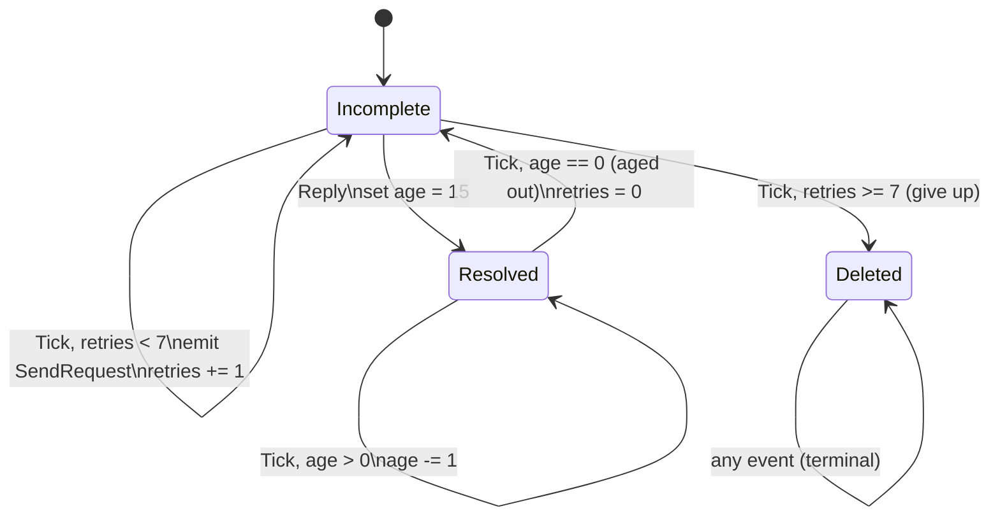

# arp_resolution - per-entry ARP resolution with retransmit limit and aging

## What it demonstrates
- A per-entry ARP resolution machine (RFC 826): an entry starts INCOMPLETE, retransmits the request until answered or the retry limit is hit, resolves to a MAC, then ages out. RFS features: guarded transitions, bit-vector retry/age counters, a safety property (no forward on an unresolved entry) and a liveness property (every incomplete entry resolves or gives up).
- The automaton is drawn from the real ARP resolution process (request retransmission, resolution, cache aging).

## The machine


## RFS modes demonstrated
### Specification & analysis (`rfs validate`, `rfs info`)
The spec parses and validates; `rfs info` reports the 3 states, 3 events, 2 outputs,
the `retries`/`age` variables, and the monitored `no_forward_unresolved` safety property.
Rationale: the analysis gate that runs before any codegen/MC.

### Model checking - in-process (`rfs mc-ref`, exact)
`pass.rfs` model-checks to **PASS complete** (137 states): no packet is forwarded on an
unresolved entry, and every incomplete entry either resolves or is deleted after the retry
limit. The negative variant `fail.rfs` drops the retry limit so an unresolvable entry
retransmits forever - a pinned **liveness-violation** CE (a cycle of length 8 looping in
INCOMPLETE on Tick, `retries` wrapping 0..7..0) on `resolves_or_gives_up`; `fixed.rfs`
restores the give-up transition and re-runs to PASS.

### Model checking - generated binaries (rust + c)
Both backends' MC binaries are generated, compiled, and run in exact mode; their reports
are **byte-identical** to each other and to mc-ref. The failing variant's lasso CE is
identical across all three engines.

### Production code generation (rust + c)
`rfs codegen rust production` and `rfs codegen c production` both compile the FSM
warning-free. The liveness property is outside the monitor subset, so production codegen
skips it (a noted warning) - only the safety monitor is emitted.

## Files layout
| File | Role |
|---|---|
| `pass.rfs` | the valid resolver (exact-MC-able) |
| `fail.rfs` | retry limit dropped (infinite retransmit loop) |
| `fixed.rfs` | the corrected spec (= pass.rfs) |
| `run.sh` | drives every demonstrated RFS mode |
| `captures/` | pinned outputs (text + JSON CE, both-backend reports) |

## Build / run / test
Prerequisite: the rfs toolchain built (`cargo build`) or `RFS_BIN` set; rustc + gcc available.
```sh
./run.sh
```
`cargo test --test example_projects_test arp_resolution` re-runs it and pins the excerpts.

## Expected results
- pass.rfs: PASS complete (137 states); no_forward_unresolved + resolves_or_gives_up hold.
- fail.rfs: FAIL, `reason=liveness-violation label=resolves_or_gives_up step=0` - an infinite retransmit loop in INCOMPLETE (cycle length 8).
- fixed.rfs: PASS complete.
