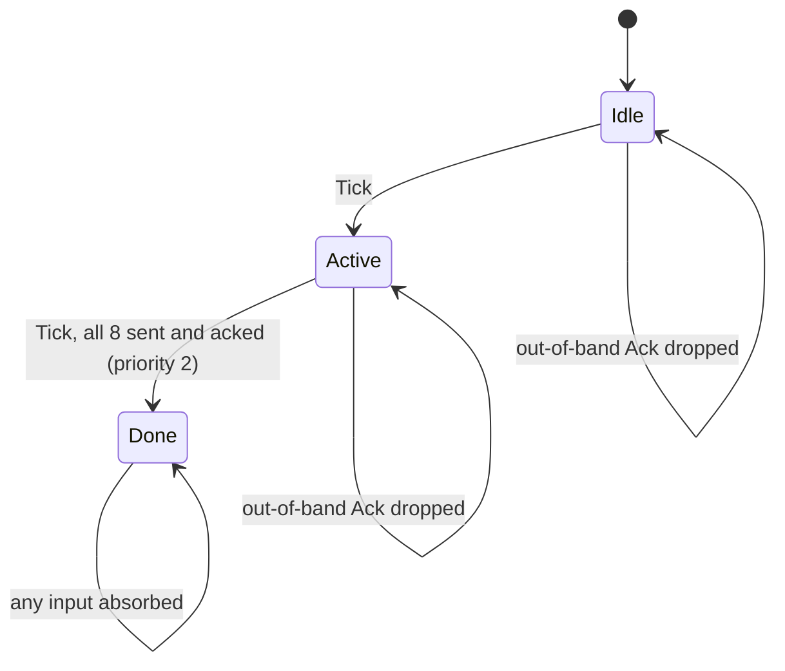

# async_handler - driving the generated ARQ sender as a futures Stream

## What it demonstrates

- **The async adapter** (`AsyncFsm`, [INTEGRATION.md section 2](../../../docs/user/INTEGRATION.md#2-protocolfsm-and-the-four-adapters)): the same integration story as sync_handler, over the async surface. The driver submits inputs with `AsyncFsm::submit` and consumes outcomes from the stream (`futures::stream::StreamExt`).
- **No tokio required**: the FSM is stepped SYNCHRONOUSLY inside `poll_next` (the generated step does no I/O), so the plain `futures` executor works - no tokio dependency (tokio interop is user code, per the task non-goals).
- **Dependency hygiene**: `futures` is confined to this crate + `rfs-adapters` (never the `rfs` toolchain or generated code).

Rationale: sync_handler shows the threaded/channel shape; this shows the same
generated machine consumed as a `Stream` - the shape for applications already
built on futures. Both drive the IDENTICAL scripted scenario and observe
identical, pinned behavior, which is the point: the adapter changes the I/O
surface, never the protocol.

The automaton itself: the **sliding-window ARQ sender** (spec 43,
[examples/valid/43_sliding_window.rfs](../../../examples/valid/43_sliding_window.rfs)) -
drawn from the real ARQ retransmission protocol. A sender with a window of 4
over sequence numbers 0..8; time is modeled by `Tick`; on each tick the sender
either sends the next frame (while there is room in the window) or the receiver
acknowledges the oldest unacked frame. Three states (`Idle`, `Active`, `Done`),
two events (`Tick`, `Ack(Seq(seq, checksum))`), two outputs (`SendFrame`,
`RecvAck`), two vars (`next_seq`, `acked`). Properties: a window-bound safety
invariant, a liveness `terminates`, and an `env_tick` timing assumption.

## The machine



| From | Event (guard) | To | Effect |
|---|---|---|---|
| Idle | Tick | Active | - |
| Idle | Ack | Idle | dropped |
| Active | Tick (`next_seq==8 && acked==8`, priority 2) | Done | - |
| Active | Tick (`next_seq<8 && next_seq-acked<4`, priority 1) | Active | emit `SendFrame(next_seq)`, `next_seq += 1` |
| Active | Tick (`acked<next_seq`) | Active | emit `RecvAck(acked)`, `acked += 1` |
| Active | Ack | Active | out-of-band, dropped (checksum never inspected) |
| Done | any | Done | absorbed |

## Files layout

| File | Role |
|---|---|
| `Cargo.toml` | member manifest: rfs-adapters dep (with the `async` feature) + rfs-build build-dep |
| `build.rs` | byte-identical to sync_handler's: generates spec 43 with `--with-protocol-fsm`, strips inner attributes, writes the body to OUT_DIR |
| `src/lib.rs` | includes the artifact in `pub mod arq`, drives one full ARQ session over the stream adapter (`run` + `ArqReport`), inline test |
| `src/main.rs` | demo binary: runs the session and prints what the receiver observed (exit 0 on success, 1 on protocol error) |

## Build / run / test

Prerequisite: the `rfs` toolchain must be built (`cargo build` at the repo
root produces `target/debug/rfs`) or `RFS_BIN` must point to it - see
`BUILD.md`. Then:

```sh
cargo run -p async_handler   # demo: prints the observed session, exit 0 on success
cargo test -p async_handler  # the same session as a test (CI record)
```

## Expected results

- The protocol scenario matches sync_handler exactly: wake tick, ticks until
  all 8 frames are sent and acknowledged with an out-of-band `Ack` injected
  every third tick, completion + quiescence. Both examples observe identical
  behavior:
  ```
    ticks issued:             19
    frames sent (in order):   [0, 1, 2, 3, 4, 5, 6, 7]
    acks received (in order): [0, 1, 2, 3, 4, 5, 6, 7]
    out-of-band acks dropped: 5
    max window observed:      4 (bound 4)
  ```
- What to pay attention to: the data lines are byte-identical to sync_handler's
  - the adapter changes the I/O surface (a Stream instead of channels), never
  the protocol. The window bound (max 4) holds, out-of-band Acks are dropped,
  and `Done` absorbs every further input.
