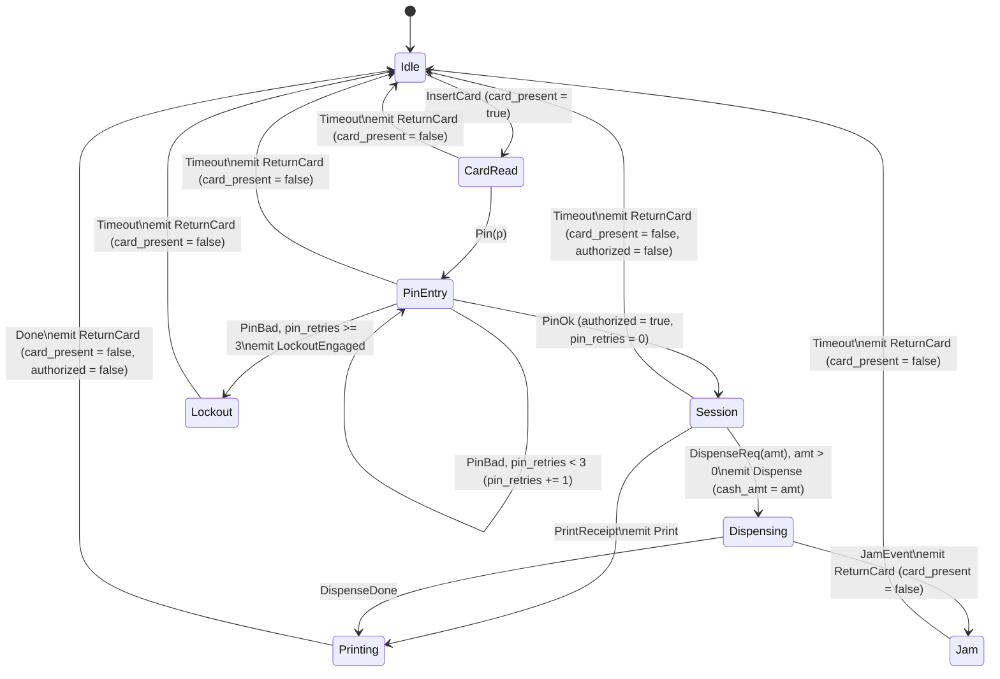

# atm_transaction - an ATM / POS transaction FSM

## What it demonstrates
- An ATM: idle -> card-read -> PIN-entry -> session -> dispensing/printing, with timeout, jam, and security-lockout branches. The PIN retry count is bit<2> (lockout after 3 bad PINs), the cash amount is scaled to bit<6> (up to 63 units - the full-width model would blow the state budget, noted simplification), and card-present / authorized are bool witnesses. The AUTHORIZATION GATE is the safety core: cash is dispensed only from an authorized session - a DispenseReq anywhere else is never honored. RFS features: an output-anchored authorization invariant, a counter invariant (lockout after N), and a no-swallowed-card invariant over every exit path.
- The automaton is drawn from real ATM transaction logic (card read, PIN verification with retry/lockout, cash dispense, receipt print, jam recovery). Rationale: no-cash-without-authorization + lockout-after-N + always-return-card are the classic ATM invariants - a financial-interlock showcase.

## The machine


## RFS modes demonstrated
### Specification & analysis (`rfs validate`, `rfs info`)
The spec parses and validates; `rfs info` reports the 8 states, 10 events, 4 outputs,
the four variables, and the three monitored properties. Rationale: the analysis gate
that runs before any codegen/MC.

### Model checking - in-process (`rfs mc-ref`, exact)
`pass.rfs` model-checks to **PASS complete** (1905 states): `no_cash_unauthorized`
holds - the only Dispense emission is the authorized-session transition, so cash never
leaves without a PinOk; `lockout_after_n` holds - Lockout is reachable only through the
`pin_retries >= 3` branch, so the counter invariant pins the 3-bad-PIN policy;
`card_returned_on_exit` holds - every transition into Idle emits ReturnCard and clears
`card_present`, so no path returns to Idle with a card still inside (jam, lockout,
timeout and normal completion all return it). The negative variant `fail.rfs` bypasses
the authorization gate - a DispenseReq during PIN entry (before any PinOk) is honored -
so a pinned **property-violation** CE on `no_cash_unauthorized` at step 3 shows
InsertCard, a PIN entry, and a DispenseReq(amt=1) that emits Dispense while
`authorized == false`; `fixed.rfs` removes the bypass and re-runs to PASS.

### Model checking - generated binaries (rust + c)
Both backends' MC binaries are generated, compiled, and run in exact mode; their reports
are **byte-identical** to each other and to mc-ref. The failing variant's CE is identical
across all three engines. Rationale: the production-identical engine must agree with the
in-process reference on both the positive proof and the negative counterexample.

### Production code generation (rust + c)
`rfs codegen rust production` and `rfs codegen c production` both compile the FSM
warning-free - the generated-C compiler-agnosticism bar. Rationale: a financial
transaction machine with retry/lockout counters compiles to shippable ATM controller
firmware in both backends.

## Files layout
| File | Role |
|---|---|
| `pass.rfs` | the valid ATM transaction FSM (authorization gate + lockout counter + card return) |
| `fail.rfs` | authorization gate bypassed (dispense during PIN entry defect) |
| `fixed.rfs` | the corrected spec (= pass.rfs) |
| `run.sh` | drives every demonstrated RFS mode |
| `captures/` | pinned outputs (text + JSON CEs) |

## Build / run / test
Prerequisite: the rfs toolchain built (`cargo build`) or `RFS_BIN` set; rustc + gcc available.
```sh
./run.sh
```

## Expected results
- `rfs validate pass.rfs` -> ok; `rfs info` lists 8 states / 10 events / 4 outputs.
- mc-ref on `pass.rfs`: `status=pass-complete states=1905 transitions=8096 max_depth=13`.
- mc-ref on `fail.rfs`: exit 1, `reason=property-violation label=no_cash_unauthorized step=3`;
  the CE shows InsertCard, Pin(p=0), then a DispenseReq(amt=1) that emits Dispense with
  `authorized: false`. The JSON form carries the same label/step.
- mc-ref on `fixed.rfs`: PASS complete again; both generated backends agree byte-for-byte.
- Production codegen compiles clean (rust) and warning-free (c).
- What to pay attention to: the cash amount is scaled to bit<6> so exact MC stays fast
  (noted simplification per the phase plan's discrete-layer rule). The lockout counter is
  bit<2> with the policy "lockout after 3 bad PINs" pinned by `lockout_after_n` - the
  fourth bad PIN (pin_retries already 3) takes the `>= 3` branch. Every exit path to Idle
  carries the ReturnCard emission, which is what makes `card_returned_on_exit` a genuine
  invariant rather than a structural tautology: the jam and lockout branches are the ones
  a careless design would forget.
