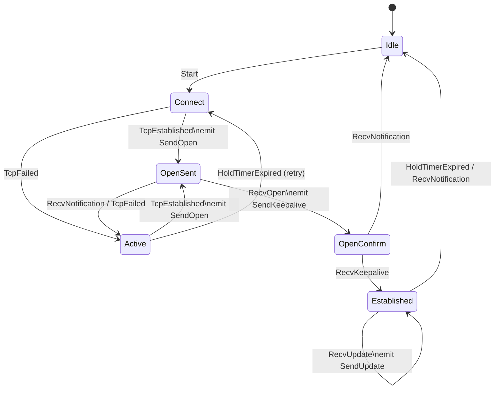

# bgp_fsm - BGP peer finite state machine with UPDATE ordering

## What it demonstrates
- A BGP peer FSM (RFC 4271): Idle -> Connect -> Active -> OpenSent -> OpenConfirm -> Established, with NOTIFICATION returning to Active/Idle. RFS features: a multi-state session machine, guarded transitions, a hold-timer var, and the ordering-safety property that no UPDATE is handled before the session is ESTABLISHED.
- The automaton is drawn from the real BGP peer state machine; the TCP layer is abstracted to TcpEstablished/TcpFailed events.

## The machine


## RFS modes demonstrated
### Specification & analysis (`rfs validate`, `rfs info`)
The spec parses and validates; `rfs info` reports the 6 session states, the events, the
outputs, the `hold_timer` variable, and the monitored `no_update_before_established`
property. Rationale: the analysis gate that runs before any codegen/MC.

### Model checking - in-process (`rfs mc-ref`, exact)
`pass.rfs` model-checks to **PASS complete** (9 states): the ordering invariant holds - a
SendUpdate is emitted only while the session is ESTABLISHED. The negative variant
`fail.rfs` removes the ESTABLISHED-state guard so an UPDATE is accepted and echoed while
still in OPENCONFIRM - a pinned **property-violation** CE on `no_update_before_established`
(step 4, the RecvUpdate->SendUpdate defect step in OpenConfirm); `fixed.rfs` re-adds the
guard and re-runs to PASS.

### Model checking - generated binaries (rust + c)
Both backends' MC binaries are generated, compiled, and run in exact mode; their reports
are **byte-identical** to each other and to mc-ref. The failing variant's CE is identical
across all three engines.

### Production code generation (rust + c)
`rfs codegen rust production` and `rfs codegen c production` both compile the FSM
warning-free - the generated-C compiler-agnosticism bar.

## Files layout
| File | Role |
|---|---|
| `pass.rfs` | the valid peer FSM (exact-MC-able) |
| `fail.rfs` | UPDATE accepted in OpenConfirm (ordering defect) |
| `fixed.rfs` | the corrected spec (= pass.rfs) |
| `run.sh` | drives every demonstrated RFS mode |
| `captures/` | pinned outputs (text + JSON CE, both-backend reports) |

## Build / run / test
Prerequisite: the rfs toolchain built (`cargo build`) or `RFS_BIN` set; rustc + gcc available.
```sh
./run.sh
```
`cargo test --test example_projects_test bgp_fsm` re-runs it and pins the excerpts.

## Expected results
- pass.rfs: PASS complete (9 states); no_update_before_established holds.
- fail.rfs: FAIL, `reason=property-violation label=no_update_before_established step=4` - a SendUpdate is emitted in OPENCONFIRM.
- fixed.rfs: PASS complete.
