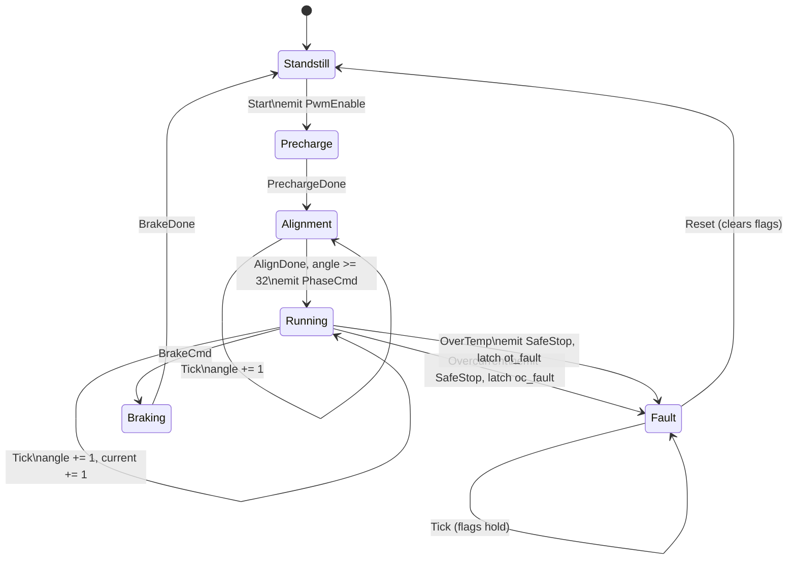

# blc_motor_foc - a BLDC motor FOC mode machine

## What it demonstrates
- The discrete MODE layer of a brushless-DC field-oriented controller: standstill -> precharge -> rotor alignment -> field-oriented running -> braking -> fault. The analog current loops are abstracted to threshold guards - the electrical-angle estimate sweeps during alignment and `AlignDone` is honoured only after a quarter turn, while overcurrent / overtemperature arrive as fault events from the (abstracted) current-magnitude comparison. RFS features: latched-fault safe-stop invariants, a no-drive-in-fault interlock, and an alignment-before-running ordering property via a machine-maintained witness var.
- The automaton is drawn from the standard FOC drive start sequence (precharge the DC link, align the rotor to a known electrical angle, then enable field-oriented current control). Rationale: power-electronics mode machines are exactly the safety-interlock domain model checking exists for - and the latch semantics ("a fault cannot be lost by time passing") is the property a transient sensor glitch would break.

## The machine


## RFS modes demonstrated
### Specification & analysis (`rfs validate`, `rfs info`)
The spec parses and validates; `rfs info` reports the 6 states, 9 events, 3 outputs,
the five variables, and the three monitored properties. Rationale: the analysis gate
that runs before any codegen/MC.

### Model checking - in-process (`rfs mc-ref`, exact)
`pass.rfs` model-checks to **PASS complete** (14402 states): `safe_stop_latches` holds
- once a fault flag is set it stays set until an explicit Reset, so the safe-stop cannot
be lost by a transient reading - `no_drive_in_fault` holds (no PhaseCmd while in Fault),
and `alignment_before_running` holds (the witness var `align_done` is set on the single
edge into Running, so no shortcut can enter the running mode). The negative variant
`fail.rfs` clears the overcurrent flag by time passing instead of latching it - a pinned
**property-violation** CE on `safe_stop_latches` at step 37 (Overcurrent latches
oc_fault=true into Fault, the next Tick clears it); `fixed.rfs` restores the latch and
re-runs to PASS.

### Model checking - generated binaries (rust + c)
Both backends' MC binaries are generated, compiled, and run in exact mode; their reports
are **byte-identical** to each other and to mc-ref. The failing variant's CE is identical
across all three engines.

### Production code generation (rust + c)
`rfs codegen rust production` and `rfs codegen c production` both compile the FSM
warning-free - the generated-C compiler-agnosticism bar. Rationale: a power-electronics
mode machine compiles to shippable controller code in both backends.

## Files layout
| File | Role |
|---|---|
| `pass.rfs` | the valid FOC mode machine (latched faults) |
| `fail.rfs` | overcurrent flag cleared by Tick instead of latching (safe-stop-loss defect) |
| `fixed.rfs` | the corrected spec (= pass.rfs) |
| `run.sh` | drives every demonstrated RFS mode |
| `captures/` | pinned outputs (text + JSON CEs) |

## Build / run / test
Prerequisite: the rfs toolchain built (`cargo build`) or `RFS_BIN` set; rustc + gcc available.
```sh
./run.sh
```

## Expected results
- `rfs validate pass.rfs` -> ok; `rfs info` lists 6 states / 9 events / 3 outputs.
- mc-ref on `pass.rfs`: `status=pass-complete states=14402 transitions=25698 max_depth=133`.
- mc-ref on `fail.rfs`: exit 1, `reason=property-violation label=safe_stop_latches step=37`;
  the CE shows Overcurrent latching oc_fault=true into Fault (step 35) and the next Tick
  clearing it (step 36) - the safe-stop lost. The JSON form carries the same label/step.
- mc-ref on `fixed.rfs`: PASS complete again; both generated backends agree byte-for-byte.
- Production codegen compiles clean (rust) and warning-free (c).
- What to pay attention to: the latch property is a `next`-form invariant - it checks the
  flag at the step AFTER the latching one, which is why the CE's violation step is one past
  the Overcurrent step. The unexpected-termination count is high by design: fault/brake
  commands are only meaningful in specific modes and are dropped elsewhere (the abstracted
  drive ignores them), exactly as a real mode machine would.
