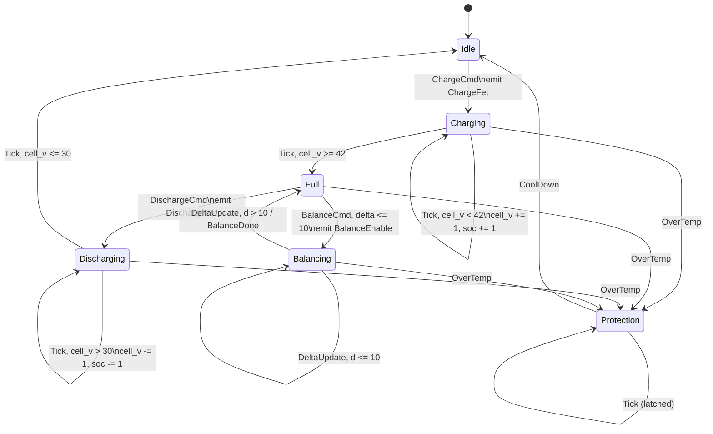

# bms_protection - a Battery Management System protection machine

## What it demonstrates
- A battery-pack manager: idle -> charging -> full -> discharging -> balancing -> protection. Cell voltage is scaled to 100 mV units (nominal 35 = 3.5 V; hard limits VMAX 42 = 4.2 V, VMIN 30 = 3.0 V), the state-of-charge estimate tracks the charge/discharge ticks, and the per-cell delta gates balancing. Pack temperature is watched by the abstracted thermal controller, which raises `OverTemp` when the limit is crossed - the same abstraction as `blc_motor_foc`'s current loop (the analog comparison lives inside the event). RFS features: hard voltage bounds enforced by transition guards, a latching thermal shutdown, and a balancing-window interlock.
- The automaton is drawn from real BMS protection logic (charge termination at Vmax, discharge cutoff at Vmin, thermal shutdown with cooldown re-permission, delta-voltage balancing). Rationale: threshold-guard-heavy safety machines are the ideal RFS showcase - every guard is a checkable invariant, and disabling one produces a deterministic counterexample.

## The machine


## RFS modes demonstrated
### Specification & analysis (`rfs validate`, `rfs info`)
The spec parses and validates; `rfs info` reports the 6 states, 8 events, 3 outputs,
the three variables, and the four monitored properties. Rationale: the analysis gate
that runs before any codegen/MC.

### Model checking - in-process (`rfs mc-ref`, exact)
`pass.rfs` model-checks to **PASS complete** (859 states): `never_above_vmax` holds -
charging stops at 4.2 V - `never_below_vmin` holds (discharge cutoff at 3.0 V),
`thermal_latch` holds (from Protection the only exit is an explicit CoolDown - no
re-entry while hot), and `balancing_window` holds (balancing runs only while the cell
spread is within 100 mV). The negative variant `fail.rfs` disables the over-voltage
guard so charging continues past VMAX - a pinned **property-violation** CE on
`never_above_vmax` at step 9 (a Tick drives cell_v to 43 while still in Charging);
`fixed.rfs` re-enables the guard and re-runs to PASS.

### Model checking - generated binaries (rust + c)
Both backends' MC binaries are generated, compiled, and run in exact mode; their reports
are **byte-identical** to each other and to mc-ref. The failing variant's CE is identical
across all three engines.

### Production code generation (rust + c)
`rfs codegen rust production` and `rfs codegen c production` both compile the FSM
warning-free - the generated-C compiler-agnosticism bar. Rationale: a threshold-guard-
heavy protection machine compiles to shippable BMS firmware in both backends. (This spec
is also promoted to a cargo-member crate with property monitors in Phase 18 task 7.)

## Files layout
| File | Role |
|---|---|
| `pass.rfs` | the valid protection machine (guarded bounds + latching thermal shutdown) |
| `fail.rfs` | over-voltage guard disabled (charge-past-VMAX defect) |
| `fixed.rfs` | the corrected spec (= pass.rfs) |
| `run.sh` | drives every demonstrated RFS mode |
| `captures/` | pinned outputs (text + JSON CEs) |

## Build / run / test
Prerequisite: the rfs toolchain built (`cargo build`) or `RFS_BIN` set; rustc + gcc available.
```sh
./run.sh
```

## Expected results
- `rfs validate pass.rfs` -> ok; `rfs info` lists 6 states / 8 events / 3 outputs.
- mc-ref on `pass.rfs`: `status=pass-complete states=859 transitions=1953 max_depth=25`.
- mc-ref on `fail.rfs`: exit 1, `reason=property-violation label=never_above_vmax step=9`;
  the CE shows ChargeCmd entering Charging at cell_v=35 and eight Ticks driving cell_v to
  43 (> VMAX 42) - the pack overcharged. The JSON form carries the same label/step.
- mc-ref on `fixed.rfs`: PASS complete again; both generated backends agree byte-for-byte.
- Production codegen compiles clean (rust) and warning-free (c).
- What to pay attention to: the voltage bounds are GUARD-enforced, not property-only -
  the guards make the bad transition impossible, and the properties pin that impossibility
  so a future guard edit that re-opens it is caught. The thermal latch is a `next`-form
  invariant over the Protection state; the unexpected-termination count reflects commands
  that are only meaningful in specific modes (ChargeCmd in Discharging, etc.) being dropped,
  exactly as a real mode machine would ignore them.
