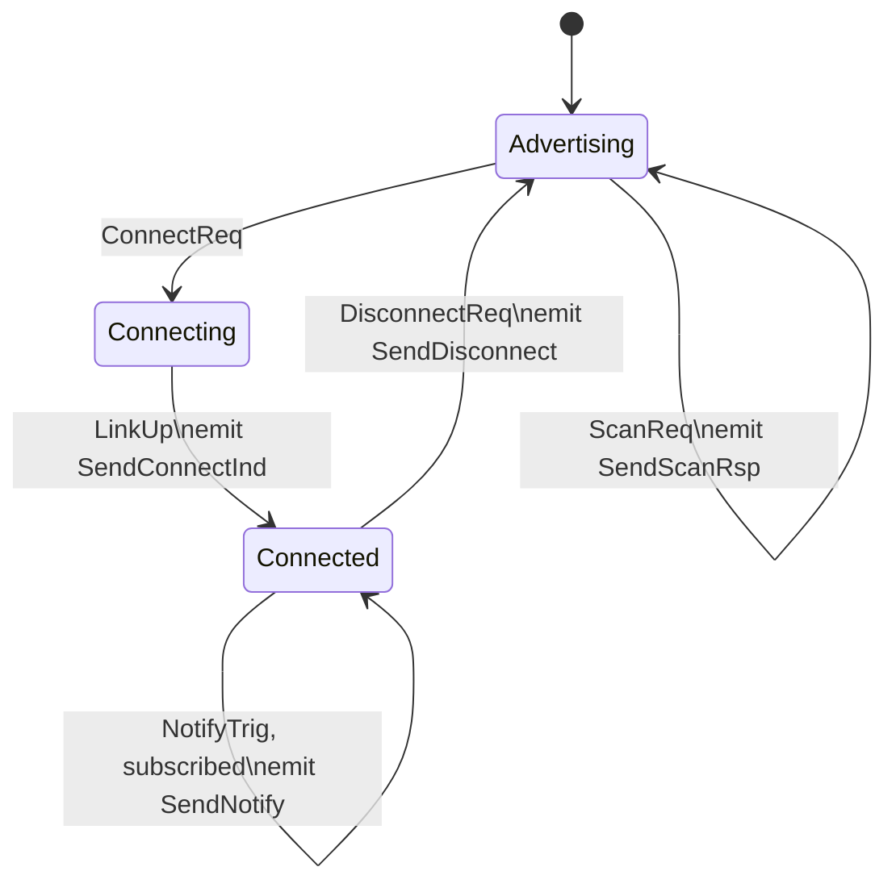

# bt_gatt_session - a Bluetooth GATT client/server session machine

## What it demonstrates
- A Bluetooth GATT (Core Spec Vol 3) session machine: advertising -> connecting -> connected, then read/write/notify per characteristic. The client characteristic configuration (CCC, handle 1) carries the subscription flag; notifications go only to subscribed clients and writes reach only mapped characteristics. RFS features: event parameters with handle/value payloads, guarded transitions on those payloads, and two safety properties.
- The automaton is drawn from the real GATT access model (services discovery folded into the link-up mapping step).

## The machine


## RFS modes demonstrated
### Specification & analysis (`rfs validate`, `rfs info`)
The spec parses and validates; `rfs info` reports the 3 states, 7 events, 6 outputs,
the two variables, and the two monitored properties. Rationale: the analysis gate that
runs before any codegen/MC.

### Model checking - in-process (`rfs mc-ref`, exact)
`pass.rfs` model-checks to **PASS complete** (4 states): `notify_only_subscribed` holds -
a notification is emitted only when the client is subscribed - and `no_write_unmapped`
holds: writes reach only mapped characteristics. The negative variant `fail.rfs` removes
the subscription guard, so a notification goes to an unsubscribed client - a pinned
**property-violation** CE on `notify_only_subscribed` at step 3 (NotifyTrig emits
SendNotify with subscribed=false); `fixed.rfs` restores the guard and re-runs to PASS.

### Model checking - generated binaries (rust + c)
Both backends' MC binaries are generated, compiled, and run in exact mode; their reports
are **byte-identical** to each other and to mc-ref. The failing variant's CE is identical
across all three engines.

### Production code generation (rust + c)
`rfs codegen rust production` and `rfs codegen c production` both compile the FSM
warning-free - the generated-C compiler-agnosticism bar. Rationale: a real GATT session
machine compiles to shippable code in both backends.

## Files layout
| File | Role |
|---|---|
| `pass.rfs` | the valid GATT session machine |
| `fail.rfs` | subscription guard removed (notify-unsubscribed defect) |
| `fixed.rfs` | the corrected spec (= pass.rfs) |
| `run.sh` | drives every demonstrated RFS mode |
| `captures/` | pinned outputs (text + JSON CEs) |

## Build / run / test
Prerequisite: the rfs toolchain built (`cargo build`) or `RFS_BIN` set; rustc + gcc available.
```sh
./run.sh
```
`cargo test --test example_projects_test bt_gatt_session` re-runs it and pins the excerpts.

## Expected results
- pass.rfs: PASS complete (4 states); both properties hold.
- fail.rfs: FAIL, `reason=property-violation label=notify_only_subscribed step=3` - SendNotify emitted with subscribed=false.
- fixed.rfs: PASS complete.
