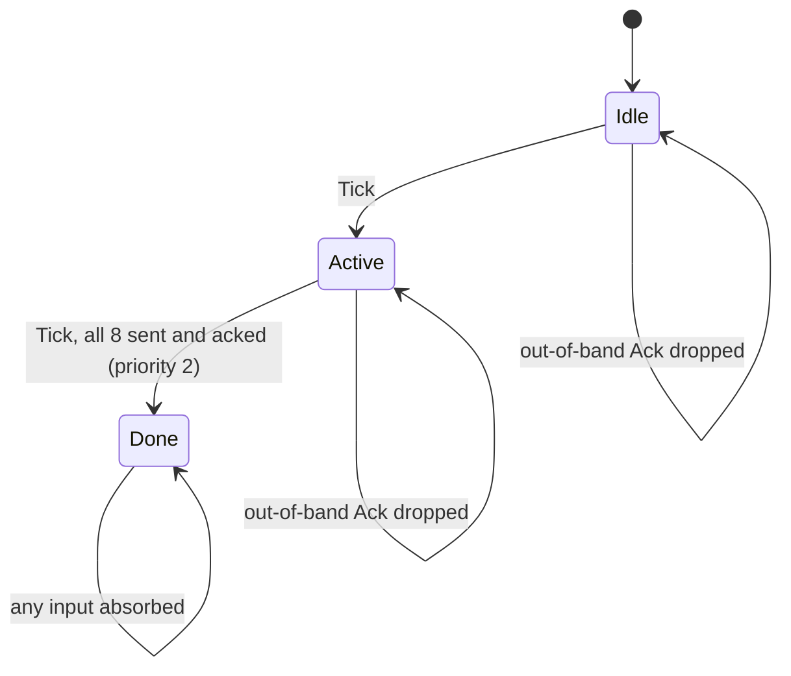

# c_sync_handler - the plain-C mirror of the ARQ sender example

## What it demonstrates

- **The C integration surface** ([INTEGRATION.md section 4](../../../docs/user/INTEGRATION.md#4-c-projects-makefile-pattern)): the C mirror of sync_handler - drives the GENERATED spec-43 sliding-window ARQ sender with a scripted peer, same scenario, same pinned outcome. Makefile-driven by design (NOT a cargo workspace member; the C equivalent surface of the Rust-ecosystem examples).
- **Single-translation-unit wiring**: `src/handler.c` includes ONLY the generated FSM header (`#include "arq_fsm.h"`) - the FSM implementation is a separate translation unit, exactly the wiring the fuzz skeleton uses.
- **A documented gcc/clang choice**: the generated C is compiler-agnostic - it compiles warning-free under BOTH gcc and clang (the guarantee pinned by `tests/c_compiler_agnostic_test.rs`). `make` uses the system compiler; `make CC=clang` builds the SAME scenario under clang. When driving rfs itself, the equivalents are the `RFS_GCC` / `RFS_CLANG` env vars ([TOOLCHAIN.md section 8.2](../../../TOOLCHAIN.md)).

Rationale: sync_handler / async_handler show the Rust-ecosystem shapes; this
proves the generated C is a first-class integration target with no Rust
runtime - just a Makefile, a header include, and a zero-warning bar.

The automaton itself: the **sliding-window ARQ sender** (spec 43,
[examples/valid/43_sliding_window.rfs](../../../examples/valid/43_sliding_window.rfs)) -
drawn from the real ARQ retransmission protocol. A sender with a window of 4
over sequence numbers 0..8; time is modeled by `Tick`; on each tick the sender
either sends the next frame (while there is room in the window) or the receiver
acknowledges the oldest unacked frame. Three states (`Idle`, `Active`, `Done`),
two events (`Tick`, `Ack(Seq(seq, checksum))`), two outputs (`SendFrame`,
`RecvAck`), two vars (`next_seq`, `acked`). Properties: a window-bound safety
invariant, a liveness `terminates`, and an `env_tick` timing assumption.

## The machine



| From | Event (guard) | To | Effect |
|---|---|---|---|
| Idle | Tick | Active | - |
| Idle | Ack | Idle | dropped |
| Active | Tick (`next_seq==8 && acked==8`, priority 2) | Done | - |
| Active | Tick (`next_seq<8 && next_seq-acked<4`, priority 1) | Active | emit `SendFrame(next_seq)`, `next_seq += 1` |
| Active | Tick (`acked<next_seq`) | Active | emit `RecvAck(acked)`, `acked += 1` |
| Active | Ack | Active | out-of-band, dropped (checksum never inspected) |
| Done | any | Done | absorbed |

## Files layout

| File | Role |
|---|---|
| `src/handler.c` | the scripted peer; includes ONLY the generated FSM header - no sanitizers, plain `-Wall` |
| `Makefile` | generates the C FSM header/source pair via rfs, compiles EXPLICIT object files (`build/arq_fsm.o`, `build/handler.o`) and links them into `c_sync_handler`; `CC ?= gcc` with a documented `make CC=clang` alternative |

## Build / run / test

```sh
cargo build                      # from the repo root, first (produces target/debug/rfs)
make RFS_BIN=$PWD/../../../target/debug/rfs   # or: export RFS_BIN=... / put rfs on PATH
./c_sync_handler                 # exit 0 on success
```

`make generate` runs only the codegen step (no compiler needed).

**Compiler choice** - the generated C is warning-free under both gcc and clang:

```sh
make RFS_BIN=...                 # default: the system C compiler (CC ?= gcc)
make RFS_BIN=... CC=clang        # the SAME scenario built under clang
```

When driving rfs itself (codegen / test invocations resolve tools the same
way - [TOOLCHAIN.md section 8.2](../../../TOOLCHAIN.md)), the equivalents are
the `RFS_GCC` and `RFS_CLANG` env vars:

```sh
RFS_GCC=/usr/bin/gcc RFS_BIN=... make        # force a specific gcc for rfs's own compiles
RFS_CLANG=/usr/bin/clang ...                 # force a specific clang (fuzz / libFuzzer paths)
```

## Expected results

- The data lines are byte-identical to the Rust `sync_handler`'s (the header
  line is language-specific), pinned by `tests/example_projects_test.rs`:
  ```
    ticks issued:             19
    frames sent (in order):   [0, 1, 2, 3, 4, 5, 6, 7]
    acks received (in order): [0, 1, 2, 3, 4, 5, 6, 7]
    out-of-band acks dropped: 5
    max window observed:      4 (bound 4)
  ```
- What to pay attention to: the zero-warning bar holds for BOTH object compiles
  (`arq_fsm.o` from the generated source, `handler.o` from handler.c) under
  EITHER compiler - that is the compiler-agnosticism guarantee made concrete.
  The assumption handler continues on violation (the scenario never violates
  one). Building under clang (`make CC=clang`) yields the SAME pinned outcome.
