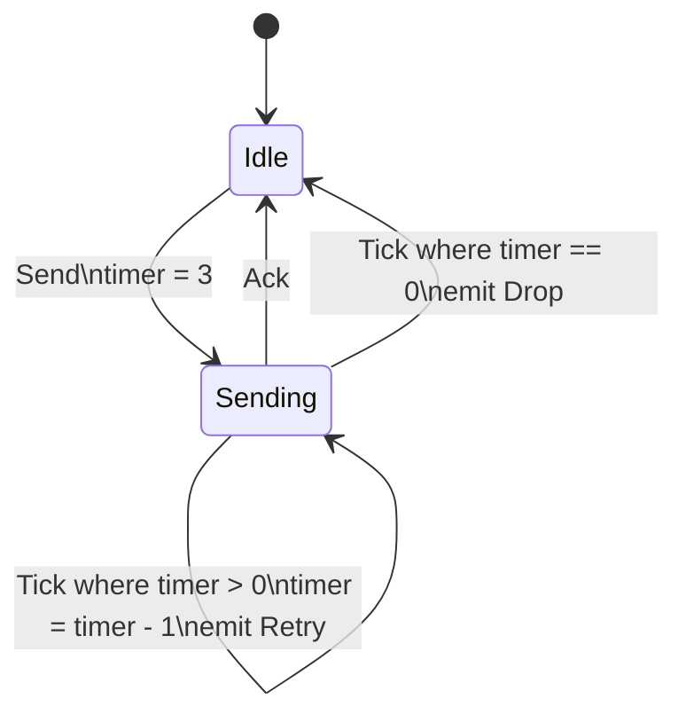

# callback_minimal_adapters - the callback driver and the no_std minimal wrapper

## What it demonstrates

- **The callback adapter** (`rfs_adapters::callback::drive`, [INTEGRATION.md section 2](../../../docs/user/INTEGRATION.md#2-protocolfsm-and-the-four-adapters)): a reactive driving loop where a user-supplied closure decides the next input from the PREVIOUS step's outputs - protocol integration without channels or streams. This example reaches ALL THREE of its outcomes against a real generated spec: `Completed` (the closure stops), `Failed` (the FSM rejects an input), `StepLimit` (the driver halts at max_steps).
- **The no_std minimal wrapper** (`rfs_adapters::minimal::Minimal`, same section): a transparent step-forwarding newtype with no state of its own - core-only, so it works with `#![no_std]` production artifacts. Demonstrated here for forwarding (same outputs, same errors, `into_inner` hands the FSM back) and COMPOSITION (`Minimal<Fsm>` is itself a `ProtocolFsm`, so the callback driver drives it).
- **rfs-build's `.with_protocol_fsm(true)`** ([INTEGRATION.md section 1](../../../docs/user/INTEGRATION.md#1-rust-integration-via-buildrs-rfs-build)): the opt-in that makes the generated `Fsm` implement `ProtocolFsm` - the one documented link between a generated artifact and an external crate.

Rationale: the channel and async adapters are demonstrated by sync_handler /
async_handler, but the callback driver and the minimal wrapper had never been
driven against a REAL generated spec (only against in-crate mocks in
`crates/rfs-adapters/tests/`). This is the usage scenario for callback-style
integration (no I/O machinery) and for no_std composition.

The automaton itself: the same timeout/retry machine as no_std_fsm (spec 03,
[examples/valid/03_timeout_retry.rfs](../../../examples/valid/03_timeout_retry.rfs)) -
constructed for teaching, pattern drawn from real retransmission timers. Two
states (`Idle`, `Sending`), three events (`Send`, `Ack`, `Tick`), two outputs
(`Retry`, `Drop`), one var (`timer: bit<3>` init 3). No properties.

## The machine



| From | Event (guard) | To | Effect |
|---|---|---|---|
| Idle | Send | Sending | `timer = 3` |
| Sending | Ack | Idle | - |
| Sending | Tick (`timer > 0`) | Sending | `timer -= 1`, emit `Retry` |
| Sending | Tick (`timer == 0`) | Idle | emit `Drop` |

The reactive driver used by the completion and composition sessions: send
once, then tick until a `Drop` output appears, then stop. Note the closure
carries its own `sent` flag - the Send step emits no output, so an empty
previous-outputs slice alone cannot tell "before the first step" from "after
the Send".

## Files layout

| File | Role |
|---|---|
| `Cargo.toml` | member manifest: rfs-adapters dep + rfs-build build-dep |
| `build.rs` | generates spec 03 with `.with_protocol_fsm(true)`; strips inner attributes; writes the byte-identical body to OUT_DIR |
| `src/lib.rs` | std lib: includes the artifact in `pub mod timeout_retry`; callback drivers (`run_callback_completion` / `_failure` / `_step_limit`), minimal drivers (`run_minimal_forwarding` / `_composition`) + tests |

## Build / run / test

Prerequisite: the rfs toolchain built (`cargo build` at the repo root produces
`target/debug/rfs`) or `RFS_BIN` set - the build script prefers the
workspace-built binary when `RFS_BIN` is not pinned.

```sh
cargo build -p callback_minimal_adapters
cargo test  -p callback_minimal_adapters
```

## Expected results

- `cargo test -p callback_minimal_adapters` runs five tests, all passing:
  - `callback_completion_stops_after_drop`: the reactive driver completes the protocol in exactly 5 steps (Send + four Ticks) and reports `CallbackResult::Completed(5)`;
  - `callback_failure_reports_the_fsm_error`: an out-of-band `Ack` is rejected by the FSM and the driver reports `Failed(UnexpectedEvent, 0)` - the error plus the number of steps completed before it (zero);
  - `callback_step_limit_halts_at_max_steps`: a closure that never stops is halted at max_steps=4 - `StepLimit(4)`;
  - `minimal_forwards_outputs_and_errors`: the wrapper forwards every output (`Retry` x3, then `Drop`) and every error (the idle `Ack` rejection) of the wrapped FSM, then hands the inner FSM back via `into_inner`;
  - `minimal_composes_with_the_callback_driver`: driving a `Minimal<Fsm>` through the callback driver yields the SAME `Completed(5)` as driving the bare FSM - the wrapper adds no behavior.
- What to pay attention to:
  - the adapters are GENERIC over `F: ProtocolFsm` and never name generated types - the same driver code works for any RFS-generated Rust FSM built with `--with-protocol-fsm`;
  - `callback` and `minimal` are core-only modules of rfs-adapters: they also compile inside `#![no_std]` crates (pinned by `crates/rfs-adapters/tests/nostd_minimal.rs`) - this example shows them on a std artifact, no_std_fsm shows the no_std artifact itself;
  - unlike the channel/async adapters, neither of these spawns threads or allocates beyond the trait's own `Vec` return - they are plain functions over your FSM.
