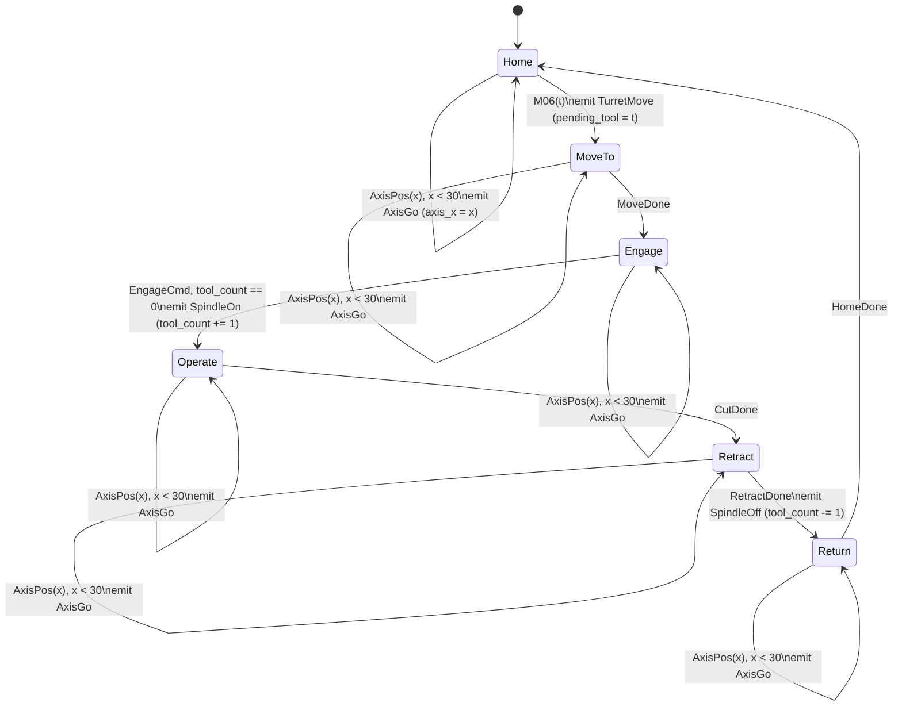

# cnc_tool_change - a CNC tool-change cycle FSM

## What it demonstrates
- A machining center: home -> move-to -> engage -> operate/cut -> retract -> return, the M06 tool-change cycle with joint limits and collision guards. The tool-in-spindle count is bit<2> (the SINGLE-TOOL GUARD keeps it at most 1: a second EngageCmd is honored only when the spindle is empty), the pending tool index is bit<3> (8 turret positions), and the axis position is scaled to bit<5> with a soft limit of 30 (the full-resolution axis space would blow the state budget, noted simplification). RFS features: a mutual-exclusion invariant over an output-anchored counter, an ordering invariant pinning the M06 handler, and a soft-limit invariant on the axis position.
- The automaton is drawn from real machining-center M06 tool-change logic (turret index, spindle engage/retract, homing before motion, axis soft limits). Rationale: machine-tool interlocks - "exactly one tool in the spindle" is the canonical mutual-exclusion-over-time invariant for a physical machine.

## The machine


## RFS modes demonstrated
### Specification & analysis (`rfs validate`, `rfs info`)
The spec parses and validates; `rfs info` reports the 6 states, 7 events, 4 outputs,
the three variables, and the three monitored properties. Rationale: the analysis gate
that runs before any codegen/MC.

### Model checking - in-process (`rfs mc-ref`, exact)
`pass.rfs` model-checks to **PASS complete** (1440 states): `one_tool_engaged` holds -
the SpindleOn emission is guarded by `tool_count == 0` in both the Engage and Operate
states, so the counter never reaches 2; `home_before_motion` holds - an M06 request is
honored by exactly one transition (the Home one) and always lands the machine in MoveTo,
an M06 anywhere else is unhandled and terminates the path; `axis_in_limits` holds - every
AxisPos update is accepted only below the soft limit of 30. The negative variant
`fail.rfs` removes the single-tool guard from both engage transitions - so a pinned
**property-violation** CE on `one_tool_engaged` at step 4 shows M06, MoveDone, an
EngageCmd (tool_count 0->1), and a SECOND EngageCmd in Operate that emits SpindleOn with
`tool_count == 2`; `fixed.rfs` restores the guard and re-runs to PASS.

### Model checking - generated binaries (rust + c)
Both backends' MC binaries are generated, compiled, and run in exact mode; their reports
are **byte-identical** to each other and to mc-ref. The failing variant's CE is identical
across all three engines. Rationale: the production-identical engine must agree with the
in-process reference on both the positive proof and the negative counterexample.

### Production code generation (rust + c)
`rfs codegen rust production` and `rfs codegen c production` both compile the FSM
warning-free - the generated-C compiler-agnosticism bar. Rationale: a machine-tool
interlock cycle compiles to shippable CNC controller firmware in both backends.

## Files layout
| File | Role |
|---|---|
| `pass.rfs` | the valid tool-change FSM (single-tool guard + home ordering + soft limits) |
| `fail.rfs` | single-tool guard removed (double-engage defect) |
| `fixed.rfs` | the corrected spec (= pass.rfs) |
| `run.sh` | drives every demonstrated RFS mode |
| `captures/` | pinned outputs (text + JSON CEs) |

## Build / run / test
Prerequisite: the rfs toolchain built (`cargo build`) or `RFS_BIN` set; rustc + gcc available.
```sh
./run.sh
```

## Expected results
- `rfs validate pass.rfs` -> ok; `rfs info` lists 6 states / 7 events / 4 outputs.
- mc-ref on `pass.rfs`: `status=pass-complete states=1440 transitions=46320 max_depth=7`.
- mc-ref on `fail.rfs`: exit 1, `reason=property-violation label=one_tool_engaged step=4`;
  the CE shows M06(t=0), MoveDone, EngageCmd (tool_count 0->1), then a second EngageCmd in
  Operate that emits SpindleOn with `tool_count: 2`. The JSON form carries the same
  label/step.
- mc-ref on `fixed.rfs`: PASS complete again; both generated backends agree byte-for-byte.
- Production codegen compiles clean (rust) and warning-free (c).
- What to pay attention to: the axis position is scaled to bit<5> with a soft limit of 30
  so exact MC stays fast (noted simplification per the phase plan's discrete-layer rule).
  The `home_before_motion` property is stated over the post-transition sample - RFS
  properties observe the configuration a transition LANDS in, so "M06 only from Home" is
  pinned as "every honored M06 lands in MoveTo" (its unique destination); an M06 in any
  other state is unhandled and terminates the path without producing a violating sample.
