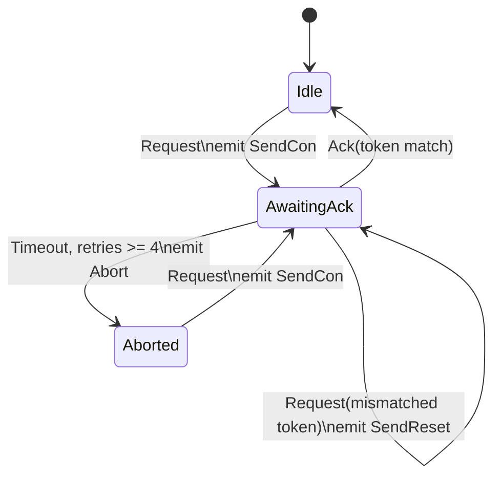

# coap_retransmit - a CoAP confirmable exchange with bounded retransmission

## What it demonstrates
- A CoAP (RFC 7252) confirmable-exchange machine: CON sent, ACK awaited, retransmission with a bounded retry count (the exponential backoff is abstracted to the retry counter), RESET on a mismatched token, and abort once the retry cap is reached. RFS features: guarded transitions with token patterns, a bit-vector retry counter, a bounded-liveness property under an environment assumption, and `--mode fuzz` random testing.
- The automaton is drawn from the real CoAP reliability mechanism (RFC 7252 section 4.2); the backoff schedule is abstracted to a retry count so exact model checking stays feasible.

## The machine


## RFS modes demonstrated
### Specification & analysis (`rfs validate`, `rfs info`)
The spec parses and validates; `rfs info` reports the 3 states, 3 events, 3 outputs,
the two variables, the monitored `ack_or_abort` property, and the `env_timeout`
assumption. Rationale: the analysis gate that runs before any codegen/MC.

### Model checking - in-process (`rfs mc-ref`, exact)
`pass.rfs` model-checks to **PASS complete** (13058 states): under the assumption that a
Timeout arrives within every 3 samples, every exchange ends - an ACK is received or the
retry cap aborts it (`ack_or_abort`). The negative variant `fail.rfs` removes the retry
cap, so a lost ACK loops forever - a pinned **property-violation** CE on `ack_or_abort`
(trigger step 1, violation step 16: the exchange retransmits and absorbs mismatched
requests indefinitely, never reaching Idle or Aborted); `fixed.rfs` restores the cap and
re-runs to PASS.

### Model checking - generated binaries (rust + c)
Both backends' MC binaries are generated, compiled, and run in exact mode; their reports
are **byte-identical** to each other and to mc-ref. The failing variant's CE is identical
across all three engines.

### Production code generation (rust + c)
`rfs codegen rust production` and `rfs codegen c production` both compile the FSM
warning-free - the generated-C compiler-agnosticism bar. Rationale: a real reliability
machine compiles to shippable code in both backends.

### Random testing (`rfs mc-ref --mode fuzz`)
The passing spec is also driven by 200 seeded random runs (up to 5 steps each, seed 7):
random request/ack/timeout sequences with no violation - the transcript is pinned so a
regression that lets an exchange stall is caught. Rationale: fuzzing complements the
exhaustive proof on the same spec.

## Files layout
| File | Role |
|---|---|
| `pass.rfs` | the valid CoAP exchange machine |
| `fail.rfs` | retry cap removed (lost-ACK infinite-loop defect) |
| `fixed.rfs` | the corrected spec (= pass.rfs) |
| `run.sh` | drives every demonstrated RFS mode |
| `captures/` | pinned outputs (text + JSON CEs, fuzz transcript) |

## Build / run / test
Prerequisite: the rfs toolchain built (`cargo build`) or `RFS_BIN` set; rustc + gcc available.
```sh
./run.sh
```
`cargo test --test example_projects_test coap_retransmit` re-runs it and pins the excerpts.

## Expected results
- pass.rfs: PASS complete (13058 states); ack_or_abort holds under env_timeout.
- fail.rfs: FAIL, `reason=property-violation label=ack_or_abort step=16` - the exchange never ends (retransmit loop).
- fixed.rfs: PASS complete.
- fuzz: 200/200 runs clean on pass.rfs.
