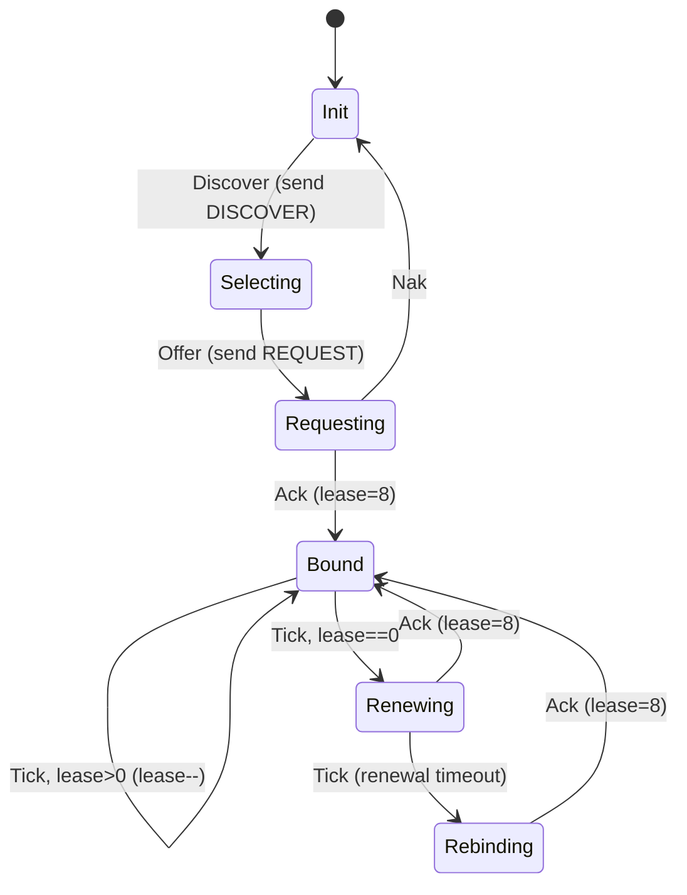

# dhcp_client - DHCP client lease & renewal machine (RFC 2131)

## What it demonstrates
- RFS functionality: specification, analysis (`rfs validate` / `rfs info`), model-checking in-process (`rfs mc-ref` exact), generated MC binaries (rust + c), production codegen (rust + c).
- Rationale: the DHCP client is a timer-driven lease state machine - a clean deadlock example (a lease that expires with no renewal path strands the client) and a demonstration of bounded lease accounting.
- The automaton: INIT -> SELECTING -> REQUESTING -> BOUND, then RENEWING / REBINDING on lease expiry. Drawn from RFC 2131.

## The machine

## RFS modes demonstrated
### Specification & analysis
`rfs validate pass.rfs` + `rfs info pass.rfs`. The spec models the lease lifecycle with a `lease` counter that counts down on Tick and triggers renewal at zero.
### Model checking - in-process (mc-ref exact)
Positive: PASS complete - every path either holds a valid lease or renews/rebinds; `no_request_before_offer` holds. Negative (`fail.rfs`): removing the `Bound on Tick where lease==0 -> Renewing` transition strands the client at BOUND with an expired lease - a pinned DEADLOCK CE. The fix restores the renewal transition.
### Model checking - generated binaries (rust + c)
Both backends agree byte-for-byte on the PASS and the deadlock CE.
### Production code generation (rust + c)
Both compile warning-free.

## Files layout
| File | Role |
|---|---|
| `pass.rfs` | valid spec, model-checks to PASS |
| `fail.rfs` | renewal transition removed -> deadlock at BOUND (lease expired) |
| `fixed.rfs` | the fix (= pass.rfs), re-runs to PASS |
| `run.sh` | drives all demonstrated RFS modes |
| `captures/` | pinned text+JSON CEs, both-backend reports, production proof |

## Build / run / test
Prerequisite: `cargo build` (or `RFS_BIN`). Run `sh run.sh`. Test leg in `tests/example_projects_test.rs`.

## Expected results
- PASS complete on pass.rfs; deadlock CE (reason=deadlock at BOUND, lease==0) on fail.rfs; PASS on fixed.rfs.
- Both backends byte-identical. Production compiles clean/warning-free.
