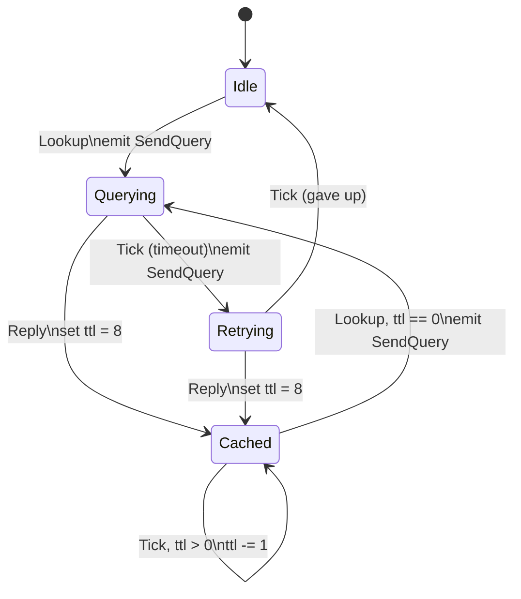

# dns_resolver - a recursive DNS resolver with a TTL cache

## What it demonstrates
- A per-query resolver state machine (RFC 1035): query -> retry(next nameserver) -> timeout, with a TTL cache. RFS features: guarded transitions, a bit-vector TTL var, a safety property, and the large-state-space twin.
- The automaton is drawn from the real DNS resolution process (query, retry on timeout, cache with TTL expiry).

## The machine


## RFS modes demonstrated
### Specification & analysis (`rfs validate`, `rfs info`)
The spec parses and validates; `rfs info` reports the 4 states, 3 events, 2 outputs,
the `ttl` variable, and the monitored `no_stale_serve` property. Rationale: the analysis
gate that runs before any codegen/MC.

### Model checking - in-process (`rfs mc-ref`, exact)
`pass.rfs` model-checks to **PASS complete** (12 states): the safety property
`no_stale_serve : always (output_has(ServeAnswer) -> ttl > 0)` holds - a cached answer is
served only while fresh. The negative variant `fail.rfs` serves regardless of TTL (the
`ttl == 0` re-query arm removed), so a stale entry is served - a pinned **property-violation**
CE on `no_stale_serve` at step 11; `fixed.rfs` restores the guard and re-runs to PASS.

### Model checking - generated binaries (rust + c)
Both backends' MC binaries are generated, compiled, and run in exact mode; their reports
are **byte-identical** to each other and to mc-ref. The failing variant's CE is identical
across all three engines.

### Production code generation (rust + c)
`rfs codegen rust production` and `rfs codegen c production` both compile the FSM
warning-free - the generated-C compiler-agnosticism bar. Rationale: a real resolver
compiles to shippable code in both backends.

### Model checking - large state space (`full.rfs`: smt-bounded + fuzz)
The faithful model holds a 16-bit query key and an 8-bit TTL - the cache content IS the
state, so no meaningful abstraction lowers the state space and exact MC is infeasible. It
is instead checked with `rfs mc-ref --mode smt-bounded --bound 12`, which proves the
native property `no_stale_serve : always (output_has(ServeAnswer) -> ttl > 0)` for every
12-step path (**PASS WITHIN BOUND**, incomplete - no completeness claim), and
`--mode fuzz --runs 200` (random query/expiry sequences, no violations). The twin also
demonstrates the two Phase 18 task-1A smt-bounded extensions end to end: `output_has`
is checked directly (the earlier plain-boolean witness encoding - `served`/
`last_serve_ttl` snapshot vars - is retired), and the reply pattern renames its event
parameter (`Reply(R(rk))` for declared field `rkey`) with the guard referencing the
binding name. Rationale: even very large specifications can be analyzed and checked
with RFS where adequate simplification is impossible.

## Files layout
| File | Role |
|---|---|
| `pass.rfs` | the valid resolver (exact-MC-able, small TTL) |
| `fail.rfs` | serves regardless of TTL (stale-serve defect) |
| `fixed.rfs` | the corrected spec (= pass.rfs) |
| `full.rfs` | the large-state-space twin (16-bit key + 8-bit TTL) |
| `run.sh` | drives every demonstrated RFS mode |
| `captures/` | pinned outputs (text + JSON CEs, smt-bounded verdict, fuzz transcript) |

## Build / run / test
Prerequisite: the rfs toolchain built (`cargo build`) or `RFS_BIN` set; rustc + gcc available.
```sh
./run.sh
```
`cargo test --test example_projects_test dns_resolver` re-runs it and pins the excerpts.

## Expected results
- pass.rfs: PASS complete (12 states); no_stale_serve holds.
- fail.rfs: FAIL, `reason=property-violation label=no_stale_serve` - a stale entry (ttl==0) is served.
- fixed.rfs: PASS complete.
- full.rfs: exact MC infeasible; smt-bounded PASS WITHIN BOUND 12; fuzz runs clean.
