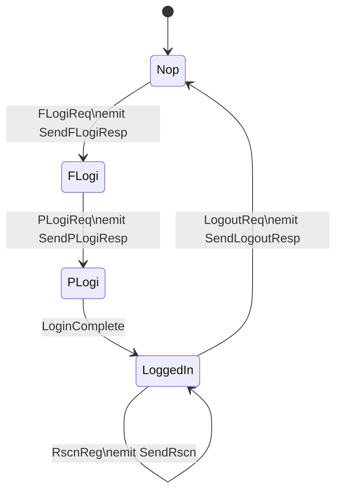

# fibrechannel_login - a Fibre Channel FLOGI/PLOGI login machine

## What it demonstrates
- A Fibre Channel (FC-FS) login machine: NOP -> F_LOGI -> P_LOGI -> logged-in, plus RSCN registration and logout. RFS features: a mutual-exclusion-over-time invariant (at most one logged-in session per port, counted by a bit-vector counter), and clean-logout semantics.
- The automaton is drawn from the real Fibre Channel fabric login protocol (FC-FS FLOGI/PLOGI exchange).

## The machine


## RFS modes demonstrated
### Specification & analysis (`rfs validate`, `rfs info`)
The spec parses and validates; `rfs info` reports the 4 states, 5 events, 4 outputs,
the `logins` counter, and the monitored `single_logged_in` property. Rationale: the
analysis gate that runs before any codegen/MC.

### Model checking - in-process (`rfs mc-ref`, exact)
`pass.rfs` model-checks to **PASS complete** (4 states): `single_logged_in` holds - at
most one P_LOGI is ever accepted per port, and logout clears the count. The negative
variant `fail.rfs` removes the state guard, so a second P_LOGI is accepted while already
logged in - a pinned **property-violation** CE on `single_logged_in` at step 4 (logins
reaches 2); `fixed.rfs` restores the guard and re-runs to PASS.

### Model checking - generated binaries (rust + c)
Both backends' MC binaries are generated, compiled, and run in exact mode; their reports
are **byte-identical** to each other and to mc-ref. The failing variant's CE is identical
across all three engines.

### Production code generation (rust + c)
`rfs codegen rust production` and `rfs codegen c production` both compile the FSM
warning-free - the generated-C compiler-agnosticism bar. Rationale: a real fabric-login
machine compiles to shippable code in both backends.

## Files layout
| File | Role |
|---|---|
| `pass.rfs` | the valid FLOGI/PLOGI login machine |
| `fail.rfs` | state guard removed (duplicate-login defect) |
| `fixed.rfs` | the corrected spec (= pass.rfs) |
| `run.sh` | drives every demonstrated RFS mode |
| `captures/` | pinned outputs (text + JSON CEs) |

## Build / run / test
Prerequisite: the rfs toolchain built (`cargo build`) or `RFS_BIN` set; rustc + gcc available.
```sh
./run.sh
```
`cargo test --test example_projects_test fibrechannel_login` re-runs it and pins the excerpts.

## Expected results
- pass.rfs: PASS complete (4 states); single_logged_in holds.
- fail.rfs: FAIL, `reason=property-violation label=single_logged_in step=4` - logins reaches 2 (second P_LOGI accepted while logged in).
- fixed.rfs: PASS complete.
