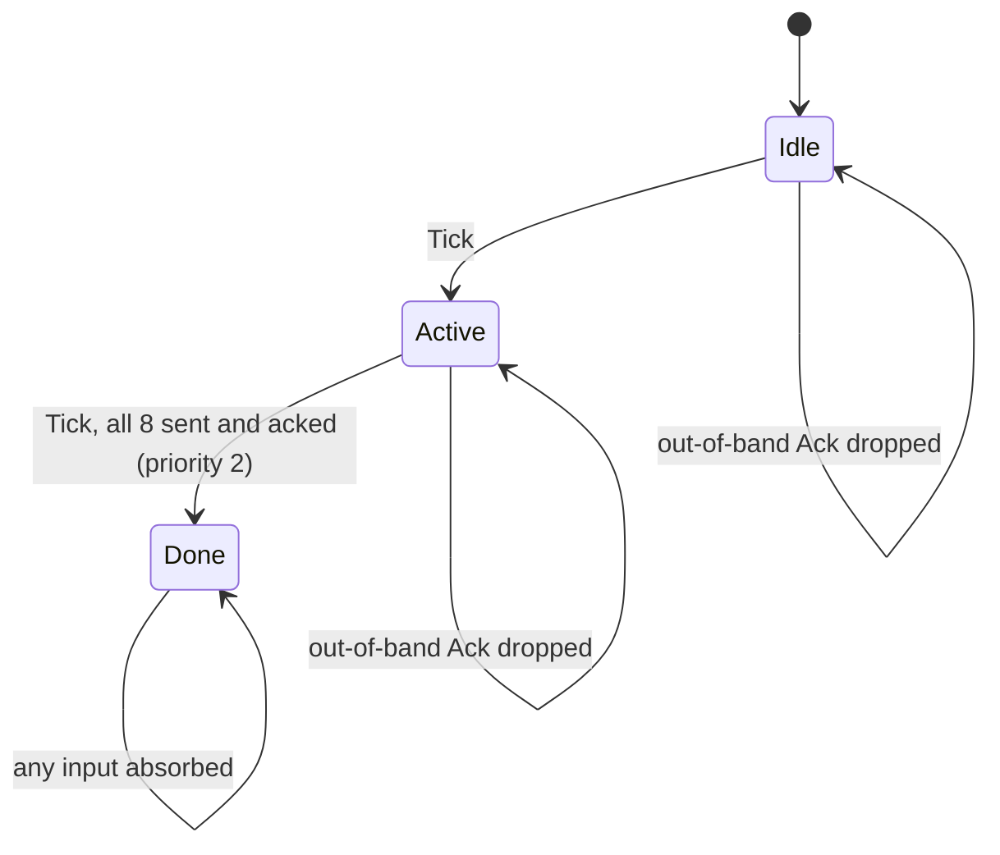

# fuzz_c - clang + libFuzzer harness for the emitted spec-43 skeleton

## What it demonstrates

- **The C side of the fuzz matrix** ([INTEGRATION.md section 5](../../../docs/user/INTEGRATION.md#5-running-generated-tests-in-ci-rfs-test)): wires the `fuzz_target.c` skeleton EMITTED by `rfs codegen c test` into a buildable libFuzzer target - the C counterpart of fuzz_rust.
- **The shared decode plan in C**: the skeleton decodes fuzzer bytes as first byte = input-variant selector, then bool/bit<4>/bit<32> fields, and loops them over `fsm_step` with the stop-on-assumption-violation handler.
- **Generation vs build tooling split**: generation needs ONLY the rfs toolchain; BUILDING needs a libFuzzer-enabled clang. The skeleton references the fsm through its header (not by source-including the .c).

Rationale: fuzz_rust shows the Rust/cargo-fuzz shape; this proves the EMITTED
C skeleton is a real, buildable libFuzzer target - the generated decode table
always matches the current spec's input/output shapes, with no hand-maintained
fuzz harness to drift.

The automaton itself: the **sliding-window ARQ sender** (spec 43,
[examples/valid/43_sliding_window.rfs](../../../examples/valid/43_sliding_window.rfs)) -
drawn from the real ARQ retransmission protocol. A sender with a window of 4
over sequence numbers 0..8; time is modeled by `Tick`; on each tick the sender
either sends the next frame (while there is room in the window) or the receiver
acknowledges the oldest unacked frame. Three states (`Idle`, `Active`, `Done`),
two events (`Tick`, `Ack(Seq(seq, checksum))`), two outputs (`SendFrame`,
`RecvAck`), two vars (`next_seq`, `acked`). The fuzz target feeds it random
`Tick` / `Ack` sequences.

## The machine



The fuzz target's relationship to this FSM: every decoded byte sequence is a
stream of `Tick` / `Ack` inputs stepped through the machine above via
`fsm_step`; an input with no enabled transition is rejected as an unexpected
event (never a crash).

## Files layout

| File | Role |
|---|---|
| `Makefile` | generation + clang build + bounded smoke run |
| `build/` (generated, not checked in) | `rfs_generated_fsm.h` + `rfs_generated_fsm.c` (the production FSM pair, under the exact names the skeleton's `#include` expects), `fuzz_target.c` (the emitted skeleton - a named slot of the `test` command) and `spec_test.c` (the test executable source the same command co-emits; unused by this example) |

## Build / run / test

**Generation works without clang; building does not.** The build recipe is a
libFuzzer-enabled clang compiling BOTH sources together (the skeleton
references the fsm through its header):

```sh
clang -O1 -fsanitize=fuzzer,address -I. -o fuzz_target build/rfs_generated_fsm.c build/fuzz_target.c
```

From the repository root, after `cargo build` (or with `RFS_BIN` set):

```sh
cd crates/examples/fuzz_c
make RFS_BIN=$PWD/../../../target/debug/rfs   # or: export RFS_BIN=...
./fuzz_target -max_total_time=10              # bounded smoke run
```

If `clang` is absent, `make generate` still works and `make` fails at the build
step with clang's own diagnostic (no graceful degradation). Install per
`TOOLCHAIN.md` (or set `CLANG=/path/to/clang`).

## Expected results

- The target exits 0 when the time budget elapses without a crash; a non-zero
  exit means libFuzzer found a crashing input (it is kept under `crash-*`).
- What to pay attention to: on this spec every decoded input sequence is either
  accepted by the FSM or rejected as an unexpected event - the generated
  `fsm_step` never crashes, so bounded runs exit 0. The run target is a bounded
  SMOKE run (`-max_total_time=10`); a real fuzz campaign is user work, not a
  build target.
