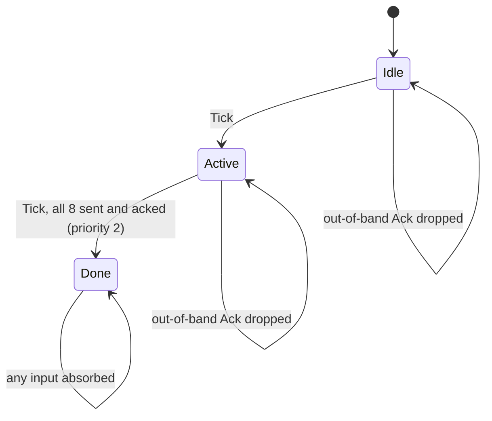

# fuzz_rust - cargo-fuzz harness for the generated ARQ sender

## What it demonstrates

- **The emitted libfuzzer_sys skeleton** ([INTEGRATION.md section 5](../../../docs/user/INTEGRATION.md#5-running-generated-tests-in-ci-rfs-test)): wires the `fuzz_target.rs` extra file of the `test` codegen command to the generated spec-43 sliding-window ARQ sender - the fuzz target is GENERATED, not hand-written.
- **The cargo-fuzz layout** (cargo-fuzz convention): the root crate (`src/lib.rs`) is a plain lib holding the generated PRODUCTION FSM (build.rs generates it via rfs-build and pulls it in with `include!`); `fuzz/` is a DETACHED cargo-fuzz workspace (its own `[workspace]` table - not a member of this repository's workspace, never built by the outer `cargo test --workspace`); `fuzz/fuzz_targets/arq.rs` is the emitted skeleton, adapted by build.rs (`use crate::{...}` -> `use fuzz_rust::{...}`) and gitignored (a build artifact, not a mapped file).
- **The shared decode plan**: the fuzz target decodes bytes as first byte = input variant selector; bool = non-zero byte; bit<W> = ceil(W/8) masked LE bytes - and steps the FSM until the input is exhausted.

Rationale: sync_handler / async_handler / c_sync_handler drive the machine with
a SCRIPTED peer. This drives it with ARBITRARY fuzzer-generated input - the
shape for finding unexpected-input handling bugs and proving the generated
`step` never panics on any byte sequence.

The automaton itself: the **sliding-window ARQ sender** (spec 43,
[examples/valid/43_sliding_window.rfs](../../../examples/valid/43_sliding_window.rfs)) -
drawn from the real ARQ retransmission protocol. A sender with a window of 4
over sequence numbers 0..8; time is modeled by `Tick`; on each tick the sender
either sends the next frame (while there is room in the window) or the receiver
acknowledges the oldest unacked frame. Three states (`Idle`, `Active`, `Done`),
two events (`Tick`, `Ack(Seq(seq, checksum))`), two outputs (`SendFrame`,
`RecvAck`), two vars (`next_seq`, `acked`). The fuzz target feeds it random
`Tick` / `Ack` sequences.

## The machine



The fuzz target's relationship to this FSM: every decoded byte sequence is a
stream of `Tick` / `Ack` inputs stepped through the machine above; an input
with no enabled transition is rejected as an unexpected event (never a panic).

## Files layout

| File | Role |
|---|---|
| `Cargo.toml` | root-crate manifest (a plain lib) - NOT a fuzz workspace |
| `build.rs` | step 1: generate the production FSM into the lib body (the shared strip pattern); step 2: run the TEST codegen command and adapt the emitted skeleton (`use crate::{` -> `use fuzz_rust::{`, asserted), writing it to fuzz/fuzz_targets/arq.rs |
| `src/lib.rs` | the root lib: `pub use arq::*` re-exports the generated module so the adapted skeleton resolves against it |
| `fuzz/Cargo.toml` | the DETACHED cargo-fuzz workspace (empty `[workspace]` + `[package.metadata] cargo-fuzz = true`; libfuzzer-sys 0.4; depends on fuzz_rust by path) |
| `fuzz/fuzz_targets/arq.rs` | the adapted emitted skeleton - a git-ignored BUILD ARTIFACT, not tracked |

## Build / run / test

```sh
# from crates/examples/fuzz_rust (needs the rfs toolchain built first: cargo build at repo root, or RFS_BIN)
cargo install cargo-fuzz        # one-time; not needed for `cargo check`
cargo fuzz run arq -- -max_total_time=10
```

- `cargo check` in `fuzz/` type-checks the adapted skeleton against the
  generated module WITHOUT a fuzzer runtime (the libFuzzer runtime is only
  needed at link time) - that is what the repository test suite verifies.
- Building the actual fuzzer binary needs the libFuzzer runtime (a
  libFuzzer-enabled clang); see `TOOLCHAIN.md`.

## Expected results

- Bounded runs (`-max_total_time`) exit 0 on this spec: every decoded input
  sequence is either accepted by the FSM or rejected as an unexpected event -
  the generated `step` never panics, so no crash is reachable through this
  interface.
- What to pay attention to: the fuzz target is GENERATED (the `test` command's
  emitted skeleton), so it always matches the current spec's input/output
  shapes - there is no hand-maintained decode table to drift. A non-zero exit
  would mean libFuzzer found a crashing input (kept under `crash-*`).
