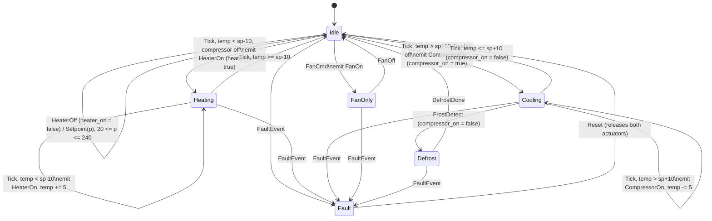

# hvac_thermostat - an HVAC thermostat control machine

## What it demonstrates
- A thermostat: idle -> heating -> cooling -> fan-only -> defrost -> fault, with hysteresis bands around the setpoint (heat below setpoint-10, cool above setpoint+10). The actuator delay is modelled as a per-tick step (+5 heating / -5 cooling), so each mode holds its side of the setpoint. The MODE-EXCLUSION guards are the safety core: the compressor cannot start while the heater is still energised (and vice versa) - the heater stays on until an explicit `HeaterOff`, so a setpoint change that flips the band while the heater runs must wait, never open both valves. Defrost engages only from cooling on a `FrostDetect` (a frozen evaporator). RFS features: mutual exclusion of opposing actuators over witness vars, hysteresis-band invariants, and a gated defrost entry.
- The automaton is drawn from real thermostat control logic (dead-band hysteresis, actuator interlocks, evaporator defrost). Rationale: a classic hysteresis-control teaching example whose key invariant - never heat and cool at once - is exactly what a missing exclusion guard breaks.

## The machine


## RFS modes demonstrated
### Specification & analysis (`rfs validate`, `rfs info`)
The spec parses and validates; `rfs info` reports the 6 states, 9 events, 3 outputs,
the four variables, and the four monitored properties. Rationale: the analysis gate
that runs before any codegen/MC.

### Model checking - in-process (`rfs mc-ref`, exact)
`pass.rfs` model-checks to **PASS complete** (71103 states): `no_simultaneous_heat_cool`
holds - the exclusion guards keep the opposing valves from opening together even when a
setpoint change flips the band while an actuator still runs - `heat_stays_below_setpoint`
and `cool_stays_above_setpoint` hold (each mode holds its side of the setpoint under the
per-tick actuator response: the hysteresis discipline), and `defrost_gated` holds (the
sole entry to Defrost is the FrostDetect). The negative variant `fail.rfs` removes the
mode-exclusion guard, so a setpoint flip while the heater runs opens both valves - a
pinned **property-violation** CE on `no_simultaneous_heat_cool` at step 6 (Setpoint(S(20))
with heater_on=true and temp=205, then a Tick starts cooling: compressor_on=true while
heater_on=true); `fixed.rfs` re-adds the exclusion and re-runs to PASS.

### Model checking - generated binaries (rust + c)
Both backends' MC binaries are generated, compiled, and run in exact mode; their reports
are **byte-identical** to each other and to mc-ref. The failing variant's CE is identical
across all three engines.

### Production code generation (rust + c)
`rfs codegen rust production` and `rfs codegen c production` both compile the FSM
warning-free - the generated-C compiler-agnosticism bar. Rationale: a hysteresis-control
machine with actuator interlocks compiles to shippable thermostat firmware in both
backends.

## Files layout
| File | Role |
|---|---|
| `pass.rfs` | the valid thermostat (exclusion guards + hysteresis bands) |
| `fail.rfs` | mode-exclusion guard removed (simultaneous heat+cool defect) |
| `fixed.rfs` | the corrected spec (= pass.rfs) |
| `run.sh` | drives every demonstrated RFS mode |
| `captures/` | pinned outputs (text + JSON CEs) |

## Build / run / test
Prerequisite: the rfs toolchain built (`cargo build`) or `RFS_BIN` set; rustc + gcc available.
```sh
./run.sh
```

## Expected results
- `rfs validate pass.rfs` -> ok; `rfs info` lists 6 states / 9 events / 3 outputs.
- mc-ref on `pass.rfs`: `status=pass-complete states=71103 transitions=4116028 max_depth=43`.
- mc-ref on `fail.rfs`: exit 1, `reason=property-violation label=no_simultaneous_heat_cool step=6`;
  the CE shows heating (heater_on=true, temp rising to 205), a Setpoint(S(20)) that flips
  the band, and the next Tick opening the compressor while the heater still runs. The JSON
  form carries the same label/step.
- mc-ref on `fixed.rfs`: PASS complete again; both generated backends agree byte-for-byte.
- Production codegen compiles clean (rust) and warning-free (c).
- What to pay attention to: out-of-band setpoints (p < 20 or p > 240) are ignored by a
  guard - besides being realistic, this keeps the band-edge arithmetic (`setpoint - 10`)
  wraparound-free in bit<8>. The blocked-start self-loops make the exclusion observable:
  with the opposing actuator running, the machine WAITS in Idle instead of opening both
  valves. The state count is dominated by the (temperature, setpoint) pair roaming their
  ranges - still fast for exact MC.
