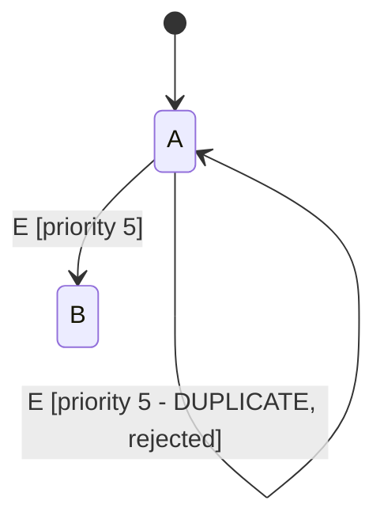

# invalid_spec_diagnosis - reading a validation failure and fixing it (NEGATIVE)

A spec that FAILS semantic validation, the exact diagnostics `rfs validate`
produces (text AND `--json`), what each field means, and the corrected spec
that validates. The negative twin of every other example: here the toolchain
refuses to work at all - and the diagnostic is the deliverable.

## What it demonstrates

- **Semantic validation failure** - not a parse error: the file is syntactically
  perfect RFS, but two transitions from the same state on the same event pattern
  declare the SAME priority. Firing order between them would be undefined, so
  the validator rejects the spec (priorities must be unique per (state, event
  pattern) - [LANGUAGE.md](../../../docs/user/LANGUAGE.md)).
- **Both diagnostic surfaces**: the human-readable stderr line and the
  machine-readable `--json` document that editor integrations consume
  ([INTEGRATION.md](../../../docs/user/INTEGRATION.md)).
- **The fix loop**: change one priority, re-validate, exit 0.

Rationale: users meet validation failures before they meet model-checking
failures; this example teaches the diagnostic vocabulary (`kind`, `line`/`col`,
the message grammar) so a real failure is readable in seconds. The broken spec
is a copy of `examples/invalid/invalid_duplicate_priority.rfs` from the file-
driven corpus (one of the 13 specs that MUST fail validation).

## The machine



Two transitions from `A` on `E`, both priority 5. Without the duplicate rule,
the engine would have to choose between `next B` and `next A` with no defined
order - exactly the ambiguity RFS forbids.

## Files layout

| File | Role |
|---|---|
| `broken.rfs` | the invalid spec (copy of the corpus file) - must fail validation |
| `fixed.rfs` | the corrected spec (self-loop demoted to priority 4) - must validate |
| `README.md` | this walkthrough |

## Build / run / test

No build - two commands:

```sh
rfs validate broken.rfs            # exit 1 + the stderr diagnostic
rfs validate --json broken.rfs     # exit 1 + the JSON document on stdout
rfs validate fixed.rfs             # exit 0 + "valid ..."
```

## Expected results

**`rfs validate broken.rfs`** (exit **1**):

```text
broken.rfs: module 'm' state 'A': duplicate priority 5 for the same event pattern (transitions #0 and #1)
```

**`rfs validate --json broken.rfs`** (exit **1**, stdout):

```json
{
  "file": "broken.rfs",
  "ok": false,
  "errors": [
    {
      "kind": "semantic",
      "line": 0,
      "col": 0,
      "message": "module 'm' state 'A': duplicate priority 5 for the same event pattern (transitions #0 and #1)"
    }
  ]
}
```

What to pay attention to:

- **`kind: "semantic"`** - the parser accepted the file; this is a MEANING error
  (a parse error would carry `kind: "parse"` with real line/col coordinates).
- **`line: 0, col: 0`** - semantic errors are MODULE-level, not token-level:
  the duplicate-priority rule compares two transitions, so there is no single
  offending token. The message itself names the state (`'A'`), the priority
  (5) and the transition indices (#0 and #1) - that IS the location.
- **The message grammar** - `module '<m>' state '<s>': <rule violation>`: every
  semantic diagnostic follows this shape, so you can grep for your module/state
  name in larger specs.

**The fix.** Give the two transitions DIFFERENT priorities. `fixed.rfs` demotes
the self-loop to priority 4: when both are enabled, transition #0 (priority 5)
fires first; the self-loop fires only as the sole enabled match. Re-running:

```sh
$ rfs validate fixed.rfs
valid fixed.rfs        # exit 0
```

**Possible fixes in general.** For a duplicate priority: change EITHER priority
(the relative order you choose IS the semantics - document it in a comment), or
remove one transition if it is redundant, or split the event pattern (guards /
distinct variants) so the two transitions no longer share a (state, pattern)
key. Re-validate after any of these; the corpus rule is that all 13 invalid
specs keep failing and all valid specs keep passing.
