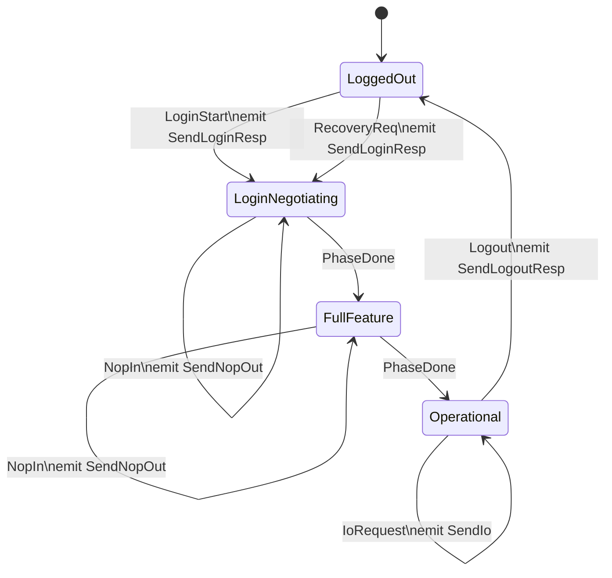

# iscsi_login - an iSCSI login and session state machine

## What it demonstrates
- An iSCSI (RFC 7143 / SPC-4) login + session machine: the login nop-in/nop-out exchange, the full-feature negotiation phase, then the operational phase where I/O flows; logout and session recovery. RFS features: a staged-negotiation phase machine, an ordering-safety property (no I/O before operational), and a clean-logout invariant.
- The automaton is drawn from the real iSCSI login state machine (RFC 7143 section 3.3); it is the storage-protocol analog of the PPP staged-negotiation pattern.

## The machine


## RFS modes demonstrated
### Specification & analysis (`rfs validate`, `rfs info`)
The spec parses and validates; `rfs info` reports the 4 states, 6 events, 4 outputs,
the two variables, and the two monitored properties. Rationale: the analysis gate that
runs before any codegen/MC.

### Model checking - in-process (`rfs mc-ref`, exact)
`pass.rfs` model-checks to **PASS complete** (6 states): `no_io_before_operational`
holds - I/O flows only once the session is operational - and `no_dangling_session`
holds: a clean logout leaves no session behind. The negative variant `fail.rfs` removes
the phase guard, so I/O is issued in the full-feature phase - a pinned **property-
violation** CE on `no_io_before_operational` at step 3 (IoRequest in FullFeature emits
SendIo); `fixed.rfs` restores the guard and re-runs to PASS.

### Model checking - generated binaries (rust + c)
Both backends' MC binaries are generated, compiled, and run in exact mode; their reports
are **byte-identical** to each other and to mc-ref. The failing variant's CE is identical
across all three engines.

### Production code generation (rust + c)
`rfs codegen rust production` and `rfs codegen c production` both compile the FSM
warning-free - the generated-C compiler-agnosticism bar. Rationale: a real storage-
protocol login machine compiles to shippable code in both backends.

## Files layout
| File | Role |
|---|---|
| `pass.rfs` | the valid iSCSI login + session machine |
| `fail.rfs` | phase guard removed (I/O-in-full-feature defect) |
| `fixed.rfs` | the corrected spec (= pass.rfs) |
| `run.sh` | drives every demonstrated RFS mode |
| `captures/` | pinned outputs (text + JSON CEs) |

## Build / run / test
Prerequisite: the rfs toolchain built (`cargo build`) or `RFS_BIN` set; rustc + gcc available.
```sh
./run.sh
```
`cargo test --test example_projects_test iscsi_login` re-runs it and pins the excerpts.

## Expected results
- pass.rfs: PASS complete (6 states); both properties hold.
- fail.rfs: FAIL, `reason=property-violation label=no_io_before_operational step=3` - SendIo emitted in FullFeature.
- fixed.rfs: PASS complete.
