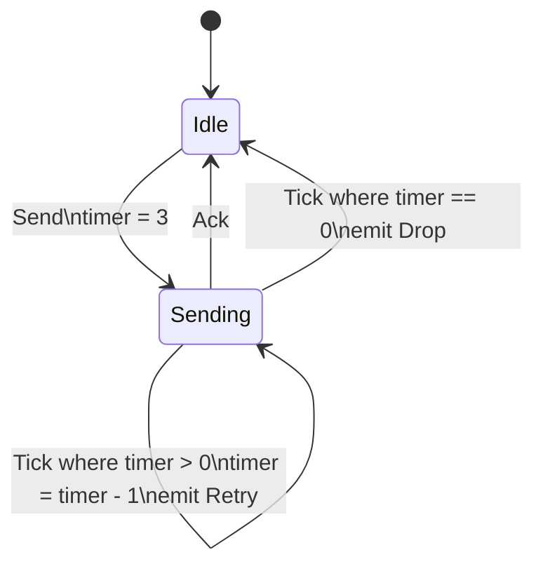
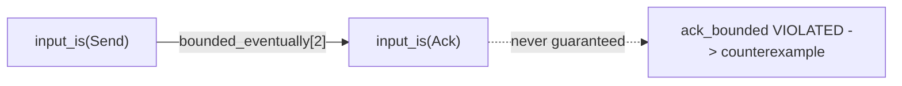

# json_schema_ci - validating real tool output against the JSON schemas

## What it demonstrates

- **Self-describing formats**: every machine-readable document rfs emits has a published JSON schema, obtainable WITHOUT the rfs source via `rfs info format <name> --output schema`. The five formats and their schemas are listed by `rfs info format --list` (the Info command; see [docs/dev/cli_commands.md](../../../docs/dev/cli_commands.md)).
- **CI validation without the toolchain source**: a downstream pipeline can pin a schema, generate (or receive) a document of that kind, and validate it with any JSON-schema validator - here `python3 -m jsonschema`. The rfs binary is only needed to PRODUCE the documents; the schemas are standalone artifacts.
- **The five formats**, each validated against its own schema from a REAL document:

| Format | Real document produced by |
|---|---|
| `spec-json` | `rfs parse --input rfs --output json pass.rfs` (the IR v1 JSON) |
| `mc-report` | `rfs mc-ref fail.rfs --counterexample-format json` (full exact-mode report) |
| `ce-trace` | the `counterexample` object extracted from that mc-report |
| `validate-json` | `rfs validate --json invalid_always_zero_bound.rfs` (one diagnostic object) |
| `info-json` | `rfs info --json pass.rfs` (per-module introspection) |

Rationale: the other examples show rfs driving codegen and model checking. This
shows the DOCUMENT side - that the JSON outputs are stable, schema-published
contracts a CI pipeline can gate on without depending on rfs internals.

The automaton itself: `pass.rfs` is the timeout/retry machine (spec 03, a copy
of [examples/valid/03_timeout_retry.rfs](../../../examples/valid/03_timeout_retry.rfs))
- two states (`Idle`, `Sending`), events `Send`/`Ack`/`Tick`, outputs `Retry`/
`Drop`, var `timer: bit<3>`. `fail.rfs` is the same machine plus one
unsatisfiable obligation (`ack_bounded`), so the mc-report and ce-trace
documents carry a real counterexample. `invalid_always_zero_bound.rfs` is an
INVALID spec (an `always[0]` bound) that produces a real validate-json
diagnostic.

## The machine



`fail.rfs` adds the property that drives the mc-report / ce-trace documents:



## Files layout

| File | Role |
|---|---|
| `pass.rfs` | valid spec (spec 03) - source of the spec-json and info-json documents |
| `fail.rfs` | failing variant - source of the mc-report and ce-trace documents |
| `invalid_always_zero_bound.rfs` | invalid spec - source of the validate-json document |
| `validate.sh` | emit all five schemas, generate one real document per format, validate each with python3 -m jsonschema (availability-gated) |

## Build / run / test

Prerequisites: the rfs toolchain built (`cargo build`) or `RFS_BIN` set; `python3`
with the `jsonschema` module for the validation step (the script skips with a
note and exits 0 if either is absent - it never fails on absence).

```sh
./validate.sh     # emits schemas, generates real documents, validates all five
```

## Expected results

- All five schemas emit (spec-json 24186 bytes, ce-trace 6193, mc-report 8785,
  validate-json 2893, info-json 7507 - sizes drift with toolchain version, the
  VALID verdicts do not).
- Each real document validates: `spec-json: VALID`, `ce-trace: VALID`,
  `mc-report: VALID`, `validate-json: VALID`, `info-json: VALID`, then
  `all five formats validated against their schemas`.
- What to pay attention to:
  - the mc-report and validate-json documents come from commands that EXIT 1
    (a FAIL / an invalid spec) - the script captures stdout regardless of exit
    code, so a "failing" run still yields a valid, schema-conforming document.
  - ce-trace is NOT emitted directly by any command - it is the `counterexample`
    object inside an mc-report. The script extracts it with a two-line python
    snippet, mirroring how a CI consumer would slice a report down to its trace.
- **Wiring into CI**: commit (or fetch) the five schemas, run your pipeline
  step that produces a document of one kind, then `python3 -m jsonschema -i
  doc.json schema.json`. A schema violation fails the build; no rfs source is
  needed at validation time.
