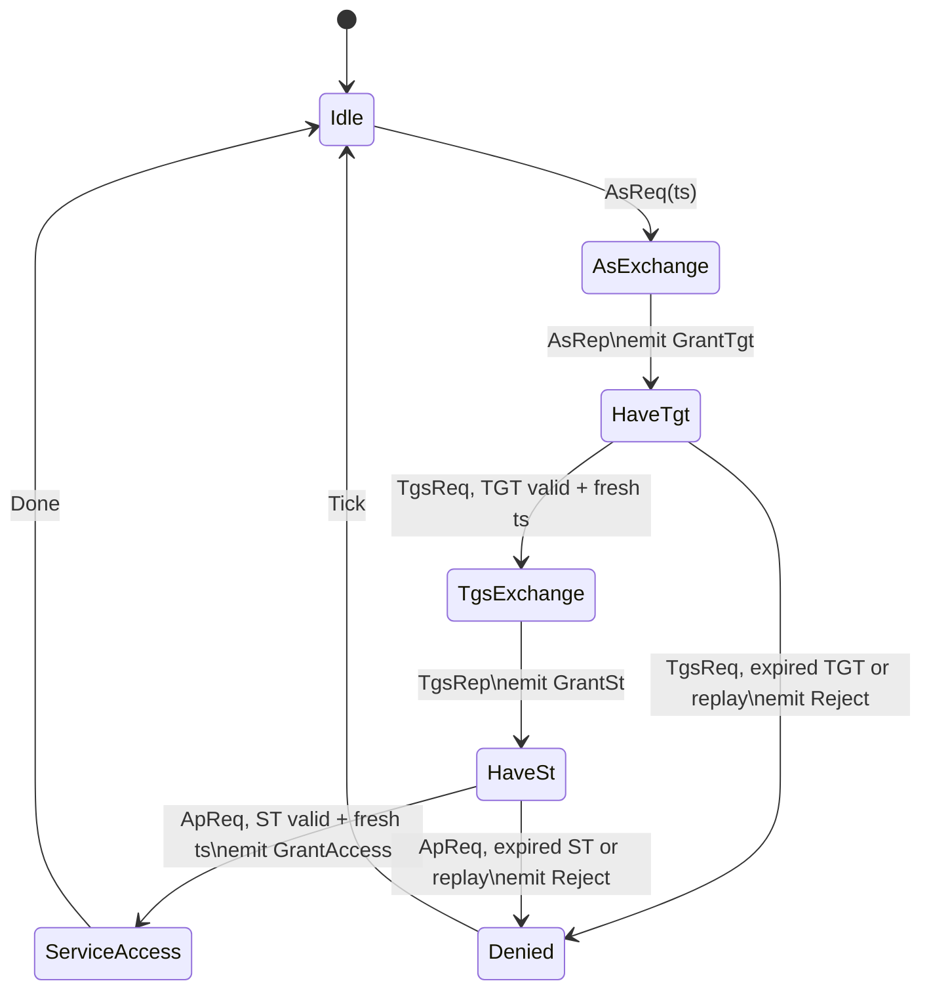

# kerberos_auth - a Kerberos authentication state machine

## What it demonstrates
- A Kerberos (RFC 4120) authentication machine: AS-REQ/AS-REP (obtain TGT), TGS-REQ/TGS-REP (obtain service ticket), AP-REQ/AP-REP (service access). The clock advances on Tick; the TGT and service ticket carry expiry timestamps, and a replay cache rejects a repeated authenticator timestamp. RFS features: staged credential chaining with expiry guards, a replay-cache invariant, and atomic-exchange modelling.
- The automaton is drawn from the real Kerberos ticket-granting flow. Time is abstracted to bit<3> (the TGT lives 6 ticks, the service ticket 4) so exact model checking stays feasible - the real protocol's hour-scale lifetimes are the same machine at a coarser clock. The AS and TGS exchanges are atomic at this abstraction level (no Tick inside them), so an expiry checked at request time still holds at grant time.

## The machine

(Tick self-loops advance the clock in Idle/HaveTgt/HaveSt/ServiceAccess/Denied.)

## RFS modes demonstrated
### Specification & analysis (`rfs validate`, `rfs info`)
The spec parses and validates; `rfs info` reports the 7 states, 7 events, 4 outputs,
the eight variables, and the two monitored properties. Rationale: the analysis gate
that runs before any codegen/MC.

### Model checking - in-process (`rfs mc-ref`, exact)
`pass.rfs` model-checks to **PASS complete** (30720 states): `no_access_with_expired_tgt`
holds - a service ticket is granted only on an unexpired TGT - and `no_replay` holds:
no grant follows a repeated authenticator timestamp. The negative variant `fail.rfs`
removes the expiry guard, so a service request is accepted with an expired TGT - a
pinned **property-violation** CE on `no_access_with_expired_tgt` at step 6 (TgsRep
emits GrantSt with tgt_expiry=0 <= clock=2); `fixed.rfs` restores the guard and re-runs
to PASS.

### Model checking - generated binaries (rust + c)
Both backends' MC binaries are generated, compiled, and run in exact mode; their reports
are **byte-identical** to each other and to mc-ref. The failing variant's CE is identical
across all three engines.

### Production code generation (rust + c)
`rfs codegen rust production` and `rfs codegen c production` both compile the FSM
warning-free - the generated-C compiler-agnosticism bar. Rationale: a real credential-
chaining machine compiles to shippable code in both backends.

## Files layout
| File | Role |
|---|---|
| `pass.rfs` | the valid authentication machine (bit<3> time) |
| `fail.rfs` | expiry guard removed (expired-TGT access defect) |
| `fixed.rfs` | the corrected spec (= pass.rfs) |
| `run.sh` | drives every demonstrated RFS mode |
| `captures/` | pinned outputs (text + JSON CEs) |

## Build / run / test
Prerequisite: the rfs toolchain built (`cargo build`) or `RFS_BIN` set; rustc + gcc available.
```sh
./run.sh
```
`cargo test --test example_projects_test kerberos_auth` re-runs it and pins the excerpts.

## Expected results
- pass.rfs: PASS complete (30720 states); both properties hold.
- fail.rfs: FAIL, `reason=property-violation label=no_access_with_expired_tgt step=6` - GrantSt emitted with tgt_expiry <= clock.
- fixed.rfs: PASS complete.
