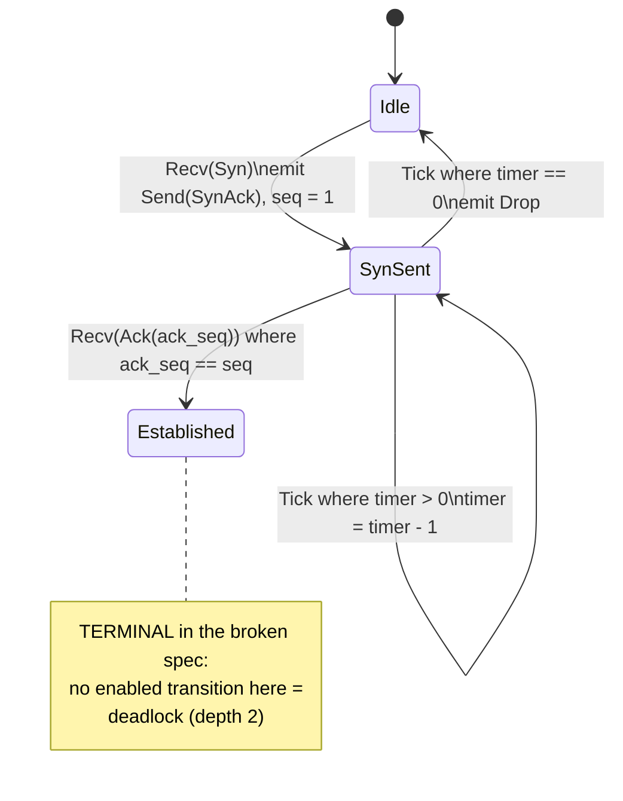
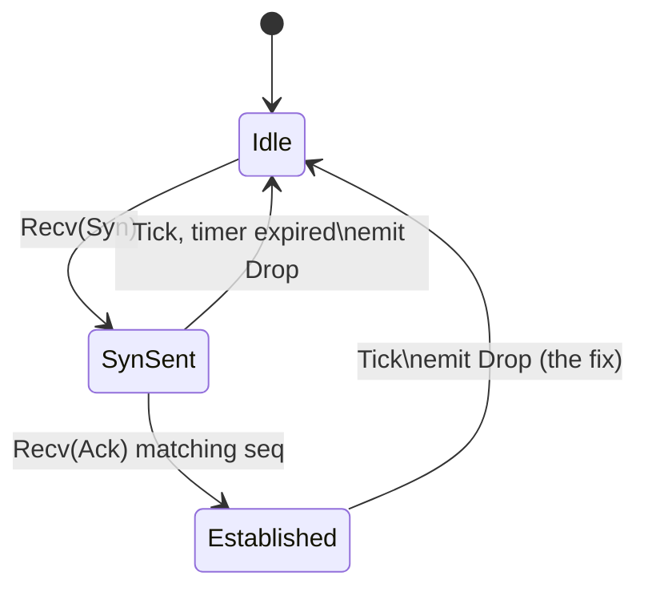

# mc_deadlock_fail - a valid spec that model checking FAILS (deadlock)

A NEGATIVE example: the spec is perfectly valid (it parses and validates), but
exact model checking proves it DEADLOCKS - and this directory walks the
counterexample trace step by step, then shows the one-transition fix with the
re-run proof.

## What it demonstrates

- A spec can be VALID and still FAIL model checking - validation checks the
  language rules, MC checks the BEHAVIOR ([LANGUAGE.md](../../../docs/user/LANGUAGE.md)).
- The `deadlock` failure reason: a reachable configuration with NO enabled
  transition - the machine is stuck forever ([MODEL_CHECKING.md section 5](../../../docs/user/MODEL_CHECKING.md#5-status-taxonomy-and-labeling-guarantees)).
- Reading a deadlock counterexample: the trace ends at the stuck configuration;
  there is no cycle (that would be a liveness failure) - just a dead end.
- The fix discipline: derive the fix FROM the trace, and re-run to prove it.

The automaton itself: a TCP-handshake-like endpoint (drawn from the real TCP
connection setup), simplified to three states. `Idle` waits for a `Syn`, replies
with `SynAck` and moves to `SynSent`; there, a matching `Ack` completes the
handshake into `Established`, while a countdown `timer` (7 ticks) aborts back to
`Idle` with a `Drop`. Properties: every `Syn` input must produce a `SynAck`
output (`syn_ack`), and `SynSent` must not persist more than 10 steps
(`timeout_progress`); the environment is assumed to tick within 5 steps
(`env_tick`).

**The bug:** `Established` has NO outgoing transition. Once the handshake
completes, nothing is ever enabled again - a deadlock at depth 2.

## The machine



The fix adds ONE transition out of the dead end:



A `Recv(Syn)`-based reset would NOT work: `prop syn_ack` requires a `Send(SynAck)`
output on EVERY `Recv(Syn)` input, so the teardown must use a different event -
`Tick` does, and the `env_tick` assumption guarantees it arrives.

## Files layout

| File | Role |
|---|---|
| `04_tcp_handshake_like.rfs` | the BROKEN spec (a copy of [examples/valid/04_tcp_handshake_like.rfs](../../../examples/valid/04_tcp_handshake_like.rfs)) - valid, but deadlocks |
| `fixed.rfs` | the corrected spec: one added transition (`Established on Tick -> Idle`, emitting `Drop`) |

## Build / run / test

No build files - this is a spec-level example. Prerequisite: the `rfs`
toolchain built (`cargo build` at the repo root) or on PATH.

```sh
# the failure (exit 1):
rfs mc-ref 04_tcp_handshake_like.rfs
# the same failure from BOTH generated backends (byte-identical reports):
rfs codegen rust mc 04_tcp_handshake_like.rfs --out-mc-code mc.rs --fsm-file fsm.rs
rustc --edition 2021 mc.rs -o mc && ./mc            # FAIL, exit 1
rfs codegen c mc 04_tcp_handshake_like.rfs --out-mc-header mc.h --out-mc-code mc.c \
    --fsm-file-header fsm.h --fsm-file-source fsm.c
gcc -Wall -c fsm.c -o fsm.o && gcc -Wall -c mc.c -o mc.o && gcc -Wall fsm.o mc.o -o mc-c && ./mc-c   # FAIL, exit 1
# the fix (exit 0):
rfs mc-ref fixed.rfs                                # PASS (complete), 62 states
```

## Expected results

Pay attention to these exact outputs (pinned by the test suite):

The broken spec - all three engines print IDENTICALLY:

```text
FAIL
model-check summary: status=fail states=4 transitions=3 max_depth=2 reason=deadlock label=- step=2
  unexpected terminations: 51
  first unexpected: config 0 input index 1
  monitor size: 9 bits
  memory estimate: 140 bytes
deadlock: configuration at depth 2 has no enabled transition
counterexample trace:
  initial state=State::Idle vars=Vars { seq: 0, timer: 7 }
  step 0 input=Input::Recv_Syn outputs=[Output::Send_SynAck] from=State::Idle to=State::SynSent vars=Vars { seq: 1, timer: 7 }
  step 1 input=Input::Recv_Ack { ack_seq: 1 } outputs=[] from=State::SynSent to=State::Established vars=Vars { seq: 1, timer: 7 }
```

Reading it: `reason=deadlock` + `step=2` - the search reached depth 2 and found
a configuration with no enabled transition. The trace is the PATH to the dead
end: step 0 completes the `Syn`/`SynAck` exchange (note the output), step 1 the
matching `Ack` lands the machine in `Established` - and there the trace STOPS,
because nothing can fire. There is no cycle: a liveness failure would show a
repeating segment, a deadlock just ends.

The JSON form (`rfs mc-ref 04_tcp_handshake_like.rfs --counterexample-format
json`) carries the same information machine-readably:

```json
{"status":"fail","metrics":{"states":4,"transitions":3,"max_depth":2},"reason":"deadlock","label":"-","step":2,"statistics":{"unexpected_terminations":51,"monitor_size_bits":9,"memory_estimate_bytes":140,"peak_rss_kb":0},"counterexample":{"kind":"deadlock-config","depth":2,"state":"State::Established","vars":{"seq":1,"timer":7},"ce_steps":2}}
```

`counterexample.kind` is `deadlock-config`: the stuck configuration itself
(`state`, `vars`, `depth`) rather than a step-by-step trace - both forms name
the same dead end, `State::Established` with `seq: 1, timer: 7`.

The fixed spec:

```text
PASS (complete)
model-check summary: status=pass-complete states=62 transitions=99 max_depth=11
```

Exit codes: broken spec exits **1** on all three engines; the fix exits **0**.
The state count jumps 4 -> 62 because the teardown transition makes `Tick`
reachable in `Established`, opening the full timer/product space - a PASS with
far more explored states is the expected shape of this fix.
