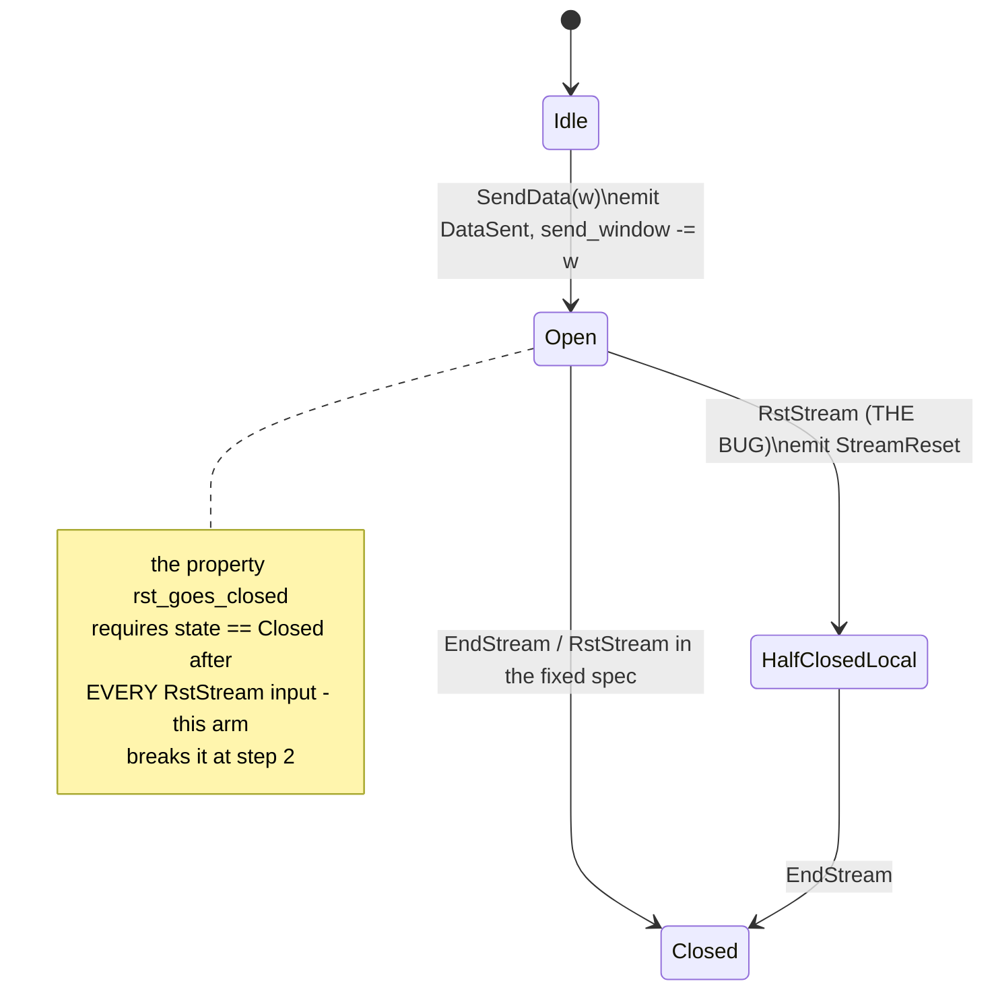

# mc_property_violation_fail - a valid spec that model checking FAILS (property violation)

A NEGATIVE example: the spec is perfectly valid, but exact model checking finds
a concrete input sequence that VIOLATES one of its safety properties - and this
directory walks the counterexample trace step by step, then shows the fix with
the re-run proof.

## What it demonstrates

- The `property-violation` failure reason: a reachable step at which a monitored
  property is false ([MODEL_CHECKING.md section 5](../../../docs/user/MODEL_CHECKING.md#5-status-taxonomy-and-labeling-guarantees)).
- Reading a violation trace: unlike a deadlock (which ends at a dead end), a
  violation trace is a PREFIX - it stops exactly at the step where the property
  breaks, and `label` names WHICH property.
- How a one-line transition retarget breaks a safety invariant - and how the
  trace pinpoints it ([PROPERTIES.md](../../../docs/user/PROPERTIES.md)).

The automaton itself: an HTTP/2-like stream state machine (drawn from the real
HTTP/2 stream lifecycle), simplified. A stream opens on `SendData` (carrying a
window decrement), can be reset by `RstStream`, half-closes in either direction,
and ends in `Closed`. The safety property at issue:

```rfs
prop rst_goes_closed : always (input_is(RstStream) -> state == Closed) ;
```

after processing a `RstStream` input, the stream MUST be in `Closed` - a reset
is terminal. **The bug:** the `Open on RstStream` arm is retargeted to
`HalfClosedLocal` instead of `Closed`, so a reset of an open stream leaves it
half-closed - the property is false at the very step the reset is processed.
This is exactly the one-line mutation the pinned test variant
`http2_rst_fail_src()` applies to the real spec (a guard-overlap mutation would
not work here: RFS priorities fire DESCENDING, so the higher-priority arm keeps
winning - see the variant's doc comment in `tests/common/fail_variants.rs`).

## The machine



(The full spec has more arms - window updates, half-close in both directions -
the diagram shows only the violation-relevant slice.)

## Files layout

| File | Role |
|---|---|
| `47_http2_stream_rst_fail.rfs` | the BROKEN spec: one-line delta from [examples/valid/47_http2_stream.rfs](../../../examples/valid/47_http2_stream.rfs) - the `Open on RstStream` arm retargeted `Closed` -> `HalfClosedLocal` |
| `fixed.rfs` | the corrected spec (= the original example): the arm lands in `Closed` again |

## Build / run / test

No build files - a spec-level example. Prerequisite: the `rfs` toolchain built
or on PATH.

```sh
# the failure (exit 1):
rfs mc-ref 47_http2_stream_rst_fail.rfs
# the fix (exit 0):
rfs mc-ref fixed.rfs
```

## Expected results

Pay attention to these exact outputs (pinned by the test suite):

The broken spec:

```text
FAIL
model-check summary: status=fail states=34 transitions=64 max_depth=2 reason=property-violation label=rst_goes_closed step=2
  unexpected terminations: 69
  first unexpected: config 0 input index 0
  monitor size: 10 bits
  memory estimate: 1190 bytes
property violation: rst_goes_closed
  violation step: 2
  vars at violation step: Vars { send_window: 15 }
counterexample trace:
  initial state=State::Idle vars=Vars { send_window: 16 }
  step 0 input=Input::SendData { w: 1 } outputs=[Output::DataSent] from=State::Idle to=State::Open vars=Vars { send_window: 15 }
  step 1 input=Input::RstStream outputs=[Output::StreamReset] from=State::Open to=State::HalfClosedLocal vars=Vars { send_window: 15 }
```

Reading it: `reason=property-violation` + `label=rst_goes_closed` + `step=2`
- the monitor for that property went false after step 2 (steps are 1-based over
the trace). The trace is a PREFIX, not a dead end: step 0 opens the stream
(`SendData { w: 1 }` decrements `send_window` 16 -> 15 and emits `DataSent`),
step 1 processes `RstStream` - the machine moves to `HalfClosedLocal`, and THAT
is where the property breaks: after a `RstStream` input the state must be
`Closed`, but it is `HalfClosedLocal`. The `vars at violation step` line shows
the variable context (`send_window: 15`) - properties can depend on variables,
so the trace always carries them.

The JSON form (`--counterexample-format json`) uses `counterexample.kind`
`trace` with one entry per step (input variant + fields, outputs, from/to
state, vars) - the same two steps, machine-readable:

```json
{"status":"fail","metrics":{"states":34,"transitions":64,"max_depth":2},"reason":"property-violation","label":"rst_goes_closed","step":2,"statistics":{"unexpected_terminations":69,"monitor_size_bits":10,"memory_estimate_bytes":1190,"peak_rss_kb":0},"counterexample":{"kind":"trace","initial_state":"State::Idle","initial_vars":{"send_window":16},"steps":[{"input":{"variant":"SendData","fields":{"w":1}},"outputs":[{"variant":"DataSent","fields":{}}],"from_state":"State::Idle","to_state":"State::Open","vars":{"send_window":15}},{"input":{"variant":"RstStream","fields":{}},"outputs":[{"variant":"StreamReset","fields":{}}],"from_state":"State::Open","to_state":"State::HalfClosedLocal","vars":{"send_window":15}}],"ce_steps":2}}
```

The fixed spec:

```text
PASS (complete)
model-check summary: status=pass-complete states=434 transitions=21857 max_depth=7
```

Exit codes: broken spec exits **1**, fix exits **0**. The state count jumps
34 -> 434 because the reset now lands in `Closed` (terminal), so the search
explores the full open/half-closed product space instead of stopping early at
the violation - a PASS with many more states is the expected shape of this fix.
