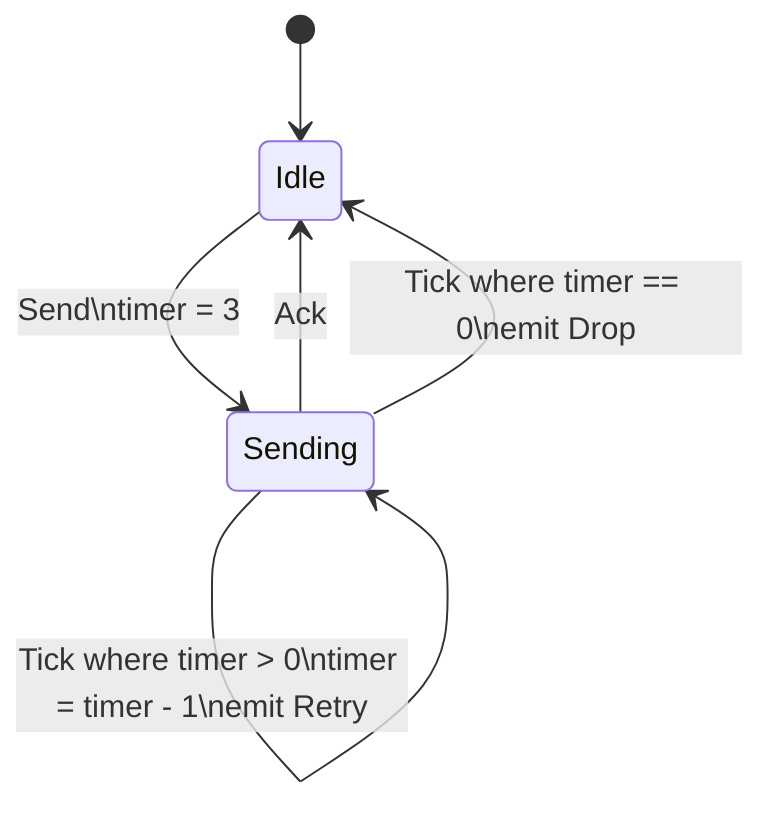
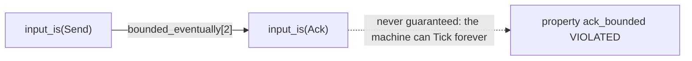

# mc_walkthrough - reading a model-check report end to end

## What it demonstrates

- **Generating MC binaries for BOTH backends** from one spec and proving they agree: `rfs codegen rust|c mc` + compile (rustc / gcc -Wall) + run exact mode. The Rust and C reports are BYTE-IDENTICAL ([MODEL_CHECKING.md](../../../docs/user/MODEL_CHECKING.md)).
- **Reading a PASS report**: every summary field explained - status, states, transitions, max_depth, unexpected terminations, monitor size, memory estimate.
- **Reading a FAIL report**: the property-violation header (label, trigger step, violation step) and the counterexample trace, in BOTH text and JSON (`--counterexample-format json`) ([MODEL_CHECKING.md section 5](../../../docs/user/MODEL_CHECKING.md#5-status-taxonomy-and-labeling-guarantees)).

Rationale: the negative examples (mc_deadlock_fail, mc_property_violation_fail)
show a single failure. This walks a report END TO END on a passing spec AND a
failing variant, so a reader learns what every field means in both outcomes -
the full vocabulary of an MC report.

The automaton itself: the timeout/retry machine (spec 03,
[pass.rfs](pass.rfs) = a copy of
[examples/valid/03_timeout_retry.rfs](../../../examples/valid/03_timeout_retry.rfs)) -
constructed for teaching, pattern drawn from real retransmission timers. Two
states (`Idle`, `Sending`), three events (`Send`, `Ack`, `Tick`), two outputs
(`Retry`, `Drop`), one var (`timer: bit<3>` init 3). The failing variant
([fail.rfs](fail.rfs)) is the SAME machine plus one unsatisfiable obligation:
every `Send` must be answered by an `Ack` within 2 samples - but the machine
can `Send` and then `Tick` forever, so the property can never hold.

## The machine



| From | Event (guard) | To | Effect |
|---|---|---|---|
| Idle | Send | Sending | `timer = 3` |
| Sending | Ack | Idle | - |
| Sending | Tick (`timer > 0`) | Sending | `timer -= 1`, emit `Retry` |
| Sending | Tick (`timer == 0`) | Idle | emit `Drop` |

The failing variant adds one property (no new states/transitions):



## Files layout

| File | Role |
|---|---|
| `pass.rfs` | the passing spec (copy of examples/valid/03_timeout_retry.rfs) |
| `fail.rfs` | the failing variant: same machine + the unsatisfiable `ack_bounded` obligation |
| `run.sh` | generate + compile MC binaries for BOTH backends on both specs, run exact mode, capture text + JSON reports to captures/ |

## Build / run / test

Prerequisites: the rfs toolchain built (`cargo build` at the repo root produces
`target/debug/rfs`) or `RFS_BIN` set; `rustc` and `gcc` resolvable (set `RUSTC`
/`GCC` to explicit paths if they are not on PATH - a cold checkout's project-
local toolchain is not on PATH by default).

```sh
./run.sh          # generates, compiles, runs, and writes captures/
```

## Expected results

- **PASS report** (pass.rfs, identical from both backends):
  ```
  PASS (complete)
  model-check summary: status=pass-complete states=8 transitions=12 max_depth=5
    unexpected terminations: 12
    first unexpected: config 0 input index 1
    monitor size: 0 bits
    memory estimate: 264 bytes
  ```
  What to pay attention to: `unexpected terminations: 12` is NOT a failure - it
  counts (config, input) pairs with no enabled transition (e.g. `Ack` in `Idle`).
  The machine still PASSES because every reachable config has at least one
  enabled transition (no deadlock). `monitor size: 0 bits` - no properties, so
  no online monitors.
- **FAIL report** (fail.rfs, text):
  ```
  FAIL
  model-check summary: status=fail states=2 transitions=3 max_depth=1 reason=property-violation label=ack_bounded step=2
    ...
  property violation: ack_bounded
    trigger step: 1
    violation step: 2
  counterexample trace:
    initial state=State::Idle vars=Vars { timer: 3 }
    step 0 input=Input::Send outputs=[] from=State::Idle to=State::Sending vars=Vars { timer: 3 }
    step 1 input=Input::Tick outputs=[Output::Retry] from=State::Sending to=State::Sending vars=Vars { timer: 2 }
  ```
  The trace shows WHY: `Send` at step 0 triggers the obligation (trigger step
  1), then a `Tick` instead of an `Ack` lets the 2-sample bound expire at
  violation step 2. The JSON form (`captures/fail-rust.json`) carries the same
  content as a single machine-readable document - `status`, `metrics`,
  `reason`, `label`, `step`, `statistics`, and the `counterexample` object
  (`kind: "trace"`, `initial_state`, `steps[]`, `ce_steps`).
- The Rust and C text reports are byte-identical (the parity guarantee) - diff
  `captures/fail-rust.txt` against `captures/fail-c.txt` to see it.
