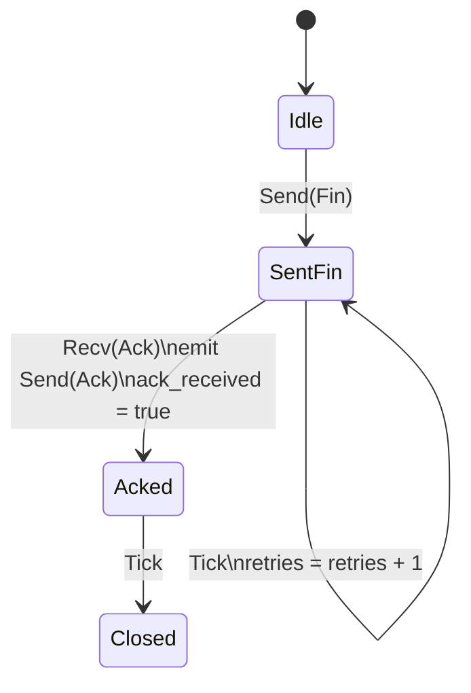
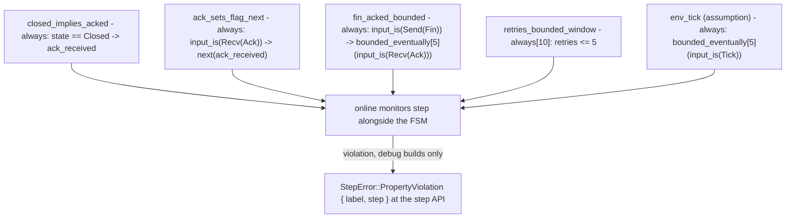

# monitors_production - production property monitors (`--with-property-monitors`)

## What it demonstrates

- **Production property monitors** ([PROPERTIES.md section 7](../../../docs/user/PROPERTIES.md#7-the-monitor-subset-and-skip-reasons)): every monitorable property compiles to an ONLINE monitor that steps alongside the FSM; a violation surfaces at the step API as `StepError::PropertyViolation { label, step }` - runtime checking of the same properties model checking verified at design time.
- **Debug gating / zero release cost**: in Rust the monitor emission and stepping are compile-gated on `#[cfg(debug_assertions)]` - a release build of the SAME artifact contains no monitor code at all (the C equivalent is `-DRFS_PROPERTY_MONITORS`, see Expected results).
- **rfs-build's `.with_property_monitors(true)`** ([INTEGRATION.md section 1](../../../docs/user/INTEGRATION.md#1-rust-integration-via-buildrs-rfs-build)).

Rationale: spec 41 is the toolchain's property showcase - every monitorable
construct in one module. This example shows what that buys you in a
PRODUCTION binary: drive the happy path (monitors stay quiet) and a violating
environment sequence (the obligation expires and the step API reports it),
then rebuild in release and watch the same sequence become all-Ok because the
monitors are compiled out.

The automaton itself: a FIN/Ack close handshake (spec 41,
[examples/valid/41_property_monitors.rfs](../../../examples/valid/41_property_monitors.rfs)) -
constructed for teaching, shaped like a real connection-close exchange (TCP's
FIN/ACK). Four states (`Idle`, `SentFin`, `Acked`, `Closed`), three events
(`Send(Fin)`, `Recv(Ack)`, `Tick`), one output (`Send(Ack)`), two vars
(`ack_received: bool`, `retries: bit<4>`). Five properties: four monitors +
one environment assumption.

## The machine



| From | Event (guard) | To | Effect |
|---|---|---|---|
| Idle | Send(Fin) | SentFin | - |
| SentFin | Recv(Ack) | Acked | emit `Send(Ack)`, `ack_received = true` |
| SentFin | Tick | SentFin | `retries += 1` |
| Acked | Tick | Closed | - |

The property/monitor structure (all five compile to online monitors under
`--with-property-monitors`):



## Files layout

| File | Role |
|---|---|
| `Cargo.toml` | member manifest: rfs-build build-dep only (NO rfs-adapters - the drivers use the artifact's inherent API) |
| `build.rs` | generates spec 41 with `.with_property_monitors(true)`; strips inner attributes; writes the byte-identical body to OUT_DIR |
| `src/lib.rs` | std lib: includes the artifact in `pub mod property_monitors`; `run_correct_session` (happy path), `run_violating_session` (debug-gated, surfaces the violation), `run_unmonitored_session` (release twin) + tests |

## Build / run / test

Prerequisite: the rfs toolchain built (`cargo build` at the repo root produces
`target/debug/rfs`) or `RFS_BIN` set - the build script prefers the
workspace-built binary when `RFS_BIN` is not pinned.

```sh
cargo build -p monitors_production            # generates + compiles (debug: monitors in)
cargo test  -p monitors_production            # debug suite: the violation surfaces at step 5
cargo test  -p monitors_production --release  # release suite: monitors compiled out, same sequence all Ok
```

## Expected results

- Debug run (`cargo test -p monitors_production`):
  - `correct_session_keeps_monitors_quiet`: Send(Fin), Recv(Ack), Tick -> Closed - three Ok steps, exactly one `Send(Ack)` emitted, NO violation;
  - `violating_session_surfaces_property_violation`: Send(Fin) then four Ticks with no Ack ever arriving - steps 1-4 are Ok, step 5 is `Err(PropertyViolation { label: "fin_acked_bounded", step: 5 })`. The obligation triggers at sample 1 (bound 5) and expires at sample 1 + 5 - 1 = 5 - the SAME label/step the MC counterexample reports (`tests/monitor_integration_test.rs`).
- Release run (`cargo test -p monitors_production --release`):
  - `release_build_compiles_monitors_out`: the identical five-input sequence steps ALL Ok - the `PropertyViolation` variant does not even exist in the release `StepError`, so the zero-cost claim is pinned mechanically, not just documented.
- What to pay attention to:
  - the violation is reported by the ENVIRONMENT failing its obligation (no Ack arrives), not by a bug in the spec - production monitors catch protocol peers that misbehave, exactly like MC catches spec bugs;
  - `env_tick` (the assumption) never fires in either session: Ticks arrive within every 6 samples in both sequences;
  - C leg: the same generated C artifact gates its monitor code on `-DRFS_PROPERTY_MONITORS` instead of `#[cfg(debug_assertions)]` - a release-style build without the define is equally zero-cost (see [INTEGRATION.md section 4](../../../docs/user/INTEGRATION.md#4-c-projects-makefile-pattern)).
