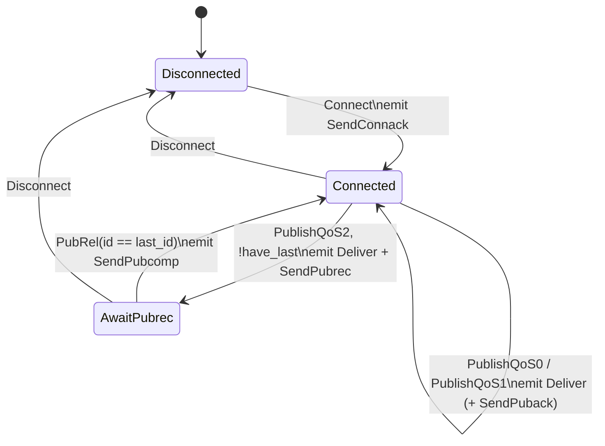

# mqtt_qos_session - an MQTT broker session with QoS0/1/2 delivery

## What it demonstrates
- An MQTT (RFC 8223) broker session machine: CONNECT/CONNACK, then PUBLISH at the three QoS levels - QoS0 fire-and-forget, QoS1 at-least-once (PUBACK), QoS2 exactly-once (PUBREC/PUBREL/PUBCOMP). RFS features: guarded transitions with packet-id patterns, bit-vector packet ids, a safety property (exactly-once), and the large-state-space twin.
- The automaton is drawn from the real MQTT delivery protocol; the packet-id space is abstracted to bit<4> for exact MC (the faithful 16-bit model is `full.rfs`). Single in-flight QoS2 exchange - concurrent exchanges with distinct ids are out of scope for this discrete model.

## The machine


## RFS modes demonstrated
### Specification & analysis (`rfs validate`, `rfs info`)
The spec parses and validates; `rfs info` reports the 3 states, 6 events, 5 outputs,
the three variables, and the two monitored properties. Rationale: the analysis gate
that runs before any codegen/MC.

### Model checking - in-process (`rfs mc-ref`, exact)
`pass.rfs` model-checks to **PASS complete** (48 states): `exactly_once` holds - a QoS2
packet id is never delivered twice while its handshake is in flight, and
`handshake_consistent` ties the AwaitPubrec state to an in-flight handshake. The negative
variant `fail.rfs` removes the dedup guard, so a duplicate PUBLISH for the in-flight id is
delivered again - a pinned **property-violation** CE on `exactly_once` at step 3 (the CE
shows the same id delivered at steps 1 and 2); `fixed.rfs` restores the guard and re-runs
to PASS.

### Model checking - generated binaries (rust + c)
Both backends' MC binaries are generated, compiled, and run in exact mode; their reports
are **byte-identical** to each other and to mc-ref. The failing variant's CE is identical
across all three engines.

### Production code generation (rust + c)
`rfs codegen rust production` and `rfs codegen c production` both compile the FSM
warning-free - the generated-C compiler-agnosticism bar. Rationale: a real broker
delivery machine compiles to shippable code in both backends.

### Model checking - large state space (`full.rfs`: smt-bounded + fuzz)
The faithful model uses the full 16-bit MQTT packet-id space: from the initial
configuration every one of the 65536 ids is a distinct reachable configuration, so exact
MC is infeasible and shrinking the id space would change the duplicate/loss behavior being
demonstrated. It is instead checked with `rfs mc-ref --mode smt-bounded --bound 12`, which
proves `exactly_once` for every 12-step path (**PASS WITHIN BOUND**, incomplete - no
completeness claim), and `--mode fuzz --runs 200` (random publish/ack sequences, no
violations). Rationale: even very large specifications can be analyzed and checked with
RFS where adequate simplification is impossible.

## Files layout
| File | Role |
|---|---|
| `pass.rfs` | the valid broker session (exact-MC-able, bit<4> ids) |
| `fail.rfs` | dedup guard removed (duplicate-delivery defect) |
| `fixed.rfs` | the corrected spec (= pass.rfs) |
| `full.rfs` | the large-state-space twin (16-bit packet-id space) |
| `run.sh` | drives every demonstrated RFS mode |
| `captures/` | pinned outputs (text + JSON CEs, smt-bounded verdict, fuzz transcript) |

## Build / run / test
Prerequisite: the rfs toolchain built (`cargo build`) or `RFS_BIN` set; rustc + gcc available.
```sh
./run.sh
```
`cargo test --test example_projects_test mqtt_qos_session` re-runs it and pins the excerpts.

## Expected results
- pass.rfs: PASS complete (48 states); exactly_once + handshake_consistent hold.
- fail.rfs: FAIL, `reason=property-violation label=exactly_once step=3` - the same packet id is delivered twice (steps 1 and 2 of the CE).
- fixed.rfs: PASS complete.
- full.rfs: exact MC infeasible; smt-bounded PASS WITHIN BOUND 12; fuzz runs clean (200/200).
