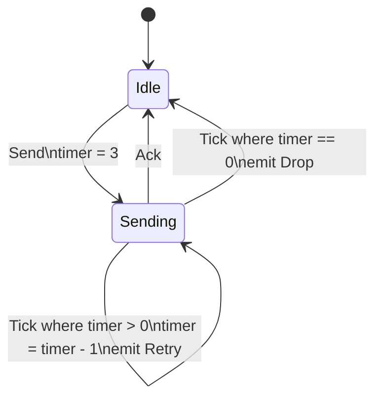

# no_std_fsm - production codegen for no_std targets (`--no-std`)

## What it demonstrates

- **`--no-std` production codegen** ([INTEGRATION.md section 3](../../../docs/user/INTEGRATION.md#3-no_std-production-codegen)): the generated Rust artifact becomes `#![no_std]` + `extern crate alloc` with an IDENTICAL public API to the std build - same `Fsm::new()` / `step(input) -> Result<Vec<Output>, StepError>`, same enums, same error kinds.
- **rfs-build's `.no_std(true)`** ([INTEGRATION.md section 1](../../../docs/user/INTEGRATION.md#1-rust-integration-via-buildrs-rfs-build)): the build.rs builder method that maps to the production-only `--no-std` flag.
- **The shared include! pattern**: build.rs strips the artifact's inner attributes and writes the byte-identical body to OUT_DIR; lib.rs pulls it in via `include!` with a module-level `#[allow]` mirroring the artifact header.

Rationale: no other example compiles a genuinely `#![no_std]` crate around
generated code - this is the embedded / bare-metal usage scenario, where the
protocol machine must live in core+alloc without std. The crate lib itself is
`#![no_std]`, so the whole build proves the artifact links without std; a plain
test then drives a full session through it, proving the API is identical to
the std build.

The automaton itself: a timeout/retry machine (spec 03,
[examples/valid/03_timeout_retry.rfs](../../../examples/valid/03_timeout_retry.rfs)) -
constructed for teaching, but the pattern is drawn from real retransmission
timers (TCP/ARQ senders retransmit on a countdown and give up after expiry).
Two states (`Idle`, `Sending`), three events (`Send`, `Ack`, `Tick`), two
outputs (`Retry`, `Drop`), one var (`timer: bit<3>` init 3). No properties.

## The machine



| From | Event (guard) | To | Effect |
|---|---|---|---|
| Idle | Send | Sending | `timer = 3` |
| Sending | Ack | Idle | - |
| Sending | Tick (`timer > 0`) | Sending | `timer -= 1`, emit `Retry` |
| Sending | Tick (`timer == 0`) | Idle | emit `Drop` |

An event with no enabled transition (e.g. `Ack` in `Idle`) is rejected at the
step API as `StepError::UnexpectedEvent` - the session below exercises that
path too.

## Files layout

| File | Role |
|---|---|
| `Cargo.toml` | member manifest: rfs-build build-dep only (NO rfs-adapters - the driver uses the artifact's inherent API) |
| `build.rs` | generates spec 03 with `.no_std(true)`; strips inner attributes; writes the byte-identical body to OUT_DIR |
| `src/lib.rs` | `#![no_std]` + `extern crate alloc` lib: includes the artifact in `pub mod timeout_retry`, drives a full session (`run_session`), std-context test |

## Build / run / test

Prerequisite: the rfs toolchain built (`cargo build` at the repo root produces
`target/debug/rfs`) or `RFS_BIN` set - the build script prefers the
workspace-built binary when `RFS_BIN` is not pinned.

```sh
cargo build -p no_std_fsm     # generates + compiles the #![no_std] crate
cargo test  -p no_std_fsm     # drives a full session through the artifact
```

## Expected results

- `cargo test -p no_std_fsm` runs one test, `full_session_through_nostd_artifact`,
  and it passes:
  - three `Retry` outputs (the timer counts 3 -> 2 -> 1), then one `Drop`
    (expiry) back to `Idle`;
  - an out-of-band `Ack` in `Idle` is rejected as `StepError::UnexpectedEvent`;
  - a resend + `Ack` completes the success path without error.
- What to pay attention to:
  - the generated artifact's header is `#![no_std]` + `extern crate alloc`
    (inspect it under `target/debug/build/no_std_fsm-*/out/03_timeout_retry_body.rs`)
    - and yet the CRATE compiles as no_std, because build.rs strips those inner
    attributes and the lib root carries them itself;
  - the public API is the same shape as the std build: `Fsm`, `Input`, `Output`,
    `StepError` with identical variants - a std consumer and a no_std consumer
    write the same driver code;
  - the test runs in a plain (std-linked) test context on purpose: it proves
    the no_std artifact's API is usable from anywhere, not just no_std code.
