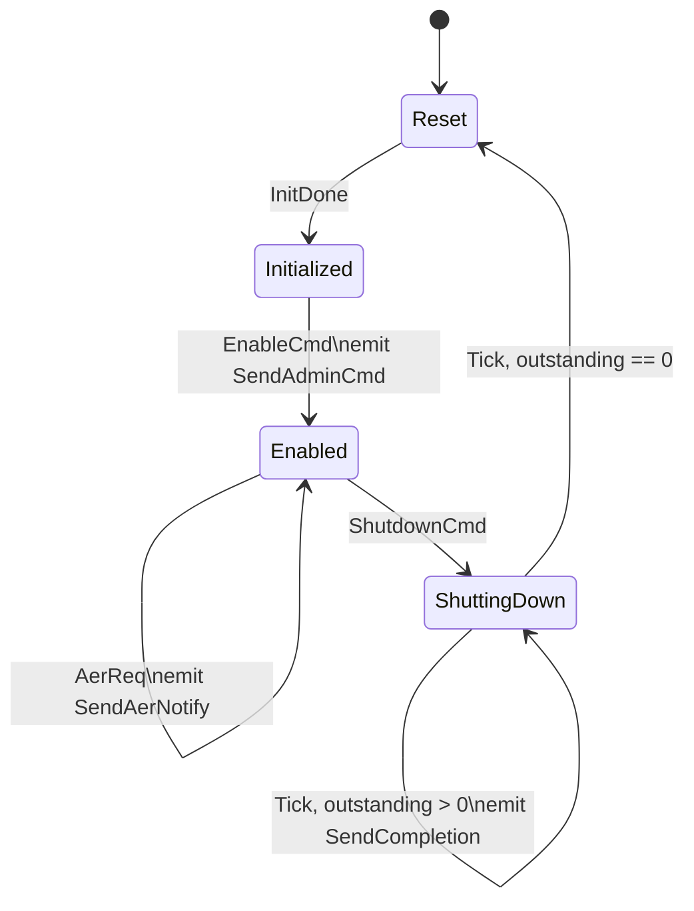

# nvme_controller - an NVMe controller and queue lifecycle machine

## What it demonstrates
- An NVMe (NVM Express) controller machine: reset -> initialized -> enabled, I/O submission/completion with a pending-queue counter, asynchronous event requests, and a shutdown that flushes the queue one completion per tick. RFS features: guarded transitions with an enable gate, a bounded-liveness property under an environment assumption, and the large-state-space twin.
- The automaton is drawn from the real NVMe controller state machine (NVM Express architecture specification); the faithful model with many IO queue pairs and deep CQ/SQ lives in `full.rfs`.

## The machine


## RFS modes demonstrated
### Specification & analysis (`rfs validate`, `rfs info`)
The spec parses and validates; `rfs info` reports the 4 states, 6 events, 4 outputs,
the two variables, the two monitored properties, and the `env_tick` assumption.
Rationale: the analysis gate that runs before any codegen/MC.

### Model checking - in-process (`rfs mc-ref`, exact)
`pass.rfs` model-checks to **PASS complete** (56 states): `no_io_before_enabled` holds -
I/O is submitted only once the controller is enabled - and `shutdown_flushes` holds:
every pending completion is drained and the controller resets, under the assumption
that a Tick arrives within every 2 samples. The negative variant `fail.rfs` removes the
enable guard, so I/O is submitted in the initialized state - a pinned **property-
violation** CE on `no_io_before_enabled` at step 4 (IoSubmit in Initialized emits
SendIo); `fixed.rfs` restores the guard and re-runs to PASS.

### Model checking - generated binaries (rust + c)
Both backends' MC binaries are generated, compiled, and run in exact mode; their reports
are **byte-identical** to each other and to mc-ref. The failing variant's CE is identical
across all three engines.

### Production code generation (rust + c)
`rfs codegen rust production` and `rfs codegen c production` both compile the FSM
warning-free - the generated-C compiler-agnosticism bar. Rationale: a real storage-
controller machine compiles to shippable code in both backends.

### Model checking - large state space (`full.rfs`: smt-bounded + fuzz)
The faithful model carries four IO queue pairs with deep submission/completion queues:
each pair's pending depth is a full bit<8> counter, so the joint state space is 2^32
configurations - many concurrent entities whose scheduling is the point, and reducing it
to a single shallow queue loses that behavior. It is instead checked with
`rfs mc-ref --mode smt-bounded --bound 12`, which proves `no_io_before_enabled` for
every 12-step path (**PASS WITHIN BOUND**, incomplete - no completeness claim), and
`--mode fuzz --runs 200` (random submit/complete interleavings across the pairs, no
violations). Rationale: even very large specifications can be analyzed and checked with
RFS where adequate simplification is impossible.

## Files layout
| File | Role |
|---|---|
| `pass.rfs` | the valid controller (exact-MC-able, single shallow queue) |
| `fail.rfs` | enable guard removed (I/O-in-initialized defect) |
| `fixed.rfs` | the corrected spec (= pass.rfs) |
| `full.rfs` | the large-state-space twin (4 queue pairs x bit<8> depth) |
| `run.sh` | drives every demonstrated RFS mode |
| `captures/` | pinned outputs (text + JSON CEs, smt-bounded verdict, fuzz transcript) |

## Build / run / test
Prerequisite: the rfs toolchain built (`cargo build`) or `RFS_BIN` set; rustc + gcc available.
```sh
./run.sh
```
`cargo test --test example_projects_test nvme_controller` re-runs it and pins the excerpts.

## Expected results
- pass.rfs: PASS complete (56 states); no_io_before_enabled + shutdown_flushes hold.
- fail.rfs: FAIL, `reason=property-violation label=no_io_before_enabled step=4` - SendIo emitted in Initialized.
- fixed.rfs: PASS complete.
- full.rfs: exact MC infeasible (2^32 configs); smt-bounded PASS WITHIN BOUND 12; fuzz runs clean (200/200).
