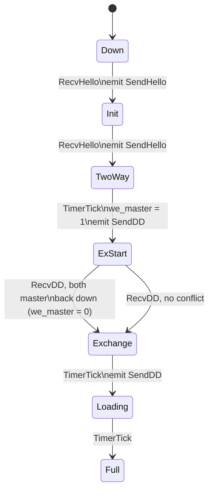

# ospf_neighbor - OSPF neighbor adjacency with a single-master DD tie-break

## What it demonstrates
- An OSPF neighbor's adjacency machine (RFC 2328): Down -> Init -> TwoWay -> ExStart -> Exchange -> Loading -> Full over the Database-Description (DD) handshake, with a master/slave role election. RFS features: guarded transitions on role bits, a parameterized DD event, and the single-master safety invariant (both sides never believe they are master at once).
- The automaton is drawn from the real OSPF neighbor state machine; the DD sequence-number exchange is abstracted to a role-election step.

## The machine


## RFS modes demonstrated
### Specification & analysis (`rfs validate`, `rfs info`)
The spec parses and validates; `rfs info` reports the 7 adjacency states, the events,
the outputs, the `we_master`/`peer_master` variables, and the monitored `single_master`
property. Rationale: the analysis gate that runs before any codegen/MC.

### Model checking - in-process (`rfs mc-ref`, exact)
`pass.rfs` model-checks to **PASS complete** (10 states): the single-master invariant
holds - the ExStart tie-break makes one side back down whenever both claim to be master.
The negative variant `fail.rfs` removes the tie-break, so if both routers claim master in
ExStart neither backs down - a pinned **property-violation** CE on `single_master` (step 4,
`Vars { we_master: 1, peer_master: 1 }`, the ExStart->Exchange defect step); `fixed.rfs`
restores the tie-break and re-runs to PASS.

### Model checking - generated binaries (rust + c)
Both backends' MC binaries are generated, compiled, and run in exact mode; their reports
are **byte-identical** to each other and to mc-ref. The failing variant's CE is identical
across all three engines.

### Production code generation (rust + c)
`rfs codegen rust production` and `rfs codegen c production` both compile the FSM
warning-free; the DD role-election guards are the showcase.

## Files layout
| File | Role |
|---|---|
| `pass.rfs` | the valid adjacency machine (exact-MC-able) |
| `fail.rfs` | tie-break removed (both sides master) |
| `fixed.rfs` | the corrected spec (= pass.rfs) |
| `run.sh` | drives every demonstrated RFS mode |
| `captures/` | pinned outputs (text + JSON CE, both-backend reports) |

## Build / run / test
Prerequisite: the rfs toolchain built (`cargo build`) or `RFS_BIN` set; rustc + gcc available.
```sh
./run.sh
```
`cargo test --test example_projects_test ospf_neighbor` re-runs it and pins the excerpts.

## Expected results
- pass.rfs: PASS complete (10 states); single_master holds.
- fail.rfs: FAIL, `reason=property-violation label=single_master step=4` - both sides believe they are master (`we_master: 1, peer_master: 1`).
- fixed.rfs: PASS complete.
