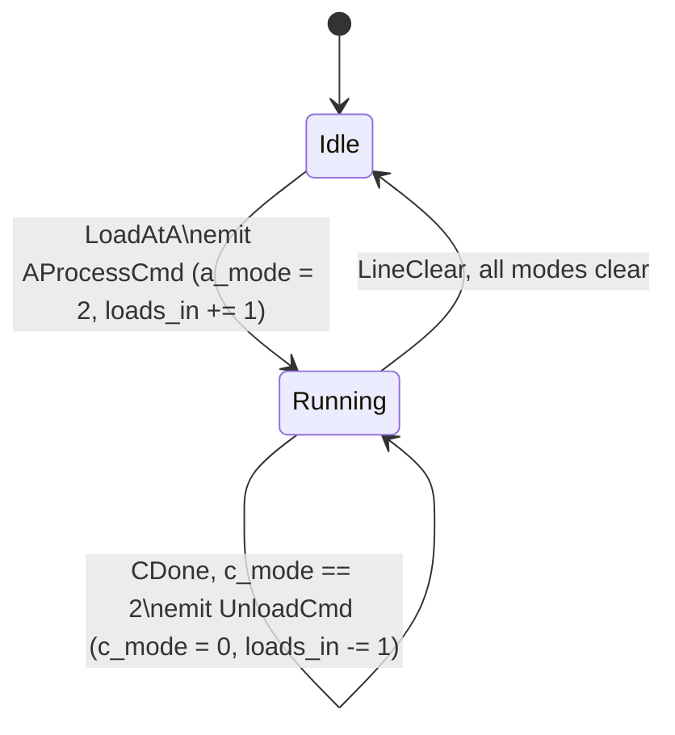

# plc_conveyor_seq - a PLC conveyor / sequencing FSM

## What it demonstrates
- A multi-station line: three stations A -> B -> C, each cycling clear -> loaded -> processing, with sensor interlocks between stations. The per-station mode is bit<2> (0=clear, 1=loaded, 2=processing) and the in-line load count is bit<3>. The DOWNSTREAM-CLEAR INTERLOCK is the safety core: station A starts processing only when B is clear, and B only when C is clear - a station never processes into an occupied downstream. RFS features: output-anchored interlock invariants over occupancy witnesses, and a load-conservation invariant (an idle line holds zero loads).
- The automaton is drawn from real PLC conveyor sequencing logic (occupancy sensors, station hand-off, end-of-line unload). Rationale: multi-station mutual exclusion + conservation - the "never feed an occupied downstream" interlock is the canonical pinch-point safety rule on a production line.

## The machine


## RFS modes demonstrated
### Specification & analysis (`rfs validate`, `rfs info`)
The spec parses and validates; `rfs info` reports the 2 states, 7 events, 4 outputs,
the four variables, and the three monitored properties. Rationale: the analysis gate
that runs before any codegen/MC.

### Model checking - in-process (`rfs mc-ref`, exact)
`pass.rfs` model-checks to **PASS complete** (11 states): `a_interlock` holds - an
AProcessCmd is emitted only when B is clear, both on the idle wake-up and on the guarded
running transition; `b_interlock` holds - B processes only when C is clear; `none_lost`
holds - the load count increments on every LoadAtA and decrements on every CDone in
lockstep with the station modes, so a fully clear line (the LineClear return to Idle)
always carries zero loads. The negative variant `fail.rfs` removes the downstream-clear
check from station A's running transition - so a pinned **property-violation** CE on
`a_interlock` at step 3 shows LoadAtA (A processes), ADone (the load moves to B), then a
SECOND LoadAtA that emits AProcessCmd while `b_mode == 1`; `fixed.rfs` restores the check
and re-runs to PASS.

### Model checking - generated binaries (rust + c)
Both backends' MC binaries are generated, compiled, and run in exact mode; their reports
are **byte-identical** to each other and to mc-ref. The failing variant's CE is identical
across all three engines. Rationale: the production-identical engine must agree with the
in-process reference on both the positive proof and the negative counterexample.

### Production code generation (rust + c)
`rfs codegen rust production` and `rfs codegen c production` both compile the FSM
warning-free - the generated-C compiler-agnosticism bar. Rationale: a multi-station
sequencer compiles to shippable PLC firmware in both backends.

## Files layout
| File | Role |
|---|---|
| `pass.rfs` | the valid conveyor sequencer (downstream-clear interlocks + load conservation) |
| `fail.rfs` | downstream-clear check removed from station A (process-into-occupied defect) |
| `fixed.rfs` | the corrected spec (= pass.rfs) |
| `run.sh` | drives every demonstrated RFS mode |
| `captures/` | pinned outputs (text + JSON CEs) |

## Build / run / test
Prerequisite: the rfs toolchain built (`cargo build`) or `RFS_BIN` set; rustc + gcc available.
```sh
./run.sh
```

## Expected results
- `rfs validate pass.rfs` -> ok; `rfs info` lists 2 states / 7 events / 4 outputs.
- mc-ref on `pass.rfs`: `status=pass-complete states=11 transitions=16 max_depth=7`.
- mc-ref on `fail.rfs`: exit 1, `reason=property-violation label=a_interlock step=3`;
  the CE shows LoadAtA (a_mode=2), ADone (b_mode=1), then a second LoadAtA that emits
  AProcessCmd with `b_mode: 1`. The JSON form carries the same label/step.
- mc-ref on `fixed.rfs`: PASS complete again; both generated backends agree byte-for-byte.
- Production codegen compiles clean (rust) and warning-free (c).
- What to pay attention to: the line is modelled at its discrete sequencing layer - the
  station modes are the state, and the interlocks are guards on those modes (the
  discrete-mode-layer rule). The reachable state space is tiny (11 configurations)
  because the hand-off transitions tightly constrain the mode combinations; the full
  2x4x4x4x8 product is mostly unreachable. C has no downstream interlock because it is
  the last station - its downstream is the unload area, modelled by the CDone/UnloadCmd
  pair rather than a fourth station.
