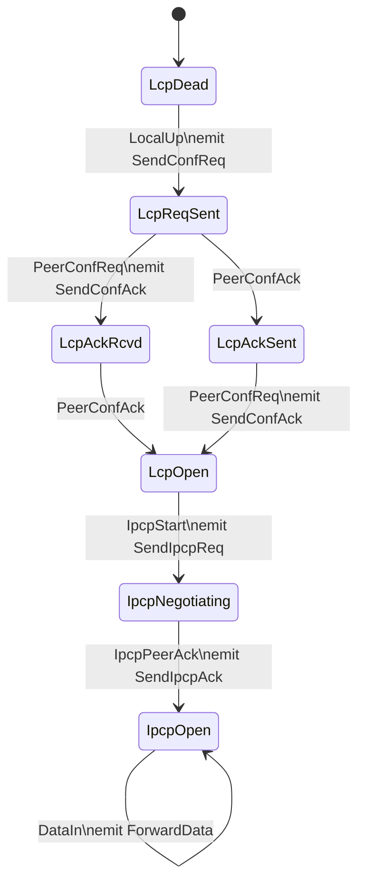

# ppp_lcp_ipcp - PPP link and IP control protocol negotiation

## What it demonstrates
- A PPP (RFC 1661/1332) multi-phase negotiation machine: the LCP four-way handshake (dead -> req-sent -> ack-rcvd/ack-sent -> open, with NAK renegotiation), then IPCP negotiation with PAP/CHAP auth folded into the IPCP exchange. RFS features: a 7-state phase machine, enum-typed variables, and two ordering-safety properties (phase ordering + auth-before-data).
- The automaton is drawn from the real PPP control-protocol architecture; the analog of option negotiation is abstracted to ConfReq/ConfAck/ConfNak events.

## The machine

(NAK self-loops in the three negotiation states and LinkDown teardown to LcpDead from every state are omitted for clarity.)

## RFS modes demonstrated
### Specification & analysis (`rfs validate`, `rfs info`)
The spec parses and validates; `rfs info` reports the 7 states, 8 events, 5 outputs,
the two variables (incl. the enum-typed `auth`), and the two monitored properties.
Rationale: the analysis gate that runs before any codegen/MC.

### Model checking - in-process (`rfs mc-ref`, exact)
`pass.rfs` model-checks to **PASS complete** (7 states): `no_ipcp_before_lcp_open` holds
- IPCP negotiation starts only once LCP is open - and `auth_before_data` holds: IP data
flows only after PAP/CHAP completed with IPCP. The negative variant `fail.rfs` removes
the phase guard, so IPCP opens while LCP is still ack-sent - a pinned **property-
violation** CE on `no_ipcp_before_lcp_open` at step 3 (IpcpStart in LcpAckSent emits
SendIpcpReq with lcp_open=false); `fixed.rfs` restores the guard and re-runs to PASS.

### Model checking - generated binaries (rust + c)
Both backends' MC binaries are generated, compiled, and run in exact mode; their reports
are **byte-identical** to each other and to mc-ref. The failing variant's CE is identical
across all three engines.

### Production code generation (rust + c)
`rfs codegen rust production` and `rfs codegen c production` both compile the FSM
warning-free - the generated-C compiler-agnosticism bar. Rationale: a real multi-phase
negotiation machine compiles to shippable code in both backends.

## Files layout
| File | Role |
|---|---|
| `pass.rfs` | the valid LCP + IPCP negotiation machine |
| `fail.rfs` | phase guard removed (IPCP-before-LCP-open defect) |
| `fixed.rfs` | the corrected spec (= pass.rfs) |
| `run.sh` | drives every demonstrated RFS mode |
| `captures/` | pinned outputs (text + JSON CEs) |

## Build / run / test
Prerequisite: the rfs toolchain built (`cargo build`) or `RFS_BIN` set; rustc + gcc available.
```sh
./run.sh
```
`cargo test --test example_projects_test ppp_lcp_ipcp` re-runs it and pins the excerpts.

## Expected results
- pass.rfs: PASS complete (7 states); both ordering properties hold.
- fail.rfs: FAIL, `reason=property-violation label=no_ipcp_before_lcp_open step=3` - IPCP starts in LcpAckSent.
- fixed.rfs: PASS complete.
