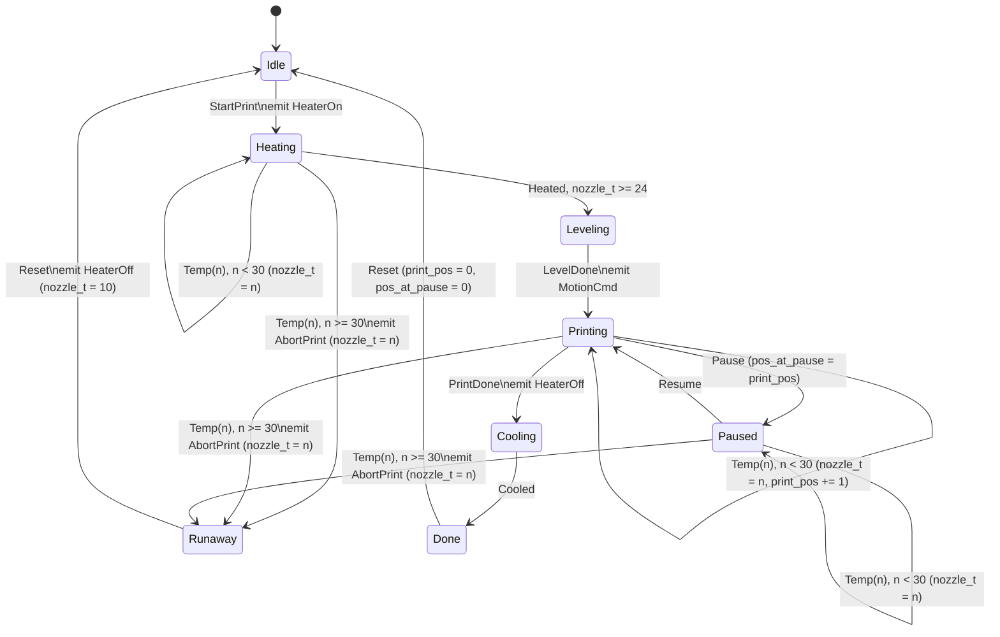

# printer_thermal - a 3D-printer print & thermal state machine

## What it demonstrates
- A printer: idle -> heating -> leveling -> printing -> paused -> cooling -> done, with a thermal-runaway fault mode. The nozzle temperature is scaled to bit<5> (target band 24-29 = "heated", runaway at >= 30; the full-resolution thermistor space would blow the state budget, noted simplification), the print position is bit<3>, and pos_at_pause witnesses the position frozen at pause. The RUNAWAY GUARD is the safety core: a temperature update at or above the abort threshold takes the printer to Runaway from EVERY active mode - heating, printing and even paused - no motion or dwell survives an overheat. RFS features: a hard-abort invariant over the temperature variable, a motion interlock (no MotionCmd while overheated), and a pause-preservation invariant checked one sample ahead.
- The automaton is drawn from real 3D-printer firmware logic (bed/nozzle heat-up, auto-leveling, print pause/resume, thermal-runaway protection as in Marlin-style firmwares). Rationale: temperature-threshold guards + a hard-abort invariant - the classic "the sensor must be able to stop the machine" safety pattern.

## The machine


## RFS modes demonstrated
### Specification & analysis (`rfs validate`, `rfs info`)
The spec parses and validates; `rfs info` reports the 8 states, 9 events, 4 outputs,
the three variables, and the three monitored properties. Rationale: the analysis gate
that runs before any codegen/MC.

### Model checking - in-process (`rfs mc-ref`, exact)
`pass.rfs` model-checks to **PASS complete** (8765 states): `runaway_aborts` holds -
every transition that can raise the nozzle to the abort threshold lands in Runaway, so a
sample with `nozzle_t >= 30` is always a Runaway sample; `no_motion_overheated` holds -
the only MotionCmd emission (leveling done) happens while the nozzle is in the heated
band, strictly below the threshold; `pause_preserves_pos` holds - a temperature update
consumed while paused leaves the head exactly where the pause froze it, checked one
sample ahead so a resume or further update in between cannot move it. The negative
variant `fail.rfs` removes the runaway guard from the motion state - printing accepts
ANY temperature reading and keeps moving the head - so a pinned **property-violation**
CE on `runaway_aborts` at step 5 shows StartPrint, Temp(24), Heated, LevelDone
(MotionCmd), then Temp(30) consumed in Printing: the nozzle reaches 30 while the state
stays Printing and `print_pos` advances to 1; `fixed.rfs` restores the guard and re-runs
to PASS.

### Model checking - generated binaries (rust + c)
Both backends' MC binaries are generated, compiled, and run in exact mode; their reports
are **byte-identical** to each other and to mc-ref. The failing variant's CE is identical
across all three engines. Rationale: the production-identical engine must agree with the
in-process reference on both the positive proof and the negative counterexample.

### Production code generation (rust + c)
`rfs codegen rust production` and `rfs codegen c production` both compile the FSM
warning-free - the generated-C compiler-agnosticism bar. Rationale: a thermal-protection
state machine compiles to shippable printer-controller firmware in both backends.

## Files layout
| File | Role |
|---|---|
| `pass.rfs` | the valid printer FSM (runaway guard in every active mode + motion interlock + pause preservation) |
| `fail.rfs` | runaway guard removed from the motion state (overheat ignored defect) |
| `fixed.rfs` | the corrected spec (= pass.rfs) |
| `run.sh` | drives every demonstrated RFS mode |
| `captures/` | pinned outputs (text + JSON CEs) |

## Build / run / test
Prerequisite: the rfs toolchain built (`cargo build`) or `RFS_BIN` set; rustc + gcc available.
```sh
./run.sh
```

## Expected results
- `rfs validate pass.rfs` -> ok; `rfs info` lists 8 states / 9 events / 4 outputs.
- mc-ref on `pass.rfs`: `status=pass-complete states=8765 transitions=147389 max_depth=25`.
- mc-ref on `fail.rfs`: exit 1, `reason=property-violation label=runaway_aborts step=5`;
  the CE shows StartPrint, Temp(n=24), Heated, LevelDone (MotionCmd), then Temp(n=30) in
  Printing with `nozzle_t: 30` and `print_pos: 1`. The JSON form carries the same
  label/step.
- mc-ref on `fixed.rfs`: PASS complete again; both generated backends agree byte-for-byte.
- Production codegen compiles clean (rust) and warning-free (c).
- What to pay attention to: the temperature is scaled to bit<5> so exact MC stays fast
  (noted simplification per the phase plan's discrete-layer rule - the analog thermal
  dynamics are abstracted to threshold guards, which is exactly what RFS models). The
  `pause_preserves_pos` property uses a `next`-form check: the obligation is evaluated
  one sample after the paused temperature update, so it pins that NOTHING following the
  update (a resume, another reading) moves the head away from the paused position.
