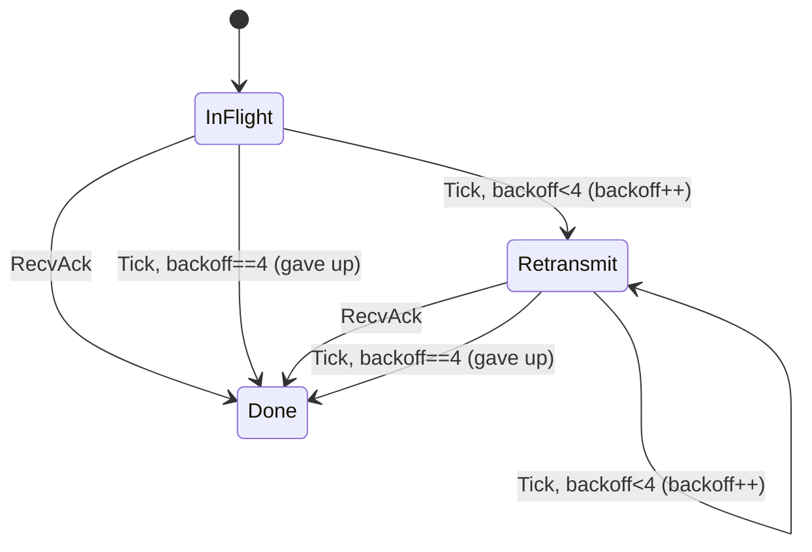

# quic_loss_recovery - QUIC loss recovery & PTO backoff (RFC 9000)

## What it demonstrates
- RFS functionality: specification, analysis (`rfs validate` / `rfs info`), model-checking in-process (`rfs mc-ref` exact + the large-state-space twin via smt-bounded + fuzz), generated MC binaries (rust + c), production codegen (rust + c).
- Rationale: QUIC's loss recovery is a timer-driven retransmission loop with exponential PTO backoff - a clean liveness example (the recovery always terminates) and a large-state-space example (the real packet-number space is too big for exact MC).
- The automaton: a sender that transmits packets, retransmits on PTO timeout with growing backoff, and gives up after the max backoff. Drawn from RFC 9000 loss recovery.

## The machine

## RFS modes demonstrated
### Specification & analysis
`rfs validate pass.rfs` + `rfs info pass.rfs`. The spec models the PTO retransmission loop with a `backoff` counter that grows on each timeout and caps at 4.
### Model checking - in-process (mc-ref exact)
Positive: `prop terminates : eventually (state == Done)` holds - every path either gets an ack or gives up after max backoff, so the recovery always terminates (PASS complete). Negative (`fail.rfs`): removing the backoff increment makes the retransmit loop infinite - a pinned liveness-violation LASSO (cycle length 1) on `terminates`. The fix restores the increment.
### Model checking - large state space (smt-bounded + fuzz, NOT exact MC)
`full.rfs` is a continuously-streaming sender with a real 16-bit packet number advancing every tick - exact MC hits the state limit (exit 2), but `--mode smt-bounded --bound 12` proves the plain invariant `backoff_in_range` for every 12-step path, and `--mode fuzz` random-tests loss patterns.
### Model checking - generated binaries (rust + c)
Both backends agree byte-for-byte on the PASS and the liveness-violation CE.
### Production code generation (rust + c)
Both compile warning-free.

## Files layout
| File | Role |
|---|---|
| `pass.rfs` | valid spec, model-checks to PASS (liveness holds) |
| `fail.rfs` | backoff increment removed -> liveness-violation lasso |
| `fixed.rfs` | the fix (= pass.rfs), re-runs to PASS |
| `full.rfs` | large-state-space twin (16-bit pkt_num, streaming) - smt-bounded + fuzz |
| `run.sh` | drives all demonstrated RFS modes |
| `captures/` | pinned text+JSON CEs, both-backend reports, production proof, smt/fuzz transcripts |

## Build / run / test
Prerequisite: `cargo build` (or `RFS_BIN`). Run `sh run.sh`. The test leg is `tcp_full_states`-style in `tests/example_projects_test.rs`.

## Expected results
- PASS complete (states=8) on pass.rfs; liveness-violation lasso (label=terminates, cycle length 1) on fail.rfs; PASS on fixed.rfs.
- Both backends byte-identical. Production compiles clean/warning-free.
- Twin: exact MC exit 2 (state limit); smt-bounded PASS WITHIN BOUND 12; fuzz runs=200 no violations.
