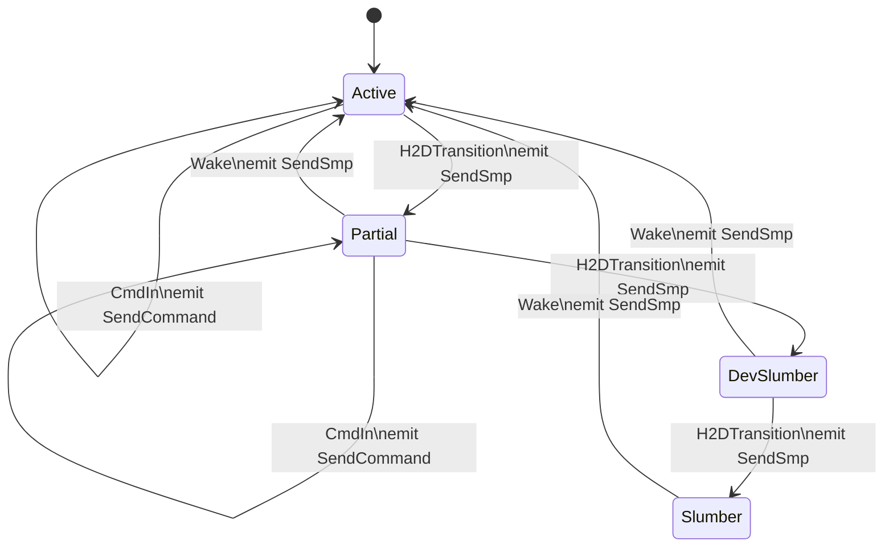

# sata_link_power - a SATA link and power state machine

## What it demonstrates
- A SATA (ACS Link Power Management) link & power machine: Active / Partial / DevSlumber / Slumber, with host-to-device power transitions one level at a time and wake from any low-power state. RFS features: an enum-typed cross-port variable (device power state), a safety property (no command while asleep), and a wake-ordering property.
- The automaton is drawn from the real SATA link power management states (ACS 4.11); the host/device cross-port power relationship is modelled as a consistency-tracked enum var.

## The machine


## RFS modes demonstrated
### Specification & analysis (`rfs validate`, `rfs info`)
The spec parses and validates; `rfs info` reports the 4 states, 3 events, 2 outputs,
the enum-typed `dev_power` variable, and the two monitored properties. Rationale: the
analysis gate that runs before any codegen/MC.

### Model checking - in-process (`rfs mc-ref`, exact)
`pass.rfs` model-checks to **PASS complete** (4 states): `no_command_while_asleep` holds
- commands issue only in Active or Partial, never in a slumber state - and
`wake_returns_active` holds: every wake lands the link in Active. The negative variant
`fail.rfs` removes the wake-before-command guard, so a command issues in Slumber - a
pinned **property-violation** CE on `no_command_while_asleep` at step 4 (CmdIn in
Slumber emits SendCommand); `fixed.rfs` restores the guard and re-runs to PASS.

### Model checking - generated binaries (rust + c)
Both backends' MC binaries are generated, compiled, and run in exact mode; their reports
are **byte-identical** to each other and to mc-ref. The failing variant's CE is identical
across all three engines.

### Production code generation (rust + c)
`rfs codegen rust production` and `rfs codegen c production` both compile the FSM
warning-free - the generated-C compiler-agnosticism bar. Rationale: a real link-power
machine compiles to shippable code in both backends.

## Files layout
| File | Role |
|---|---|
| `pass.rfs` | the valid link & power machine |
| `fail.rfs` | wake-before-command guard removed (command-in-Slumber defect) |
| `fixed.rfs` | the corrected spec (= pass.rfs) |
| `run.sh` | drives every demonstrated RFS mode |
| `captures/` | pinned outputs (text + JSON CEs) |

## Build / run / test
Prerequisite: the rfs toolchain built (`cargo build`) or `RFS_BIN` set; rustc + gcc available.
```sh
./run.sh
```
`cargo test --test example_projects_test sata_link_power` re-runs it and pins the excerpts.

## Expected results
- pass.rfs: PASS complete (4 states); both properties hold.
- fail.rfs: FAIL, `reason=property-violation label=no_command_while_asleep step=4` - SendCommand emitted in Slumber.
- fixed.rfs: PASS complete.
