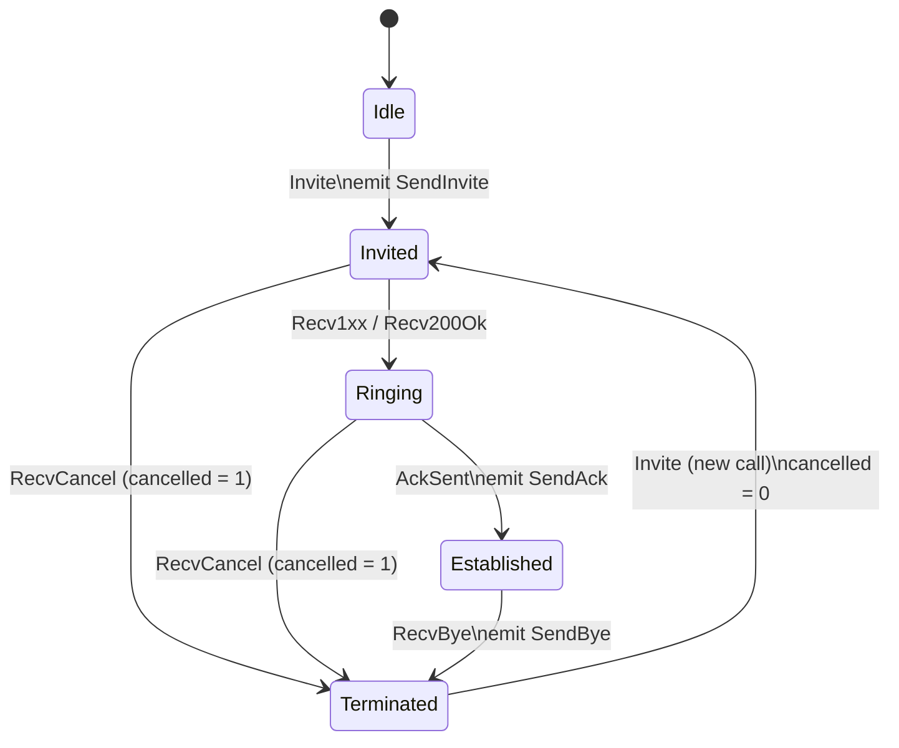

# sip_call_signaling - SIP INVITE transaction and dialog with CANCEL handling

## What it demonstrates
- A SIP INVITE transaction + dialog (RFC 3261) from the caller's view: Idle -> Invited -> Ringing -> Established, torn down by BYE and cancellable before establishment. RFS features: a multi-state signaling machine, guarded transitions, a cancelled flag, and the safety property that a cancelled invite never reaches ESTABLISHED.
- The automaton is drawn from the real SIP INVITE transaction and dialog state machines; re-INVITE modify is out of scope for this discrete model.

## The machine


## RFS modes demonstrated
### Specification & analysis (`rfs validate`, `rfs info`)
The spec parses and validates; `rfs info` reports the 5 dialog states, the events, the
outputs, the `cancelled` variable, and the monitored `no_established_after_cancel`
property. Rationale: the analysis gate that runs before any codegen/MC.

### Model checking - in-process (`rfs mc-ref`, exact)
`pass.rfs` model-checks to **PASS complete** (6 states): the invariant holds - a CANCEL
terminates the pending invite, so a cancelled call never reaches ESTABLISHED. The negative
variant `fail.rfs` drops the CANCEL handling, so a cancelled INVITE is ignored and the
dialog still proceeds to ESTABLISHED - a pinned **property-violation** CE on
`no_established_after_cancel` (step 4, `Vars { cancelled: 1 }`, the Ringing->Established
defect step after an ignored CANCEL); `fixed.rfs` restores the CANCEL -> Terminated
transition and re-runs to PASS.

### Model checking - generated binaries (rust + c)
Both backends' MC binaries are generated, compiled, and run in exact mode; their reports
are **byte-identical** to each other and to mc-ref. The failing variant's CE is identical
across all three engines.

### Production code generation (rust + c)
`rfs codegen rust production` and `rfs codegen c production` both compile the FSM
warning-free - the generated-C compiler-agnosticism bar.

## Files layout
| File | Role |
|---|---|
| `pass.rfs` | the valid signaling machine (exact-MC-able) |
| `fail.rfs` | CANCEL ignored (cancelled invite reaches Established) |
| `fixed.rfs` | the corrected spec (= pass.rfs) |
| `run.sh` | drives every demonstrated RFS mode |
| `captures/` | pinned outputs (text + JSON CE, both-backend reports) |

## Build / run / test
Prerequisite: the rfs toolchain built (`cargo build`) or `RFS_BIN` set; rustc + gcc available.
```sh
./run.sh
```
`cargo test --test example_projects_test sip_call_signaling` re-runs it and pins the excerpts.

## Expected results
- pass.rfs: PASS complete (6 states); no_established_after_cancel holds.
- fail.rfs: FAIL, `reason=property-violation label=no_established_after_cancel step=4` - a cancelled invite reaches ESTABLISHED (`cancelled: 1`).
- fixed.rfs: PASS complete.
