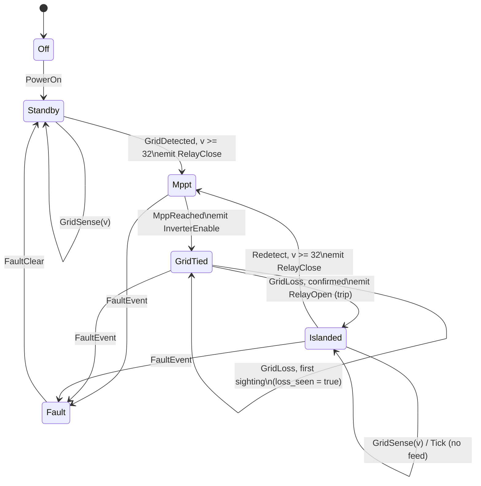

# solar_inverter - a solar inverter & anti-islanding machine

## What it demonstrates
- A grid-tied inverter: off -> standby -> MPPT tracking -> grid-tied -> islanded -> fault. The grid voltage is sensed in scaled units (threshold 32 = nominal); the relay interlock and the inverter enable are the two safety outputs. Anti-islanding is CONFIRMED - a single `GridLoss` sighting is recorded (glitch tolerance) and feeding continues; a second consecutive sighting trips: the relay opens and the inverter disables, so a de-energized grid is never backfed. Re-synchronisation requires a re-sensed healthy grid. RFS features: a two-step confirmation countermodelled with witness vars, a no-backfeed invariant over the enable output, and relay/state interlocks.
- The automaton is drawn from real anti-islanding requirements (IEEE 1547-style ride-through/confirmation before islanding). Rationale: energy-system safety - backfeeding a de-energized grid endangers line workers, which is exactly the invariant class model checking exists to pin.

## The machine


## RFS modes demonstrated
### Specification & analysis (`rfs validate`, `rfs info`)
The spec parses and validates; `rfs info` reports the 6 states, 9 events, 3 outputs,
the five variables, and the three monitored properties. Rationale: the analysis gate
that runs before any codegen/MC.

### Model checking - in-process (`rfs mc-ref`, exact)
`pass.rfs` model-checks to **PASS complete** (353 states): `no_backfeed` holds - the
inverter is enabled only with a healthy grid AND a closed relay - `island_after_confirm`
holds (islanding engages only after a confirmed grid fault, via the `confirmed` witness),
and `relay_open_when_islanded` holds. The negative variant `fail.rfs` leaves the enable
signal ungated by grid health, so the inverter keeps feeding a de-energized grid - a
pinned **property-violation** CE on `no_backfeed` at step 7 (a Tick in Islanded emits
InverterEnable with grid_ok=false and relay_closed=false); `fixed.rfs` re-gates the
enable and re-runs to PASS.

### Model checking - generated binaries (rust + c)
Both backends' MC binaries are generated, compiled, and run in exact mode; their reports
are **byte-identical** to each other and to mc-ref. The failing variant's CE is identical
across all three engines.

### Production code generation (rust + c)
`rfs codegen rust production` and `rfs codegen c production` both compile the FSM
warning-free - the generated-C compiler-agnosticism bar. Rationale: an energy-system
safety machine compiles to shippable inverter firmware in both backends.

## Files layout
| File | Role |
|---|---|
| `pass.rfs` | the valid inverter machine (confirmed anti-islanding trip) |
| `fail.rfs` | enable ungated by grid health (backfeed-while-islanded defect) |
| `fixed.rfs` | the corrected spec (= pass.rfs) |
| `run.sh` | drives every demonstrated RFS mode |
| `captures/` | pinned outputs (text + JSON CEs) |

## Build / run / test
Prerequisite: the rfs toolchain built (`cargo build`) or `RFS_BIN` set; rustc + gcc available.
```sh
./run.sh
```

## Expected results
- `rfs validate pass.rfs` -> ok; `rfs info` lists 6 states / 9 events / 3 outputs.
- mc-ref on `pass.rfs`: `status=pass-complete states=353 transitions=8769 max_depth=8`.
- mc-ref on `fail.rfs`: exit 1, `reason=property-violation label=no_backfeed step=7`;
  the CE shows the confirmed GridLoss trip (RelayOpen into Islanded) followed by a Tick
  that emits InverterEnable with grid_ok=false - backfeeding the dead grid. The JSON form
  carries the same label/step.
- mc-ref on `fixed.rfs`: PASS complete again; both generated backends agree byte-for-byte.
- Production codegen compiles clean (rust) and warning-free (c).
- What to pay attention to: the confirmation logic is two witness vars (`loss_seen`,
  `confirmed`) - a single glitch never trips, and a healthy tick clears the pending
  sighting. The DC bus level and MPPT operating point are inside the abstracted power
  stage (they surface only as the MppReached command) - noted simplification per the
  phase plan's discrete-layer rule.
