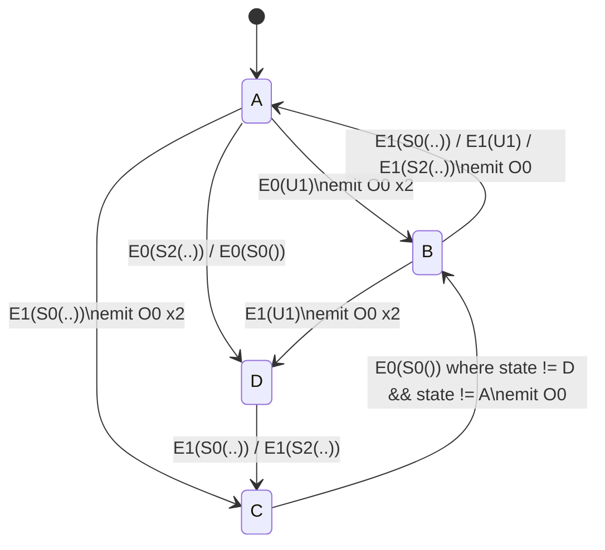
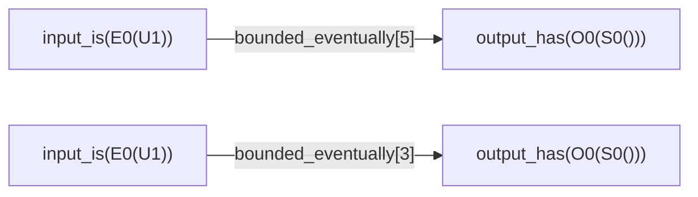

# specgen_mutation_loop - the rapid-prototyping loop as a runnable example

## What it demonstrates

- **`rfs gen-spec` random generation, seed-deterministic**: `--seed 17` produces the SAME spec byte-for-byte on every run ([INTEGRATION.md section 8](../../../docs/user/INTEGRATION.md#8-rapid-prototyping-rfs-gen-spec-and-rfs-mc-ref)). The script proves it by generating twice and `cmp`-ing the files.
- **Always-valid output**: gen-spec emits specs that pass `rfs validate` by construction - the loop never has to fix a syntax error, only behavior.
- **Instant in-process checking**: `rfs mc-ref` (the reference model checker) gives a PASS/FAIL verdict with no compilation step - the feedback loop is seconds, not a build.
- **Mutation as corner-case exploration**: `--base SPEC --mutations K` applies K seeded mutations to a known-good base. A mutation that BREAKS a property is the teaching moment - the captured counterexample shows exactly what the mutation did wrong.

Rationale: the other examples start from a hand-written spec. This shows the
INVERSE workflow - let the toolchain invent the machine, check it instantly,
then mutate it to probe corner cases. It is the fastest way to generate
non-trivial test protocols without designing them by hand.

The automaton itself: RANDOMLY GENERATED (not drawn from a real protocol).
With `--seed 17` the base is a 4-state machine (`A`, `B`, `C`, `D`) with
several payload-carrying events, one output group, and two safety properties
(`p0`, `p1`). The exact states/events/transitions are seed-determined - the
pinned transcript below is the REAL output of that seed. The mutated variant
(`--mutations 8 --seed 1`) alters the machine until a property (`p2`) is
violated at the initial configuration.

## The machine

The seed-17 base (states and representative transitions; the full transition
table is in `work/base.rfs` after a run):



The two base properties are bounded obligations on the output:



The K=8 mutation introduces a `p2` that the initial configuration already
violates - so the counterexample is just the initial state (no input sequence
needed to reach it).

## Files layout

| File | Role |
|---|---|
| `loop.sh` | generate base (seed 17), prove byte-determinism, validate, mc-ref (PASS), mutate (K=8 seed 1), validate, mc-ref (FAIL) - writing the full transcript to work/transcript.txt |

## Build / run / test

Prerequisite: the rfs toolchain built (`cargo build` at the repo root produces
`target/debug/rfs`) or `RFS_BIN` set. No compiler needed - gen-spec, validate
and mc-ref are all in-process.

```sh
./loop.sh         # runs the whole loop and prints the transcript
```

## Expected results

The pinned transcript (a REAL run, seed-deterministic) is:

```
$ rfs gen-spec --out work/base.rfs --seed 17            exit=0
$ rfs gen-spec --out work/base_again.rfs --seed 17      exit=0
DETERMINISM: base.rfs and base_again.rfs are byte-identical
$ rfs validate work/base.rfs                            -> valid work/base.rfs   exit=0
$ rfs mc-ref work/base.rfs                              -> PASS (complete)        exit=0
    model-check summary: status=pass-complete states=4 transitions=12 max_depth=1
$ rfs gen-spec --base work/base.rfs --mutations 8 --seed 1 --out work/mut.rfs   exit=0
$ rfs validate work/mut.rfs                             -> valid work/mut.rfs    exit=0
$ rfs mc-ref work/mut.rfs                               -> FAIL                   exit=1
    model-check summary: status=fail states=1 transitions=0 max_depth=0 reason=property-violation label=p2 step=0
    property violation: p2
      violation step: 0 (initial configuration)
    counterexample trace:
      initial state=State::A vars=Vars
```

What to pay attention to:
- **Determinism is proven, not assumed**: two generations from seed 17 are
  `cmp`-identical. Change the seed and the machine changes; keep it and the
  transcript reproduces exactly.
- **The base PASSES** (states=4, transitions=12) - gen-spec produced a
  consistent machine whose two properties hold everywhere reachable.
- **The mutation FAILS at step 0**: `p2` is violated in the INITIAL
  configuration, so the counterexample trace has no input steps - just the
  initial state. That is the signature of a mutation that broke an invariant
  the machine must satisfy from the start (rather than one reachable only after
  some input sequence).
- **When to use the loop**: exploring corner cases of a protocol shape you
  already trust (mutate a known-good base), or generating diverse test machines
  quickly (vary the seed). It is NOT a substitute for hand-written specs when
  the machine must model a specific real protocol.
