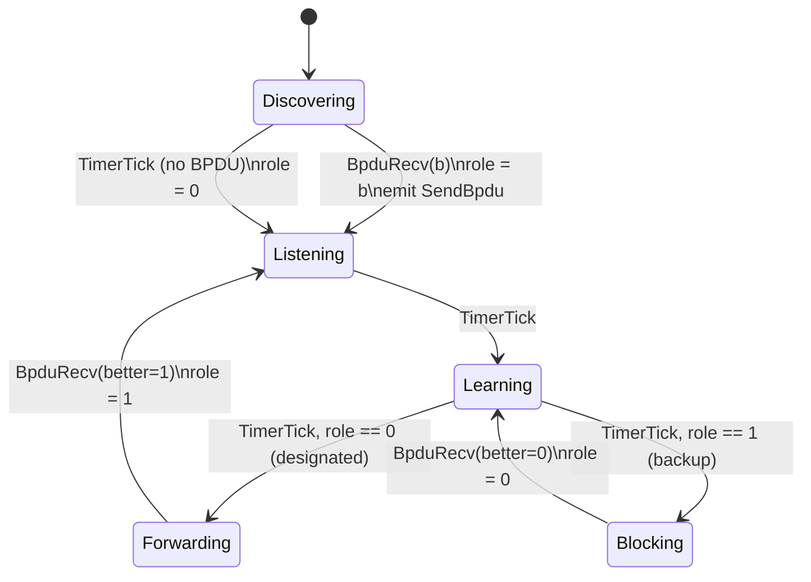

# stp_port_states - Spanning Tree Protocol port states with a loop-free invariant

## What it demonstrates
- A single port's STP machine (IEEE 802.1D): DISCOVERING -> LISTENING -> LEARNING, then FORWARDING if the port is designated or BLOCKING if a superior BPDU makes it a backup. RFS features: guarded transitions on a role bit, a parameterized BPDU event, and the loop-free safety invariant (a port forwards only when designated).
- The automaton is drawn from the real STP port state machine; the root/backup election is abstracted to a single `role` bit set by BPDU comparison.

## The machine


## RFS modes demonstrated
### Specification & analysis (`rfs validate`, `rfs info`)
The spec parses and validates; `rfs info` reports the 5 port states, the BPDU/timer
events, the `role` variable, and the monitored `loop_free` property. Rationale: the
analysis gate that runs before any codegen/MC.

### Model checking - in-process (`rfs mc-ref`, exact)
`pass.rfs` model-checks to **PASS complete** (7 states): the loop-free invariant holds -
only a designated port (role==0) ever reaches FORWARDING; a backup port is held at
BLOCKING. The negative variant `fail.rfs` removes the role guard on the LEARNING ->
FORWARDING step, so a backup port (role==1) also advances to FORWARDING while the
designated port forwards - a loop. A pinned **property-violation** CE on `loop_free`
(step 3, `vars { role: 1 }`, the Learning->Forwarding defect step); `fixed.rfs` restores
the guard and re-runs to PASS.

### Model checking - generated binaries (rust + c)
Both backends' MC binaries are generated, compiled, and run in exact mode; their reports
are **byte-identical** to each other and to mc-ref. The failing variant's CE is identical
across all three engines.

### Production code generation (rust + c)
`rfs codegen rust production` and `rfs codegen c production` both compile the FSM
warning-free; the BPDU-comparison guards are the showcase.

## Files layout
| File | Role |
|---|---|
| `pass.rfs` | the valid port machine (exact-MC-able) |
| `fail.rfs` | role guard removed (backup port forwards -> loop) |
| `fixed.rfs` | the corrected spec (= pass.rfs) |
| `run.sh` | drives every demonstrated RFS mode |
| `captures/` | pinned outputs (text + JSON CE, both-backend reports) |

## Build / run / test
Prerequisite: the rfs toolchain built (`cargo build`) or `RFS_BIN` set; rustc + gcc available.
```sh
./run.sh
```
`cargo test --test example_projects_test stp_port_states` re-runs it and pins the excerpts.

## Expected results
- pass.rfs: PASS complete (7 states); loop_free holds.
- fail.rfs: FAIL, `reason=property-violation label=loop_free step=3` - a backup port (role==1) reaches FORWARDING.
- fixed.rfs: PASS complete.
