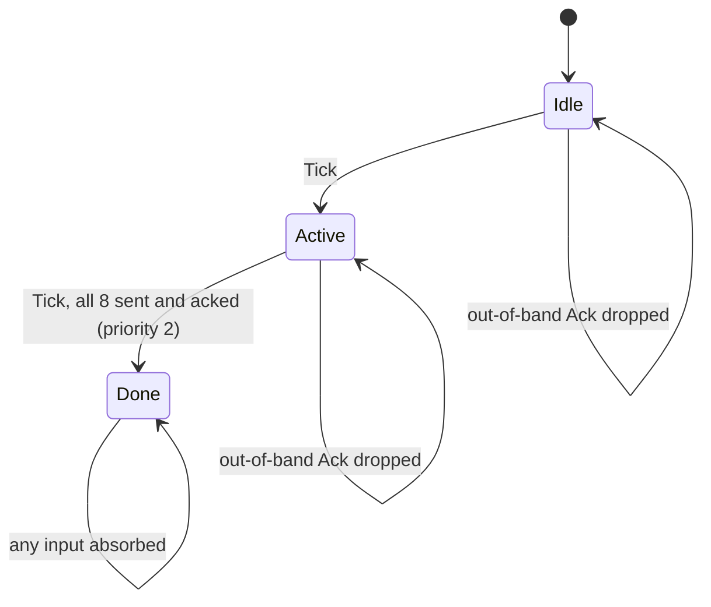

# sync_handler - driving the generated ARQ sender over std mpsc channels

## What it demonstrates

- **The full Rust-ecosystem integration story** ([INTEGRATION.md section 1](../../../docs/user/INTEGRATION.md#1-rust-integration-via-buildrs-rfs-build)): `build.rs` generates the FSM at build time with `rfs-build`, passing the opt-in `--with-protocol-fsm` flag so the generated `Fsm` implements `rfs_adapters::ProtocolFsm` (the one documented opt-in that links a generated artifact to an external crate).
- **The channel adapter** (`ChannelFsm`, [INTEGRATION.md section 2](../../../docs/user/INTEGRATION.md#2-protocolfsm-and-the-four-adapters)): the FSM runs on its OWN thread; inputs and outcomes cross std mpsc channels. The driver plays the environment, the receiver observes only what crosses the channel.
- **The shared include! pattern**: build.rs strips the artifact's inner attributes and writes the byte-identical body to OUT_DIR; lib.rs pulls it in via `include!` with a module-level `#[allow]` mirroring the artifact header (the generated code never enters the source tree, so `cargo fmt` never sees it).

Rationale: this is the reference example for integrating a generated protocol
machine into a Rust application that already uses threads and channels - the
most common production shape. The same scripted scenario is mirrored by
async_handler (futures) and c_sync_handler (plain C), so all three observe
identical, pinned behavior.

The automaton itself: the **sliding-window ARQ sender** (spec 43,
[examples/valid/43_sliding_window.rfs](../../../examples/valid/43_sliding_window.rfs)) -
drawn from the real ARQ (automatic repeat request) retransmission protocol.
A sender with a window of 4 over sequence numbers 0..8; time is modeled by
`Tick`; on each tick the sender either sends the next frame (while there is
room in the window) or the receiver acknowledges the oldest unacked frame.
Three states (`Idle`, `Active`, `Done`), two events (`Tick`,
`Ack(Seq(seq, checksum))`), two outputs (`SendFrame`, `RecvAck`), two vars
(`next_seq`, `acked`). Properties: a window-bound safety invariant, a
liveness `terminates`, and an `env_tick` timing assumption.

## The machine



| From | Event (guard) | To | Effect |
|---|---|---|---|
| Idle | Tick | Active | - |
| Idle | Ack | Idle | dropped |
| Active | Tick (`next_seq==8 && acked==8`, priority 2) | Done | - |
| Active | Tick (`next_seq<8 && next_seq-acked<4`, priority 1) | Active | emit `SendFrame(next_seq)`, `next_seq += 1` |
| Active | Tick (`acked<next_seq`) | Active | emit `RecvAck(acked)`, `acked += 1` |
| Active | Ack | Active | out-of-band, dropped (checksum never inspected) |
| Done | any | Done | absorbed |

## Files layout

| File | Role |
|---|---|
| `Cargo.toml` | member manifest: rfs-adapters dep + rfs-build build-dep |
| `build.rs` | generates spec 43 with `--with-protocol-fsm`; strips inner attributes; writes the byte-identical body to OUT_DIR |
| `src/lib.rs` | includes the artifact in `pub mod arq`, drives one full ARQ session over the channel adapter (`run` + `ArqReport`), inline test |
| `src/main.rs` | demo binary: runs the session and prints what the receiver observed (exit 0 on success, 1 on protocol error) |

## Build / run / test

Prerequisite: the `rfs` toolchain must be built (`cargo build` at the repo
root produces `target/debug/rfs`) or `RFS_BIN` must point to it - see
`BUILD.md`. Then:

```sh
cargo run -p sync_handler   # demo: prints the observed session, exit 0 on success
cargo test -p sync_handler  # the same session as a test (CI record)
```

## Expected results

- The driver wakes the sender (Idle -> Active), then keeps ticking until all 8
  frames are sent and acknowledged; every third tick it injects an out-of-band
  `Ack` that the protocol must drop. It finishes with a completion tick
  (-> Done) and a quiescence tick.
- The receiver observes only what crosses the channel - SendFrame / RecvAck
  outputs - verified in-order with the window bound held:
  ```
    ticks issued:             19
    frames sent (in order):   [0, 1, 2, 3, 4, 5, 6, 7]
    acks received (in order): [0, 1, 2, 3, 4, 5, 6, 7]
    out-of-band acks dropped: 5
    max window observed:      4 (bound 4)
  ```
- What to pay attention to: the window never exceeds 4 unacked frames (the
  safety invariant), the out-of-band Acks are silently dropped (input
  abstraction - the checksum is never inspected), and `Done` absorbs every
  further input (the terminal-state convention that keeps exact MC from
  reporting a deadlock). These data lines are byte-identical to async_handler
  and c_sync_handler's.
