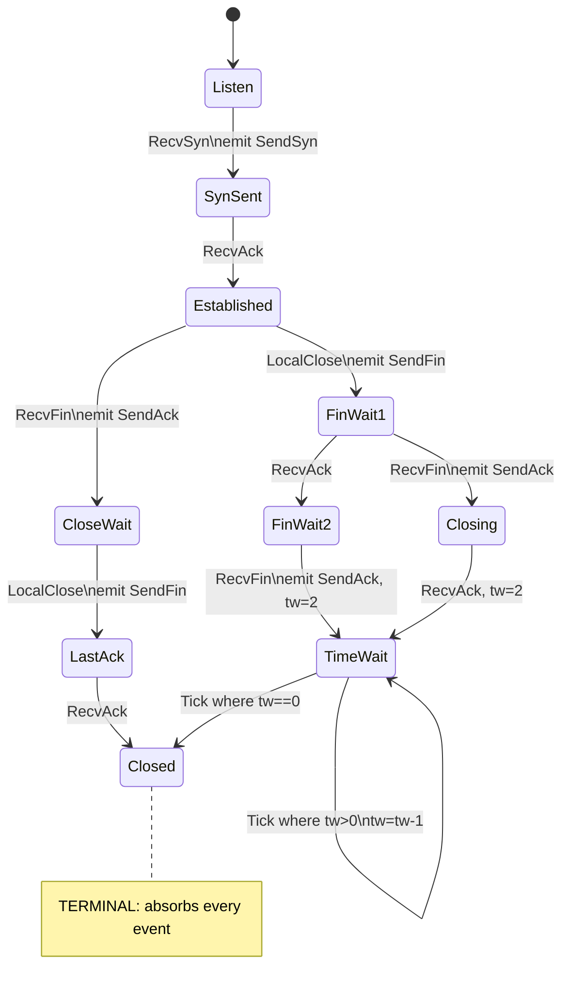

# tcp_full_states - the full TCP connection state machine

## What it demonstrates
- The **full** TCP connection lifecycle (RFC 793 / RFC 9293) as an RFS spec - LISTEN
  through ESTABLISHED and the complete teardown half (FIN_WAIT_1/2, CLOSE_WAIT, CLOSING,
  LAST_ACK, TIME_WAIT -> CLOSED). Distinct from the existing 3-state
  [`04_tcp_handshake_like`](../../../examples/valid/04_tcp_handshake_like.rfs), which only
  models the handshake.
- Rationale: TCP is the canonical protocol FSM - a great showcase for specification,
  analysis, model checking (in-process + both generated backends), production codegen,
  AND a large-state-space twin checked via SMT-bounded + fuzz.
- The automaton: 10 states; inputs are received segment types (RecvSyn/RecvAck/RecvFin),
  the local application closing (LocalClose), and the clock (Tick); outputs are the sent
  segments (SendSyn/SendAck/SendFin). `tw` is the TIME_WAIT countdown.

## The machine

Every state handles `Tick` (a self-loop, except TIME_WAIT which counts down) so the
environment-timing assumption is always satisfiable and never deadlocks the search.

## RFS modes demonstrated
### Specification & analysis (`rfs validate`, `rfs info`)
The spec parses and validates; `rfs info` reports the 10 states, 5 events, 3 outputs,
the `tw` variable, 17 transitions, and the two monitored properties. Rationale: the
analysis gate that runs before any codegen/MC.

### Model checking - in-process (`rfs mc-ref`, exact)
`pass.rfs` model-checks to **PASS complete** (30 states): `closed_terminal` (CLOSED is
terminal) and `time_wait_expires` (TIME_WAIT always expires to CLOSED, bounded liveness
under the tick assumption) both hold. The negative variant `fail.rfs` makes CLOSED
non-terminal (a stray RecvSyn resurrects a closed connection back to LISTEN) - a pinned
**property-violation** CE on `closed_terminal` at step 9; `fixed.rfs` restores the
terminal self-loop and re-runs to PASS. See [Expected results](#expected-results).

### Model checking - generated binaries (rust + c)
Both backends' MC binaries are generated, compiled, and run in exact mode; their reports
are **byte-identical** to each other and to mc-ref (the unified-report guarantee). The
failing variant's CE is identical across all three engines.

### Production code generation (rust + c)
`rfs codegen rust production` and `rfs codegen c production` both compile the FSM
warning-free - the generated-C compiler-agnosticism bar. Rationale: a real protocol
compiles to shippable code in both backends.

### Model checking - large state space (`full.rfs`: smt-bounded + fuzz)
The faithful model uses a real 16-bit sequence number (advancing with the clock) and a
payload-carrying RecvAck - a state space too large for exact MC (it times out). It is
instead checked with `rfs mc-ref --mode smt-bounded --bound 12`, which proves the plain
invariant `timer_only_in_timewait` for every 12-step path (**PASS WITHIN BOUND**,
incomplete - no completeness claim), and `--mode fuzz --runs 200` (random testing, no
violations). Rationale: even very large specifications can be analyzed and checked with
RFS where adequate simplification is impossible.

## Files layout
| File | Role |
|---|---|
| `pass.rfs` | the valid spec - model-checks to PASS complete (30 states) |
| `fail.rfs` | CLOSED made non-terminal (stray RecvSyn -> LISTEN) - pinned property-violation CE on `closed_terminal` |
| `fixed.rfs` | the corrected spec (= pass.rfs) - re-runs to PASS |
| `full.rfs` | the large-state-space twin (16-bit seq, payload RecvAck) - smt-bounded + fuzz, NOT exact MC |
| `run.sh` | drives every demonstrated RFS mode; writes captures/ |
| `captures/` | pinned text+JSON CEs, both-backend MC reports, production-compile proof, smt-bounded verdict + fuzz transcript |

## Build / run / test
Prerequisite: the rfs toolchain built (`cargo build`) or `RFS_BIN` set; rustc + gcc on
PATH (or RUSTC/GCC). For the twin's smt-bounded leg, an smt-enabled binary is needed
(`cargo build --features smt` with z3 per TOOLCHAIN.md section 5.2) - else that leg uses
the committed capture.
```sh
./run.sh            # drives all modes, writes captures/
```

## Expected results
- `pass.rfs`: **PASS (complete)**, 30 states - both properties hold.
- `fail.rfs`: **FAIL**, `reason=property-violation label=closed_terminal step=9` - the CE
  walks the full teardown (Listen->SynSent->Established->CloseWait->LastAck->Closed) then
  the defect: at CLOSED a RecvSyn resurrects the connection to LISTEN, breaking
  `closed_terminal`. Pay attention to the trace ending at `step 8 ... from=Closed to=Listen`.
- `fixed.rfs`: **PASS (complete)** again - the fix restores the terminal self-loop.
- Both generated MC backends print byte-identical reports to mc-ref.
- Production codegen compiles warning-free in both backends.
- `full.rfs`: exact MC times out (infeasible); smt-bounded reports **PASS WITHIN BOUND 12**
  (incomplete); fuzz runs 200 iterations with no violations.
