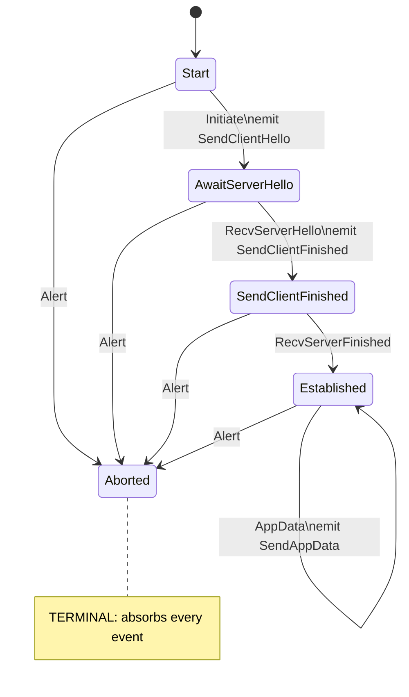

# tls13_handshake - the TLS 1.3 handshake state machine

## What it demonstrates
- The **TLS 1.3** handshake (RFC 8446) from one endpoint's view: ClientHello ->
  ServerHello -> Finished -> application data, with a fatal-alert abort path.
- Rationale: a security protocol whose core safety invariant is *ordering* - no
  application data before the handshake completes. A clean showcase for a
  property-violation negative (app data leaked pre-Finished).
- The automaton: 5 states; inputs Initiate / RecvServerHello / RecvServerFinished /
  AppData / Alert; outputs SendClientHello / SendClientFinished / SendAppData.

## The machine


## RFS modes demonstrated
### Specification & analysis (`rfs validate`, `rfs info`)
The spec parses and validates; `rfs info` reports the 5 states, 5 events, 3 outputs,
13 transitions, and the monitored `no_app_data_before_finished` property.

### Model checking - in-process (`rfs mc-ref`, exact)
`pass.rfs` model-checks to **PASS complete** (5 states): no application data is ever sent
before the handshake completes. The negative variant `fail.rfs` adds a SendAppData
transition in AwaitServerHello (app data before Finished) - a pinned **property-violation**
CE on `no_app_data_before_finished` at step 2; `fixed.rfs` removes it and re-runs to PASS.

### Model checking - generated binaries (rust + c)
Both backends' MC binaries are generated, compiled, and run in exact mode; their reports
are byte-identical to each other and to mc-ref. The failing variant's CE is identical
across all three engines.

### Production code generation (rust + c)
`rfs codegen rust production` and `rfs codegen c production` both compile the FSM
warning-free - a real security protocol compiles to shippable code in both backends.

## Files layout
| File | Role |
|---|---|
| `pass.rfs` | the valid spec - model-checks to PASS complete (5 states) |
| `fail.rfs` | app data allowed before Finished - pinned property-violation CE on `no_app_data_before_finished` |
| `fixed.rfs` | the corrected spec (= pass.rfs) - re-runs to PASS |
| `run.sh` | drives every demonstrated RFS mode; writes captures/ |
| `captures/` | pinned text+JSON CEs, both-backend MC reports, production-compile proof |

## Build / run / test
Prerequisite: the rfs toolchain built (`cargo build`) or `RFS_BIN` set; rustc + gcc on
PATH (or RUSTC/GCC).
```sh
./run.sh            # drives all modes, writes captures/
```

## Expected results
- `pass.rfs`: **PASS (complete)**, 5 states - no app data before Finished.
- `fail.rfs`: **FAIL**, `reason=property-violation label=no_app_data_before_finished step=2`
  - the CE shows Initiate -> AwaitServerHello, then AppData emitting SendAppData while
  still in AwaitServerHello (before Finished). Pay attention to `step 1 ... from=
  AwaitServerHello` with `outputs=[SendAppData]`.
- `fixed.rfs`: **PASS (complete)** again.
- Both generated MC backends print byte-identical reports to mc-ref.
- Production codegen compiles warning-free in both backends.
