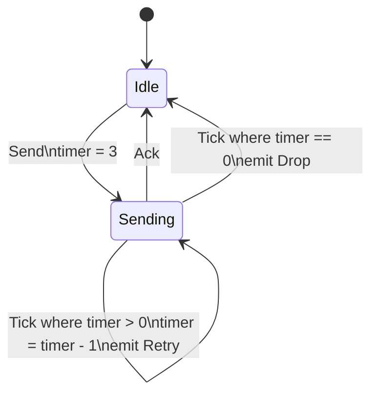

# tool_resolution - explicit external-tool path passing, proven end to end

## What it demonstrates

- **The RFS_* env-var contract** ([TOOLCHAIN.md section 8.2](../../../TOOLCHAIN.md)): every external tool rfs may invoke (gcc, rustc, clang, cargo-fuzz, make) resolves by the precedence **CLI flag > RFS_\* env var > standard Unix var > auto-discovery on PATH**. This example PROVES that contract with real `# tools:` output.
- **`--print-script` as the proof artifact**: `rfs test --print-script` prints the resolved invocation as a self-contained POSIX sh script whose header carries a `# tools: <name>=<path> ...` line. That line names the EXACT path the resolver chose - so capturing it is capturing the resolution decision, with no tool actually invoked.
- **A gcc/clang Makefile choice**: `CC ?= gcc` builds the generated C FSM warning-free under the system compiler by default; `make CC=clang` builds the SAME source under clang - the generated-C compiler-agnosticism guarantee, exercised for real.

Rationale: the other examples assume the tools are found. This one makes the
resolution VISIBLE and PINNED - a user on an exotic system (NixOS store paths,
a container with compilers in non-standard locations) can see exactly which
binary rfs will call, and force it with an env var or a flag.

The automaton itself: `pass.rfs` is the timeout/retry machine (spec 03, a copy
of [examples/valid/03_timeout_retry.rfs](../../../examples/valid/03_timeout_retry.rfs))
- two states (`Idle`, `Sending`), events `Send`/`Ack`/`Tick`, outputs `Retry`/
`Drop`, var `timer: bit<3>`. It is used only as the spec argument to the
`rfs test` / codegen invocations; its behavior is not the point.

## The machine



## Files layout

| File | Role |
|---|---|
| `pass.rfs` | the spec argument (spec 03) for the rfs test / codegen invocations |
| `run.sh` | set explicit RFS_* paths, run `rfs test --print-script` (C + Rust), capture the `# tools:` lines; then prove flag-beats-env and bare-PATH fallback |
| `Makefile` | `CC ?= gcc` with a documented `make CC=clang` alternative, building the generated C FSM warning-free under either compiler |

## Build / run / test

Prerequisites: the rfs toolchain built (`cargo build`) or `RFS_BIN` set; `gcc`
and `clang` present for the Makefile legs (the clang leg is availability-gated
in the test - it skips with a note if clang is absent); a resolvable `rustc`
for the Rust print-script scenario (set `RUSTC` to an explicit path if it is
not on PATH).

```sh
./run.sh              # captures the # tools: proof lines to captures/
make RFS=<rfs>        # build the generated C FSM under gcc (default CC)
make RFS=<rfs> CC=clang   # build the SAME source under clang
```

## Expected results

- **Explicit env vars win** - with `RFS_GCC` / `RFS_RUSTC` / `RFS_CLANG` set to
  absolute paths, the `# tools:` header lines name those exact paths:
  ```
  # tools: gcc=/usr/bin/gcc
  # tools: rustc=/workspace/host/rustup/toolchains/stable-x86_64-unknown-linux-gnu/bin/rustc
  ```
  (the rustc path is whatever real compiler the script resolved on this host -
  an absolute path, never the bare name).
- **A CLI flag beats the env var** - with `RFS_GCC=/usr/bin/gcc` AND
  `--gcc /bin/sh-fake`, the header shows the flag's value:
  ```
  # tools: gcc=/bin/sh-fake
  ```
- **Nothing set falls through to bare PATH** - with all RFS_* vars cleared, the
  resolver names the bare tool (looked up on PATH at run time):
  ```
  # tools: gcc=gcc
  ```
- **The Makefile builds under both compilers** - `make` compiles the generated
  C FSM with `-Wall` clean under the system compiler, and `make CC=clang`
  compiles the SAME source warning-free under clang. What to pay attention to:
  the generated source carries no compiler-specific constructs, so the zero-
  warning bar holds identically under gcc and clang - that is the
  compiler-agnosticism guarantee made concrete.
