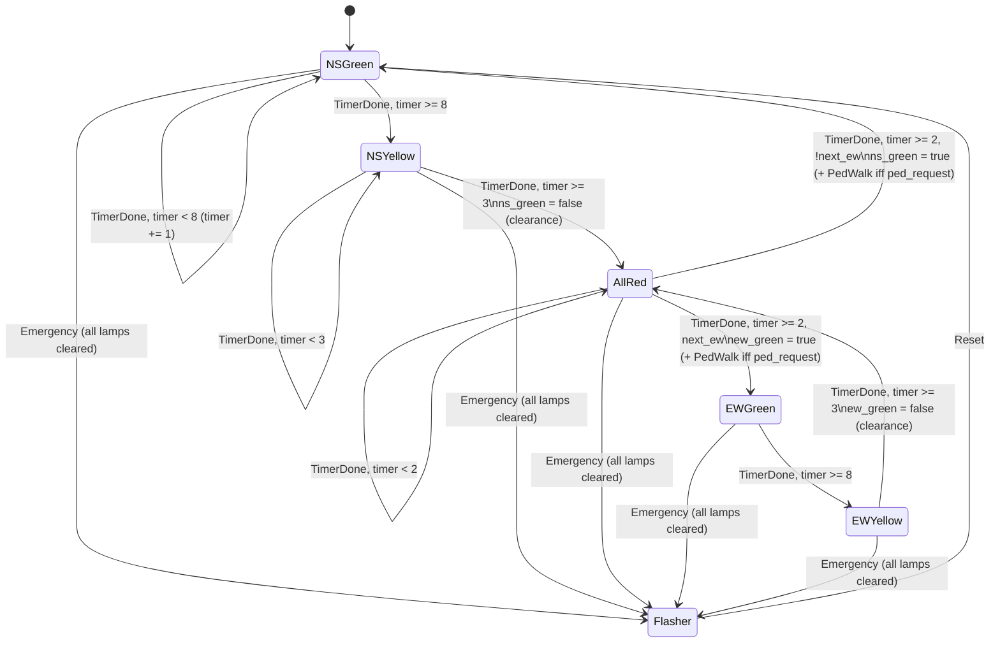

# traffic_light_ctrl - a traffic light controller FSM

## What it demonstrates
- A signal controller for two conflicting approaches (N-S and E-W): per-phase green -> yellow -> red with an ALL-RED clearance interval between every phase change, pedestrian request handling (remembered, honoured with a `PedWalk` output on the next clearance), emergency-vehicle preemption into a flasher fault mode, and a reset. The lamp states are witness vars (`ns_green` / `ew_green`); the all-red interval is where the departing approach's lamp is cleared, so two conflicting greens can never overlap. RFS features: the key mutual-exclusion invariant of a signal plan, a clearance-interval invariant, a preemption safe-gap property, and - because the spec is small (126 states) and assumption-free - an `smt-bounded` k-step safety proof on top of exact MC.
- The automaton is drawn from real signal-plan logic (clearance intervals, pedestrian call boxes, emergency preemption). Rationale: a rich mutual-exclusion + sequencing example where the safety case is exactly "never two conflicting greens at once".

## The machine

(PedRequest self-loops in NSGreen/EWGreen/AllRed remember the request; EWGreen/EWYellow
carry timer self-loops like their N-S counterparts.)

## RFS modes demonstrated
### Specification & analysis (`rfs validate`, `rfs info`)
The spec parses and validates; `rfs info` reports the 6 states, 4 events, 1 output,
the five variables, and the three monitored properties. Rationale: the analysis gate
that runs before any codegen/MC.

### Model checking - in-process (`rfs mc-ref`, exact + smt-bounded)
`pass.rfs` model-checks to **PASS complete** (126 states): `no_conflicting_greens` holds
- never two conflicting approaches green at once - `allred_is_the_only_clearance` holds
(the lamps are off throughout the clearance interval, and since a green is only set out
of AllRed while the other is only cleared in it, the all-red insertion before every phase
change is pinned jointly), and `preemption_safe` holds (an Emergency lands in Flasher with
every lamp cleared - the safe gap). The cycle time is bounded by construction: fixed phase
lengths of 8/3/2 ticks per approach. The negative variant `fail.rfs` removes the all-red
clearance so N-S yellow hands straight over to E-W green with the N-S lamp still on - a
pinned **property-violation** CE on `no_conflicting_greens` at step 13 (a TimerDone from
NSYellow to EWGreen leaves ns_green=true AND ew_green=true); `fixed.rfs` re-inserts the
clearance and re-runs to PASS. Because the spec is small and assumption-free, it is ALSO
checked with `rfs mc-ref --mode smt-bounded --bound 16`: **PASS WITHIN BOUND 16** - a
k-step safety proof from the SMT engine over the same properties.

### Model checking - generated binaries (rust + c)
Both backends' MC binaries are generated, compiled, and run in exact mode; their reports
are **byte-identical** to each other and to mc-ref. The failing variant's CE is identical
across all three engines.

### Production code generation (rust + c)
`rfs codegen rust production` and `rfs codegen c production` both compile the FSM
warning-free - the generated-C compiler-agnosticism bar. Rationale: a signal controller
with mutual-exclusion invariants compiles to shippable traffic-signal firmware in both
backends.

## Files layout
| File | Role |
|---|---|
| `pass.rfs` | the valid signal controller (all-red clearance + preemption) |
| `fail.rfs` | all-red clearance removed (conflicting-greens defect) |
| `fixed.rfs` | the corrected spec (= pass.rfs) |
| `run.sh` | drives every demonstrated RFS mode (incl. smt-bounded) |
| `captures/` | pinned outputs (text + JSON CEs, smt verdict) |

## Build / run / test
Prerequisite: the rfs toolchain built (`cargo build`) or `RFS_BIN` set; rustc + gcc available.
The smt-bounded section needs an smt-enabled binary (`RFS_SMT_BIN` or `target/debug/rfs-smt`,
built with `--features smt` + z3 per TOOLCHAIN.md section 5); without it the committed
capture is shown instead.
```sh
./run.sh
```

## Expected results
- `rfs validate pass.rfs` -> ok; `rfs info` lists 6 states / 4 events / 1 output.
- mc-ref on `pass.rfs`: `status=pass-complete states=126 transitions=282 max_depth=32`.
- smt-bounded on `pass.rfs`: `PASS WITHIN BOUND 16` (exit 0).
- mc-ref on `fail.rfs`: exit 1, `reason=property-violation label=no_conflicting_greens step=13`;
  the CE shows the N-S phase running out (green 8 ticks, yellow 3) and the handover TimerDone
  that turns E-W green while N-S is still green. The JSON form carries the same label/step.
- mc-ref on `fixed.rfs`: PASS complete again; both generated backends agree byte-for-byte.
- Production codegen compiles clean (rust) and warning-free (c).
- What to pay attention to: the clearance invariant is a JOINT pin - `no_conflicting_greens`
  alone would still hold if both lamps were cleared somewhere else, and the clearance
  invariant alone would not catch a handover that skipped it; together they force every green
  change through AllRed. The spec carries no assumptions (smt-bounded rejects them), which is
  why the bounded-cycle claim is stated by construction (fixed phase lengths) rather than as
  a liveness property.
