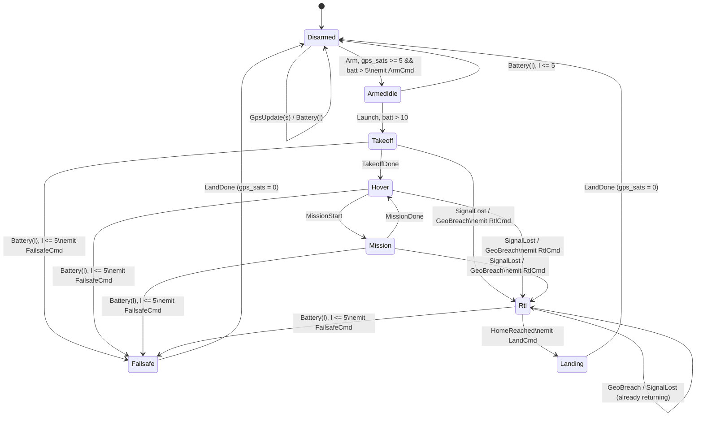

# uav_flight_modes - a drone / UAV flight-mode FSM

## What it demonstrates
- A drone: disarmed -> armed-idle -> takeoff -> hover -> mission -> RTL -> landing, with a failsafe mode. Arming is gated on GPS lock (at least 5 satellites of the bit<3> count) AND battery margin, launch needs battery headroom (bit<5>, nominal 31), and geofence breach / signal loss / low battery all route the aircraft to RTL or failsafe in one step. The ARM GUARD is the safety core: no arming without GPS ready - a takeoff with an unlocked position estimate is how drones get lost. RFS features: an output-anchored arm-readiness invariant, a same-sample bounded-reaction invariant on the geofence breach event, and a low-battery failsafe invariant over the whole flight envelope.
- The automaton is drawn from real UAV flight-control mode logic (arming checks, mission modes, return-to-launch, autonomous-failsafe landing). Rationale: safety-critical mode gating - the bounded-reaction invariants pin that a breach or brown-out leaves no intermediate "still flying" sample.

## The machine


## RFS modes demonstrated
### Specification & analysis (`rfs validate`, `rfs info`)
The spec parses and validates; `rfs info` reports the 8 states, 11 events, 4 outputs,
the two variables, and the three monitored properties. Rationale: the analysis gate
that runs before any codegen/MC.

### Model checking - in-process (`rfs mc-ref`, exact)
`pass.rfs` model-checks to **PASS complete** (1688 states): `no_arm_unready` holds -
ArmCmd is emitted only by the guarded arm transition, so the satellite count is always
at least 5 when the motors arm; `geofence_held` holds - a GeoBreach consumed in any
flying state lands the aircraft in RTL at that very sample (and RTL absorbs repeated
breaches), so no "still flying" sample ever follows a breach; `low_batt_failsafe` holds
- a brown-out battery (<= 5) is reachable only in failsafe or on the ground, because
every flight state routes a low-battery update to failsafe and arming itself demands
battery margin. The negative variant `fail.rfs` lowers the arm guard from "at least 5
satellites" to "at least 1" - so a pinned **property-violation** CE on `no_arm_unready`
at step 2 shows a GpsUpdate(s=1) followed by an Arm that emits ArmCmd while
`gps_sats == 1`; `fixed.rfs` restores the threshold and re-runs to PASS.

### Model checking - generated binaries (rust + c)
Both backends' MC binaries are generated, compiled, and run in exact mode; their reports
are **byte-identical** to each other and to mc-ref. The failing variant's CE is identical
across all three engines. Rationale: the production-identical engine must agree with the
in-process reference on both the positive proof and the negative counterexample.

### Production code generation (rust + c)
`rfs codegen rust production` and `rfs codegen c production` both compile the FSM
warning-free - the generated-C compiler-agnosticism bar. Rationale: a safety-critical
mode-gating machine compiles to shippable flight-controller firmware in both backends.

## Files layout
| File | Role |
|---|---|
| `pass.rfs` | the valid flight-mode FSM (arm guard + bounded-reaction + low-battery failsafe) |
| `fail.rfs` | arm guard lowered to 1 satellite (arming without GPS ready defect) |
| `fixed.rfs` | the corrected spec (= pass.rfs) |
| `run.sh` | drives every demonstrated RFS mode |
| `captures/` | pinned outputs (text + JSON CEs) |

## Build / run / test
Prerequisite: the rfs toolchain built (`cargo build`) or `RFS_BIN` set; rustc + gcc available.
```sh
./run.sh
```

## Expected results
- `rfs validate pass.rfs` -> ok; `rfs info` lists 8 states / 11 events / 4 outputs.
- mc-ref on `pass.rfs`: `status=pass-complete states=1688 transitions=48862 max_depth=7`.
- mc-ref on `fail.rfs`: exit 1, `reason=property-violation label=no_arm_unready step=2`;
  the CE shows a GpsUpdate(s=1) and an Arm that emits ArmCmd with `gps_sats: 1`. The JSON
  form carries the same label/step.
- mc-ref on `fixed.rfs`: PASS complete again; both generated backends agree byte-for-byte.
- Production codegen compiles clean (rust) and warning-free (c).
- What to pay attention to: the geofence distance comparison is abstracted into the
  environment - the aircraft raises `GeoBreach` when it crosses the fence, so the model
  pins the REACTION (one step to RTL/failsafe) rather than re-implementing the distance
  math (the discrete-mode-layer rule). The arm guard carries a battery-margin conjunct as
  well: arming on a dead battery would reach ArmedIdle with `batt <= 5` and violate
  `low_batt_failsafe` - the model checker found exactly that in the first draft, which is
  why the interlock is stated here.
