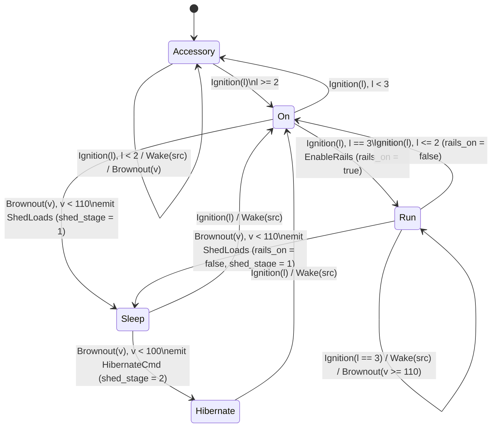

# vehicle_power_modes - an automotive electrical power-mode FSM

## What it demonstrates
- A vehicle power manager: ACCESSORY -> ON -> RUN -> SLEEP -> HIBERNATE, with multiple wake sources and load-shedding on brown-out. The ignition level is a bit<2> payload (0=off, 1=accessory, 2=on, 3=run), the pending wake-source bitmask is bit<4>, and the battery voltage arrives in 0.1V units (bit<8>, nominal 125 = 12.5V). The HIGH-LOAD RAIL GATE is the safety core: the infotainment/drive rails are enabled only in RUN and cleared on every exit from RUN - a brown-out that drops the vehicle to SLEEP must shed them, never carry them across. RFS features: a rail-liveness invariant over a bool witness, bounded liveness under an environment assumption (a wake request arrives within 8 samples), and load-shedding sequencing via a stage counter.
- The automaton is drawn from real automotive power-management logic (ignition levels, wake sources, brown-out load shedding, hibernate). Rationale: automotive power-management interlocks - "no high-load rail in sleep" is exactly the class of invariant model checking exists to pin.

## The machine


## RFS modes demonstrated
### Specification & analysis (`rfs validate`, `rfs info`)
The spec parses and validates; `rfs info` reports the 5 states, 3 events, 3 outputs,
the three variables, and the two monitored properties plus the environment assumption.
Rationale: the analysis gate that runs before any codegen/MC.

### Model checking - in-process (`rfs mc-ref`, exact)
`pass.rfs` model-checks to **PASS complete** (1696 states): `no_high_load_in_sleep`
holds - the rails are live only in RUN, and every exit from RUN (ignition-down or
brown-out) clears them before the vehicle sleeps; `wake_returns_consistent` holds under
the `env_wake` assumption - a sleeping vehicle leaves SLEEP for ON (any wake source or
ignition command) or HIBERNATE (a deep brown-out below 10.0V) within 8 samples, and the
assumption guarantees a wake request arrives in that window. The negative variant
`fail.rfs` removes the SLEEP load gate - the brown-out transition no longer clears
`rails_on` - so a pinned **property-violation** CE on `no_high_load_in_sleep` at step 3
shows RUN with the rails live taking a Brownout(v=0) into SLEEP while `rails_on` stays
true; `fixed.rfs` re-adds the gate and re-runs to PASS.

### Model checking - generated binaries (rust + c)
Both backends' MC binaries are generated, compiled, and run in exact mode; their reports
are **byte-identical** to each other and to mc-ref. The failing variant's CE is identical
across all three engines. Rationale: the production-identical engine must agree with the
in-process reference on both the positive proof and the negative counterexample.

### Production code generation (rust + c)
`rfs codegen rust production` and `rfs codegen c production` both compile the FSM
warning-free - the generated-C compiler-agnosticism bar. Rationale: a power-management
interlock machine compiles to shippable vehicle ECU firmware in both backends.

## Files layout
| File | Role |
|---|---|
| `pass.rfs` | the valid power-mode FSM (rail gate + wake liveness under assumption) |
| `fail.rfs` | SLEEP load gate removed (rails carried into sleep defect) |
| `fixed.rfs` | the corrected spec (= pass.rfs) |
| `run.sh` | drives every demonstrated RFS mode |
| `captures/` | pinned outputs (text + JSON CEs) |

## Build / run / test
Prerequisite: the rfs toolchain built (`cargo build`) or `RFS_BIN` set; rustc + gcc available.
```sh
./run.sh
```

## Expected results
- `rfs validate pass.rfs` -> ok; `rfs info` lists 5 states / 3 events / 3 outputs.
- mc-ref on `pass.rfs`: `status=pass-complete states=1696 transitions=468096 max_depth=9`.
- mc-ref on `fail.rfs`: exit 1, `reason=property-violation label=no_high_load_in_sleep step=3`;
  the CE shows ignition to ON, ignition to RUN (EnableRails, rails_on=true), then a
  Brownout(v=0) into SLEEP with `rails_on` still true. The JSON form carries the same
  label/step.
- mc-ref on `fixed.rfs`: PASS complete again; both generated backends agree byte-for-byte.
- Production codegen compiles clean (rust) and warning-free (c).
- What to pay attention to: the wake liveness is assumption-relative - without `env_wake`
  the vehicle may sit in SLEEP forever (a legitimate parked state), so the bounded
  return-to-consistency claim needs the environment contract. The rail invariant is a
  plain state+var implication, robust under both exact MC and any future smt-bounded
  check of this spec.
