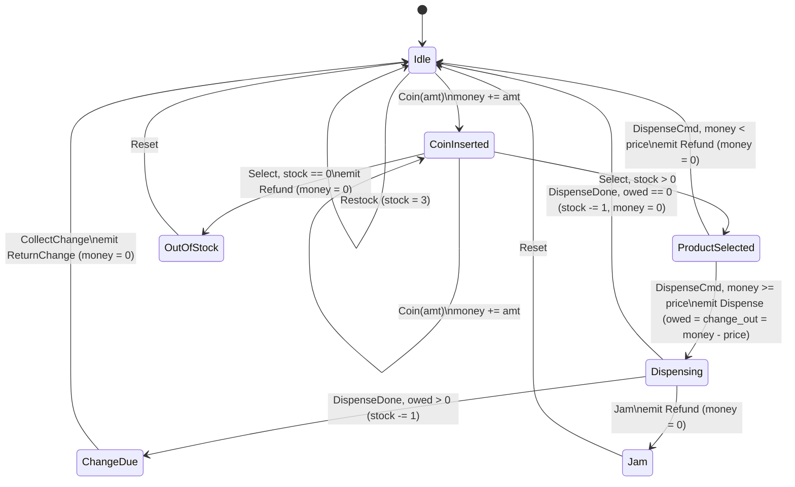

# vending_machine - a vending machine control FSM

## What it demonstrates
- A vending machine: idle -> coin-inserted -> product-selected -> dispensing -> change-due, with out-of-stock and jam branches. Money is accumulated in cents scaled to bit<6> (the machine takes up to 63 cents - the price of 50 fits with change to spare), the product price is fixed at 50, and stock counts items (bit<2>, restocked to 3). The FULL-PAYMENT guard is the safety core: a product is dispensed only when `money >= price` - underpaid selections are refunded instead. The change arithmetic (`owed = money - price`, computed in bit-vector subtraction at dispense) is pinned by an invariant on the `ReturnChange` output, and every refund zeroes the held money (no loss: a jam or an out-of-stock selection returns everything). RFS features: money-accounting guards as bit-vector arithmetic, a change-correctness invariant over witness vars, and no-loss refund invariants.
- The automaton is drawn from real vending-machine control logic (coin accumulation, price comparison, change computation, jam/out-of-stock recovery). Rationale: money-accounting guards are a great bit-vector arithmetic exercise - the subtraction `money - price` and its wraparound behaviour on the defect path are exactly what the invariants pin.

## The machine


## RFS modes demonstrated
### Specification & analysis (`rfs validate`, `rfs info`)
The spec parses and validates; `rfs info` reports the 7 states, 8 events, 3 outputs,
the five variables, and the four monitored properties. Rationale: the analysis gate
that runs before any codegen/MC.

### Model checking - in-process (`rfs mc-ref`, exact + smt-bounded)
`pass.rfs` model-checks to **PASS complete** (6465 states): `no_dispense_underpaid` holds
- a product is dispensed only with full payment - `correct_change` holds (the returned
change equals what was owed at dispense: the bit-vector subtraction is pinned),
`no_loss_on_refund` holds (every refund zeroes the held money - jam, out-of-stock and
underpaid selections all return everything), `no_dispense_out_of_stock` holds, and
`jam_resets_to_idle` is a **next-form** step semantic (task 3B): a Jam lands the machine in
the Jam state, whose only exit is the Reset back to Idle, so the sample after a Jam is Idle -
it holds because every step consumes an input (the next input is either Reset or unhandled,
which terminates the path and makes the next-obligation weak). The
negative variant `fail.rfs` removes the full-payment guard so a product is dispensed on
partial payment - a pinned **property-violation** CE on `no_dispense_underpaid` at step 3
(a DispenseCmd with money=0 < price=50 emits Dispense; owed wraps to 14 = 0-50 mod 64);
`fixed.rfs` re-adds the guard and re-runs to PASS. Because the spec is small and
assumption-free, it is ALSO checked with `rfs mc-ref --mode smt-bounded --bound 16`:
**PASS WITHIN BOUND 16** - a k-step safety proof from the SMT engine over the same
properties.

### Model checking - generated binaries (rust + c)
Both backends' MC binaries are generated, compiled, and run in exact mode; their reports
are **byte-identical** to each other and to mc-ref. The failing variant's CE is identical
across all three engines.

### Production code generation (rust + c)
`rfs codegen rust production` and `rfs codegen c production` both compile the FSM
warning-free - the generated-C compiler-agnosticism bar. Rationale: a money-accounting
machine with bit-vector arithmetic compiles to shippable vending-controller firmware in
both backends.

## Files layout
| File | Role |
|---|---|
| `pass.rfs` | the valid vending machine (full-payment guard + change arithmetic) |
| `fail.rfs` | full-payment guard removed (partial-payment dispense defect) |
| `fixed.rfs` | the corrected spec (= pass.rfs) |
| `run.sh` | drives every demonstrated RFS mode (incl. smt-bounded) |
| `captures/` | pinned outputs (text + JSON CEs, smt verdict) |

## Build / run / test
Prerequisite: the rfs toolchain built (`cargo build`) or `RFS_BIN` set; rustc + gcc available.
The smt-bounded section needs an smt-enabled binary (`RFS_SMT_BIN` or `target/debug/rfs-smt`,
built with `--features smt` + z3 per TOOLCHAIN.md section 5); without it the committed
capture is shown instead.
```sh
./run.sh
```

## Expected results
- `rfs validate pass.rfs` -> ok; `rfs info` lists 7 states / 8 events / 3 outputs.
- mc-ref on `pass.rfs`: `status=pass-complete states=6465 transitions=239467 max_depth=15`.
- smt-bounded on `pass.rfs`: `PASS WITHIN BOUND 16` (exit 0).
- mc-ref on `fail.rfs`: exit 1, `reason=property-violation label=no_dispense_underpaid step=3`;
  the CE shows a zero-cent coin, a selection, and a DispenseCmd that dispenses with money=0
  (< price=50) - owed wraps to 14. The JSON form carries the same label/step.
- mc-ref on `fixed.rfs`: PASS complete again; both generated backends agree byte-for-byte.
- Production codegen compiles clean (rust) and warning-free (c).
- What to pay attention to: the money variables are scaled to bit<6> so exact MC stays fast
  (the full-width bit<8> model exceeds this sandbox's ~1 GB RSS cap - noted simplification
  per the phase plan's discrete-layer rule). The `owed`/`change_out` witnesses make the
  change arithmetic checkable: the invariant compares them at ReturnChange time, and the
  defect path's wraparound (0 - 50 = 14 mod 64) is visible in the pinned CE. The `next`-form
  property is checked under BOTH exact MC and smt-bounded: before task 3A it false-failed
  under smt-bounded (an intervening unhandled input froze the Jam config and the old engine
  checked `next(state == Idle)` against it), and 3A's liveness gate makes it weak at trace
  death. A `bounded_eventually[N](state == Idle)` return claim is deliberately NOT stated:
  the machine can sit in Jam/OutOfStock until a Reset, so that liveness needs an assumption
  (Reset eventually arrives) - assumption support in smt-bounded is task 3C's territory.
