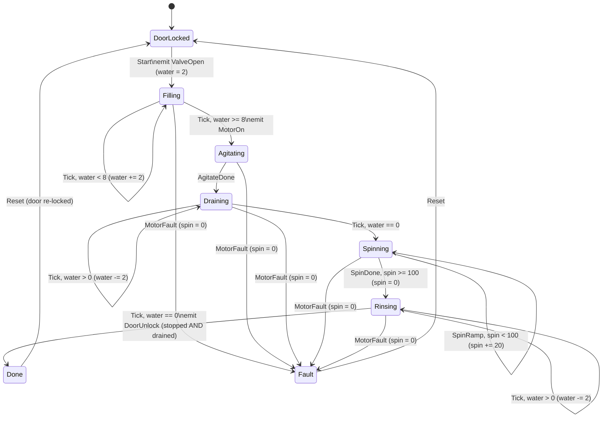

# washing_machine - a washing machine control FSM

## What it demonstrates
- A washer: door-locked -> filling -> agitating -> draining -> spinning -> rinsing -> done, with a fault branch. The water level fills to 8 and drains to 0; the spin speed RAMPs in steps of 20 up to the bound of 100 (never above it). The COMPOUND UNLOCK GUARD is the safety core: the door unlocks only when the drum is stopped (`spin == 0`) AND the water is drained (`water == 0`) - both conditions are checked at the unlock step, so neither a spinning drum nor standing water can be opened onto. RFS features: a compound-guard interlock over two witness vars, a no-spin-with-door-open invariant, and a bounded spin-ramp invariant.
- The automaton is drawn from real washer control logic (fill/agitate/drain/spin/rinse sequencing, door interlock, spin-speed ramping). Rationale: compound-guard + interlock semantics - the classic appliance safety case where two independent conditions must both hold before an unsafe action is enabled.

## The machine


## RFS modes demonstrated
### Specification & analysis (`rfs validate`, `rfs info`)
The spec parses and validates; `rfs info` reports the 8 states, 8 events, 3 outputs,
the three variables, and the three monitored properties. Rationale: the analysis gate
that runs before any codegen/MC.

### Model checking - in-process (`rfs mc-ref`, exact)
`pass.rfs` model-checks to **PASS complete** (30 states): `safe_unlock` holds - the door
unlocks only when the drum is stopped AND the water is drained (the compound guard) -
`no_spin_door_open` holds (whenever the spin speed is non-zero the door is locked), and
`spin_bounded` holds (the ramp never exceeds 100). The negative variant `fail.rfs` removes
the drained-check from the unlock guard (with the drain self-loop that enforced it), so
the door unlocks while water remains - a pinned **property-violation** CE on `safe_unlock`
at step 19 (a Tick emits DoorUnlock with water=4); `fixed.rfs` re-adds the check and
re-runs to PASS.

### Model checking - generated binaries (rust + c)
Both backends' MC binaries are generated, compiled, and run in exact mode; their reports
are **byte-identical** to each other and to mc-ref. The failing variant's CE is identical
across all three engines.

### Production code generation (rust + c)
`rfs codegen rust production` and `rfs codegen c production` both compile the FSM
warning-free - the generated-C compiler-agnosticism bar. Rationale: an appliance control
machine with compound interlocks compiles to shippable washer firmware in both backends.

## Files layout
| File | Role |
|---|---|
| `pass.rfs` | the valid washer (compound unlock guard + bounded spin ramp) |
| `fail.rfs` | drained-check removed from the unlock guard (unlock-with-water defect) |
| `fixed.rfs` | the corrected spec (= pass.rfs) |
| `run.sh` | drives every demonstrated RFS mode |
| `captures/` | pinned outputs (text + JSON CEs) |

## Build / run / test
Prerequisite: the rfs toolchain built (`cargo build`) or `RFS_BIN` set; rustc + gcc available.
```sh
./run.sh
```

## Expected results
- `rfs validate pass.rfs` -> ok; `rfs info` lists 8 states / 8 events / 3 outputs.
- mc-ref on `pass.rfs`: `status=pass-complete states=30 transitions=52 max_depth=19`.
- mc-ref on `fail.rfs`: exit 1, `reason=property-violation label=safe_unlock step=19`;
  the CE shows the full cycle (fill to 8, agitate, drain, spin ramp 0->100, stop, rinse
  water in) and then a Tick that emits DoorUnlock with water=4 still in the drum. The JSON
  form carries the same label/step.
- mc-ref on `fixed.rfs`: PASS complete again; both generated backends agree byte-for-byte.
- Production codegen compiles clean (rust) and warning-free (c).
- What to pay attention to: the defect variant had to REMOVE the drain self-loop as well as
  unguard the unlock - leaving both in place, the guarded drain shadows the unlock by source
  order and the machine behaves correctly again (the overlapping-guard pitfall). The Done
  state carries a Reset transition back to DoorLocked: without it the completed cycle is a
  deadlock configuration (no enabled transition), which exact MC reports as reason=deadlock.
