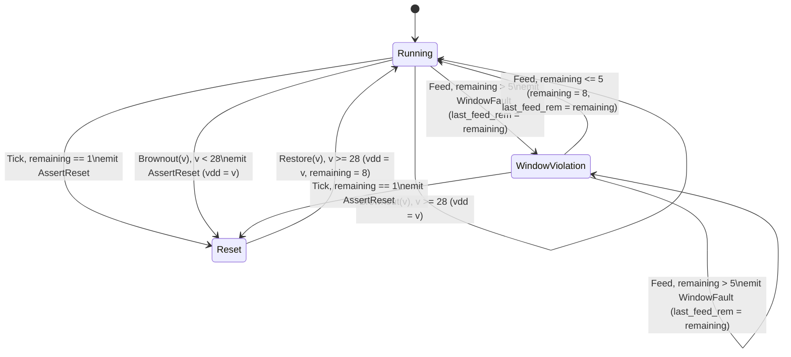

# watchdog_reset - a watchdog / reset-controller FSM

## What it demonstrates
- A watchdog: running -> window-violation -> timeout-reset, with a brown-out reset path. The feed window is encoded as a countdown: `remaining` ticks until timeout (re-armed to win_hi = 8 on every accepted feed), the valid-feed window is the last win_lo = 3 ticks of it (a feed earlier than that is TOO EARLY and faults), and the supply voltage is scaled to bit<6> in 0.1V units (brown-out below 28 = 2.8V; the full-resolution rail would blow the state budget, noted simplification). The WINDOW GUARD is the safety core: a feed is accepted only inside the valid window - too early or too late both fault, so the watchdog can never be petted out of a genuine timeout. RFS features: a no-spurious-reset invariant over the reset output, and a window-enforcement invariant pinned by a pre-feed countdown witness.
- The automaton is drawn from real watchdog-timer hardware (feed window, timeout reset, brown-out detection) as in MCU watchdog peripherals. Rationale: a precise valid-feed-window invariant - "no spurious reset while feeding in-window" and "the window is actually enforced" are the two halves of watchdog correctness.

## The machine


## RFS modes demonstrated
### Specification & analysis (`rfs validate`, `rfs info`)
The spec parses and validates; `rfs info` reports the 3 states, 4 events, 2 outputs,
the three variables, and the two monitored properties. Rationale: the analysis gate
that runs before any codegen/MC.

### Model checking - in-process (`rfs mc-ref`, exact)
`pass.rfs` model-checks to **PASS complete** (5140 states): `no_spurious_reset` holds -
AssertReset is emitted only by the firing-tick transition (remaining == 1 at that sample)
and the brown-out transition (vdd < 28 set in the same step), never by an in-window feed;
`window_enforced` holds - a feed that arrived too early (the pre-feed countdown witness
`last_feed_rem` still above the valid window) always lands the watchdog in
WindowViolation, while an in-window feed re-arms the countdown and stays Running. The
negative variant `fail.rfs` widens the window guard - only a feed with less than one tick
elapsed faults, so too-early feeds are petted through - and a pinned **property-violation**
CE on `window_enforced` at step 2 shows a Tick (remaining 8->7) followed by a Feed at
remaining = 7 that is ACCEPTED (remaining re-armed to 8) while `last_feed_rem == 7 > 5`;
`fixed.rfs` restores the guard and re-runs to PASS.

### Model checking - generated binaries (rust + c)
Both backends' MC binaries are generated, compiled, and run in exact mode; their reports
are **byte-identical** to each other and to mc-ref. The failing variant's CE is identical
across all three engines. Rationale: the production-identical engine must agree with the
in-process reference on both the positive proof and the negative counterexample.

### Production code generation (rust + c)
`rfs codegen rust production` and `rfs codegen c production` both compile the FSM
warning-free - the generated-C compiler-agnosticism bar. Rationale: a watchdog controller
compiles to shippable safety-monitor firmware in both backends.

## Files layout
| File | Role |
|---|---|
| `pass.rfs` | the valid watchdog (window guard + no-spurious-reset + brown-out path) |
| `fail.rfs` | window guard widened (out-of-window feed accepted defect) |
| `fixed.rfs` | the corrected spec (= pass.rfs) |
| `run.sh` | drives every demonstrated RFS mode |
| `captures/` | pinned outputs (text + JSON CEs) |

## Build / run / test
Prerequisite: the rfs toolchain built (`cargo build`) or `RFS_BIN` set; rustc + gcc available.
```sh
./run.sh
```

## Expected results
- `rfs validate pass.rfs` -> ok; `rfs info` lists 3 states / 4 events / 2 outputs.
- mc-ref on `pass.rfs`: `status=pass-complete states=5140 transitions=228456 max_depth=18`.
- mc-ref on `fail.rfs`: exit 1, `reason=property-violation label=window_enforced step=2`;
  the CE shows a Tick (remaining 8->7) and a Feed at remaining = 7 that is accepted with
  `last_feed_rem: 7`. The JSON form carries the same label/step.
- mc-ref on `fixed.rfs`: PASS complete again; both generated backends agree byte-for-byte.
- Production codegen compiles clean (rust) and warning-free (c).
- What to pay attention to: the feed timestamp is abstracted to a countdown (`remaining`
  ticks until timeout) - the discrete-mode-layer rule applied to timing hardware. The
  `last_feed_rem` witness exists because RFS properties observe the POST-transition
  configuration: an accepted feed re-arms `remaining` to 8 in the same step, so "the feed
  was too early" is only observable through the countdown captured before the re-arm.
  Without the witness, the window-enforcement property could not distinguish a petted
  too-early feed from a legitimate in-window one.
